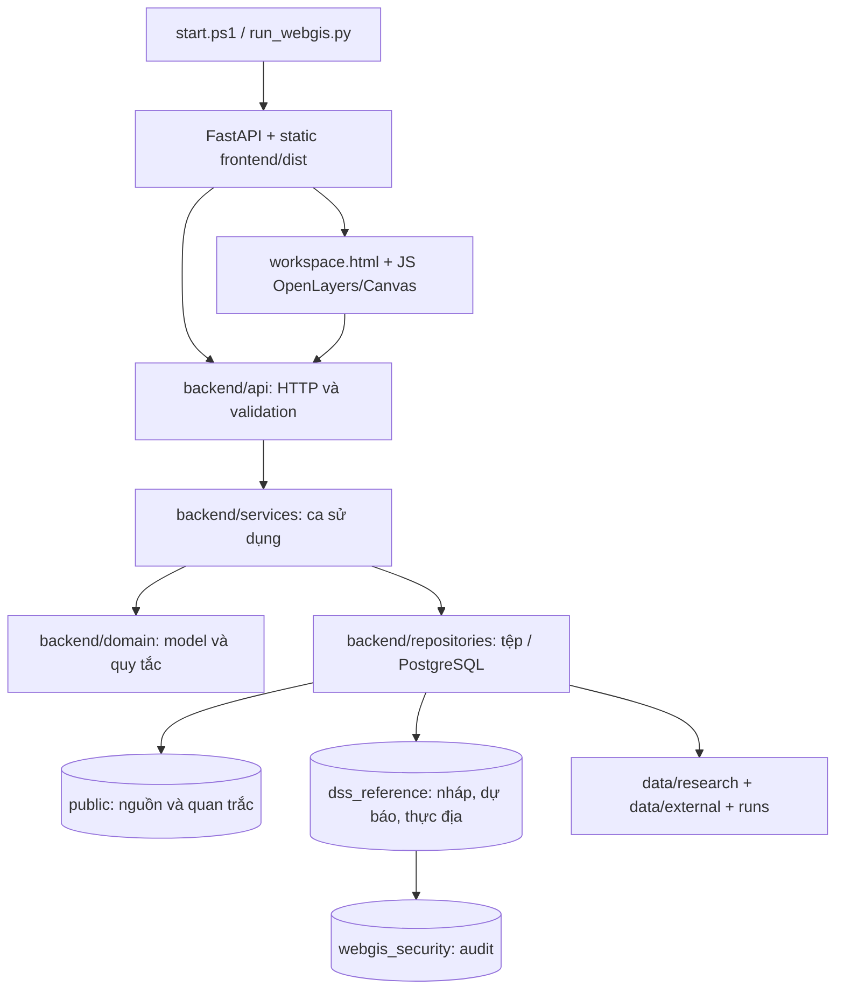

# Bản đồ repository phục vụ báo cáo đồ án

**Khảo sát ngày 15/11/2026 (giờ Việt Nam).** Tài liệu được đối chiếu từ working tree thực tế sau dọn dẹp, không suy ra kiến trúc từ prompt. Mốc Git lúc bắt đầu: `TinBranch`, HEAD `663b26c`; đã có 7 tệp thay đổi chưa commit. Nội dung các tệp đó được giữ nguyên byte. Hồ sơ kiểm chứng máy đọc được: [verification.json](reports/repo-cleanup-2026-11-15/verification.json).

Ưu tiên nguồn khi viết luận văn: mã hiện hành → `data/models/multivariate_registry.json` và manifest → snapshot/metrics có nguồn → báo cáo đúng thời điểm. Các tài liệu lịch sử vẫn được giữ, không sửa để che sự thay đổi phiên bản.

| Chi tiết trong prompt | Bằng chứng tại checkout này |
|---|---|
| Vanilla JS/Leaflet | Vanilla JS, **OpenLayers `ol ^6.15.1`**, Canvas; Vite `^5.4.21` (`frontend/package.json`). |
| Hai trạm MRC được nêu, model `20261023T041813Z` là model chính | Snapshot có **13 trạm, 1.428 mẫu**; ba trạm MRC và 10 RIA2. Mỹ Tho hiện dùng `20261108T_HYDROLOGY_PRIMARY_V1`. |
| 1D IDW/45 đỉnh | Mã hiện hành dùng **tuyến tính từng chặng qua ba trạm**, fallback hai trạm khi thiếu Mỹ Thuận; `TIEN_MAIN` có **175 đỉnh**. |
| Savenije và `experiment_estuary_shape.py`, LOOCV | Không tìm thấy file, mã hay báo cáo kết quả tương ứng trong checkout đã khảo sát. Không có số để trích dẫn. |
| 112/112 checks, 23 kịch bản UI | Là **bằng chứng lịch sử 26/10/2026**, không phải số test hiện tại. Kết quả chạy ngày 15/11 ở Phần 5. |

## Phần 1 — Cây thư mục chuẩn sau dọn dẹp

Cây dưới đây lấy từ hệ thống tệp, gồm cả dữ liệu/bằng chứng cục bộ bị Git ignore. Loại `.git`, các môi trường Python, mọi `node_modules` và cache/bytecode. `frontend/dist` là bản build nên gộp thành một dòng; `.security` chỉ ghi tên, không công bố cấu hình. Các thư mục nhiều ảnh được gộp theo số ảnh, không làm mất ảnh thực tế.

```text
saltwater-intrusion-warning/
├── .security/ [cấu hình cục bộ; không công bố nội dung]
├── backend/
│   ├── api/
│   │   ├── __init__.py
│   │   ├── data_freshness.py
│   │   ├── dss_storage.py
│   │   ├── field_measurements.py
│   │   ├── forecast_issues.py
│   │   ├── gate_screening.py
│   │   ├── multivariate.py
│   │   └── workspace.py
│   ├── domain/
│   │   ├── __init__.py
│   │   ├── data_freshness.py
│   │   ├── ec_gap_evaluation.py
│   │   ├── ec_gap_followup.py
│   │   ├── ec_gap_remedies.py
│   │   ├── field_measurement.py
│   │   ├── forecast_issue.py
│   │   ├── gate_intake_rules.py
│   │   ├── gate_simulation.py
│   │   ├── gates.py
│   │   ├── multivariate_ec.py
│   │   ├── river_interpolation.py
│   │   └── workspace.py
│   ├── repositories/
│   │   ├── __init__.py
│   │   ├── dss_storage.py
│   │   ├── field_measurements.py
│   │   ├── forecast_issues.py
│   │   ├── hydrology_inputs.py
│   │   ├── multivariate_inputs.py
│   │   └── workspace.py
│   ├── services/
│   │   ├── __init__.py
│   │   ├── dss_storage.py
│   │   ├── field_measurements.py
│   │   ├── forecast_issues.py
│   │   ├── forecasts.py
│   │   ├── gates.py
│   │   ├── multivariate.py
│   │   ├── spatial_inputs.py
│   │   ├── spatial_simulation.py
│   │   └── workspace.py
│   ├── __init__.py
│   ├── database.py
│   ├── db_security.py
│   ├── intake.py
│   ├── main.py
│   ├── requirements-api.txt
│   ├── research.py
│   ├── schemas.py
│   └── security.py
├── config/
│   ├── glofas/
│   │   ├── constraints.json
│   │   ├── glofas_form.json
│   │   └── glofas_schema.json
│   ├── aviso_sftp_known_hosts
│   └── fes2022b_full.yaml
├── data/
│   ├── 8file/
│   │   ├── 01_ec_salinity_calibration_and_lookup.csv
│   │   ├── 02_stations_master_catalog_63.csv
│   │   ├── 03_sluice_gates_190_and_27_verified_gis.csv
│   │   ├── 04_sluice_gate_operation_rules_and_risk_matrix.csv
│   │   ├── 05_sluice_gate_operation_logs_57.csv
│   │   ├── 06_river_and_interior_salinity_ec_observations_759.csv
│   │   ├── 07_hydro_meteo_waterlevel_drivers_533.csv
│   │   └── 08_ml_timeseries_642_and_pilot_154_cleaned.csv
│   ├── archive/
│   │   ├── legacy_analysis/
│   │   │   ├── plots/
│   │   │   │   └── [4 ảnh: .png]
│   │   │   ├── cross_correlation_plot.png
│   │   │   ├── master_timeseries.csv
│   │   │   ├── ml_features_dataset.csv
│   │   │   └── README.md
│   │   ├── retired_hourly_evidence/
│   │   ├── sluice_gates_legacy_DO_NOT_USE.csv
│   │   └── sluice_gates_legacy_DO_NOT_USE.geojson
│   ├── biengioi/
│   │   ├── tien_osm_waterways_source.json
│   │   ├── tien_river_corridor.geojson
│   │   ├── Tiền Giang - 63.geojson
│   │   ├── Đồng Tháp (phường xã) - 34.geojson
│   │   └── Đồng Tháp - 63.geojson
│   ├── contracts/
│   │   ├── gate_input.json
│   │   ├── gate_policy.json
│   │   └── station_gate_link.json
│   ├── external/
│   │   ├── climate_indices_20261029/
│   │   │   ├── climate_indices_combined.csv
│   │   │   ├── oni_monthly.csv
│   │   │   └── pdo_monthly.csv
│   │   ├── ec_feature_research_20261019/
│   │   │   ├── download_manifest.json
│   │   │   ├── era5_extra_MyTho.json
│   │   │   ├── era5_extra_TanChau.json
│   │   │   ├── glofas_preview_MyTho_2021.json
│   │   │   ├── glofas_preview_TanChau_2021.json
│   │   │   └── noaa_nino34_anomaly.txt
│   │   ├── ec_hydrology_current_20261029/
│   │   │   ├── era5_extra_MyTho_2026-09.json
│   │   │   └── manifest.json
│   │   ├── ec_recovery_20261011/
│   │   │   ├── catra_2025_15.pdf
│   │   │   ├── catra_2025_16.doc
│   │   │   ├── catra_2025_17.doc
│   │   │   ├── catra_2025_18.doc
│   │   │   ├── ec_dongthap_ria2_2025.csv
│   │   │   ├── ec_mrc_rechecked_20261011.csv
│   │   │   ├── ec_recovery_manifest.json
│   │   │   └── mrc_recheck_manifest.json
│   │   ├── grit_20261029/
│   │   │   └── manifest.json
│   │   ├── mrc_20261014_network/
│   │   │   ├── 019803_Conductivity_Water_Quality_bc365241.csv
│   │   │   ├── 019803_Conductivity_Water_Quality_bc365241.json
│   │   │   ├── 019803_Water_Level_Manual_3bd17f3a.csv
│   │   │   ├── 019803_Water_Level_Manual_3bd17f3a.json
│   │   │   ├── 019803_Water_Level_Telemetry_c27f981e.csv
│   │   │   ├── 019803_Water_Level_Telemetry_c27f981e.json
│   │   │   ├── 019803_Water_Temperature_Water_Quality_bb1fab49.csv
│   │   │   ├── 019803_Water_Temperature_Water_Quality_bb1fab49.json
│   │   │   ├── 019805_Conductivity_Water_Quality_acce65db.csv
│   │   │   ├── 019805_Conductivity_Water_Quality_acce65db.json
│   │   │   ├── 019805_Water_Temperature_Water_Quality_46c3d7c0.csv
│   │   │   ├── 019805_Water_Temperature_Water_Quality_46c3d7c0.json
│   │   │   ├── ec_water_temperature_pairs.csv
│   │   │   ├── inventory.json
│   │   │   ├── selected_series_metadata.json
│   │   │   └── source_manifest.json
│   │   ├── mrc_20261014_review/
│   │   │   └── source_manifest.json
│   │   ├── mrc_kratie_discharge_20261029/
│   │   │   ├── 014901_Discharge_Calculated daily discharge_22a8130e.csv
│   │   │   ├── 014901_Discharge_Calculated daily discharge_22a8130e_1985.json
│   │   │   ├── 014901_Discharge_Calculated daily discharge_22a8130e_1990.json
│   │   │   ├── 014901_Discharge_Calculated daily discharge_22a8130e_1995.json
│   │   │   ├── 014901_Discharge_Calculated daily discharge_22a8130e_2000.json
│   │   │   ├── 014901_Discharge_Calculated daily discharge_22a8130e_2005.json
│   │   │   ├── 014901_Discharge_Calculated daily discharge_22a8130e_2010.json
│   │   │   ├── 014901_Discharge_Calculated daily discharge_22a8130e_2015.json
│   │   │   ├── 014901_Discharge_Calculated daily discharge_22a8130e_2020.json
│   │   │   ├── 014901_Discharge_Calculated daily discharge_22a8130e_2025.json
│   │   │   ├── inventory.json
│   │   │   └── manifest.json
│   │   ├── multivariate_weather/
│   │   │   ├── era5_MyTho_1985-01-01_1989-12-31.json
│   │   │   ├── era5_MyTho_1990-01-01_1994-12-31.json
│   │   │   ├── era5_MyTho_1995-01-01_1999-12-31.json
│   │   │   ├── era5_MyTho_2000-01-01_2004-12-31.json
│   │   │   ├── era5_MyTho_2005-01-01_2009-12-31.json
│   │   │   ├── era5_MyTho_2010-01-01_2014-12-31.json
│   │   │   ├── era5_MyTho_2015-01-01_2019-12-31.json
│   │   │   ├── era5_MyTho_2020-01-01_2024-12-31.json
│   │   │   ├── era5_MyTho_2025-01-01_2026-09-30.json
│   │   │   ├── era5_MyTho_2026-10-01_2026-10-31.json
│   │   │   ├── era5_MyThuan_2026-10-01_2026-10-31.json
│   │   │   ├── era5_TanChau_1985-01-01_1989-12-31.json
│   │   │   ├── era5_TanChau_1990-01-01_1994-12-31.json
│   │   │   ├── era5_TanChau_1995-01-01_1999-12-31.json
│   │   │   ├── era5_TanChau_2000-01-01_2004-12-31.json
│   │   │   ├── era5_TanChau_2005-01-01_2009-12-31.json
│   │   │   ├── era5_TanChau_2010-01-01_2014-12-31.json
│   │   │   ├── era5_TanChau_2015-01-01_2019-12-31.json
│   │   │   ├── era5_TanChau_2020-01-01_2024-12-31.json
│   │   │   ├── era5_TanChau_2025-01-01_2026-09-30.json
│   │   │   ├── era5_TanChau_2026-10-01_2026-10-31.json
│   │   │   └── manifest.json
│   │   ├── mythuan_weather_20261104/
│   │   │   ├── era5_MyThuan_1985-01-01_1989-12-31.json
│   │   │   ├── era5_MyThuan_1990-01-01_1994-12-31.json
│   │   │   ├── era5_MyThuan_1995-01-01_1999-12-31.json
│   │   │   ├── era5_MyThuan_2000-01-01_2004-12-31.json
│   │   │   ├── era5_MyThuan_2005-01-01_2009-12-31.json
│   │   │   ├── era5_MyThuan_2010-01-01_2014-12-31.json
│   │   │   ├── era5_MyThuan_2015-01-01_2019-12-31.json
│   │   │   ├── era5_MyThuan_2020-01-01_2024-12-31.json
│   │   │   ├── era5_MyThuan_2025-01-01_2026-09-30.json
│   │   │   └── manifest.json
│   │   ├── new_data_search_20261029/
│   │   │   ├── gfz_apel_2024/
│   │   │   │   ├── 2024-004_Apel-et-al_discharge_Qmonthly_TanChau_1964-2017_gaps-filled.csv
│   │   │   │   ├── 2024-004_Apel_salinity_SONDOC_1996-2016.csv
│   │   │   │   ├── manifest.json
│   │   │   │   ├── sondoc_salinity_preserved.csv
│   │   │   │   └── tanchau_q_monthly_preserved.csv
│   │   │   ├── official_tiengiang_salinity_2026_sep_oct_preserved.csv
│   │   │   └── official_tiengiang_salinity_manifest.json
│   │   ├── research_tls_20261010_215230/
│   │   │   ├── gfz_description.pdf
│   │   │   ├── sondoc_observations.csv
│   │   │   ├── sondoc_quarantine.csv
│   │   │   ├── sondoc_source.csv
│   │   │   ├── source_manifest.json
│   │   │   ├── tanchau_discharge_monthly.csv
│   │   │   └── tanchau_discharge_source.csv
│   │   ├── source_review_20261014T065738Z/
│   │   │   ├── catra_2025_15.pdf
│   │   │   ├── catra_2025_16.doc
│   │   │   ├── catra_2025_17.doc
│   │   │   ├── catra_2025_18.doc
│   │   │   ├── manifest.json
│   │   │   ├── ria2_index.html
│   │   │   └── siwrr_forecast.pdf
│   │   ├── tanchau_discharge_mendeley_20261029/
│   │   │   ├── Daily-averaged_discharge_TanChau.xlsx
│   │   │   └── manifest.json
│   │   ├── tien_ec_extended_20261029/
│   │   │   ├── 039803_Conductivity_Water Quality_d7ae7f2f.csv
│   │   │   ├── 039803_Conductivity_Water Quality_d7ae7f2f.json
│   │   │   ├── 988103_Conductivity_Water Quality_e2983e0a.csv
│   │   │   ├── 988103_Conductivity_Water Quality_e2983e0a.json
│   │   │   ├── 988104_Conductivity_Water Quality_394bf55c.csv
│   │   │   ├── 988104_Conductivity_Water Quality_394bf55c.json
│   │   │   ├── 988108_Conductivity_Water Quality_83744e8d.csv
│   │   │   ├── 988108_Conductivity_Water Quality_83744e8d.json
│   │   │   ├── inventory.json
│   │   │   └── manifest.json
│   │   ├── tien_manual_2024_2026_20261029/
│   │   │   ├── 019803_Water_Level_Manual_3bd17f3a.csv
│   │   │   ├── 019803_Water_Level_Manual_3bd17f3a.json
│   │   │   ├── 019803_Water_Level_Manual_3bd17f3a_daily.csv
│   │   │   ├── inventory.json
│   │   │   └── manifest.json
│   │   ├── tien_manual_history_20261029/
│   │   │   ├── 019804_Water_Level_Manual_cd6c69a7.csv
│   │   │   ├── 019804_Water_Level_Manual_cd6c69a7.json
│   │   │   ├── 019804_Water_Level_Manual_cd6c69a7_daily.csv
│   │   │   ├── 980601_Water_Level_Manual_23b97124.csv
│   │   │   ├── 980601_Water_Level_Manual_23b97124.json
│   │   │   ├── 980601_Water_Level_Manual_23b97124_daily.csv
│   │   │   ├── 985203_Water_Level_Manual_54d4a565.csv
│   │   │   ├── 985203_Water_Level_Manual_54d4a565.json
│   │   │   ├── 985203_Water_Level_Manual_54d4a565_daily.csv
│   │   │   ├── inventory.json
│   │   │   └── manifest.json
│   │   ├── tien_manual_long_20261029/
│   │   │   ├── 019803_Water_Level_Manual_3bd17f3a.csv
│   │   │   ├── 019803_Water_Level_Manual_3bd17f3a_1985.json
│   │   │   ├── 019803_Water_Level_Manual_3bd17f3a_1990.json
│   │   │   ├── 019803_Water_Level_Manual_3bd17f3a_1995.json
│   │   │   ├── 019803_Water_Level_Manual_3bd17f3a_2000.json
│   │   │   ├── 019803_Water_Level_Manual_3bd17f3a_2005.json
│   │   │   ├── 019803_Water_Level_Manual_3bd17f3a_2010.json
│   │   │   ├── 019803_Water_Level_Manual_3bd17f3a_2015.json
│   │   │   ├── 019803_Water_Level_Manual_3bd17f3a_2020.json
│   │   │   ├── 019803_Water_Level_Manual_3bd17f3a_daily.csv
│   │   │   ├── 019804_Water_Level_Manual_cd6c69a7.csv
│   │   │   ├── 019804_Water_Level_Manual_cd6c69a7_1985.json
│   │   │   ├── 019804_Water_Level_Manual_cd6c69a7_1990.json
│   │   │   ├── 019804_Water_Level_Manual_cd6c69a7_1995.json
│   │   │   ├── 019804_Water_Level_Manual_cd6c69a7_2000.json
│   │   │   ├── 019804_Water_Level_Manual_cd6c69a7_2005.json
│   │   │   ├── 019804_Water_Level_Manual_cd6c69a7_daily.csv
│   │   │   ├── 980601_Water_Level_Manual_23b97124.csv
│   │   │   ├── 980601_Water_Level_Manual_23b97124_1992.json
│   │   │   ├── 980601_Water_Level_Manual_23b97124_1997.json
│   │   │   ├── 980601_Water_Level_Manual_23b97124_2002.json
│   │   │   ├── 980601_Water_Level_Manual_23b97124_2007.json
│   │   │   ├── 980601_Water_Level_Manual_23b97124_daily.csv
│   │   │   ├── 985203_Water_Level_Manual_54d4a565.csv
│   │   │   ├── 985203_Water_Level_Manual_54d4a565_1992.json
│   │   │   ├── 985203_Water_Level_Manual_54d4a565_1997.json
│   │   │   ├── 985203_Water_Level_Manual_54d4a565_2002.json
│   │   │   ├── 985203_Water_Level_Manual_54d4a565_2007.json
│   │   │   ├── 985203_Water_Level_Manual_54d4a565_daily.csv
│   │   │   ├── inventory.json
│   │   │   └── manifest.json
│   │   ├── tien_multisite_20261029/
│   │   │   └── manifest.json
│   │   ├── tien_multisite_20261029_verified/
│   │   │   ├── 019803_Water_Level_Telemetry_c27f981e.csv
│   │   │   ├── 019803_Water_Level_Telemetry_c27f981e_2019.json
│   │   │   ├── 019803_Water_Level_Telemetry_c27f981e_2020.json
│   │   │   ├── 019803_Water_Level_Telemetry_c27f981e_2021.json
│   │   │   ├── 019803_Water_Level_Telemetry_c27f981e_2022.json
│   │   │   ├── 019803_Water_Level_Telemetry_c27f981e_2023.json
│   │   │   ├── 019803_Water_Level_Telemetry_c27f981e_daily.csv
│   │   │   ├── 019804_Conductivity_Water Quality_4c105414.csv
│   │   │   ├── 019804_Conductivity_Water Quality_4c105414.json
│   │   │   ├── 019804_Water_Level_Telemetry_198f5577.csv
│   │   │   ├── 019804_Water_Level_Telemetry_198f5577_2019.json
│   │   │   ├── 019804_Water_Level_Telemetry_198f5577_2020.json
│   │   │   ├── 019804_Water_Level_Telemetry_198f5577_2021.json
│   │   │   ├── 019804_Water_Level_Telemetry_198f5577_2022.json
│   │   │   ├── 019804_Water_Level_Telemetry_198f5577_2023.json
│   │   │   ├── 019804_Water_Level_Telemetry_198f5577_daily.csv
│   │   │   ├── 019805_Water_Level_Manual_4f9acde8.csv
│   │   │   ├── 019805_Water_Level_Manual_4f9acde8.json
│   │   │   ├── 019805_Water_Level_Manual_4f9acde8_daily.csv
│   │   │   ├── 985203_Water_Level_Telemetry_9305ab16.csv
│   │   │   ├── 985203_Water_Level_Telemetry_9305ab16_2019.json
│   │   │   ├── 985203_Water_Level_Telemetry_9305ab16_2020.json
│   │   │   ├── 985203_Water_Level_Telemetry_9305ab16_2021.json
│   │   │   ├── 985203_Water_Level_Telemetry_9305ab16_2022.json
│   │   │   ├── 985203_Water_Level_Telemetry_9305ab16_2023.json
│   │   │   ├── 985203_Water_Level_Telemetry_9305ab16_daily.csv
│   │   │   ├── 988101_Conductivity_Water Quality_63133090.csv
│   │   │   ├── 988101_Conductivity_Water Quality_63133090.json
│   │   │   ├── 988109_Conductivity_Water Quality_6d2cb0b2.csv
│   │   │   ├── 988109_Conductivity_Water Quality_6d2cb0b2.json
│   │   │   ├── 988114_Conductivity_Water Quality_3ab408a3.csv
│   │   │   ├── 988114_Conductivity_Water Quality_3ab408a3.json
│   │   │   ├── inventory.json
│   │   │   └── manifest.json
│   │   ├── tien_multisite_supplement_20261029/
│   │   │   ├── 019803_Water_Level_Telemetry_c27f981e.csv
│   │   │   ├── 019803_Water_Level_Telemetry_c27f981e_2024.json
│   │   │   ├── 019803_Water_Level_Telemetry_c27f981e_2025.json
│   │   │   ├── 019803_Water_Level_Telemetry_c27f981e_2026.json
│   │   │   ├── 019803_Water_Level_Telemetry_c27f981e_daily.csv
│   │   │   ├── 019804_Water_Level_Manual_cd6c69a7.csv
│   │   │   ├── 019804_Water_Level_Manual_cd6c69a7.json
│   │   │   ├── 019804_Water_Level_Manual_cd6c69a7_daily.csv
│   │   │   ├── 019804_Water_Level_Telemetry_198f5577.csv
│   │   │   ├── 019804_Water_Level_Telemetry_198f5577_2024.json
│   │   │   ├── 019804_Water_Level_Telemetry_198f5577_2025.json
│   │   │   ├── 019804_Water_Level_Telemetry_198f5577_2026.json
│   │   │   ├── 019804_Water_Level_Telemetry_198f5577_daily.csv
│   │   │   ├── 980601_Water_Level_Manual_23b97124.csv
│   │   │   ├── 980601_Water_Level_Manual_23b97124.json
│   │   │   ├── 980601_Water_Level_Manual_23b97124_daily.csv
│   │   │   ├── 980601_Water_Level_Telemetry_c050e7a2.csv
│   │   │   ├── 980601_Water_Level_Telemetry_c050e7a2_2019.json
│   │   │   ├── 980601_Water_Level_Telemetry_c050e7a2_2020.json
│   │   │   ├── 980601_Water_Level_Telemetry_c050e7a2_2021.json
│   │   │   ├── 980601_Water_Level_Telemetry_c050e7a2_2022.json
│   │   │   ├── 980601_Water_Level_Telemetry_c050e7a2_2023.json
│   │   │   ├── 980601_Water_Level_Telemetry_c050e7a2_2024.json
│   │   │   ├── 980601_Water_Level_Telemetry_c050e7a2_2025.json
│   │   │   ├── 980601_Water_Level_Telemetry_c050e7a2_2026.json
│   │   │   ├── 980601_Water_Level_Telemetry_c050e7a2_daily.csv
│   │   │   ├── 985203_Water_Level_Manual_54d4a565.csv
│   │   │   ├── 985203_Water_Level_Manual_54d4a565.json
│   │   │   ├── 985203_Water_Level_Manual_54d4a565_daily.csv
│   │   │   ├── 985203_Water_Level_Telemetry_9305ab16.csv
│   │   │   ├── 985203_Water_Level_Telemetry_9305ab16_2024.json
│   │   │   ├── 985203_Water_Level_Telemetry_9305ab16_2025.json
│   │   │   ├── 985203_Water_Level_Telemetry_9305ab16_2026.json
│   │   │   ├── 985203_Water_Level_Telemetry_9305ab16_daily.csv
│   │   │   ├── inventory.json
│   │   │   └── manifest.json
│   │   ├── topodem_20261029/
│   │   │   └── manifest.json
│   │   ├── uhslc_vungtau_hourly_20261030/
│   │   │   ├── h142_langkawi_fast.csv
│   │   │   ├── h383_fast.csv
│   │   │   ├── h383b.csv
│   │   │   ├── manifest.json
│   │   │   ├── qa383b.dmt
│   │   │   ├── vungtau_383b_daily_max.csv
│   │   │   ├── vungtau_383b_daily_range.csv
│   │   │   └── vungtau_383b_hourly.csv
│   │   └── user_v3_review_20261015/
│   │       ├── audit.json
│   │       ├── normalized_review.json
│   │       ├── normalized_review.manifest.json
│   │       ├── row_issues.json
│   │       ├── source_urls.json
│   │       ├── station_coverage.json
│   │       ├── WebGIS_DongThap_TienGiang_Master_Dataset_v3.xlsx
│   │       ├── webgis_dongthap_tiengiang_spatial_v3.json
│   │       └── WebGIS_ML_Time_Series_Ready_v3.csv
│   ├── features/
│   │   └── 10_monthly_feature_v2.csv
│   ├── metadata/
│   │   ├── data_dictionary.md
│   │   ├── data_source_inventory.csv
│   │   ├── forecast_sources.json
│   │   ├── gate_catalog_reviewed.json
│   │   ├── ria2_issue12_transcription.json
│   │   └── target_definition.md
│   ├── models/
│   │   ├── 15_model_comparison.csv
│   │   ├── frozen_ec_gap_evaluation.json
│   │   ├── future_ec_forecast_2024_2026.csv
│   │   ├── future_ec_forecast_2024_2026.manifest.json
│   │   ├── gate_alert_reference_candidate_20261114.json
│   │   └── multivariate_registry.json
│   ├── processed/
│   │   ├── ec/
│   │   │   ├── 02_ec_qa_report.csv
│   │   │   └── 03_ec_clean.csv
│   │   ├── gis/
│   │   │   └── 09_gate_coordinate_qa.csv
│   │   ├── glofas/
│   │   │   ├── 07_glofas_mytho_daily.csv
│   │   │   └── 08_glofas_mytho_monthly.csv
│   │   └── cross_correlation_plot.png
│   ├── raw/
│   │   ├── dahiti/
│   │   │   ├── dahiti_download_summary.json
│   │   │   ├── dahiti_waterlevel_MyTho_id3316.csv
│   │   │   └── dahiti_waterlevel_TanChau_id627.csv
│   │   ├── ec/
│   │   │   └── mrc/
│   │   │       ├── Conductivity.Water Quality@VN_019803_[Tan Chau].csv
│   │   │       ├── Conductivity.Water Quality@VN_019803_[Tan Chau].xlsx
│   │   │       ├── Conductivity.Water Quality@VN_019803_[Tan Chau]__README.txt
│   │   │       ├── Conductivity.Water Quality@VN_019803_[Tan Chau]__station-location.kml
│   │   │       ├── Conductivity.Water Quality@VN_019805_[My Tho].csv
│   │   │       ├── Conductivity.Water Quality@VN_019805_[My Tho].xlsx
│   │   │       ├── Conductivity.Water Quality@VN_019805_[My Tho]__README.txt
│   │   │       ├── Conductivity.Water Quality@VN_019805_[My Tho]__station-location.kml
│   │   │       ├── data-request-e-receipt.pdf
│   │   │       └── data-use-license.pdf
│   │   ├── gates/
│   │   │   └── dongthap_gate_catalog_2025.pdf
│   │   ├── gis/
│   │   │   ├── gates/
│   │   │   │   ├── Dong_Thap_Sluice_Gates_WEBGIS_Master.xlsx
│   │   │   │   ├── sluice_gates_dong_thap_new.csv
│   │   │   │   └── sluice_gates_dong_thap_new.geojson
│   │   │   └── spatial/
│   │   │       ├── Conductivity.Water Quality@VN_019803_[Tan Chau]__station-location.kml
│   │   │       ├── Conductivity.Water Quality@VN_019805_[My Tho]__station-location.kml
│   │   │       ├── dong_thap_boundary.geojson
│   │   │       ├── sluice_gates_dong_thap_new.csv
│   │   │       ├── sluice_gates_dong_thap_new.geojson
│   │   │       ├── stations_observed.geojson
│   │   │       └── stations_synthetic_demo.geojson
│   │   ├── glofas/
│   │   │   └── tanchau/
│   │   │       ├── glofas_1985_29days.nc
│   │   │       ├── glofas_1985_30days.nc
│   │   │       ├── glofas_1985_31days.nc
│   │   │       ├── glofas_1986_29days.nc
│   │   │       ├── glofas_1986_30days.nc
│   │   │       ├── glofas_1986_31days.nc
│   │   │       ├── glofas_1987_29days.nc
│   │   │       ├── glofas_1987_30days.nc
│   │   │       ├── glofas_1987_31days.nc
│   │   │       ├── glofas_1988_29days.nc
│   │   │       ├── glofas_1988_30days.nc
│   │   │       ├── glofas_1988_31days.nc
│   │   │       ├── glofas_1989_29days.nc
│   │   │       ├── glofas_1989_30days.nc
│   │   │       ├── glofas_1989_31days.nc
│   │   │       ├── glofas_1990_29days.nc
│   │   │       ├── glofas_1990_30days.nc
│   │   │       ├── glofas_1990_31days.nc
│   │   │       ├── glofas_1991_29days.nc
│   │   │       ├── glofas_1991_30days.nc
│   │   │       ├── glofas_1991_31days.nc
│   │   │       ├── glofas_1992_29days.nc
│   │   │       ├── glofas_1992_30days.nc
│   │   │       ├── glofas_1992_31days.nc
│   │   │       ├── glofas_1993_29days.nc
│   │   │       ├── glofas_1993_30days.nc
│   │   │       ├── glofas_1993_31days.nc
│   │   │       ├── glofas_1994_29days.nc
│   │   │       ├── glofas_1994_30days.nc
│   │   │       ├── glofas_1994_31days.nc
│   │   │       ├── glofas_1995_29days.nc
│   │   │       ├── glofas_1995_30days.nc
│   │   │       ├── glofas_1995_31days.nc
│   │   │       ├── glofas_1996_29days.nc
│   │   │       ├── glofas_1996_30days.nc
│   │   │       ├── glofas_1996_31days.nc
│   │   │       ├── glofas_1997_29days.nc
│   │   │       ├── glofas_1997_30days.nc
│   │   │       ├── glofas_1997_31days.nc
│   │   │       ├── glofas_1998_29days.nc
│   │   │       ├── glofas_1998_30days.nc
│   │   │       ├── glofas_1998_31days.nc
│   │   │       ├── glofas_1999_29days.nc
│   │   │       ├── glofas_1999_30days.nc
│   │   │       ├── glofas_1999_31days.nc
│   │   │       ├── glofas_2000_29days.nc
│   │   │       ├── glofas_2000_30days.nc
│   │   │       ├── glofas_2000_31days.nc
│   │   │       ├── glofas_2001_29days.nc
│   │   │       ├── glofas_2001_30days.nc
│   │   │       ├── glofas_2001_31days.nc
│   │   │       ├── glofas_2002_29days.nc
│   │   │       ├── glofas_2002_30days.nc
│   │   │       ├── glofas_2002_31days.nc
│   │   │       ├── glofas_2003_29days.nc
│   │   │       ├── glofas_2003_30days.nc
│   │   │       ├── glofas_2003_31days.nc
│   │   │       ├── glofas_2004_29days.nc
│   │   │       ├── glofas_2004_30days.nc
│   │   │       ├── glofas_2004_31days.nc
│   │   │       ├── glofas_2005_29days.nc
│   │   │       ├── glofas_2005_30days.nc
│   │   │       ├── glofas_2005_31days.nc
│   │   │       ├── glofas_2006_29days.nc
│   │   │       ├── glofas_2006_30days.nc
│   │   │       ├── glofas_2006_31days.nc
│   │   │       ├── glofas_2007_29days.nc
│   │   │       ├── glofas_2007_30days.nc
│   │   │       ├── glofas_2007_31days.nc
│   │   │       ├── glofas_2008_29days.nc
│   │   │       ├── glofas_2008_30days.nc
│   │   │       ├── glofas_2008_31days.nc
│   │   │       ├── glofas_2009_29days.nc
│   │   │       ├── glofas_2009_30days.nc
│   │   │       ├── glofas_2009_31days.nc
│   │   │       ├── glofas_2010_29days.nc
│   │   │       ├── glofas_2010_30days.nc
│   │   │       ├── glofas_2010_31days.nc
│   │   │       ├── glofas_2011_29days.nc
│   │   │       ├── glofas_2011_30days.nc
│   │   │       ├── glofas_2011_31days.nc
│   │   │       ├── glofas_2012_29days.nc
│   │   │       ├── glofas_2012_30days.nc
│   │   │       ├── glofas_2012_31days.nc
│   │   │       ├── glofas_2013_29days.nc
│   │   │       ├── glofas_2013_30days.nc
│   │   │       ├── glofas_2013_31days.nc
│   │   │       ├── glofas_2014_29days.nc
│   │   │       ├── glofas_2014_30days.nc
│   │   │       ├── glofas_2014_31days.nc
│   │   │       ├── glofas_2015_29days.nc
│   │   │       ├── glofas_2015_30days.nc
│   │   │       ├── glofas_2015_31days.nc
│   │   │       ├── glofas_2016_29days.nc
│   │   │       ├── glofas_2016_30days.nc
│   │   │       ├── glofas_2016_31days.nc
│   │   │       ├── glofas_2017_29days.nc
│   │   │       ├── glofas_2017_30days.nc
│   │   │       ├── glofas_2017_31days.nc
│   │   │       ├── glofas_2018_29days.nc
│   │   │       ├── glofas_2018_30days.nc
│   │   │       ├── glofas_2018_31days.nc
│   │   │       ├── glofas_2019_29days.nc
│   │   │       ├── glofas_2019_30days.nc
│   │   │       ├── glofas_2019_31days.nc
│   │   │       ├── glofas_2020_29days.nc
│   │   │       ├── glofas_2020_30days.nc
│   │   │       ├── glofas_2020_31days.nc
│   │   │       ├── glofas_2021_29days.nc
│   │   │       ├── glofas_2021_30days.nc
│   │   │       ├── glofas_2021_31days.nc
│   │   │       ├── glofas_2022_29days.nc
│   │   │       ├── glofas_2022_30days.nc
│   │   │       ├── glofas_2022_31days.nc
│   │   │       ├── glofas_2023_29days.nc
│   │   │       ├── glofas_2023_30days.nc
│   │   │       └── glofas_2023_31days.nc
│   │   ├── meteorology/
│   │   │   └── openmeteo/
│   │   │       ├── openmeteo_all_stations_daily.csv
│   │   │       ├── openmeteo_MyTho_daily.csv
│   │   │       ├── openmeteo_MyTho_daily_1985_2026.csv
│   │   │       ├── openmeteo_TanChau_daily.csv
│   │   │       └── openmeteo_TanChau_daily_1985_2026.csv
│   │   └── tide/
│   │       ├── fes2022/
│   │       │   └── README.md
│   │       ├── fes2022b/
│   │       │   ├── collection_inventory.csv
│   │       │   └── collection_status.json
│   │       └── uhslc/
│   │           └── uhslc_tides_VungTau_id142_daily.csv
│   ├── research/
│   │   ├── audit/
│   │   │   ├── audit.json
│   │   │   ├── input_label_overlap.csv
│   │   │   └── series.csv
│   │   ├── experiment_registry.json
│   │   ├── mrc_ec_monthly_samples.csv
│   │   ├── workspace.json
│   │   └── workspace_manifest.json
│   ├── staging/
│   │   ├── dahiti/
│   │   │   ├── dahiti_MyTho_monthly.csv
│   │   │   └── dahiti_TanChau_monthly.csv
│   │   └── interim/
│   │       ├── conductivity_MyTho_monthly_clean.csv
│   │       ├── conductivity_TanChau_monthly_clean.csv
│   │       ├── meteo_MyTho_monthly.csv
│   │       └── meteo_TanChau_monthly.csv
│   └── irrigation_gates_template.csv
├── data_collection/
│   ├── extract_boundary_no_geopandas.py
│   ├── extract_dong_thap_new_boundary.py
│   ├── fetch_dahiti.py
│   ├── fetch_glofas.py
│   └── fetch_uhslc.py
├── data_processing/
│   ├── inspect_nc.py
│   ├── process_data.py
│   └── save_eda_plots.py
├── docs/
│   ├── bao_cao_webgis_ec_mytho_2026_11_08/
│   │   └── main.tex
│   ├── design/
│   │   └── UI-UX, User Flow & Sequence Design – Hệ thống cảnh báo sớm xâm nhập mặn Đồng Tháp.md
│   ├── diagrams/
│   │   ├── 01_study_area_map.md
│   │   ├── 02_research_workflow.md
│   │   └── README.md
│   ├── etl/
│   │   ├── README.md
│   │   ├── sau_khi_test_dat.md
│   │   └── source_manifest.csv
│   ├── gis/
│   │   └── README_sluice_gates.md
│   ├── on_tap_hoi_dong_2026-11-13/
│   │   └── 04_cap_nhat_trien_khai_2026-11-14.md
│   ├── qa_archive/
│   │   ├── gate-intake-qa/
│   │   │   └── criteria-result.jpg
│   │   └── ui-cleanup-20261104/
│   │       └── [2 ảnh: .jpg]
│   ├── reports/
│   ├── screenshots/
│   │   └── [2 ảnh: .jpg]
│   ├── superpowers/
│   │   └── plans/
│   │       └── 2026-11-14-stabilize-and-interactive-features.md
│   ├── architecture.md
│   ├── asof_backtest_2026-10-29.md
│   ├── backend_step02.md
│   ├── bao_cao_ban_thao_2026-10-28.md
│   ├── cap_nhat_giao_dien_va_kiem_tra_mythuan_2026-11-04.md
│   ├── cap_nhat_logic_va_tien_trinh_2026-11-01.md
│   ├── current_state.md
│   ├── database-security-verification.json
│   ├── database-security.md
│   ├── dss-storage.md
│   ├── ec_adaptive_asof_audit_2026-10-30.md
│   ├── ec_advanced_search_2026-10-29.md
│   ├── ec_annual_robustness_2026-10-30.md
│   ├── ec_cleaning_plan_2026-10-29.md
│   ├── ec_compact_recalibration_2026-10-29.md
│   ├── ec_data_substitutes_and_model_check_2026-10-29.md
│   ├── ec_enso_and_extreme_recalibration_2026-10-29.md
│   ├── ec_error_reduction_2026-11-08.md
│   ├── ec_feature_importance_and_adaptive_ensemble_research.md
│   ├── ec_feature_physics_hybrid_2026-10-29.md
│   ├── ec_hydrology_recalibration_2026-10-29.md
│   ├── ec_issue_daily_hydro_2026-10-30.md
│   ├── ec_math_physics_experiments_2026-11-08.md
│   ├── ec_model_recalibration_2026-10-29.md
│   ├── ec_mytho_mythuan_pair_2026-10-30.md
│   ├── ec_physical_evidence_review_2026-10-30.md
│   ├── ec_publication_lag_sensitivity_2026-10-30.md
│   ├── ec_tide_window_audit_2026-11-08.md
│   ├── evidence_drift_2026-11-14.md
│   ├── fes2022_vs_observed_tide_2026-10-30.md
│   ├── fes_tide_boundary_validation_2026-10-29.md
│   ├── field_ec_label_protocol_2026-11-14.md
│   ├── frontend_step03.md
│   ├── frozen_ec_followup_2026-11-08.md
│   ├── frozen_ec_remedies_2026-11-08.md
│   ├── giai_doan_1_timeline_forecast_overlay.md
│   ├── giai_doan_2_gate_intake_rule_engine.md
│   ├── grit_gate_feasibility_2026-10-29.md
│   ├── handover.md
│   ├── HUONG_DAN_LUONG_WEBGIS_VA_THU_NGHIEM_GIAM_SAI_SO.md
│   ├── implementation-plan.md
│   ├── integrated_ec_salinity_gate_2026-10-29.md
│   ├── ke_hoach_4_tuan_2026-10-28.md
│   ├── ke_hoach_khac_phuc_danh_gia_2026-11-14.md
│   ├── kiem_chung_mythuan_ba_tram_2026-11-04.md
│   ├── metadata_verification_step06.md
│   ├── migration_32_execution_2026-11-14.md
│   ├── migration_33_execution_2026-11-14.md
│   ├── migration_35_execution_2026-11-14.md
│   ├── mo_hinh_rf_compact_chinh_thuc_2026-10-30.md
│   ├── model_data_audit_2026-10-29.md
│   ├── multivariate-forecast.md
│   ├── multivariate_error_audit_protocol_2026-10-29.md
│   ├── mytho_hydrology_primary_2026-11-08.md
│   ├── new_data_search_2026-10-29.md
│   ├── README.md
│   ├── run_guide.md
│   ├── sequence_coverage_2026-10-29.md
│   ├── spatial-simulation-verification.json
│   ├── spatial-simulation.md
│   ├── temp_merge_2026-11-14.md
│   ├── tich_hop_mythuan_buoc_3_2026-11-04.md
│   ├── tien_multisite_acquisition_2026-10-29.md
│   ├── tien_trinh_web_2026-10-25.md
│   ├── user-flow.md
│   ├── web-interface-package.zip
│   ├── web-interface.md
│   ├── weekly_progress.md
│   └── workflow-audit-2026-10-28.md
├── etl/
│   └── etl_csv.py
├── frontend/
│   ├── dist/ [bản build sinh lại được; 14 tệp]
│   ├── public/
│   │   ├── fonts/
│   │   │   ├── BeVietnamPro-Black.ttf
│   │   │   ├── BeVietnamPro-Bold.ttf
│   │   │   ├── BeVietnamPro-Medium.ttf
│   │   │   ├── BeVietnamPro-Regular.ttf
│   │   │   ├── BeVietnamPro-SemiBold.ttf
│   │   │   └── OFL.txt
│   │   └── river-diagram.svg
│   ├── scripts/
│   │   └── generate-river-diagram.mjs
│   ├── src/
│   │   ├── app/
│   │   │   ├── base.css
│   │   │   ├── legacy.js
│   │   │   ├── navigation.js
│   │   │   ├── refresh.css
│   │   │   ├── tokens.css
│   │   │   ├── workspace.css
│   │   │   └── workspace.js
│   │   ├── features/
│   │   │   ├── database-history.js
│   │   │   ├── field-measurements.js
│   │   │   ├── forecast-issue-panel.js
│   │   │   ├── forecasts.js
│   │   │   ├── gate-dossiers.js
│   │   │   ├── gate-forecast-context.js
│   │   │   ├── gate-intake-screening.js
│   │   │   ├── gate-simulation-draft.js
│   │   │   ├── gate-simulation-draft.test.js
│   │   │   ├── gated-waterways.js
│   │   │   ├── map-particles.js
│   │   │   ├── multivariate-forecast.js
│   │   │   ├── next-forecast.js
│   │   │   ├── observations-map.js
│   │   │   ├── observations.js
│   │   │   ├── overview.js
│   │   │   ├── point-inspection.js
│   │   │   ├── prediction-history.js
│   │   │   ├── river-geometry.js
│   │   │   ├── river-profile.js
│   │   │   ├── timeline-scrubber.js
│   │   │   └── weather-estimates.js
│   │   ├── shared/
│   │   │   ├── ec-scenario.js
│   │   │   ├── forecast-contract.js
│   │   │   ├── forecast-map-overlay.js
│   │   │   ├── gate-intake-rules.js
│   │   │   ├── observation-contract.js
│   │   │   ├── river-interpolation.js
│   │   │   ├── simulation-display.js
│   │   │   ├── threshold-presets.js
│   │   │   ├── time-series.js
│   │   │   ├── timeline-months.js
│   │   │   ├── ui.js
│   │   │   ├── water-advisory.js
│   │   │   └── workspace-api.js
│   │   ├── styles/
│   │   │   └── simulation.css
│   │   ├── api.js
│   │   ├── chart.js
│   │   ├── intake.js
│   │   ├── main.js
│   │   ├── map.js
│   │   ├── research-chart.js
│   │   ├── research-utils.js
│   │   └── style.css
│   ├── index.html
│   ├── package-lock.json
│   ├── package.json
│   ├── research.html
│   ├── vite.config.js
│   └── workspace.html
├── notebooks/
│   └── legacy/
│       ├── EDA.ipynb
│       └── ML_Pipeline.ipynb
├── outputs/
│   ├── ec_adaptive_asof_audit_20261030/
│   │   ├── metrics.csv
│   │   ├── predictions_35d.csv
│   │   ├── predictions_5d.csv
│   │   └── predictions_history_2010_2018.csv
│   ├── ec_advanced_20261029/
│   │   ├── dry_blend_development_grid.csv
│   │   ├── dry_blend_metrics.csv
│   │   ├── dry_blend_predictions.csv
│   │   ├── dry_blend_protocol.json
│   │   ├── metrics_35d.csv
│   │   ├── metrics_5d.csv
│   │   ├── predictions_35d.csv
│   │   ├── predictions_5d.csv
│   │   ├── protocol_35d.json
│   │   └── protocol_5d.json
│   ├── ec_annual_robustness_20261030/
│   │   ├── annual_metrics.csv
│   │   └── paired_monthly_errors.csv
│   ├── ec_boosting_20261029/
│   │   ├── metrics_35d.csv
│   │   ├── metrics_5d.csv
│   │   ├── predictions_35d.csv
│   │   └── predictions_5d.csv
│   ├── ec_compact_candidate_20261029/
│   │   ├── forecast_2026_11.csv
│   │   ├── manifest.json
│   │   └── mytho_rf_compact.joblib
│   ├── ec_compact_group_ablation_20261029/
│   │   ├── metrics.csv
│   │   └── predictions.csv
│   ├── ec_compact_history_20261029/
│   │   ├── metrics_2010_2018.csv
│   │   └── predictions_2010_2018.csv
│   ├── ec_compact_summary_20261029/
│   │   ├── largest_15_errors_per_split.csv
│   │   ├── manifest.json
│   │   └── matched_metrics.csv
│   ├── ec_enso_experiment_20261029/
│   │   ├── metrics_35d.csv
│   │   ├── metrics_5d.csv
│   │   ├── predictions_35d.csv
│   │   └── predictions_5d.csv
│   ├── ec_enso_history_20261029/
│   │   ├── metrics_2010_2018_5d.csv
│   │   └── predictions_2010_2018_5d.csv
│   ├── ec_error_reduction_20261108/
│   │   ├── metrics_35d.csv
│   │   ├── metrics_5d.csv
│   │   ├── predictions_35d.csv
│   │   ├── predictions_5d.csv
│   │   ├── protocol_35d.json
│   │   └── protocol_5d.json
│   ├── ec_extreme_robust_20261029/
│   │   ├── metrics_35d.csv
│   │   ├── metrics_5d.csv
│   │   ├── predictions_35d.csv
│   │   ├── predictions_5d.csv
│   │   ├── protocol_35d.json
│   │   └── protocol_5d.json
│   ├── ec_feature_ablation_20261029/
│   │   ├── ablation_2010_2018_5d.csv
│   │   └── ablation_summary_5d.csv
│   ├── ec_feature_association_20261030/
│   │   └── associations.csv
│   ├── ec_feature_enhanced_20261029/
│   │   ├── metrics_35d.csv
│   │   ├── metrics_5d.csv
│   │   ├── predictions_35d.csv
│   │   ├── predictions_5d.csv
│   │   └── README_AUDIT.md
│   ├── ec_feature_enhanced_history_20261029/
│   │   ├── metrics_2010_2018_5d.csv
│   │   └── predictions_2010_2018_5d.csv
│   ├── ec_feature_research_20261019/
│   │   ├── candidate_daily_era5.csv
│   │   ├── coverage.csv
│   │   ├── data_manifest.json
│   │   ├── drop_group_summary.csv
│   │   ├── evaluation_manifest.json
│   │   ├── feature_catalog.csv
│   │   ├── feature_gain_summary.csv
│   │   ├── feature_matrix.csv
│   │   ├── glofas_preview_2021.csv
│   │   ├── group_permutation.csv
│   │   ├── holdout_metrics.csv
│   │   ├── holdout_predictions.csv
│   │   ├── hydrology_metrics.csv
│   │   ├── hydrology_predictions.csv
│   │   ├── hydrology_protocol.json
│   │   ├── noaa_nino34_monthly.csv
│   │   ├── preview_2023.csv
│   │   ├── protocol.json
│   │   ├── research_report.md
│   │   ├── selection.json
│   │   ├── target_audit.csv
│   │   ├── validation_metrics.csv
│   │   ├── validation_predictions.csv
│   │   ├── validation_yearly_mae.csv
│   │   ├── verification.json
│   │   └── workbook_data.json
│   ├── ec_fes_day15_fixed_20261030/
│   │   ├── fes_manifest.json
│   │   ├── fes_south_daily_days13_17_1985_2023.csv
│   │   ├── fes_south_feature_days13_17_1985_2023.csv
│   │   ├── fes_south_hourly_days13_17_1985_2023.csv
│   │   ├── metrics_35d.csv
│   │   ├── metrics_5d.csv
│   │   ├── predictions_35d.csv
│   │   └── predictions_5d.csv
│   ├── ec_fes_validated_20261029/
│   │   ├── metrics_35d.csv
│   │   ├── metrics_5d.csv
│   │   ├── predictions_35d.csv
│   │   └── predictions_5d.csv
│   ├── ec_final_candidates_20261029/
│   │   ├── metrics_35d.csv
│   │   ├── metrics_5d.csv
│   │   ├── predictions_35d.csv
│   │   ├── predictions_5d.csv
│   │   └── README_AUDIT.md
│   ├── ec_hydrology_forecast_20261029/
│   │   ├── forecast_2026_11.csv
│   │   ├── manifest.json
│   │   └── mytho_no_recent_ec_model.joblib
│   ├── ec_issue_daily_hydro_20261030/
│   │   ├── metrics_ec5_hydro35.csv
│   │   ├── metrics_ec5_hydro5.csv
│   │   ├── predictions_ec5_hydro35.csv
│   │   ├── predictions_ec5_hydro5.csv
│   │   ├── protocol_ec5_hydro35.json
│   │   └── protocol_ec5_hydro5.json
│   ├── ec_long_hydrology_20261029/
│   │   ├── ec_delay_35d/
│   │   │   ├── metrics.csv
│   │   │   ├── predictions.csv
│   │   │   └── protocol.json
│   │   ├── no_recent_ec/
│   │   │   ├── metrics_35d.csv
│   │   │   ├── metrics_5d.csv
│   │   │   ├── predictions_35d.csv
│   │   │   ├── predictions_5d.csv
│   │   │   ├── protocol_35d.json
│   │   │   └── protocol_5d.json
│   │   ├── metrics.csv
│   │   ├── predictions.csv
│   │   ├── protocol.json
│   │   └── selection_audit.csv
│   ├── ec_math_physics_20261108/
│   │   ├── calibration.csv
│   │   ├── interval_audit.csv
│   │   ├── metrics.csv
│   │   ├── predictions.csv
│   │   ├── protocol.json
│   │   └── recent_daily_features.csv
│   ├── ec_past_anomalies_20261030/
│   │   ├── metrics_5d.csv
│   │   └── predictions_5d.csv
│   ├── ec_release_lag_scan_20261030/
│   │   ├── metrics.csv
│   │   └── predictions.csv
│   ├── ec_station_pair_20261030/
│   │   ├── mytho_high_months.csv
│   │   ├── paired_monthly_samples.csv
│   │   └── summary.json
│   ├── ec_tide_flow_interaction_20261029/
│   │   ├── metrics_35d.csv
│   │   ├── metrics_5d.csv
│   │   ├── metrics_history_2010_2018.csv
│   │   ├── predictions_35d.csv
│   │   ├── predictions_5d.csv
│   │   └── predictions_history_2010_2018.csv
│   ├── ec_tide_windows_20261108/
│   │   ├── audit.json
│   │   ├── fes_fixed_windows.csv
│   │   ├── frozen_predictions.csv
│   │   └── metrics.csv
│   ├── ec_upstream_asof_20261029/
│   │   ├── blend_grid.csv
│   │   ├── blend_selection.csv
│   │   ├── metrics.csv
│   │   ├── predictions.csv
│   │   ├── protocol.json
│   │   └── selection.csv
│   ├── fes_ec_experiment_20261026/
│   │   ├── fes_monthly_feature.csv
│   │   ├── paired_predictions.csv
│   │   ├── README.md
│   │   └── summary.json
│   ├── fes_ec_multipoint_20261026/
│   │   ├── experimental_model.joblib
│   │   ├── fes_features_1985_2026.csv
│   │   ├── forecast_2026_11.csv
│   │   ├── monthly_features.csv
│   │   ├── paired_predictions.csv
│   │   ├── README.md
│   │   └── summary.json
│   ├── fes_ec_offshore_sensitivity_20261026/
│   │   ├── experimental_model.joblib
│   │   ├── fes_features_1985_2026.csv
│   │   ├── forecast_2026_11.csv
│   │   ├── paired_predictions.csv
│   │   ├── README.md
│   │   └── summary.json
│   ├── fes_multimouth_candidates_20261029/
│   │   ├── manifest.json
│   │   ├── offshore_fes_daily_ranges_2019_2026.csv
│   │   └── offshore_fes_hourly_2019_2026.csv
│   ├── fes_vamkenh_validation_20261029/
│   │   ├── daily_ranges.csv
│   │   ├── manifest.json
│   │   ├── metrics.csv
│   │   ├── protocol.json
│   │   ├── range_calibration.csv
│   │   ├── south_daily_boundary_2019_2026.csv
│   │   └── south_hourly_boundary_2019_2026.csv
│   ├── frozen_ec_followup_20261108/
│   │   ├── metrics.csv
│   │   ├── predictions.csv
│   │   └── run_manifest.json
│   ├── frozen_ec_gap_20261104/
│   │   ├── archive_before_sync/
│   │   │   ├── future_ec_forecast_2024_2026.csv
│   │   │   └── future_ec_forecast_2024_2026.manifest.json
│   │   ├── baseline_availability.csv
│   │   ├── interpolation_metrics.csv
│   │   ├── interpolation_predictions.csv
│   │   ├── metrics.csv
│   │   ├── predictions.csv
│   │   ├── python-tests.log
│   │   ├── run_manifest.json
│   │   ├── verification.json
│   │   ├── webgis.stderr.log
│   │   └── webgis.stdout.log
│   ├── frozen_ec_remedies_20261108/
│   │   ├── source_snapshots/
│   │   │   └── scripts/
│   │   │       └── evaluate_frozen_ec_gap_remedies.py
│   │   ├── metrics.csv
│   │   ├── predictions.csv
│   │   └── run_manifest.json
│   ├── grit_delta_network_20261029/
│   │   └── audit.json
│   ├── grit_gate_audit_20261029/
│   │   ├── audit.json
│   │   ├── gate_nearest_grit.csv
│   │   ├── gate_proximity.geojson
│   │   ├── station_routes.csv
│   │   ├── tide_stage_day_coverage.csv
│   │   ├── tide_wave_lag_audit.json
│   │   └── tide_wave_lag_metrics.csv
│   ├── multivariate_ec_asof_20261029/
│   │   ├── asof_metrics.csv
│   │   ├── asof_predictions.csv
│   │   └── protocol.json
│   ├── multivariate_error_audit_20261029/
│   │   ├── audit_summary.json
│   │   ├── build_report.mjs
│   │   ├── ec_qc_review.csv
│   │   ├── ec_qc_summary.json
│   │   ├── high_ec_metrics.csv
│   │   ├── multivariate_error_audit.xlsx
│   │   ├── multivariate_error_audit.xlsx.inspect.ndjson
│   │   ├── season_metrics.csv
│   │   ├── seasonal_split_comparison.csv
│   │   ├── top_errors.csv
│   │   └── [4 ảnh: .png]
│   ├── mythuan_integration_20261104/
│   │   ├── build.log
│   │   ├── diff-check.log
│   │   ├── js.log
│   │   ├── python.log
│   │   ├── verification.json
│   │   └── [3 ảnh: .png]
│   ├── mythuan_three_station_20261104/
│   │   ├── source_snapshots/
│   │   │   ├── data/
│   │   │   │   └── research/
│   │   │   │       └── mrc_ec_monthly_samples.csv
│   │   │   └── scripts/
│   │   │       ├── backtest_asof_ec.py
│   │   │       ├── evaluate_mythuan_three_station.py
│   │   │       └── train_multivariate_ec.py
│   │   ├── feature_matrix.csv
│   │   ├── improvements.csv
│   │   ├── interpolation_metrics.csv
│   │   ├── interpolation_predictions.csv
│   │   ├── model_metrics.csv
│   │   ├── mythuan_model.joblib
│   │   ├── predictions.csv
│   │   ├── predictions.partial.csv
│   │   ├── report.md
│   │   ├── run_manifest.json
│   │   ├── source_audit.csv
│   │   └── targets.csv
│   ├── station_hydrology_screening_20261110/
│   │   ├── metrics.csv
│   │   ├── predictions.csv
│   │   ├── protocol.json
│   │   └── README.md
│   ├── tien_multisite_asof_20261029/
│   │   ├── metrics.csv
│   │   ├── predictions.csv
│   │   └── protocol.json
│   ├── tien_multisite_audit_20261029/
│   │   ├── checks.json
│   │   ├── manual_telemetry_agreement.json
│   │   └── series_coverage.csv
│   └── tien_network_20261029/
│       ├── centerline.geojson
│       ├── station_chainage.csv
│       └── topology_audit.json
├── pipelines/
│   ├── etl/
│   │   └── 12_etl_update.py
│   ├── features/
│   │   └── 13_feature_pipeline.py
│   ├── legacy/
│   │   ├── cross_correlation.py
│   │   └── train_baseline.py
│   └── models/
│       └── 14_model_baseline.py
├── reports/
│   ├── repo-cleanup-2026-11-15/
│   │   └── verification.json
│   ├── webgis-uat-2026-10-26/
│   │   ├── downloads/
│   │   │   ├── du-bao-mytho-2026-11.csv
│   │   │   ├── du-bao-mytho-2026-11.json
│   │   │   ├── ho-so-cong-gia-dinh.json
│   │   │   ├── ket-qua-quy-trinh-thieu.json
│   │   │   ├── lich-su-tanchau-toan-bo.csv
│   │   │   ├── quan-trac-mytho-2023.csv
│   │   │   └── quy-trinh-cong-mau.json
│   │   ├── screenshots/
│   │   │   └── [23 ảnh: .png]
│   │   ├── sources/
│   │   │   ├── dss-storage.md
│   │   │   ├── multivariate-forecast.md
│   │   │   ├── spatial-simulation.md
│   │   │   └── web-interface.md
│   │   ├── browser-console.json
│   │   ├── build_report.py
│   │   ├── contact-sheet.jpg
│   │   ├── database-security-verification.json
│   │   ├── database-security.log
│   │   ├── final-verification.json
│   │   ├── index.html
│   │   ├── javascript-tests.log
│   │   ├── live-api-checks.log
│   │   ├── live-api-results.json
│   │   ├── live_api_checks.py
│   │   ├── python-tests.log
│   │   ├── report.md
│   │   └── ui-results.json
│   └── webgis-uat-2026-10-26.zip
├── runs/
│   ├── forecast_exp/
│   │   ├── forecast_chart.png
│   │   ├── metrics.csv
│   │   ├── predictions.csv
│   │   └── split_manifest.csv
│   ├── gate_advice/
│   │   └── 20261014T120955Z_5d1bee15/
│   │       └── advice.json
│   ├── local_audit/
│   │   ├── 20261003T050311Z_8de56678/
│   │   │   ├── audit_report.json
│   │   │   ├── audit_report.md
│   │   │   └── stations_from_kml.geojson
│   │   ├── fixed_paths_20261014/
│   │   │   ├── audit_report.json
│   │   │   ├── audit_report.md
│   │   │   └── stations_from_kml.geojson
│   │   └── review_20261014/
│   │       ├── audit_report.json
│   │       └── audit_report.md
│   ├── local_ec_backtest/
│   │   ├── MYTHO_20261014T065550Z_a064245e/
│   │   │   ├── feature_audit.csv
│   │   │   ├── run_manifest.json
│   │   │   ├── selection.json
│   │   │   ├── split_manifest.csv
│   │   │   ├── validation_metrics.csv
│   │   │   └── validation_predictions.csv
│   │   ├── MYTHO_20261014T065649Z_049e7fca/
│   │   │   ├── evaluation_cohort.csv
│   │   │   ├── feature_audit.csv
│   │   │   ├── forecast_chart.png
│   │   │   ├── high_ec_metrics.csv
│   │   │   ├── metrics.csv
│   │   │   ├── model_bundle.joblib
│   │   │   ├── next_forecast.json
│   │   │   ├── predictions.csv
│   │   │   ├── run_manifest.json
│   │   │   ├── selection.json
│   │   │   ├── split_manifest.csv
│   │   │   ├── validation_metrics.csv
│   │   │   └── validation_predictions.csv
│   │   ├── MYTHO_20261014T065714Z_5f8ea991/
│   │   │   ├── evaluation_cohort.csv
│   │   │   ├── feature_audit.csv
│   │   │   ├── forecast_chart.png
│   │   │   ├── high_ec_metrics.csv
│   │   │   ├── metrics.csv
│   │   │   ├── model_bundle.joblib
│   │   │   ├── next_forecast.json
│   │   │   ├── predictions.csv
│   │   │   ├── run_manifest.json
│   │   │   ├── selection.json
│   │   │   ├── split_manifest.csv
│   │   │   ├── validation_metrics.csv
│   │   │   └── validation_predictions.csv
│   │   ├── MYTHO_RF_COMPACT_20261030/
│   │   │   ├── forecast_chart.png
│   │   │   ├── high_ec_metrics.csv
│   │   │   ├── metrics.csv
│   │   │   ├── next_forecast.json
│   │   │   ├── predictions.csv
│   │   │   ├── run_manifest.json
│   │   │   ├── selection.json
│   │   │   └── split_manifest.csv
│   │   ├── MYTHO_RF_COMPACT_LAG30_20261030/
│   │   │   ├── forecast_chart.png
│   │   │   ├── high_ec_metrics.csv
│   │   │   ├── metrics.csv
│   │   │   ├── next_forecast.json
│   │   │   ├── predictions.csv
│   │   │   ├── run_manifest.json
│   │   │   ├── selection.json
│   │   │   └── split_manifest.csv
│   │   ├── TANCHAU_20261014T065736Z_d13dff7f/
│   │   │   ├── evaluation_cohort.csv
│   │   │   ├── feature_audit.csv
│   │   │   ├── forecast_chart.png
│   │   │   ├── high_ec_metrics.csv
│   │   │   ├── metrics.csv
│   │   │   ├── model_bundle.joblib
│   │   │   ├── next_forecast.json
│   │   │   ├── predictions.csv
│   │   │   ├── run_manifest.json
│   │   │   ├── selection.json
│   │   │   ├── split_manifest.csv
│   │   │   ├── validation_metrics.csv
│   │   │   └── validation_predictions.csv
│   │   └── TANCHAU_20261014T065804Z_41b3ca0d/
│   │       ├── evaluation_cohort.csv
│   │       ├── feature_audit.csv
│   │       ├── forecast_chart.png
│   │       ├── high_ec_metrics.csv
│   │       ├── metrics.csv
│   │       ├── model_bundle.joblib
│   │       ├── next_forecast.json
│   │       ├── predictions.csv
│   │       ├── run_manifest.json
│   │       ├── selection.json
│   │       ├── split_manifest.csv
│   │       ├── validation_metrics.csv
│   │       └── validation_predictions.csv
│   ├── multivariate_ec/
│   │   ├── mytho/
│   │   │   ├── 20261023T041813Z/
│   │   │   │   ├── manifest.json
│   │   │   │   ├── model.joblib
│   │   │   │   └── predictions.csv
│   │   │   └── 20261108T_HYDROLOGY_PRIMARY_V1/
│   │   │       ├── manifest.json
│   │   │       ├── model.joblib
│   │   │       └── predictions.csv
│   │   ├── mythuan/
│   │   │   └── 20261104T_MYTHUAN_3STATION/
│   │   │       ├── manifest.json
│   │   │       ├── model.joblib
│   │   │       └── predictions.csv
│   │   └── tanchau/
│   │       └── 20261023T041813Z/
│   │           ├── manifest.json
│   │           ├── model.joblib
│   │           └── predictions.csv
│   ├── setup_checks/
│   │   ├── 20261016T023059641686Z.json
│   │   ├── 20261016T023206038311Z.json
│   │   ├── 20261016T024831540973Z.json
│   │   ├── 20261016T025615286968Z.json
│   │   ├── 20261016T025644137181Z.json
│   │   ├── 20261016T025839619449Z.json
│   │   ├── 20261016T082156634699Z.json
│   │   ├── 20261016T082446887665Z.json
│   │   └── 20261022T093403637095Z.json
│   └── webgis_evidence/
│       ├── 20261016T022902767835Z/
│       ├── 20261016T082404012128Z/
│       │   ├── app_health.json
│       │   ├── capture_manifest.json
│       │   ├── database_gates.json
│       │   ├── database_health.json
│       │   ├── database_stations.geojson
│       │   ├── gate_catalog.json
│       │   ├── intake_coverage.json
│       │   ├── intake_points.json
│       │   ├── intake_rachbang_0m.json
│       │   ├── intake_summary.json
│       │   ├── research_summary.json
│       │   └── stations.geojson
│       ├── 20261016T082444345031Z/
│       │   ├── app_health.json
│       │   ├── capture_manifest.json
│       │   ├── database_gates.json
│       │   ├── database_health.json
│       │   ├── database_stations.geojson
│       │   ├── gate_catalog.json
│       │   ├── intake_coverage.json
│       │   ├── intake_points.json
│       │   ├── intake_rachbang_0m.json
│       │   ├── intake_summary.json
│       │   ├── MYTHO_MONTHLY_LAG0.json
│       │   ├── MYTHO_MONTHLY_LAG0_metrics.csv
│       │   ├── MYTHO_MONTHLY_LAG0_predictions.csv
│       │   ├── MYTHO_MONTHLY_LAG0_run_manifest.json
│       │   ├── MYTHO_MONTHLY_LAG0_split_manifest.csv
│       │   ├── MYTHO_MONTHLY_LAG30.json
│       │   ├── MYTHO_MONTHLY_LAG30_metrics.csv
│       │   ├── MYTHO_MONTHLY_LAG30_predictions.csv
│       │   ├── MYTHO_MONTHLY_LAG30_run_manifest.json
│       │   ├── MYTHO_MONTHLY_LAG30_split_manifest.csv
│       │   ├── research_summary.json
│       │   ├── stations.geojson
│       │   ├── TANCHAU_MONTHLY_LAG0.json
│       │   ├── TANCHAU_MONTHLY_LAG0_metrics.csv
│       │   ├── TANCHAU_MONTHLY_LAG0_predictions.csv
│       │   ├── TANCHAU_MONTHLY_LAG0_run_manifest.json
│       │   ├── TANCHAU_MONTHLY_LAG0_split_manifest.csv
│       │   ├── TANCHAU_MONTHLY_LAG30.json
│       │   ├── TANCHAU_MONTHLY_LAG30_metrics.csv
│       │   ├── TANCHAU_MONTHLY_LAG30_predictions.csv
│       │   ├── TANCHAU_MONTHLY_LAG30_run_manifest.json
│       │   └── TANCHAU_MONTHLY_LAG30_split_manifest.csv
│       ├── 20261016T143124466606Z/
│       │   ├── app_health.json
│       │   ├── capture_manifest.json
│       │   ├── database_gates.json
│       │   ├── database_health.json
│       │   ├── database_stations.geojson
│       │   ├── gate_catalog.json
│       │   ├── intake_coverage.json
│       │   ├── intake_points.json
│       │   ├── intake_rachbang_0m.json
│       │   ├── intake_summary.json
│       │   ├── research_summary.json
│       │   └── stations.geojson
│       └── 20261016T143223666988Z/
│           ├── app_health.json
│           ├── capture_manifest.json
│           ├── database_gates.json
│           ├── database_health.json
│           ├── database_stations.geojson
│           ├── gate_catalog.json
│           ├── intake_coverage.json
│           ├── intake_points.json
│           ├── intake_rachbang_0m.json
│           ├── intake_summary.json
│           ├── MYTHO_MONTHLY_LAG0.json
│           ├── MYTHO_MONTHLY_LAG0_metrics.csv
│           ├── MYTHO_MONTHLY_LAG0_predictions.csv
│           ├── MYTHO_MONTHLY_LAG0_run_manifest.json
│           ├── MYTHO_MONTHLY_LAG0_split_manifest.csv
│           ├── MYTHO_MONTHLY_LAG30.json
│           ├── MYTHO_MONTHLY_LAG30_metrics.csv
│           ├── MYTHO_MONTHLY_LAG30_predictions.csv
│           ├── MYTHO_MONTHLY_LAG30_run_manifest.json
│           ├── MYTHO_MONTHLY_LAG30_split_manifest.csv
│           ├── research_summary.json
│           ├── stations.geojson
│           ├── TANCHAU_MONTHLY_LAG0.json
│           ├── TANCHAU_MONTHLY_LAG0_metrics.csv
│           ├── TANCHAU_MONTHLY_LAG0_predictions.csv
│           ├── TANCHAU_MONTHLY_LAG0_run_manifest.json
│           ├── TANCHAU_MONTHLY_LAG0_split_manifest.csv
│           ├── TANCHAU_MONTHLY_LAG30.json
│           ├── TANCHAU_MONTHLY_LAG30_metrics.csv
│           ├── TANCHAU_MONTHLY_LAG30_predictions.csv
│           ├── TANCHAU_MONTHLY_LAG30_run_manifest.json
│           └── TANCHAU_MONTHLY_LAG30_split_manifest.csv
├── scripts/
│   ├── utilities/
│   │   ├── collect_fes2022b.py
│   │   ├── requirements_fes_collection.txt
│   │   └── START_FES_DOWNLOAD.cmd
│   ├── apply_dss_migration.py
│   ├── apply_dss_storage.py
│   ├── audit_ec_adaptive_asof.py
│   ├── audit_ec_annual_robustness.py
│   ├── audit_ec_feature_association.py
│   ├── audit_ec_station_pair.py
│   ├── audit_ec_tide_windows_20261108.py
│   ├── audit_grit_gate_connectivity.py
│   ├── audit_grit_gate_tide_phase.py
│   ├── audit_local_data.py
│   ├── audit_multivariate_errors.py
│   ├── audit_research_data.py
│   ├── audit_station_hydrology_20261110.py
│   ├── audit_supplied_v3.py
│   ├── audit_tien_manual_telemetry.py
│   ├── audit_tien_multisite.py
│   ├── backtest_asof_ec.py
│   ├── build_research_workspace.py
│   ├── build_tien_network_audit.py
│   ├── check.ps1
│   ├── check_ec_feature_research.py
│   ├── check_webgis_setup.py
│   ├── collect_climate_indices.py
│   ├── collect_grit_simple.py
│   ├── collect_new_8file_safe_subset.py
│   ├── collect_new_gfz.py
│   ├── collect_observation_archive.py
│   ├── collect_tien_observations.py
│   ├── collect_tien_osm_network.py
│   ├── collect_webgis_evidence.py
│   ├── evaluate_ec_adaptive.py
│   ├── evaluate_ec_combination.py
│   ├── evaluate_frozen_ec_followup.py
│   ├── evaluate_frozen_ec_gap.py
│   ├── evaluate_frozen_ec_gap_remedies.py
│   ├── evaluate_mythuan_three_station.py
│   ├── experiment_ec_ablation_features.py
│   ├── experiment_ec_advanced_blend.py
│   ├── experiment_ec_advanced_models.py
│   ├── experiment_ec_boosting_20261029.py
│   ├── experiment_ec_compact_group_ablation.py
│   ├── experiment_ec_enso_climate.py
│   ├── experiment_ec_error_reduction.py
│   ├── experiment_ec_extreme_robust.py
│   ├── experiment_ec_feature_enhanced.py
│   ├── experiment_ec_fes_day15_fixed.py
│   ├── experiment_ec_fes_validated.py
│   ├── experiment_ec_final_candidates.py
│   ├── experiment_ec_issue_daily_hydro.py
│   ├── experiment_ec_long_hydrology.py
│   ├── experiment_ec_math_physics_20261108.py
│   ├── experiment_ec_no_recent_label.py
│   ├── experiment_ec_past_climatology_anomalies.py
│   ├── experiment_ec_tide_flow_interaction.py
│   ├── experiment_ec_upstream_asof.py
│   ├── experiment_fes_ec.py
│   ├── experiment_fes_ec_multipoint.py
│   ├── experiment_seasonal_ec.py
│   ├── experiment_tien_multisite_asof.py
│   ├── export_fes_multimouth_boundaries.py
│   ├── extract_grit_delta_network.py
│   ├── fetch_ec_feature_candidates.py
│   ├── fetch_ec_recent_era5_extra.py
│   ├── fetch_mrc_public.py
│   ├── fetch_public_research_data.py
│   ├── forecast_mytho_ec_hydrology.py
│   ├── generate_ec_final_report.py
│   ├── import_research_workspace.py
│   ├── inspect_database.py
│   ├── inspect_observation_archive.py
│   ├── integrate_mythuan.py
│   ├── issue_monthly_forecast.py
│   ├── normalize_v3_observations.py
│   ├── pack_rf_compact_lag30.py
│   ├── pack_rf_compact_run.py
│   ├── prepare_ec_qc.py
│   ├── prepare_uhslc_vungtau.py
│   ├── refine_tien_osm.py
│   ├── refresh_review_sources.py
│   ├── research_ec_features.py
│   ├── research_ec_hydrology.py
│   ├── rf_compact_artifacts.py
│   ├── rollback_dss_prediction_stations.py
│   ├── run_future_forecast_2024_2026.py
│   ├── scan_ec_release_lag.py
│   ├── score_forecast_issues.py
│   ├── select_ec_asof_blends.py
│   ├── setup_field_keys.py
│   ├── setup_security.py
│   ├── summarize_ec_compact.py
│   ├── summarize_ec_feature_research.py
│   ├── summarize_ec_hydrology.py
│   ├── sync_mythuan_to_postgres.py
│   ├── sync_ria2_to_postgres.py
│   ├── train_ec_compact_candidate.py
│   ├── train_multivariate_ec.py
│   ├── train_mytho_hydrology_primary.py
│   ├── update_multivariate_weather.py
│   ├── update_workspace_with_rf_compact.py
│   ├── validate_ec_compact_history.py
│   ├── validate_ec_enso_history.py
│   ├── validate_ec_feature_enhanced_history.py
│   ├── validate_fes_vamkenh.py
│   ├── verify_database_security.py
│   ├── verify_db_pools.py
│   ├── verify_dss_station_migration.py
│   ├── verify_field_api.py
│   ├── verify_field_migration.py
│   ├── verify_field_runtime.py
│   ├── verify_forecast_migration.py
│   ├── verify_forecast_runtime.py
│   └── verify_mrc_export.py
├── sql/
│   ├── checks/
│   │   ├── 00_kiem_tra_hien_trang.sql
│   │   ├── 01_audit_v2.sql
│   │   ├── 01_erd_query.sql
│   │   ├── 02_gate_queries.sql
│   │   └── 03_webgis_readiness.sql
│   ├── migrations/
│   │   └── 11_schema_migration.sql
│   ├── 00_preflight_v1.sql
│   ├── 01_core_schema_if_new.sql
│   ├── 01_toa_do_tram_MyTho_TanChau.sql
│   ├── 02_irrigation_gate_dong_thap.sql
│   ├── 03_admin_boundary_dong_thap.py
│   ├── 04_research_workspace.sql
│   ├── 10_extend_realdata_schema.sql
│   ├── 11_import_supplied_real_data.sql
│   ├── 12_verify_real_data.sql
│   ├── 20_alert_threshold_gate_rule_freshness.sql
│   ├── 30_dss_storage.sql
│   ├── 31_database_security.sql
│   ├── 32_dss_prediction_stations.sql
│   ├── 32_dss_prediction_stations_down.sql
│   ├── 33_forecast_issue.sql
│   ├── 33b_forecast_issue_guard.sql
│   └── 35_field_measurement.sql
├── tests/
│   ├── fixtures/
│   │   └── gate_intake_cases.json
│   ├── database_history.test.mjs
│   ├── field_measurements.test.mjs
│   ├── forecast_flows.test.mjs
│   ├── forecast_issue_panel.test.mjs
│   ├── forecast_map_overlay.test.mjs
│   ├── forecast_month_choice.test.mjs
│   ├── frontend_api.test.mjs
│   ├── gate_dossiers.test.mjs
│   ├── gate_forecast_context.test.mjs
│   ├── gate_intake_parity.test.mjs
│   ├── gate_intake_rules.test.mjs
│   ├── gate_intake_screening.test.mjs
│   ├── gated_waterways.test.mjs
│   ├── map_particles.test.mjs
│   ├── observations_contract.test.mjs
│   ├── observations_map_gates.test.mjs
│   ├── overview_freshness.test.mjs
│   ├── point_inspection.test.mjs
│   ├── river_geometry.test.mjs
│   ├── river_interpolation.test.mjs
│   ├── river_profile.test.mjs
│   ├── simulation_display.test.mjs
│   ├── test_backend_audit.py
│   ├── test_backtest_asof_ec.py
│   ├── test_collect_fes2022b.py
│   ├── test_data_freshness.py
│   ├── test_database_pool.py
│   ├── test_dss_postgres_contract.py
│   ├── test_dss_storage_errors.py
│   ├── test_experiment_ec_upstream_asof.py
│   ├── test_field_measurement.py
│   ├── test_forecast_issue.py
│   ├── test_frozen_ec_followup.py
│   ├── test_frozen_ec_gap.py
│   ├── test_frozen_ec_remedies.py
│   ├── test_gate_intake_rules.py
│   ├── test_model_loading.py
│   ├── test_multivariate_error_audit.py
│   ├── test_mytho_hydrology_primary.py
│   ├── test_mythuan_three_station.py
│   ├── test_rf_compact_artifacts.py
│   ├── test_run_webgis_args.py
│   ├── test_security.py
│   ├── test_spatial_inputs_cache.py
│   ├── test_spatial_simulation.py
│   ├── test_sql_migrations.py
│   ├── test_three_station_integration.py
│   ├── test_workspace_api.py
│   ├── test_workspace_workflows.py
│   ├── timeline_months.test.mjs
│   ├── timeline_scrubber.test.mjs
│   └── water_advisory.test.mjs
├── tmp/
│   ├── ec_feature_workbook/
│   │   └── build.mjs
│   ├── mythuan-step3-api-focused.log
│   ├── mythuan-step3-focused.log
│   ├── mythuan-step3-runtime.json
│   ├── mythuan-step3-server-error.log
│   ├── mythuan-step3-server.log
│   ├── phase1_base_frame.json
│   └── save_mythuan_step3_verification.py
├── .env
├── .env.example
├── .gitattributes
├── .gitignore
├── CLAUDE.md
├── DESIGN.md
├── merge-js-tests.log
├── merge-python-tests.log
├── merge-runtime-smoke.log
├── process_data.py
├── README.md
├── REPO_MAP_FOR_THESIS.md
├── requirements-dev.txt
├── requirements-forecast-multivariate.txt
├── requirements-prototype.txt
├── requirements.txt
├── run_forecast.py
├── run_forecast_multivariate.py
├── run_gate_advisor.py
├── run_monthly_ec.py
├── run_station_gate_link.py
├── run_webgis.py
├── runtime-test-20261114.log
├── start-tinbranch.ps1
└── start.ps1
```

## Phần 2 — Kiến trúc và chức năng từng nhóm tệp

### 2.1. Luồng hệ thống hiện hành



`start.ps1` build trước rồi khởi động cùng cổng; `run_webgis.py` mới gắn static frontend và chuyển `/` tới `/workspace.html`. Chạy trực tiếp `uvicorn backend.main:app` chỉ có API. Chế độ `postgres` không tự thay bằng snapshot khi DB hỏng. Snapshot vẫn là nguồn của RIA2/hồ sơ nghiên cứu và được kiểm mã băm. Các bảng ghi DSS độc lập với bảng số đo nguồn.

### 2.2. Entry point và lệnh vận hành

Các lệnh dưới đây là tài liệu tham chiếu; đợt dọn repo không chạy ETL ghi DB, migration, thu thập hay huấn luyện. Python phục vụ dự án là `.venv/Scripts/python.exe` (3.12.10); Python toàn máy 3.14.7 không có đủ dependency cho suite này.

| Tệp | Lệnh / tham số chính | Đầu vào | Đầu ra / tác động |
| --- | --- | --- | --- |
| [start.ps1](<start.ps1>) | `./start.ps1 [-Mode postgres\|snapshot] [-Port 8000] [-SkipBuild]` | .env, .venv (fallback .venv-api), frontend source hoặc dist | Vite build và một tiến trình FastAPI phục vụ API + web. |
| [start-tinbranch.ps1](<start-tinbranch.ps1>) | `./start-tinbranch.ps1 [-SettingsRoot PATH] [-Mode postgres\|snapshot] [-Port 8000] [-SkipBuild]` | SettingsRoot mặc định D:/Study/TLCN; lấy .env/môi trường tại đó, lấy code và frontend ở checkout hiện tại | Chạy worktree khác; ở checkout hiện tại dùng start.ps1 để tránh đường dẫn thiết lập cũ. |
| [run_webgis.py](<run_webgis.py>) | `python run_webgis.py --mode snapshot --host 127.0.0.1 --port 8000 [--api-only]` | .env, data/research hoặc PostgreSQL, model registry, frontend/dist | Server; LAN cần host allowlist và `WEBGIS_AUTH_SECRET`. |
| [run_gate_advisor.py](<run_gate_advisor.py>) | `python run_gate_advisor.py --policy PATH --input PATH` | Hai JSON policy/input theo data/contracts | JSON kết quả rà soát INTAKE/DRAIN ra stdout; không có lệnh cống. |
| [run_station_gate_link.py](<run_station_gate_link.py>) | `python run_station_gate_link.py` + tham số liệt kê ở bảng CLI | Hợp đồng liên kết trạm/cống và bằng chứng đại diện | JSON kết quả kiểm tra đại diện; khoảng cách gần không tự đủ điều kiện. |
| [run_monthly_ec.py](<run_monthly_ec.py>) | `python run_monthly_ec.py --station MYTHO` + tham số CLI | EC/khí tượng đã chuẩn hóa, ngày khả dụng và cấu hình split | Run có metrics, predictions, split/selection/manifest và model; có huấn luyện. |
| [run_forecast_multivariate.py](<run_forecast_multivariate.py>) | `python run_forecast_multivariate.py train --station MYTHO`; `... predict --contract PATH --request PATH` | Chuỗi tháng hoặc hợp đồng/request có mốc thời gian | Thí nghiệm đa biến/hợp đồng suy luận; không phải HTTP entry chính. |
| [run_forecast.py](<run_forecast.py>) | `python run_forecast.py` (không có argparse) | data/processed/master_timeseries.csv | Baseline RF/SARIMAX và hình/metrics trong runs/forecast_exp; có huấn luyện. |
| [process_data.py](<process_data.py>) | `python process_data.py` (xem đường dẫn cố định trong mã) | Dữ liệu nguồn quy trình cũ | Chuỗi chuẩn hóa phục vụ nghiên cứu cũ; giữ để truy nguồn. |

Các file `requirements*.txt`, `backend/requirements-api.txt`, `frontend/package.json` và `frontend/package-lock.json` là hợp đồng dependency; giữ nguyên. Các wrapper có thể nhắc tài liệu cũ không còn trong checkout: cần kiểm đường dẫn trước khi tái lập, không xóa wrapper theo suy đoán.

### 2.3. Toàn bộ module Python backend

| Tệp | Trách nhiệm | Hàm công khai để tra cứu |
| --- | --- | --- |
| [backend/__init__.py](<backend/__init__.py>) | Khởi tạo package/namespace Python; giữ cho import ổn định. | Package/kiểu dữ liệu hoặc helper nội bộ. |
| [backend/api/__init__.py](<backend/api/__init__.py>) | Khởi tạo package/namespace Python; giữ cho import ổn định. | Package/kiểu dữ liệu hoặc helper nội bộ. |
| [backend/api/data_freshness.py](<backend/api/data_freshness.py>) | Báo độ mới ERA5, Kratie, Tân Châu, EC Mỹ Tho; không tạo thêm số đo. | `report`, `data_freshness` |
| [backend/api/dss_storage.py](<backend/api/dss_storage.py>) | Lịch sử dự báo, ngưỡng và nháp cống; yêu cầu JSON/same-origin, giới hạn payload và phân trang. | `same_origin_write`, `presets`, `history`, `saved_prediction`, `save_prediction`, `drafts`, `save_draft`, `invalid_constant` |
| [backend/api/field_measurements.py](<backend/api/field_measurements.py>) | Tiếp nhận số đo cán bộ, danh sách và duyệt độc lập; khóa submit/review riêng, payload ≤16 KiB. | `require_submit_key`, `require_review_key`, `submit`, `measurements`, `review` |
| [backend/api/forecast_issues.py](<backend/api/forecast_issues.py>) | API phát hành theo tháng và xem sổ phát hành/điểm chấm; IssueRequest khóa schedule code. | `issue`, `history` |
| [backend/api/gate_screening.py](<backend/api/gate_screening.py>) | Endpoint rà soát điều kiện lấy nước thuần tính toán; ScreeningRequest và payload ≤64 KiB. | `gate_screening` |
| [backend/api/multivariate.py](<backend/api/multivariate.py>) | Hợp đồng ForecastRequest, catalog/inputs/evaluation/predict; chặn trường thừa và số không hữu hạn. | `catalog`, `inputs`, `evaluation`, `predict` |
| [backend/api/workspace.py](<backend/api/workspace.py>) | Adapter HTTP workspace: catalog, quan trắc, thí nghiệm, timeline/frame/corridor, hồ sơ cống và tải artifact theo allowlist. | `simulation_corridor`, `simulation_timeline`, `simulation_frame`, `candidate_stations`, `gate_template`, `gate_evaluation`, `export_estimates`, `artifact`, `gate_source`, `invalid_constant` |
| [backend/database.py](<backend/database.py>) | Repository PostgreSQL v1/v2, SQL có tham số, pool đọc và transaction chỉ đọc; chọn dataset, lọc/phân trang lịch sử EC. | `open_read_pool`, `close_read_pool`, `read_connection`, `history_predicate`, `health`, `stations`, `datasets`, `history` |
| [backend/db_security.py](<backend/db_security.py>) | Chặn tài khoản ứng dụng có quyền admin/owner; kiểm ranh giới quyền đọc và ghi. | `assert_application_role` |
| [backend/domain/__init__.py](<backend/domain/__init__.py>) | Khởi tạo package/namespace Python; giữ cho import ổn định. | Package/kiểu dữ liệu hoặc helper nội bộ. |
| [backend/domain/data_freshness.py](<backend/domain/data_freshness.py>) | Quy tắc đánh giá độ mới dựa trên giả định trễ công bố 5 ngày; nguồn thiếu được đánh dấu rõ. | `assess` |
| [backend/domain/ec_gap_evaluation.py](<backend/domain/ec_gap_evaluation.py>) | Đọc và kiểm hash bộ đánh giá khóa EC; tách với rolling origin và không tự huấn luyện. | `evidence`, `summary`, `records` |
| [backend/domain/ec_gap_followup.py](<backend/domain/ec_gap_followup.py>) | Đọc bằng chứng nghiên cứu tiếp theo của chuỗi EC Mỹ Tho bị khóa; bảo vệ provenance. | `summary` |
| [backend/domain/ec_gap_remedies.py](<backend/domain/ec_gap_remedies.py>) | Đọc bằng chứng thử khắc phục đứt EC, xác thực hash/metadata và phân biệt ứng viên với model chính. | `summary` |
| [backend/domain/field_measurement.py](<backend/domain/field_measurement.py>) | Chuẩn hóa µS/cm, dS/m, mS/cm về mS/m; kiểm giờ đo, vị trí, thiết bị và hiệu chuẩn. | `normalize` |
| [backend/domain/forecast_issue.py](<backend/domain/forecast_issue.py>) | Lịch phát hành, provenance bất biến, giao thức chọn nhãn và phân loại đúng hạn/muộn. | `schedule`, `build_issue`, `score` |
| [backend/domain/gate_intake_rules.py](<backend/domain/gate_intake_rules.py>) | Rule engine rà soát lấy nước từ phiếu đo và profile cấu hình; forecast_context không thay số đo. | `evaluate`, `add` |
| [backend/domain/gate_simulation.py](<backend/domain/gate_simulation.py>) | Rà soát chênh mực nước và EC trong kịch bản khai báo, không sinh actuator_command. | `simulate`, `number` |
| [backend/domain/gates.py](<backend/domain/gates.py>) | Luật hồ sơ INTAKE/DRAIN, bằng chứng/thời gian/QA/hệ cao độ/độ mặn và cơ khí; không xác định giờ đóng mở. | `stamp`, `validate_chronology`, `numeric`, `nonempty`, `evaluate` |
| [backend/domain/multivariate_ec.py](<backend/domain/multivariate_ec.py>) | Chuẩn hóa trạm, kiểm hash model/manifest và sklearn version, cache giải tuần tự, feature order, catalog/evaluation và thống kê từng cây. | `normalize_station`, `sha256`, `monthly_weather`, `load_model`, `warmup_models`, `ensemble_distribution`, `model_catalog`, `evaluation_records`, `predict_month` |
| [backend/domain/river_interpolation.py](<backend/domain/river_interpolation.py>) | Neo Mỹ Thuận km85,217605 và nội suy tuyến tính giữa hai neo kề nhau; công thức dùng chung cho mô phỏng. | `interpolate_anchors` |
| [backend/domain/workspace.py](<backend/domain/workspace.py>) | Kiểm schema snapshot, trạm/EC/nguồn/artifact và các bất biến số liệu trước khi phục vụ. | `validate_bundle` |
| [backend/intake.py](<backend/intake.py>) | Đọc hồ sơ tiếp nhận user_v3_review, kiểm SHA-256 và workbook, phân trang REVIEW_ONLY; không nhập thành số đo được chấp thuận. | `read_intake`, `summary`, `coverage`, `read_normalized`, `points`, `observations` |
| [backend/main.py](<backend/main.py>) | Tạo FastAPI, lifespan nạp sẵn model và pool kết nối, gắn router, CORS/TrustedHost/bảo mật; API lịch sử PostgreSQL và ánh xạ lỗi DB. | `lifespan`, `workspace_error`, `app_health`, `get_repository`, `site_not_found`, `dataset_not_found`, `database_error`, `health`, `stations`, `datasets`, `observations` |
| [backend/repositories/__init__.py](<backend/repositories/__init__.py>) | Khởi tạo package/namespace Python; giữ cho import ổn định. | Package/kiểu dữ liệu hoặc helper nội bộ. |
| [backend/repositories/dss_storage.py](<backend/repositories/dss_storage.py>) | Pool/transaction ghi DSS tùy chọn, quyền writer và actor audit; lưu append-only dự báo/nháp và đọc presets. | `require_writes`, `open_write_pool`, `close_write_pool`, `write_connection`, `threshold_presets`, `save_prediction`, `predictions`, `prediction`, `save_draft`, `drafts` |
| [backend/repositories/field_measurements.py](<backend/repositories/field_measurements.py>) | Thêm phiếu và review append-only, truy vấn view trạng thái và chọn nhãn tháng từ số đo hợp lệ. | `insert_measurement`, `list_measurements`, `insert_review`, `historical_month_median`, `field_label_from_rows`, `candidate_field_label` |
| [backend/repositories/forecast_issues.py](<backend/repositories/forecast_issues.py>) | Truy vấn slot, event, issue, score theo migration 33; giữ tên cột có đơn vị qua alias SQL. | `insert_slot`, `insert_missed`, `existing_issue`, `insert_issue`, `list_slots`, `insert_score`, `candidate_mrc_label` |
| [backend/repositories/hydrology_inputs.py](<backend/repositories/hydrology_inputs.py>) | Nạp CSV Q Kratie/mực Tân Châu, tối thiểu 20 ngày/tháng, tính 5 đặc trưng thủy văn, cache/hash nguồn. | `source_paths`, `get_hydrology_input` |
| [backend/repositories/multivariate_inputs.py](<backend/repositories/multivariate_inputs.py>) | Đọc ERA5, cộng mưa/trung bình nhiệt/gió theo tháng đủ ngày, kiểm đơn vị gió, provenance và độ trễ hai tháng. | `normalize_station`, `get_monthly_weather`, `get_weather_input` |
| [backend/repositories/workspace.py](<backend/repositories/workspace.py>) | Snapshot có kiểm checksum/schema; chế độ postgres chọn RAW_EC, bổ sung RIA2 từ snapshot, không tự fallback khi DB lỗi. | `load_bundle`, `bundle_stamp`, `read_json`, `estimate_rows`, `database_gates`, `candidate_stations` |
| [backend/research.py](<backend/research.py>) | Lớp tương thích: tái xuất validate/load bundle và router /api/v1/research từ workspace hiện hành. | Package/kiểu dữ liệu hoặc helper nội bộ. |
| [backend/schemas.py](<backend/schemas.py>) | Pydantic/enum cho GeoJSON trạm, EC lịch sử, dataset, health và múi giờ Việt Nam; giữ đơn vị mS/m/cờ QA. | `local_timestamp`, `serialize_timestamp`, `serialize_timestamp` |
| [backend/security.py](<backend/security.py>) | Middleware same-origin, khóa ghi tùy cấu hình, actor context, no-store và các header HTTP bảo vệ. | `enabled`, `same_origin`, `dispatch` |
| [backend/services/__init__.py](<backend/services/__init__.py>) | Khởi tạo package/namespace Python; giữ cho import ổn định. | Package/kiểu dữ liệu hoặc helper nội bộ. |
| [backend/services/dss_storage.py](<backend/services/dss_storage.py>) | Kiểm tra trước khi lưu dự báo/nháp, biến lỗi kho thành thông báo có kiểm soát, không nâng bằng chứng thành phê duyệt. | `storage_errors`, `presets`, `save_prediction`, `predictions`, `prediction`, `validate_draft`, `save_draft`, `drafts`, `guarded`, `walk`, `numeric` |
| [backend/services/field_measurements.py](<backend/services/field_measurements.py>) | Kiểm tra số đo thực địa, chuyển trạng thái duyệt và báo lỗi lưu trữ; không trộn vào chuỗi MRC. | `submit`, `list_measurements`, `review` |
| [backend/services/forecast_issues.py](<backend/services/forecast_issues.py>) | Tạo slot/issue một lần, đánh dấu MISSED/ON_TIME/LATE, sổ bất biến và MAE tách MRC/FIELD_APPROVED. | `issue_for_station`, `issue_month`, `audit_due`, `list_issues`, `metrics` |
| [backend/services/forecasts.py](<backend/services/forecasts.py>) | Đọc chuỗi ước tính khí tượng lưu trữ và next forecast hồi cứu; ghi rõ giới hạn, không coi là quan trắc. | `next_forecast`, `normalize_station`, `monthly_estimates` |
| [backend/services/gates.py](<backend/services/gates.py>) | Rà soát hồ sơ cống và phân biệt dữ liệu giả định với bằng chứng vận hành. | `review_dossier` |
| [backend/services/multivariate.py](<backend/services/multivariate.py>) | Dự báo bằng artifact đã lưu, kiểm tháng t−2, đơn vị/độ đầy đủ/thời điểm sẵn có; trả đặc trưng, nguồn, độ phân tán cây và metrics. | `catalog`, `evaluation`, `inputs`, `predict` |
| [backend/services/spatial_inputs.py](<backend/services/spatial_inputs.py>) | Bộ dữ liệu tháng cho timeline, cache theo nguồn/ngày và khóa đồng thời; bù thời gian có gắn nhãn, dự báo Mỹ Tho theo model hiện hành khi đủ đầu vào. | `source_stamp`, `cache_metadata`, `monthly_inputs` |
| [backend/services/spatial_simulation.py](<backend/services/spatial_simulation.py>) | Hình học trục sông, 35 đoạn/27 cống, tuyến tính từng chặng, biên cửa sông giả định và quy đổi EC; không ghi dữ liệu hay phát lệnh. | `ec_to_salinity_g_l`, `gate_state`, `simulation_corridor`, `simulation_timeline`, `interpolate_river_profile`, `simulation_frame`, `coordinate`, `section`, `project` |
| [backend/services/workspace.py](<backend/services/workspace.py>) | Ca sử dụng summary, GeoJSON, lọc số đo, thí nghiệm, cống và đường dẫn artifact; WorkspaceError có status rõ. | `load_bundle`, `summary`, `stations`, `observations`, `experiment`, `boundaries`, `gates`, `gate_template`, `database_gates`, `candidate_stations`, `artifact_path` |

### 2.4. Danh sách đầy đủ HTTP API

Đối chiếu OpenAPI và các effective route của FastAPI tại thời điểm audit: **85 tổ hợp method/path trên 78 path**. Bao gồm alias `/api/v1/research` và `/api/v1/workspace`; alias không phải chức năng riêng. Việc trích xuất chỉ import app, không chạy lifespan, không truy vấn DB hay gửi request ghi.

Quy ước: tên tham số kèm `?` là tùy chọn; body dùng các schema ở bảng tiếp theo. Các API nhận `Request` thô có giới hạn payload được ghi riêng. Nhiều handler trả `dict` không khai báo `response_model`, vì vậy OpenAPI chưa mô tả đủ field; cột phản hồi nêu hợp đồng nghiệp vụ, mã handler/service là nguồn chi tiết.

| Method | Path đầy đủ | Handler / nơi định nghĩa | Request chính | Response chính |
| --- | --- | --- | --- | --- |
| GET | `/api/v1/app-health` | [app_health](<backend/main.py>) (dòng 94) | Không có query/body nghiệp vụ. | status, research_mode, database_checked=false; không phải kiểm DB. |
| GET | `/api/v1/data-freshness` | [data_freshness](<backend/api/data_freshness.py>) (dòng 52) | Không có query/body nghiệp vụ. | as_of, sources: trạng thái, tháng nguồn cuối, tháng mục tiêu hỗ trợ và giả định sẵn có. |
| GET | `/api/v1/field-measurements` | [measurements](<backend/api/field_measurements.py>) | `status=APPROVED` công khai; các trạng thái khác cần `INSPECTOR` | Phiếu EC chuẩn hóa/trạng thái duyệt; nguồn FIELD_APPROVED độc lập MRC. |
| GET | `/api/v1/field-measurements/mine` | [mine](<backend/api/field_measurements.py>) | Bearer `FIELD_STAFF` | Chỉ phiếu của tài khoản đang đăng nhập. |
| POST | `/api/v1/field-measurements` | [submit](<backend/api/field_measurements.py>) | Bearer `FIELD_STAFF`, body ≤16 KiB; tên người gửi lấy từ token | Phiếu EC chờ duyệt. |
| POST | `/api/v1/field-measurements/{measurement_id}/review` | [review](<backend/api/field_measurements.py>) | Bearer `INSPECTOR`; tên người duyệt lấy từ token | Duyệt/từ chối; không tự duyệt phiếu mình gửi. |
| GET | `/api/v1/forecast-issues` | [history](<backend/api/forecast_issues.py>) (dòng 24) | query: `station?` (string/null); query: `from?` (string/null); query: `to?` (string/null); query: `with_scores?` (boolean) | POST: các slot/issue/MISSED; GET: items(slot,event,issue,score), summary.by_source, label_protocol_version. |
| POST | `/api/v1/forecast-issues` | [issue](<backend/api/forecast_issues.py>) (dòng 19) | body application/json: IssueRequest | POST: các slot/issue/MISSED; GET: items(slot,event,issue,score), summary.by_source, label_protocol_version. |
| POST | `/api/v1/gate-screening/evaluate` | [gate_screening](<backend/api/gate_screening.py>) (dòng 20) | body ScreeningRequest, ≤64 KiB | Kết quả từng điều kiện và cảnh báo/bối cảnh; không có lệnh chấp hành. |
| GET | `/api/v1/health` | [health](<backend/main.py>) (dòng 136) | Không có query/body nghiệp vụ. | Health: kết nối DB/thông tin transaction chỉ đọc. |
| GET | `/api/v1/multivariate/catalog` | [catalog](<backend/api/multivariate.py>) (dòng 21) | Không có query/body nghiệp vụ. | status, stations, model_version, default_target_month, unit, weather_lag_months. |
| GET | `/api/v1/multivariate/evaluation` | [evaluation](<backend/api/multivariate.py>) (dòng 31) | query: `station` (string); query: `protocol?` (HISTORICAL/FROZEN_EC_WEATHER_ONLY_V1); query: `experiment?` (gap_2019_2021/gap_2021_2023/gap_2022_2023/null); query: `ec_delay_days?` (5/35) | Records và metrics theo giao thức HISTORICAL hoặc FROZEN_EC_WEATHER_ONLY_V1. |
| GET | `/api/v1/multivariate/history` | [history](<backend/api/dss_storage.py>) (dòng 42) | query: `station?` (string/null); query: `target_month?` (string/null); query: `limit?` (integer); query: `offset?` (integer) | Lịch sử dự báo có UUID/inputs/model/provenance, hoặc bản lưu; POST tính lại rồi lưu. |
| POST | `/api/v1/multivariate/history` | [save_prediction](<backend/api/dss_storage.py>) (dòng 53) | body application/json: ForecastRequest | Lịch sử dự báo có UUID/inputs/model/provenance, hoặc bản lưu; POST tính lại rồi lưu. |
| GET | `/api/v1/multivariate/history/{prediction_id}` | [saved_prediction](<backend/api/dss_storage.py>) (dòng 48) | path: `prediction_id` (string) | Lịch sử dự báo có UUID/inputs/model/provenance, hoặc bản lưu; POST tính lại rồi lưu. |
| GET | `/api/v1/multivariate/inputs` | [inputs](<backend/api/multivariate.py>) (dòng 26) | query: `station` (string); query: `target_month` (string) | Khí tượng t−2 và hydrology (Mỹ Tho), complete, đơn vị, provenance/thời điểm sẵn có. |
| POST | `/api/v1/multivariate/predict` | [predict](<backend/api/multivariate.py>) (dòng 39) | body application/json: ForecastRequest | predicted_ec_mS_m, model_version, inputs/feature_values, provenance, metrics và phân tán cây chưa hiệu chuẩn. |
| GET | `/api/v1/research/artifacts/{experiment_id}/{filename}` | [artifact](<backend/api/workspace.py>) (dòng 109) | path: `experiment_id` (string); path: `filename` (string) | FileResponse từ allowlist của experiment; không tải model nhị phân tùy ý. |
| GET | `/api/v1/research/boundaries` | [boundaries](<backend/services/workspace.py>) (dòng 118) | Không có query/body nghiệp vụ. | GeoJSON địa giới có nguồn. |
| GET | `/api/v1/research/database-gates` | [database_gates](<backend/services/workspace.py>) (dòng 172) | Không có query/body nghiệp vụ. | Danh mục cống và nguồn/phạm vi hồ sơ tương ứng. |
| GET | `/api/v1/research/database-gates/{gate_code}/candidate-stations` | [candidate_stations](<backend/api/workspace.py>) (dòng 49) | path: `gate_code` (string); query: `radius_km?` (number) | Trạm ứng viên theo bán kính; gần về địa lý không xác nhận kết nối thủy lực. |
| GET | `/api/v1/research/experiments/{experiment_id}` | [experiment](<backend/services/workspace.py>) (dòng 111) | path: `experiment_id` (string) | Metadata, metrics và predictions của experiment đã đăng ký. |
| GET | `/api/v1/research/experiments/{experiment_id}/next-forecast` | [next_forecast](<backend/services/forecasts.py>) (dòng 10) | path: `experiment_id` (string) | Kết quả tiếp theo của thí nghiệm lưu trữ và giới hạn nguồn. |
| GET | `/api/v1/research/future-forecast` | [monthly_estimates](<backend/services/forecasts.py>) (dòng 61) | query: `station?` (string/null) | Chuỗi ước tính khí tượng lưu trữ, data_kind và giới hạn; không phải model Mỹ Tho mới. |
| GET | `/api/v1/research/gate-drafts` | [drafts](<backend/api/dss_storage.py>) (dòng 58) | query: `gate_code` (string); query: `limit?` (integer); query: `offset?` (integer) | Nháp input/policy/evaluation hoặc danh sách phân trang; không phải phê duyệt cống. |
| POST | `/api/v1/research/gate-drafts` | [save_draft](<backend/api/dss_storage.py>) (dòng 63) | body DraftRequest {gate_code,input,policy}, ≤256 KiB | Nháp input/policy/evaluation hoặc danh sách phân trang; không phải phê duyệt cống. |
| POST | `/api/v1/research/gate-evaluation` | [gate_evaluation](<backend/api/workspace.py>) (dòng 65) | body JSON {policy,input}, ≤256 KiB | Kết quả rà soát policy/input, lỗi/điều kiện thiếu; không phát lệnh. |
| GET | `/api/v1/research/gate-source` | [gate_source](<backend/api/workspace.py>) (dòng 117) | Không có query/body nghiệp vụ. | application/pdf: danh mục công trình gốc. |
| GET | `/api/v1/research/gate-template/{kind}` | [gate_template](<backend/api/workspace.py>) (dòng 57) | path: `kind` (string); query: `gate_code?` (string/null) | JSON mẫu policy/input theo kind và gate_code. |
| GET | `/api/v1/research/gates` | [gates](<backend/services/workspace.py>) (dòng 136) | Không có query/body nghiệp vụ. | Danh mục cống và nguồn/phạm vi hồ sơ tương ứng. |
| GET | `/api/v1/research/intake` | [summary](<backend/intake.py>) (dòng 26) | Không có query/body nghiệp vụ. | Hồ sơ REVIEW_ONLY/UNVERIFIED, checksum/độ phủ hoặc items phân trang; không cho phép huấn luyện/vận hành. |
| GET | `/api/v1/research/intake/coverage` | [coverage](<backend/intake.py>) (dòng 38) | Không có query/body nghiệp vụ. | Hồ sơ REVIEW_ONLY/UNVERIFIED, checksum/độ phủ hoặc items phân trang; không cho phép huấn luyện/vận hành. |
| GET | `/api/v1/research/intake/measurement-points` | [points](<backend/intake.py>) (dòng 66) | Không có query/body nghiệp vụ. | Hồ sơ REVIEW_ONLY/UNVERIFIED, checksum/độ phủ hoặc items phân trang; không cho phép huấn luyện/vận hành. |
| GET | `/api/v1/research/intake/observations` | [observations](<backend/intake.py>) (dòng 76) | query: `point` (string); query: `offset?` (integer); query: `limit?` (integer) | Hồ sơ REVIEW_ONLY/UNVERIFIED, checksum/độ phủ hoặc items phân trang; không cho phép huấn luyện/vận hành. |
| GET | `/api/v1/research/monthly-estimates` | [monthly_estimates](<backend/services/forecasts.py>) (dòng 61) | query: `station?` (string/null) | Chuỗi ước tính khí tượng lưu trữ, data_kind và giới hạn; không phải model Mỹ Tho mới. |
| GET | `/api/v1/research/monthly-estimates/export` | [export_estimates](<backend/api/workspace.py>) (dòng 89) | query: `station?` (string/null) | CSV ước tính EC, có data_kind/unit/live_forecast_available/gate_decision_eligible. |
| GET | `/api/v1/research/multivariate/catalog` | [catalog](<backend/api/multivariate.py>) (dòng 21) | Không có query/body nghiệp vụ. | status, stations, model_version, default_target_month, unit, weather_lag_months. |
| GET | `/api/v1/research/multivariate/evaluation` | [evaluation](<backend/api/multivariate.py>) (dòng 31) | query: `station` (string); query: `protocol?` (HISTORICAL/FROZEN_EC_WEATHER_ONLY_V1); query: `experiment?` (gap_2019_2021/gap_2021_2023/gap_2022_2023/null); query: `ec_delay_days?` (5/35) | Records và metrics theo giao thức HISTORICAL hoặc FROZEN_EC_WEATHER_ONLY_V1. |
| GET | `/api/v1/research/multivariate/history` | [history](<backend/api/dss_storage.py>) (dòng 42) | query: `station?` (string/null); query: `target_month?` (string/null); query: `limit?` (integer); query: `offset?` (integer) | Lịch sử dự báo có UUID/inputs/model/provenance, hoặc bản lưu; POST tính lại rồi lưu. |
| POST | `/api/v1/research/multivariate/history` | [save_prediction](<backend/api/dss_storage.py>) (dòng 53) | body application/json: ForecastRequest | Lịch sử dự báo có UUID/inputs/model/provenance, hoặc bản lưu; POST tính lại rồi lưu. |
| GET | `/api/v1/research/multivariate/history/{prediction_id}` | [saved_prediction](<backend/api/dss_storage.py>) (dòng 48) | path: `prediction_id` (string) | Lịch sử dự báo có UUID/inputs/model/provenance, hoặc bản lưu; POST tính lại rồi lưu. |
| GET | `/api/v1/research/multivariate/inputs` | [inputs](<backend/api/multivariate.py>) (dòng 26) | query: `station` (string); query: `target_month` (string) | Khí tượng t−2 và hydrology (Mỹ Tho), complete, đơn vị, provenance/thời điểm sẵn có. |
| POST | `/api/v1/research/multivariate/predict` | [predict](<backend/api/multivariate.py>) (dòng 39) | body application/json: ForecastRequest | predicted_ec_mS_m, model_version, inputs/feature_values, provenance, metrics và phân tán cây chưa hiệu chuẩn. |
| GET | `/api/v1/research/simulation/corridor` | [simulation_corridor](<backend/api/workspace.py>) (dòng 30) | Không có query/body nghiệp vụ. | GeoJSON tuyến sông đại diện và metadata mô phỏng. |
| GET | `/api/v1/research/simulation/frame` | [simulation_frame](<backend/api/workspace.py>) (dòng 40) | query: `year_month` (string); query: `open_below_ec?` (number); query: `close_above_ec?` (number) | Frame: river_segments, gates, anchors/assumptions, thresholds, wind, provenance; simulation_layer=true. |
| GET | `/api/v1/research/simulation/timeline` | [simulation_timeline](<backend/api/workspace.py>) (dòng 35) | Không có query/body nghiệp vụ. | Tháng khả dụng và metadata/cache nguồn; 495 tháng ở bộ hiện tại. |
| GET | `/api/v1/research/stations` | [stations](<backend/services/workspace.py>) (dòng 65) | Không có query/body nghiệp vụ. | GeoJSON FeatureCollection; geometry có thể null, giữ thuộc tính nguồn. |
| GET | `/api/v1/research/stations/{site_code}/observations` | [observations](<backend/services/workspace.py>) (dòng 82) | path: `site_code` (string); query: `date_from?` (string/null); query: `date_to?` (string/null) | EC mS/m/cờ QA và ngày đo; workspace trả items/total, API DB có filters/limit/offset/has_more. |
| GET | `/api/v1/research/summary` | [summary](<backend/services/workspace.py>) (dòng 22) | Không có query/body nghiệp vụ. | storage_mode, stations, observations, sources, experiments, phạm vi và giới hạn bằng chứng. |
| GET | `/api/v1/research/threshold-presets` | [presets](<backend/api/dss_storage.py>) (dòng 37) | Không có query/body nghiệp vụ. | items các mẫu ngưỡng EC, nguồn và evidence_status. |
| GET | `/api/v1/stations` | [stations](<backend/main.py>) (dòng 142) | Không có query/body nghiệp vụ. | GeoJSON FeatureCollection; geometry có thể null, giữ thuộc tính nguồn. |
| GET | `/api/v1/stations/{site_code}/datasets` | [datasets](<backend/main.py>) (dòng 155) | path: `site_code` (string) | DatasetCollection các phiên bản EC cho trạm. |
| GET | `/api/v1/stations/{site_code}/observations` | [observations](<backend/main.py>) (dòng 161) | path: `site_code` (string); query: `dataset_code` (string); query: `date_from?` (string/null); query: `date_to?` (string/null); query: `quality_flag?` (UNVERIFIED/VALIDATED/SUSPECT/INVALID/null); query: `observed_or_estimated?` (O/E/null); query: `limit?` (integer); query: `offset?` (integer) | EC mS/m/cờ QA và ngày đo; workspace trả items/total, API DB có filters/limit/offset/has_more. |
| GET | `/api/v1/workspace/artifacts/{experiment_id}/{filename}` | [artifact](<backend/api/workspace.py>) (dòng 109) | path: `experiment_id` (string); path: `filename` (string) | FileResponse từ allowlist của experiment; không tải model nhị phân tùy ý. |
| GET | `/api/v1/workspace/boundaries` | [boundaries](<backend/services/workspace.py>) (dòng 118) | Không có query/body nghiệp vụ. | GeoJSON địa giới có nguồn. |
| GET | `/api/v1/workspace/database-gates` | [database_gates](<backend/services/workspace.py>) (dòng 172) | Không có query/body nghiệp vụ. | Danh mục cống và nguồn/phạm vi hồ sơ tương ứng. |
| GET | `/api/v1/workspace/database-gates/{gate_code}/candidate-stations` | [candidate_stations](<backend/api/workspace.py>) (dòng 49) | path: `gate_code` (string); query: `radius_km?` (number) | Trạm ứng viên theo bán kính; gần về địa lý không xác nhận kết nối thủy lực. |
| GET | `/api/v1/workspace/experiments/{experiment_id}` | [experiment](<backend/services/workspace.py>) (dòng 111) | path: `experiment_id` (string) | Metadata, metrics và predictions của experiment đã đăng ký. |
| GET | `/api/v1/workspace/experiments/{experiment_id}/next-forecast` | [next_forecast](<backend/services/forecasts.py>) (dòng 10) | path: `experiment_id` (string) | Kết quả tiếp theo của thí nghiệm lưu trữ và giới hạn nguồn. |
| GET | `/api/v1/workspace/future-forecast` | [monthly_estimates](<backend/services/forecasts.py>) (dòng 61) | query: `station?` (string/null) | Chuỗi ước tính khí tượng lưu trữ, data_kind và giới hạn; không phải model Mỹ Tho mới. |
| GET | `/api/v1/workspace/gate-drafts` | [drafts](<backend/api/dss_storage.py>) (dòng 58) | query: `gate_code` (string); query: `limit?` (integer); query: `offset?` (integer) | Nháp input/policy/evaluation hoặc danh sách phân trang; không phải phê duyệt cống. |
| POST | `/api/v1/workspace/gate-drafts` | [save_draft](<backend/api/dss_storage.py>) (dòng 63) | body DraftRequest {gate_code,input,policy}, ≤256 KiB | Nháp input/policy/evaluation hoặc danh sách phân trang; không phải phê duyệt cống. |
| POST | `/api/v1/workspace/gate-evaluation` | [gate_evaluation](<backend/api/workspace.py>) (dòng 65) | body JSON {policy,input}, ≤256 KiB | Kết quả rà soát policy/input, lỗi/điều kiện thiếu; không phát lệnh. |
| GET | `/api/v1/workspace/gate-source` | [gate_source](<backend/api/workspace.py>) (dòng 117) | Không có query/body nghiệp vụ. | application/pdf: danh mục công trình gốc. |
| GET | `/api/v1/workspace/gate-template/{kind}` | [gate_template](<backend/api/workspace.py>) (dòng 57) | path: `kind` (string); query: `gate_code?` (string/null) | JSON mẫu policy/input theo kind và gate_code. |
| GET | `/api/v1/workspace/gates` | [gates](<backend/services/workspace.py>) (dòng 136) | Không có query/body nghiệp vụ. | Danh mục cống và nguồn/phạm vi hồ sơ tương ứng. |
| GET | `/api/v1/workspace/intake` | [summary](<backend/intake.py>) (dòng 26) | Không có query/body nghiệp vụ. | Hồ sơ REVIEW_ONLY/UNVERIFIED, checksum/độ phủ hoặc items phân trang; không cho phép huấn luyện/vận hành. |
| GET | `/api/v1/workspace/intake/coverage` | [coverage](<backend/intake.py>) (dòng 38) | Không có query/body nghiệp vụ. | Hồ sơ REVIEW_ONLY/UNVERIFIED, checksum/độ phủ hoặc items phân trang; không cho phép huấn luyện/vận hành. |
| GET | `/api/v1/workspace/intake/measurement-points` | [points](<backend/intake.py>) (dòng 66) | Không có query/body nghiệp vụ. | Hồ sơ REVIEW_ONLY/UNVERIFIED, checksum/độ phủ hoặc items phân trang; không cho phép huấn luyện/vận hành. |
| GET | `/api/v1/workspace/intake/observations` | [observations](<backend/intake.py>) (dòng 76) | query: `point` (string); query: `offset?` (integer); query: `limit?` (integer) | Hồ sơ REVIEW_ONLY/UNVERIFIED, checksum/độ phủ hoặc items phân trang; không cho phép huấn luyện/vận hành. |
| GET | `/api/v1/workspace/monthly-estimates` | [monthly_estimates](<backend/services/forecasts.py>) (dòng 61) | query: `station?` (string/null) | Chuỗi ước tính khí tượng lưu trữ, data_kind và giới hạn; không phải model Mỹ Tho mới. |
| GET | `/api/v1/workspace/monthly-estimates/export` | [export_estimates](<backend/api/workspace.py>) (dòng 89) | query: `station?` (string/null) | CSV ước tính EC, có data_kind/unit/live_forecast_available/gate_decision_eligible. |
| GET | `/api/v1/workspace/multivariate/catalog` | [catalog](<backend/api/multivariate.py>) (dòng 21) | Không có query/body nghiệp vụ. | status, stations, model_version, default_target_month, unit, weather_lag_months. |
| GET | `/api/v1/workspace/multivariate/evaluation` | [evaluation](<backend/api/multivariate.py>) (dòng 31) | query: `station` (string); query: `protocol?` (HISTORICAL/FROZEN_EC_WEATHER_ONLY_V1); query: `experiment?` (gap_2019_2021/gap_2021_2023/gap_2022_2023/null); query: `ec_delay_days?` (5/35) | Records và metrics theo giao thức HISTORICAL hoặc FROZEN_EC_WEATHER_ONLY_V1. |
| GET | `/api/v1/workspace/multivariate/history` | [history](<backend/api/dss_storage.py>) (dòng 42) | query: `station?` (string/null); query: `target_month?` (string/null); query: `limit?` (integer); query: `offset?` (integer) | Lịch sử dự báo có UUID/inputs/model/provenance, hoặc bản lưu; POST tính lại rồi lưu. |
| POST | `/api/v1/workspace/multivariate/history` | [save_prediction](<backend/api/dss_storage.py>) (dòng 53) | body application/json: ForecastRequest | Lịch sử dự báo có UUID/inputs/model/provenance, hoặc bản lưu; POST tính lại rồi lưu. |
| GET | `/api/v1/workspace/multivariate/history/{prediction_id}` | [saved_prediction](<backend/api/dss_storage.py>) (dòng 48) | path: `prediction_id` (string) | Lịch sử dự báo có UUID/inputs/model/provenance, hoặc bản lưu; POST tính lại rồi lưu. |
| GET | `/api/v1/workspace/multivariate/inputs` | [inputs](<backend/api/multivariate.py>) (dòng 26) | query: `station` (string); query: `target_month` (string) | Khí tượng t−2 và hydrology (Mỹ Tho), complete, đơn vị, provenance/thời điểm sẵn có. |
| POST | `/api/v1/workspace/multivariate/predict` | [predict](<backend/api/multivariate.py>) (dòng 39) | body application/json: ForecastRequest | predicted_ec_mS_m, model_version, inputs/feature_values, provenance, metrics và phân tán cây chưa hiệu chuẩn. |
| GET | `/api/v1/workspace/simulation/corridor` | [simulation_corridor](<backend/api/workspace.py>) (dòng 30) | Không có query/body nghiệp vụ. | GeoJSON tuyến sông đại diện và metadata mô phỏng. |
| GET | `/api/v1/workspace/simulation/frame` | [simulation_frame](<backend/api/workspace.py>) (dòng 40) | query: `year_month` (string); query: `open_below_ec?` (number); query: `close_above_ec?` (number) | Frame: river_segments, gates, anchors/assumptions, thresholds, wind, provenance; simulation_layer=true. |
| GET | `/api/v1/workspace/simulation/timeline` | [simulation_timeline](<backend/api/workspace.py>) (dòng 35) | Không có query/body nghiệp vụ. | Tháng khả dụng và metadata/cache nguồn; 495 tháng ở bộ hiện tại. |
| GET | `/api/v1/workspace/stations` | [stations](<backend/services/workspace.py>) (dòng 65) | Không có query/body nghiệp vụ. | GeoJSON FeatureCollection; geometry có thể null, giữ thuộc tính nguồn. |
| GET | `/api/v1/workspace/stations/{site_code}/observations` | [observations](<backend/services/workspace.py>) (dòng 82) | path: `site_code` (string); query: `date_from?` (string/null); query: `date_to?` (string/null) | EC mS/m/cờ QA và ngày đo; workspace trả items/total, API DB có filters/limit/offset/has_more. |
| GET | `/api/v1/workspace/summary` | [summary](<backend/services/workspace.py>) (dòng 22) | Không có query/body nghiệp vụ. | storage_mode, stations, observations, sources, experiments, phạm vi và giới hạn bằng chứng. |
| GET | `/api/v1/workspace/threshold-presets` | [presets](<backend/api/dss_storage.py>) (dòng 37) | Không có query/body nghiệp vụ. | items các mẫu ngưỡng EC, nguồn và evidence_status. |

Ngoài 85 API trên, FastAPI có `GET /openapi.json`, `/docs`, `/docs/oauth2-redirect`, `/redoc`. Khi dùng `run_webgis.py` không có `--api-only`, `GET /` chuyển hướng và static mount `/` phục vụ `workspace.html`, `index.html`, `research.html`, assets/fonts; các đường này không nằm trong 85 API.

| Body schema | Trường chính | Ràng buộc |
| --- | --- | --- |
| ForecastRequest | `station`: string; `target_month`: string; `input_mode?`: ARCHIVE/MANUAL; `rainfall_mm?`: number/null; `temperature_degC?`: number/null; `wind_source_units?`: number/null | Pydantic extra=forbid; xem Field trong module API. |
| IssueRequest | `target_month`: string; `schedule_code?`: string | Pydantic extra=forbid; xem Field trong module API. |
| ReviewRequest | `decision`: APPROVED/REJECTED; `reviewer`: string; `note?`: string | Pydantic extra=forbid; xem Field trong module API. |
| DraftRequest | gate_code, input object, policy object | Body đọc/validate thủ công; số hữu hạn, ≤256 KiB. |
| ScreeningRequest | measurement object; profile?, forecast_context?; now_iso | Body đọc/validate thủ công, ≤64 KiB. |
| FieldRequest | ec, unit, observed_at, longitude/latitude, position_kind, device, submitted_by, ec_basis?, calibrated_at?, calibration_reference?, water_temp_degC? | Số hữu hạn, vị trí hợp lệ, ≤16 KiB; µS/cm/dS/m/mS/cm/mS/m. |

### 2.5. PostgreSQL/PostGIS và bảo mật

Tên DB được tài liệu cấu hình gọi là `dongthap_gis`; tên/kết nối thực tế phụ thuộc `.env`, không được công bố trong bản đồ này. Kiểm kê dưới đây là **định nghĩa trong mã/SQL**, không phải tuyên bố mọi migration đang tồn tại trên DB máy đang chạy. Đợt cleanup không thực thi migration hay đổi quyền.

- `public`: dữ liệu nguồn/địa giới/công trình và quan trắc. Schema cũ có `salinity_station/salinity_observation`; lớp v2 phục vụ EC dùng `measurement_site`, `source_dataset`, `conductivity_observation`. Không nhầm hai lớp hoặc gọi tất cả là bảng độ mặn đã quy đổi.
- `webgis_research`: snapshot/nguồn/site/EC/cống/thí nghiệm nghiên cứu, tách với quan trắc được phục vụ trong `public`.
- `dss_reference`: presets, lịch sử dự báo, nháp cống, slot/event/issue/score và phiếu/review thực địa. Migration 33b bổ sung guard, migration 35 có view trạng thái. `32_*_down.sql` là rollback cần giữ.
- `webgis_security.audit_log`: nhật ký append-only, `database_actor`, `application_actor`, tên bảng/action/record_id. Trigger `audit_dss_insert` cho nháp và lịch sử dự báo; các migration mới có trigger/bảo vệ riêng trong SQL.
- `scripts/setup_security.py`: tạo/kiểm `webgis_reader` và `webgis_writer`, tách tài khoản đọc nguồn với ghi DSS, loại quyền admin/owner; cấu hình cục bộ giữ riêng. Reader không sửa quan trắc, writer không được tùy ý ghi vào `public` hay sửa audit.
- `backend/database.py` và `backend/repositories/dss_storage.py` mở pool đọc/ghi riêng, transaction có timeout; SQL nhận tham số, không đưa lỗi SQL/password ra API. `backend/db_security.py` kiểm quyền khi kết nối.
- CORS mặc định chỉ localhost/127.0.0.1 cổng 5173/4173, credentials=false, methods GET/POST, headers Accept/Content-Type/Authorization; override bằng `WEBGIS_CORS_ORIGINS`. TrustedHost kiểm `WEBGIS_ALLOWED_HOSTS`.
- Middleware chặn request ghi khác origin/cross-site. Router kiểm JWT và vai `FIELD_STAFF`/`INSPECTOR` trước các thao tác ghi. Tài khoản nằm ở `webgis_security.app_user`; mật khẩu scrypt, JWT HS256 sống 8 giờ.
- Header hiện hành: `Referrer-Policy: strict-origin-when-cross-origin` (tile bản đồ chỉ nhận origin khi khác site), `X-Content-Type-Options: nosniff`, `X-Frame-Options: DENY`, API `Cache-Control: no-store`.

Danh mục **mọi tệp SQL** (cả schema cũ, kiểm tra, import, migration và rollback):

| Tệp SQL | Đối tượng định nghĩa tĩnh | Mục đích / chú thích gốc |
| --- | --- | --- |
| [sql/00_preflight_v1.sql](<sql/00_preflight_v1.sql>) | Không tạo bảng/view/schema; truy vấn, dữ liệu, ALTER/guard/rollback hoặc kiểm tra. | Chay trong Query Tool cua database dongthap_gis. Chi doc, khong thay doi DB. |
| [sql/01_core_schema_if_new.sql](<sql/01_core_schema_if_new.sql>) | TABLE `public.data_source`; TABLE `public.admin_boundary`; TABLE `public.salinity_station`; TABLE `public.irrigation_gate`; TABLE `public.salinity_observation`; TABLE `public.water_level_observation`; VIEW `public.v_station_latest`; VIEW `public.v_station_training` | Schema v1. Chay MOT LAN trong database dongthap_gis, sau 00_preflight.sql. Toan bo trong mot transaction. Khong xoa/sua bang da co. |
| [sql/01_toa_do_tram_MyTho_TanChau.sql](<sql/01_toa_do_tram_MyTho_TanChau.sql>) | Không tạo bảng/view/schema; truy vấn, dữ liệu, ALTER/guard/rollback hoặc kiểm tra. | DOC README truoc. Chay sau khi 2 measurement_site da co, DB da sao luu. Toa do trich nguyen van tu 2 KML da cung cap; trang thai REPORTED. Mac dinh ROLLBACK: xem ket qua, chua luu. Neu dung thi doi dong CUOI thanh COMMIT va chay lai TOAN BO file. Script khong ghi de toa do khac da co. |
| [sql/02_irrigation_gate_dong_thap.sql](<sql/02_irrigation_gate_dong_thap.sql>) | Không tạo bảng/view/schema; truy vấn, dữ liệu, ALTER/guard/rollback hoặc kiểm tra. | ============================================================================= Migration 02: Nạp danh sách 15 cống thủy lợi vào public.irrigation_gate Nguồn: sluice_gates_dong_thap_new.geojson + docs/gis/README_sluice_gates.md CRS:   EPSG:4326 / WGS84 Ngày:  2026-09-26  Phạm vi: |
| [sql/04_research_workspace.sql](<sql/04_research_workspace.sql>) | SCHEMA `webgis_research`; TABLE `webgis_research.snapshot`; TABLE `webgis_research.source`; TABLE `webgis_research.site`; TABLE `webgis_research.ec_observation`; TABLE `webgis_research.gate_catalog`; TABLE `webgis_research.experiment` | Additive research schema. Does not alter the existing 11 business tables. Run transactionally through scripts/import_research_workspace.py --apply. |
| [sql/10_extend_realdata_schema.sql](<sql/10_extend_realdata_schema.sql>) | TABLE `public.analysis_area`; TABLE `public.source_dataset`; TABLE `public.measurement_site`; TABLE `public.conductivity_observation`; TABLE `public.monthly_feature`; VIEW `public.v_monthly_coverage` | Migration bo sung v2. Chay MOT LAN trong dongthap_gis, sau schema nen v1. Giu nguyen tat ca bang v1. Khong DROP/ALTER/TRUNCATE du lieu hien co. |
| [sql/11_import_supplied_real_data.sql](<sql/11_import_supplied_real_data.sql>) | Không tạo bảng/view/schema; truy vấn, dữ liệu, ALTER/guard/rollback hoặc kiểm tra. | Generated from the supplied real inputs. EC remains mS/m; missing remains NULL. Execute after 10_extend_realdata_schema.sql. Unchanged snapshots are repeatable. |
| [sql/12_verify_real_data.sql](<sql/12_verify_real_data.sql>) | Không tạo bảng/view/schema; truy vấn, dữ liệu, ALTER/guard/rollback hoặc kiểm tra. | Read-only checks for the two supplied snapshots. Execute after file 11. Expected: raw EC=464, monthly=1000; comparison=464 pairs, 0 mismatches. |
| [sql/20_alert_threshold_gate_rule_freshness.sql](<sql/20_alert_threshold_gate_rule_freshness.sql>) | TABLE `public.alert_threshold_profile`; TABLE `public.gate_rule_profile`; TABLE `public.gate_rule_required_input`; TABLE `public.data_freshness_policy`; TABLE `public.system_capability_snapshot` | Migration 20: Alert threshold profiles, gate rule profiles, data freshness policy. Chay sau 10_extend_realdata_schema.sql. Khong DROP/ALTER bang cu. |
| [sql/30_dss_storage.sql](<sql/30_dss_storage.sql>) | SCHEMA `dss_reference`; TABLE `dss_reference.ec_threshold_presets`; TABLE `dss_reference.multivariate_prediction_log`; TABLE `dss_reference.gate_simulation_drafts` | Applied in one transaction by scripts/apply_dss_storage.py. No public table writes. Existing incompatible DSS tables cause an error instead of being overwritten. |
| [sql/31_database_security.sql](<sql/31_database_security.sql>) | TABLE `webgis_security.audit_log`; FUNCTION `webgis_security.audit_dss_insert` | Installed atomically by setup_security.py, using the deployment administrator. |
| [sql/32_dss_prediction_stations.sql](<sql/32_dss_prediction_stations.sql>) | Không tạo bảng/view/schema; truy vấn, dữ liệu, ALTER/guard/rollback hoặc kiểm tra. | Add My Thuan to the saved-prediction station/site contract; no row rewrites. |
| [sql/32_dss_prediction_stations_down.sql](<sql/32_dss_prediction_stations_down.sql>) | Không tạo bảng/view/schema; truy vấn, dữ liệu, ALTER/guard/rollback hoặc kiểm tra. | Valid only while no MyThuan prediction rows exist. Run through rollback script. |
| [sql/33_forecast_issue.sql](<sql/33_forecast_issue.sql>) | TABLE `dss_reference.forecast_slot`; TABLE `dss_reference.forecast_slot_event`; TABLE `dss_reference.forecast_issue`; TABLE `dss_reference.forecast_score`; FUNCTION `dss_reference.guard_forecast_issue`; FUNCTION `dss_reference.stamp_forecast_event`; FUNCTION `dss_reference.guard_forecast_score`; FUNCTION `dss_reference.reject_forecast_mutation`; FUNCTION `webgis_security.audit_dss_insert` | Immutable monthly issue ledger. Apply with scripts/apply_dss_migration.py. |
| [sql/33b_forecast_issue_guard.sql](<sql/33b_forecast_issue_guard.sql>) | FUNCTION `dss_reference.guard_forecast_issue` | Correct the issue trigger to read immutable slots without requiring UPDATE privilege. |
| [sql/35_field_measurement.sql](<sql/35_field_measurement.sql>) | TABLE `dss_reference.field_measurement`; TABLE `dss_reference.field_measurement_review`; VIEW `dss_reference.v_field_measurement_status`; FUNCTION `dss_reference.stamp_field_event`; FUNCTION `webgis_security.audit_dss_insert` | Reviewed staff-only field EC. Kept separate from MRC observation tables. |
| [sql/checks/00_kiem_tra_hien_trang.sql](<sql/checks/00_kiem_tra_hien_trang.sql>) | SCHEMA `tren` | CHI DOC. Chay tung khoi A01...A12 trong Query Tool, luu CSV theo ma khoi. Chay A01/A02 truoc. Neu PostGIS/bang thieu, dung cac khoi phu thuoc. Khong chay lai script CREATE schema tren DB da co. A01: Ket noi va extension. Khong yeu cau PostGIS de chay cau nay. |
| [sql/checks/01_audit_v2.sql](<sql/checks/01_audit_v2.sql>) | Không tạo bảng/view/schema; truy vấn, dữ liệu, ALTER/guard/rollback hoặc kiểm tra. | Bổ sung audit schema theo yêu cầu: 1. Số dòng các bảng nghiệp vụ |
| [sql/checks/01_erd_query.sql](<sql/checks/01_erd_query.sql>) | Không tạo bảng/view/schema; truy vấn, dữ liệu, ALTER/guard/rollback hoặc kiểm tra. | ============================================================================= ERD Query: Hiển thị toàn bộ schema dongthap_gis (bảng, cột, FK) Chạy trong pgAdmin Query Tool của database dongthap_gis Để xem ERD đồ họa: Tools → ERD Tool (pgAdmin 7+) ============================================================================= ───────────────────────────────────────────────────────────────────────────── |
| [sql/checks/02_gate_queries.sql](<sql/checks/02_gate_queries.sql>) | Không tạo bảng/view/schema; truy vấn, dữ liệu, ALTER/guard/rollback hoặc kiểm tra. | Cống thuộc ranh giới được chọn (tính cả điểm trên biên) Ví dụ: ranh giới DONG_THAP |
| [sql/checks/03_webgis_readiness.sql](<sql/checks/03_webgis_readiness.sql>) | Không tạo bảng/view/schema; truy vấn, dữ liệu, ALTER/guard/rollback hoặc kiểm tra. | Chi doc: doi chieu database truoc khi xay API tram va lich su EC. Chay trong pgAdmin/DBeaver, database dongthap_gis da co schema v1 + v2. |
| [sql/migrations/11_schema_migration.sql](<sql/migrations/11_schema_migration.sql>) | TABLE `public.data_quality_flag`; TABLE `public.tide_point`; TABLE `public.hydro_point`; TABLE `public.tide_prediction`; TABLE `public.discharge_observation`; TABLE `public.gate_coordinate_source` | Pipeline extension required by the execution prompt. This migration is idempotent and does not modify raw observations. Review against the live schema before applying; this repository has no DB connection credentials and therefore cannot prove that the migration ran. |

`scripts/apply_dss_storage.py`, `apply_dss_migration.py`, `setup_security.py`, `sync_ria2_to_postgres.py`, `sync_mythuan_to_postgres.py`, `import_research_workspace.py` là các đường ghi/khởi tạo cần phân biệt với script audit. Bộ MRC có mã `MRC_VN_019803` (Tân Châu), `MRC_VN_019804` (Mỹ Thuận), `MRC_VN_019805` (Mỹ Tho); RIA2 `RIA2_DT_01..10`. Tham số/dry-run cụ thể ở bảng script dưới đây. Các tệp `sql/checks/*` không phải migration.

### 2.6. Mô hình học máy và mô phỏng không gian

Registry hiện hành là `data/models/multivariate_registry.json`; mỗi entry ghi đường model/manifest và SHA-256. Loader kiểm hash, station/feature order, version sklearn trước khi giải tuần tự; cache chỉ phần nạp model. Lifespan có warmup model, không huấn luyện trong HTTP request.

| Trạm | Version đang đăng ký | Artifact | Manifest | Tập học | Feature order |
| --- | --- | --- | --- | --- | --- |
| MYTHO | 20261108T_HYDROLOGY_PRIMARY_V1 | [runs/multivariate_ec/mytho/20261108T_HYDROLOGY_PRIMARY_V1/model.joblib](<runs/multivariate_ec/mytho/20261108T_HYDROLOGY_PRIMARY_V1/model.joblib>) | [runs/multivariate_ec/mytho/20261108T_HYDROLOGY_PRIMARY_V1/manifest.json](<runs/multivariate_ec/mytho/20261108T_HYDROLOGY_PRIMARY_V1/manifest.json>) | 463 mẫu; cutoff 2023-12-01 | `rainfall_mm`, `temperature_degC`, `wind_source_units`, `month_sin`, `month_cos`, `kratie_q_t2`, `kratie_q3_t2`, `kratie_q_ratio_t2`, `tc_stage_t2`, `tc_stage3_t2` |
| TANCHAU | 20261023T041813Z | [runs/multivariate_ec/tanchau/20261023T041813Z/model.joblib](<runs/multivariate_ec/tanchau/20261023T041813Z/model.joblib>) | [runs/multivariate_ec/tanchau/20261023T041813Z/manifest.json](<runs/multivariate_ec/tanchau/20261023T041813Z/manifest.json>) | 464 mẫu; cutoff 2023-12-01 | `rainfall_mm`, `temperature_degC`, `wind_source_units`, `month_sin`, `month_cos` |
| MYTHUAN | 20261104T_MYTHUAN_3STATION | [runs/multivariate_ec/mythuan/20261104T_MYTHUAN_3STATION/model.joblib](<runs/multivariate_ec/mythuan/20261104T_MYTHUAN_3STATION/model.joblib>) | [runs/multivariate_ec/mythuan/20261104T_MYTHUAN_3STATION/manifest.json](<runs/multivariate_ec/mythuan/20261104T_MYTHUAN_3STATION/manifest.json>) | 451 mẫu; cutoff 2023-12-01 | `rainfall_mm`, `temperature_degC`, `wind_source_units`, `month_sin`, `month_cos` |

- **Mỹ Tho:** RF 300 cây, max_depth=8, min_samples_leaf=3, seed=42. Năm biến khí tượng/chu kỳ là `rainfall_mm`, `temperature_degC`, `wind_source_units`, `month_sin`, `month_cos`. Năm biến thủy văn là `kratie_q_t2`, `kratie_q3_t2`, `kratie_q_ratio_t2`, `tc_stage_t2`, `tc_stage3_t2`. Khí tượng/thủy văn t−2, tối thiểu 20 ngày cho một tháng thủy văn; lịch công bố +5 ngày là giả định. MANUAL chỉ thay khí tượng, vẫn cần thủy văn Mỹ Tho.
- **Version `20261023T041813Z`:** vẫn giữ cả các run lịch sử, hiện Tân Châu còn đăng ký version đó. Artifact Mỹ Tho cũ được giữ cho đối chứng; không gọi nó là model chính Mỹ Tho hiện tại.
- **Đánh giá hồi cứu:** `scripts/backtest_asof_ec.py`, nhóm `evaluate_frozen_ec_*`, `evaluate_mythuan_three_station.py`, `experiment_ec_*`; metrics/predictions/split/manifests nằm trong `runs/`, `outputs/`. Không dùng một metric của rolling origin để thay metric giao thức khóa EC.
- **Conformal/khoảng trên thực nghiệm:** có trong `scripts/experiment_ec_math_physics_20261108.py` (`conformal_upper`), kết quả `outputs/ec_math_physics_20261108/{calibration.csv,interval_audit.csv,protocol.json}` và báo cáo cùng ngày. Dùng tối đa 120 tháng đã biết để hiệu chỉnh theo thời gian; giả định hoán đổi chưa xác minh, chưa phải bảo đảm bao phủ tương lai. P10–P90 giữa các cây RF là phân tán cây, không phải Conformal Prediction đã hiệu chuẩn.
- **Savenije/LOOCV:** không có `experiment_estuary_shape.py`, không tìm thấy bằng chứng Savenije/LOOCV trong mã, tài liệu hay manifest được khảo sát. Không tạo giả mô hình, phương trình đã hiệu chuẩn hoặc kết quả kiểm định để lấp đề cương.
- **Không gian:** `backend/services/spatial_simulation.py`, `spatial_inputs.py`, `backend/domain/river_interpolation.py`; đồng bộ với `frontend/src/shared/river-interpolation.js`. Trục danh nghĩa Tân Châu 0 km → Mỹ Thuận 85,217605 km → Mỹ Tho 125 km → cửa sông 175 km. Có 35 đoạn 5 km; `TIEN_MAIN` 175 đỉnh WGS84. Neo Mỹ Thuận giữ điểm gãy trong `ec_stops`; 13 tháng lịch sử thiếu trạm này dùng fallback hai trạm có nhãn. Tên helper `_idw` còn để tương thích, mã bên trong gọi nội suy tuyến tính; `assumptions.idw_power=null`.
- **Quy đổi và biên:** `salinity_g_l = round(0.0064 * EC_mS_m, 3)`, chỉ là ước tính thực nghiệm chưa xác minh cơ sở nhiệt độ. Biên cửa sông theo `my_tho_ec * amplification + max(0, my_tho_ec - tan_chau_ec) * 0.4`, amplification mùa 6 hoặc 1,5, chưa hiệu chuẩn. Màu cảnh báo dùng EC, không phải độ mặn thực đo.
- **Cống:** lớp mô phỏng 27 cống Tiền Giang từ `data/8file/03_sluice_gates_190_and_27_verified_gis.csv` khác 4 hồ sơ nghiên cứu trong workspace. Rule INTAKE/DRAIN kiểm chiều chênh mực nước, EC hai phía, thời gian/QA/hệ cao độ/cơ khí; `backend/domain/gate_intake_rules.py` và JS dùng fixture chung. Kết quả mô phỏng có `gate_decision_eligible=false`, `actuator_command=null`; dự báo/nội suy không thay phép đo tại cống.

### 2.7. Frontend: toàn bộ HTML, JS, CSS và cấu hình

OpenLayers lấy từ dependency `ol`; Canvas vẽ dòng/gió và biểu đồ, Vite đóng gói asset. Không có import `node_modules` trực tiếp trong HTML runtime; backend production phục vụ `frontend/dist`. Riêng `tests/observations_map_gates.test.mjs` import `ol` từ `frontend/node_modules`, do đó thư mục dependency này được giữ.

| Tệp | Chức năng | Export để tra cứu |
| --- | --- | --- |
| [frontend/index.html](<frontend/index.html>) | Trang vào/chuyển hướng đến workspace. | Entry/CSS/cấu hình hoặc export theo danh sách. |
| [frontend/package-lock.json](<frontend/package-lock.json>) | Lockfile npm; giữ để npm ci tái lập dependency. | Entry/CSS/cấu hình hoặc export theo danh sách. |
| [frontend/package.json](<frontend/package.json>) | Manifest dependency: ol; devDependency vite; lệnh dev/build/preview. | Entry/CSS/cấu hình hoặc export theo danh sách. |
| [frontend/research.html](<frontend/research.html>) | Trang tương thích chuyển tới workspace. | Entry/CSS/cấu hình hoặc export theo danh sách. |
| [frontend/scripts/generate-river-diagram.mjs](<frontend/scripts/generate-river-diagram.mjs>) | Sinh public/river-diagram.svg; chỉ chạy khi muốn tái tạo tài nguyên hình. | Entry/CSS/cấu hình hoặc export theo danh sách. |
| [frontend/src/api.js](<frontend/src/api.js>) | Fetch API, abort/request gate và timeout. | `TIME_ZONE`, `APIError`, `requestJSON`, `getStations`, `getDatasets`, `getHistory`, `createRequestGate`, `localDate`, `recentRange` |
| [frontend/src/app/base.css](<frontend/src/app/base.css>) | Reset/style nền dùng chung. | Entry/CSS/cấu hình hoặc export theo danh sách. |
| [frontend/src/app/legacy.js](<frontend/src/app/legacy.js>) | Tương thích các entry giao diện cũ. | Entry/CSS/cấu hình hoặc export theo danh sách. |
| [frontend/src/app/navigation.js](<frontend/src/app/navigation.js>) | Điều hướng tab/hash và vòng đời màn hình. | `bindNavigation` |
| [frontend/src/app/refresh.css](<frontend/src/app/refresh.css>) | Điều chỉnh bố cục giao diện hiện hành. | Entry/CSS/cấu hình hoặc export theo danh sách. |
| [frontend/src/app/tokens.css](<frontend/src/app/tokens.css>) | Design tokens: màu, chữ, khoảng cách. | Entry/CSS/cấu hình hoặc export theo danh sách. |
| [frontend/src/app/workspace.css](<frontend/src/app/workspace.css>) | Bố cục và component của workspace. | Entry/CSS/cấu hình hoặc export theo danh sách. |
| [frontend/src/app/workspace.js](<frontend/src/app/workspace.js>) | Khởi tạo các feature, tải summary/stations/gates song song, điều phối sự kiện chọn trạm và đưa dự báo lên bản đồ. | Entry/CSS/cấu hình hoặc export theo danh sách. |
| [frontend/src/chart.js](<frontend/src/chart.js>) | Biểu đồ giao diện cũ. | `QUALITY_LABELS`, `number`, `dateLabel`, `describeSeries`, `renderChart` |
| [frontend/src/features/database-history.js](<frontend/src/features/database-history.js>) | Lịch sử PostgreSQL theo dataset/QA/trạm, phân trang và xuất đủ kết quả lọc. | `createDatabaseHistory` |
| [frontend/src/features/field-measurements.js](<frontend/src/features/field-measurements.js>) | Giao diện số đo thực địa/duyệt bằng khóa cán bộ và giữ trạng thái nguồn riêng. | `convertedEc`, `approvedMapItems`, `createFieldMeasurements` |
| [frontend/src/features/forecast-issue-panel.js](<frontend/src/features/forecast-issue-panel.js>) | Giao diện sổ phát hành, đúng hạn/muộn, nguồn nhãn và điểm chấm tách biệt. | `issueRow`, `scoreSummary`, `createForecastIssuePanel` |
| [frontend/src/features/forecasts.js](<frontend/src/features/forecasts.js>) | Hiển thị các thí nghiệm hồi cứu, metrics và biểu đồ; tách kết quả cũ với luồng dự báo chính. | `largestForecastError`, `createForecasts` |
| [frontend/src/features/gate-dossiers.js](<frontend/src/features/gate-dossiers.js>) | Hồ sơ cống phần A bối cảnh/B số đo, nháp trình duyệt/DB, nhập/xuất JSON và kết quả rà soát. | `createGateDossiers` |
| [frontend/src/features/gate-forecast-context.js](<frontend/src/features/gate-forecast-context.js>) | Đưa dự báo vào bối cảnh hồ sơ, giữ provenance và không điền thay số đo thực địa. | `projectForecastContextForGate` |
| [frontend/src/features/gate-intake-screening.js](<frontend/src/features/gate-intake-screening.js>) | Phiếu điều kiện lấy nước, kiểm quy tắc và giải thích từng điều kiện. | `createGateIntakeScreening` |
| [frontend/src/features/gate-simulation-draft.js](<frontend/src/features/gate-simulation-draft.js>) | Chuyển sự kiện mô phỏng thành nháp DRAFT/UNVERIFIED, để trống mực nước và chứng cứ vận hành. | `validateGateDraftPart`, `validateGateDraftPair`, `validForecastReference`, `createSpatialGateDraft` |
| [frontend/src/features/gate-simulation-draft.test.js](<frontend/src/features/gate-simulation-draft.test.js>) | Hai test Node đặt cạnh feature; chạy riêng ngoài tests/*.test.mjs. | Entry/CSS/cấu hình hoặc export theo danh sách. |
| [frontend/src/features/gated-waterways.js](<frontend/src/features/gated-waterways.js>) | Tuyến kênh/cống và đoạn từ sông đến cống; sau cống thiếu số đo nên không tô như nước đã biết. | `ecWarningLevel`, `splitGatedWaterways` |
| [frontend/src/features/map-particles.js](<frontend/src/features/map-particles.js>) | Canvas particles dòng chảy/gió, hướng mùa, chiếu hình học và vòng lặp hoạt họa. | `RIVER_PARTICLE_COUNT`, `RIVER_STREAK_BANDS`, `WIND_COLOR`, `windAppearance`, `MAX_PARTICLE_DT`, `WIND_TRAIL_POINTS`, `RIVER_TRAIL_POINTS`, `appendTrailPoint`, `windParticleCount`, `riverMotion`, `windVector`, `mapWindVector`, `boundedDelta`, `createMapParticles` |
| [frontend/src/features/multivariate-forecast.js](<frontend/src/features/multivariate-forecast.js>) | Form dự báo tháng, khí tượng/thủy văn, kết quả/đánh giá, so sánh, xuất và gửi bản đồ. | `createMultivariateForecast` |
| [frontend/src/features/next-forecast.js](<frontend/src/features/next-forecast.js>) | Hiển thị lượt dự báo tiếp theo thuộc thí nghiệm hồi cứu. | `createNextForecast` |
| [frontend/src/features/observations-map.js](<frontend/src/features/observations-map.js>) | OpenLayers map, lớp trạm, tuyến sông, cống và overlay dự báo; phân biệt tọa độ nguồn/điểm tham khảo. | `createResearchMap`, `databaseGateFeatureCollection`, `fieldMeasurementFeatureCollection` |
| [frontend/src/features/observations.js](<frontend/src/features/observations.js>) | Lọc trạm/ngày, biểu đồ EC, xuất CSV và kết nối bản đồ/timeline. | `createObservations` |
| [frontend/src/features/overview.js](<frontend/src/features/overview.js>) | Thẻ thống kê nguồn/trạm, kiểm DB, độ mới và nút mở kịch bản. | `mountQuickScenarios`, `renderOverview`, `freshnessText`, `loadDataFreshness`, `renderOverviewStations`, `bindDatabaseCheck` |
| [frontend/src/features/point-inspection.js](<frontend/src/features/point-inspection.js>) | Tra cứu đoạn sông, trạm và cống lân cận điểm bấm; không gán nội suy thành số đo tại điểm. | `validCoordinate`, `haversineKm`, `nearestRiverPoint`, `inspectWaterPoint` |
| [frontend/src/features/prediction-history.js](<frontend/src/features/prediction-history.js>) | Lưu/đọc/lọc lịch sử dự báo PostgreSQL và chạy lại bằng đầu vào có nguồn. | `createPredictionHistory` |
| [frontend/src/features/river-geometry.js](<frontend/src/features/river-geometry.js>) | Hình học ribbon sông, lát màu và thao tác chiếu điểm lên tuyến. | `smoothCoordinates`, `smoothRiverSegments`, `riverRibbon` |
| [frontend/src/features/river-profile.js](<frontend/src/features/river-profile.js>) | Biểu đồ mặt cắt dọc EC/độ mặn quy đổi và vị trí các neo. | `riverProfileData`, `profileSelectionDetail`, `createRiverProfile` |
| [frontend/src/features/timeline-scrubber.js](<frontend/src/features/timeline-scrubber.js>) | Tháng timeline, chọn/gõ/kéo, play/pause 1x/2x/4x, hủy request cũ và giữ ngưỡng đang chọn. | `simulationInputLabel`, `validateThresholds`, `createSimulationFrameLoader`, `renderSpatialSummary`, `createTimelineScrubber` |
| [frontend/src/features/weather-estimates.js](<frontend/src/features/weather-estimates.js>) | Chuỗi ước tính khí tượng lưu trữ, chi tiết và xuất; gắn nhãn hồi cứu. | `createWeatherEstimates` |
| [frontend/src/intake.js](<frontend/src/intake.js>) | Hiển thị kiểm toán hồ sơ chưa xác minh ở mục Chất lượng dữ liệu. | `showIntake` |
| [frontend/src/main.js](<frontend/src/main.js>) | Entry trang cũ/khởi tạo tương thích. | Entry/CSS/cấu hình hoặc export theo danh sách. |
| [frontend/src/map.js](<frontend/src/map.js>) | Bản đồ của giao diện cũ, giữ cho luồng tương thích. | `hasCoordinates`, `createStationMap` |
| [frontend/src/research-chart.js](<frontend/src/research-chart.js>) | Biểu đồ nghiên cứu của giao diện tương thích. | Entry/CSS/cấu hình hoặc export theo danh sách. |
| [frontend/src/research-utils.js](<frontend/src/research-utils.js>) | Tiện ích nghiên cứu của giao diện tương thích. | `labels`, `dateOnly`, `recentDateWindow`, `filterObservations`, `mapFeatures`, `experimentAssessment`, `safeExternalURL` |
| [frontend/src/shared/ec-scenario.js](<frontend/src/shared/ec-scenario.js>) | Hợp đồng sự kiện kịch bản và cặp ngưỡng. | `ecComparison`, `setECComparison`, `comparisonLines` |
| [frontend/src/shared/forecast-contract.js](<frontend/src/shared/forecast-contract.js>) | Hợp đồng kết quả dự báo và provenance dùng giữa feature. | `validMonth`, `validEc`, `forecastMonthFromToday`, `inputMonthFor`, `validPrediction` |
| [frontend/src/shared/forecast-map-overlay.js](<frontend/src/shared/forecast-map-overlay.js>) | Tạo frame dự báo ba trạm cho bản đồ từ bản sao, không sửa frame nguồn. | `DEFAULT_P90_MYTHO_MS_M`, `EC_TO_SALINITY_GL_FACTOR`, `DIRECT_FORECAST_MODEL`, `COMPACT_FORECAST_MODEL`, `DIRECT_FORECAST_SUBTITLE`, `COMPACT_FORECAST_SUBTITLE`, `FORECAST_SPATIAL_DISCLAIMER`, `forecastModelLabel`, `normalizeForecastContext`, `loadMultivariateForecastContext`, `buildForecastOverlayFrame`, `activeForecastContext`, `createForecastMapBridge` |
| [frontend/src/shared/gate-intake-rules.js](<frontend/src/shared/gate-intake-rules.js>) | Rule engine JS được đối chiếu với Python bằng fixture chung. | `DEFAULT_GATE_RULE_PROFILE`, `GATE_INTAKE_STATUS_TITLES`, `gateMeasurementNumber`, `gateTimestampMs`, `validateGateRuleProfile`, `deriveForecastAdvisoryForGate`, `evaluateGateIntakeCondition` |
| [frontend/src/shared/observation-contract.js](<frontend/src/shared/observation-contract.js>) | Chuẩn hóa hợp đồng số đo, nguồn và nhãn quan trắc/dự báo. | `validateObservations`, `createObservationLoader` |
| [frontend/src/shared/river-interpolation.js](<frontend/src/shared/river-interpolation.js>) | Nội suy các neo dọc sông phía frontend, giữ điểm gãy Mỹ Thuận. | `MY_THUAN_RATIO`, `MY_THUAN_KM`, `THREE_STATION_MODE`, `TWO_STATION_MODE`, `interpolateStationEc`, `segmentEcAt` |
| [frontend/src/shared/simulation-display.js](<frontend/src/shared/simulation-display.js>) | Tên nguồn/nhãn/trạng thái cống trong lớp mô phỏng. | `formatWater`, `salinityColor`, `advisoryColor` |
| [frontend/src/shared/threshold-presets.js](<frontend/src/shared/threshold-presets.js>) | Nạp preset từ API PostgreSQL, trình bày nguồn/trạng thái bằng chứng. | `loadThresholdPresets`, `populateThresholdPresets`, `presetReference` |
| [frontend/src/shared/time-series.js](<frontend/src/shared/time-series.js>) | Vẽ/chuẩn hóa chuỗi thời gian dùng chung. | `drawSeries` |
| [frontend/src/shared/timeline-months.js](<frontend/src/shared/timeline-months.js>) | Chuẩn hóa/chọn tháng gần nhất, không tạo tháng nguồn mới. | `HISTORICAL_CUTOFF_MONTH`, `resolveValidTimelineMonth` |
| [frontend/src/shared/ui.js](<frontend/src/shared/ui.js>) | DOM helper, định dạng số, trạng thái lỗi/tải. | `num`, `node`, `save`, `sourceAnchor`, `saveCSV` |
| [frontend/src/shared/water-advisory.js](<frontend/src/shared/water-advisory.js>) | Phân loại cảnh báo theo cặp ngưỡng EC và các preset minh họa. | `ADVISORY_PRESETS`, `cropAdvisories` |
| [frontend/src/shared/workspace-api.js](<frontend/src/shared/workspace-api.js>) | HTTP client namespace workspace, timeout và lỗi có kiểm soát. | `workspaceAPI`, `artifactURL` |
| [frontend/src/style.css](<frontend/src/style.css>) | Style giao diện entry cũ. | Entry/CSS/cấu hình hoặc export theo danh sách. |
| [frontend/src/styles/simulation.css](<frontend/src/styles/simulation.css>) | Bản đồ sông, legend, timeline, mặt cắt và overlay. | Entry/CSS/cấu hình hoặc export theo danh sách. |
| [frontend/vite.config.js](<frontend/vite.config.js>) | Ba HTML entry; build production, dev :5173/preview :4173 và proxy /api về :8000. | Entry/CSS/cấu hình hoặc export theo danh sách. |
| [frontend/workspace.html](<frontend/workspace.html>) | Trang làm việc chính; DOM năm mục Tổng quan, Quan trắc, Dự báo EC đa biến, Chất lượng dữ liệu, Hồ sơ cống. | Entry/CSS/cấu hình hoặc export theo danh sách. |

`frontend/public/fonts/` giữ bộ Be Vietnam Pro và `OFL.txt`; `frontend/public/river-diagram.svg` là tài nguyên sơ đồ. Preset minh họa: sầu riêng 50/80, cây có múi 100/150, lúa 120/200 mS/m. Chúng chưa được xác nhận là tiêu chuẩn tưới địa phương; giao diện phải giữ nhãn tham khảo và nguồn. Các giá trị được điều phối ở `water-advisory.js`/kịch bản và danh mục DB; không coi mọi preset là lệnh vận hành đã duyệt.

### 2.8. Kiểm kê từng script/ETL/pipeline: CLI và I/O

Mỗi dòng dưới đây là tệp có thật. Chạy từ gốc bằng `.venv/Scripts/python.exe <đường-dẫn>`; các `add_argument(...)` được trích nguyên cấu hình tĩnh để giữ default, choices, required, help. Với CLI có subcommand, xem `run_forecast_multivariate.py` và `data_collection/fetch_glofas.py` trước khi chọn chế độ. Cột I/O là các hằng đường dẫn ở cấp module; đường dẫn ghép động còn phụ thuộc CLI/hàm, không được khẳng định chỉ từ tên file. Script không có argparse có thể ghi ngay khi chạy, không mặc định chạy `--help`.

Nhóm `collect/fetch/update` thu thập nguồn; `audit/inspect/check/verify` kiểm chứng (một số verify có phép thử DB rollback, cần đọc mã); `build/prepare/normalize/integrate/pack` tạo dữ liệu hoặc artifact; `train/experiment/evaluate/backtest` có thể huấn luyện/ghi kết quả; `apply/setup/sync/import/rollback` có khả năng thay DB hoặc cấu hình. Đợt cleanup không chạy các tác vụ đó.

| Tệp / lệnh python tương ứng | Mục đích theo mã/docstring | Toàn bộ khai báo CLI tĩnh | I/O khai báo ở cấp module |
| --- | --- | --- | --- |
| [data_collection/extract_boundary_no_geopandas.py](<data_collection/extract_boundary_no_geopandas.py>) | Script: extract_boundary_no_geopandas.py Không cần geopandas, chỉ dùng thư viện chuẩn Python. Trích xuất polygon Đồng Tháp + Tiền Giang từ GADM và gộp thành dong_thap_boundary.geojson. | Không có khai báo argparse.add_argument; đọc main/cấu hình cố định trước khi chạy. | `GADM_PATH = ROOT / 'gadm41_VNM_1.json'`; `OUT_PATH = ROOT / 'data' / 'raw' / 'gis' / 'spatial' / 'dong_thap_boundary.geojson'` |
| [data_collection/extract_dong_thap_new_boundary.py](<data_collection/extract_dong_thap_new_boundary.py>) | Script: extract_dong_thap_new_boundary.py Mục đích: Từ GADM Level 1 (toàn quốc VN), trích xuất và gộp ranh giới           tỉnh Đồng Tháp (cũ) + Tiền Giang (cũ) thành 1 polygon "Đồng Tháp mới"           rồi lưu vào data/raw/gis/spatial/dong_thap_boundary.geojson | Không có khai báo argparse.add_argument; đọc main/cấu hình cố định trước khi chạy. | `GADM_PATH = ROOT / 'gadm41_VNM_1.json'`; `OUT_PATH = ROOT / 'data' / 'raw' / 'gis' / 'spatial' / 'dong_thap_boundary.geojson'`; `merged['SOURCE'] = 'GADM v4.1 – https://gadm.org/'` |
| [data_collection/fetch_dahiti.py](<data_collection/fetch_dahiti.py>) | Script tai du lieu DAHITI: - Water Level (altimetry) tai tram gan Tan Chau va My Tho - Discharge tai tram gan Tan Chau | Không có khai báo argparse.add_argument; đọc main/cấu hình cố định trước khi chạy. | `ENV_PATH = Path(__file__).parent.parent / '.env'` |
| [data_collection/fetch_glofas.py](<data_collection/fetch_glofas.py>) | Tác vụ fetch_glofas.py. Hàm chính:  | Không có khai báo argparse.add_argument; đọc main/cấu hình cố định trước khi chạy. | `ENV_PATH = Path(__file__).parent.parent / '.env'`; `out_dir = ROOT / 'data' / 'raw' / 'glofas' / 'tanchau'` |
| [data_collection/fetch_uhslc.py](<data_collection/fetch_uhslc.py>) | Tác vụ fetch_uhslc.py. Hàm chính: download_with_resume, main | Không có khai báo argparse.add_argument; đọc main/cấu hình cố định trước khi chạy. | Đường dẫn lấy từ CLI hoặc được ghép trong hàm; xem các tham số và mã nguồn. |
| [data_processing/inspect_nc.py](<data_processing/inspect_nc.py>) | Tác vụ inspect_nc.py. Hàm chính: inspect_nc | Không có khai báo argparse.add_argument; đọc main/cấu hình cố định trước khi chạy. | Đường dẫn lấy từ CLI hoặc được ghép trong hàm; xem các tham số và mã nguồn. |
| [data_processing/process_data.py](<data_processing/process_data.py>) | Tác vụ process_data.py. Hàm chính: get_conductivity, get_meteo, get_dahiti, get_glofas, get_tide, main | Không có khai báo argparse.add_argument; đọc main/cấu hình cố định trước khi chạy. | `DATA_DIR = Path('data')`; `PROCESSED_DIR = DATA_DIR / 'archive' / 'legacy_analysis'` |
| [data_processing/save_eda_plots.py](<data_processing/save_eda_plots.py>) | Tác vụ save_eda_plots.py. Hàm chính: main | Không có khai báo argparse.add_argument; đọc main/cấu hình cố định trước khi chạy. | Đường dẫn lấy từ CLI hoặc được ghép trong hàm; xem các tham số và mã nguồn. |
| [etl/etl_csv.py](<etl/etl_csv.py>) | CSV -> validation/reject -> normalized CSV -> transactional SQL -> optional psql. | `parser.add_argument('kind', choices=['raw', 'master'])`<br>`parser.add_argument('file', type=Path)`<br>`parser.add_argument('--station', choices=sorted(SITES))`<br>`parser.add_argument('--db', required=True, help='Exact target database name; embedded in SQL guard')`<br>`parser.add_argument('--out', type=Path, default=Path('runs'))`<br>`parser.add_argument('--load', action='store_true', help='Run generated SQL using psql; writes to the named database')`<br>`parser.add_argument('--psql', default='psql')`<br>`parser.add_argument('--host', default='localhost')`<br>`parser.add_argument('--port', type=int, default=5432)`<br>`parser.add_argument('--user', default='postgres')` | Đường dẫn lấy từ CLI hoặc được ghép trong hàm; xem các tham số và mã nguồn. |
| [pipelines/etl/12_etl_update.py](<pipelines/etl/12_etl_update.py>) | ETL v2: EC QA, GloFAS Mỹ Tho status, DAHITI staging, and gate QA. | Không có khai báo argparse.add_argument; đọc main/cấu hình cố định trước khi chạy. | `DATA_DIR = ROOT / 'data'`; `RAW_DIR = DATA_DIR / 'raw'`; `STAGING_DIR = DATA_DIR / 'staging'`; `PROCESSED_DIR = DATA_DIR / 'processed'`; `RAW_EC_DIR = RAW_DIR / 'ec' / 'mrc'`; `RAW_DAHITI_DIR = RAW_DIR / 'dahiti'`; `RAW_GATE_DIR = RAW_DIR / 'gis' / 'gates'`; `EC_OUTPUT_DIR = PROCESSED_DIR / 'ec'`; `GLOFAS_OUTPUT_DIR = PROCESSED_DIR / 'glofas'`; `GATE_OUTPUT_DIR = PROCESSED_DIR / 'gis'`; `DAHITI_STAGING_DIR = STAGING_DIR / 'dahiti'` |
| [pipelines/features/13_feature_pipeline.py](<pipelines/features/13_feature_pipeline.py>) | Build ``monthly_feature_v2`` at one location x one month grain. | Không có khai báo argparse.add_argument; đọc main/cấu hình cố định trước khi chạy. | `DATA_DIR = ROOT / 'data'`; `RAW_DIR = DATA_DIR / 'raw'`; `STAGING_DIR = DATA_DIR / 'staging'`; `PROCESSED_DIR = DATA_DIR / 'processed'`; `FEATURE_DIR = DATA_DIR / 'features'`; `GLOFAS_DIR = RAW_DIR / 'glofas' / 'tanchau'`; `OUTPUT_FILE = FEATURE_DIR / '10_monthly_feature_v2.csv'` |
| [pipelines/legacy/cross_correlation.py](<pipelines/legacy/cross_correlation.py>) | Tác vụ cross_correlation.py. Hàm chính: main | Không có khai báo argparse.add_argument; đọc main/cấu hình cố định trước khi chạy. | `DATA_DIR = Path('data')`; `PROCESSED_DIR = DATA_DIR / 'archive' / 'legacy_analysis'`; `OUT_PLOT = PROCESSED_DIR / 'cross_correlation_plot.png'` |
| [pipelines/legacy/train_baseline.py](<pipelines/legacy/train_baseline.py>) | Tác vụ train_baseline.py. Hàm chính: prepare_data, naive_forecast, main | Không có khai báo argparse.add_argument; đọc main/cấu hình cố định trước khi chạy. | `DATA_DIR = Path('data')`; `PROCESSED_DIR = DATA_DIR / 'archive' / 'legacy_analysis'` |
| [pipelines/models/14_model_baseline.py](<pipelines/models/14_model_baseline.py>) | Compare Seasonal Naive, SARIMA, and Random Forest with a time split. | Không có khai báo argparse.add_argument; đọc main/cấu hình cố định trước khi chạy. | `OUTPUT_FILE = ROOT / 'data' / 'models' / '15_model_comparison.csv'` |
| [process_data.py](<process_data.py>) | Tác vụ process_data.py. Hàm chính: get_conductivity, get_meteo, get_dahiti, get_glofas, main | Không có khai báo argparse.add_argument; đọc main/cấu hình cố định trước khi chạy. | `DATA_DIR = Path('d:\\Study\\TLCN\\data')`; `PROCESSED_DIR = DATA_DIR / 'processed'` |
| [run_forecast.py](<run_forecast.py>) | Tác vụ run_forecast.py. Hàm chính: create_continuous_calendar, main | Không có khai báo argparse.add_argument; đọc main/cấu hình cố định trước khi chạy. | `DATA_DIR = Path('data')`; `PROCESSED_DIR = DATA_DIR / 'processed'`; `OUT_DIR = Path('runs/forecast_exp')` |
| [run_forecast_multivariate.py](<run_forecast_multivariate.py>) | Monthly multivariate EC experiments and explicit-time inference. | `p.add_argument('--data', type=Path, default=ROOT / 'data/processed/master_timeseries.csv')`<br>`p.add_argument('--registry', type=Path, default=ROOT / 'data/metadata/forecast_sources.json')`<br>`p.add_argument('--output-dir', type=Path, default=ROOT / 'runs/forecast_multivariate')`<br>`p.add_argument('--station', required=True)`<br>`p.add_argument('--include-hydro-proxies', action='store_true')`<br>`p.add_argument('--contract', type=Path, required=True)`<br>`p.add_argument('--request', type=Path, required=True)` | `PATHS = ('AR', 'ARX', 'EXOG', 'EXOG_DELAYED')` |
| [run_gate_advisor.py](<run_gate_advisor.py>) | CLI compatibility wrapper for the gate dossier reviewer. | `parser.add_argument('--policy', type=Path, required=True)`<br>`parser.add_argument('--input', type=Path, required=True)` | Đường dẫn lấy từ CLI hoặc được ghép trong hàm; xem các tham số và mã nguồn. |
| [run_monthly_ec.py](<run_monthly_ec.py>) | Kiểm định EC một tháng tới: dữ liệu khả dụng -> validation -> test. | `parser.add_argument('--data', type=Path, default=ROOT / 'data/research/mrc_ec_monthly_samples.csv')`<br>`parser.add_argument('--output-dir', type=Path, default=ROOT / 'runs/local_ec_backtest')`<br>`parser.add_argument('--station', default='MYTHO', help='Ví dụ MYTHO hoặc TANCHAU')`<br>`parser.add_argument('--validation-months', type=int, default=12)`<br>`parser.add_argument('--test-months', type=int, default=24)`<br>`parser.add_argument('--min-train-samples', type=int, default=36)`<br>`parser.add_argument('--min-eval-months', type=int, default=6)`<br>`parser.add_argument('--trees', type=int, default=100)`<br>`parser.add_argument('--seed', type=int, default=42)`<br>`parser.add_argument('--availability-lag-days', type=int, default=0, help='Giả định EC khả dụng sau cuối tháng bao nhiêu ngày; mặc định 0.')` | Đường dẫn lấy từ CLI hoặc được ghép trong hàm; xem các tham số và mã nguồn. |
| [run_station_gate_link.py](<run_station_gate_link.py>) | Check a documented station-to-gate link without relabelling a proxy as a sensor. | `parser.add_argument('--link', required=True, type=Path)`<br>`parser.add_argument('--record', required=True, type=Path)`<br>`parser.add_argument('--issue-time', required=True)`<br>`parser.add_argument('--out', required=True, type=Path)` | Đường dẫn lấy từ CLI hoặc được ghép trong hàm; xem các tham số và mã nguồn. |
| [run_webgis.py](<run_webgis.py>) | Serve the WebGIS application and API from one local process. | `parser.add_argument('--mode', choices=['snapshot', 'postgres'], default=os.getenv('WEBGIS_RESEARCH_MODE', 'postgres'))`<br>`parser.add_argument('--host', type=bind_host, default='127.0.0.1')`<br>`parser.add_argument('--port', type=port_number, default=8000)`<br>`parser.add_argument('--api-only', action='store_true', help='Run without the built frontend.')` | Đường dẫn lấy từ CLI hoặc được ghép trong hàm; xem các tham số và mã nguồn. |
| [scripts/apply_dss_migration.py](<scripts/apply_dss_migration.py>) | Apply one checked DSS SQL migration; default is a dry-run plan. | `parser.add_argument('--file', required=True, help='Project-relative SQL file directly under sql/.')`<br>`parser.add_argument('--version', required=True, help='Unique migration version.')`<br>`parser.add_argument('--apply', action='store_true', help='Commit migration to PostgreSQL.')` | Đường dẫn lấy từ CLI hoặc được ghép trong hàm; xem các tham số và mã nguồn. |
| [scripts/apply_dss_storage.py](<scripts/apply_dss_storage.py>) | Explicit additive DSS migration, checksum tracked and atomic; no model training. | `parser.add_argument('--apply', action='store_true', help='Apply in one database transaction; default prints plan only.')` | Đường dẫn lấy từ CLI hoặc được ghép trong hàm; xem các tham số và mã nguồn. |
| [scripts/audit_ec_adaptive_asof.py](<scripts/audit_ec_adaptive_asof.py>) | Re-score adaptive EC candidates against matched, issue-time baselines. | Không có khai báo argparse.add_argument; đọc main/cấu hình cố định trước khi chạy. | `OUT = ROOT / 'outputs/ec_adaptive_asof_audit_20261030'` |
| [scripts/audit_ec_annual_robustness.py](<scripts/audit_ec_annual_robustness.py>) | Summarize paired, as-of EC backtests by calendar year. | `parser.add_argument('--source-dir', default='outputs/ec_extreme_robust_20261029')`<br>`parser.add_argument('--output-dir', default='outputs/ec_annual_robustness_20261030')` | Đường dẫn lấy từ CLI hoặc được ghép trong hàm; xem các tham số và mã nguồn. |
| [scripts/audit_ec_feature_association.py](<scripts/audit_ec_feature_association.py>) | Descriptive EC feature associations, with season-adjusted sensitivity. | Không có khai báo argparse.add_argument; đọc main/cấu hình cố định trước khi chạy. | `OUT = ROOT / 'outputs/ec_feature_association_20261030'` |
| [scripts/audit_ec_station_pair.py](<scripts/audit_ec_station_pair.py>) | Compare same-month MRC EC samples at My Tho and My Thuan without interpolation. | `parser.add_argument('--output-dir', default='outputs/ec_station_pair_20261030')` | `SOURCES = {'mytho': Path('data/external/mrc_20261014_network/019805_Conductivity_Water_Quality_acce65db.csv'), 'mythuan': Path('data/external/tien_multisite_20261029_verified/019804_Conductivity_Water Quality_4c105414.csv')}` |
| [scripts/audit_ec_tide_windows_20261108.py](<scripts/audit_ec_tide_windows_20261108.py>) | Research-only FES window ablation for frozen My Tho EC outages. | `parser.add_argument('--source-root', type=Path, default=Path(__file__).resolve().parents[1])`<br>`parser.add_argument('--output', type=Path)` | Đường dẫn lấy từ CLI hoặc được ghép trong hàm; xem các tham số và mã nguồn. |
| [scripts/audit_grit_gate_connectivity.py](<scripts/audit_grit_gate_connectivity.py>) | Audit provisional GRIT routing and gate proximity without predicting salt. | Không có khai báo argparse.add_argument; đọc main/cấu hình cố định trước khi chạy. | `OUT = ROOT / 'outputs/grit_gate_audit_20261029'` |
| [scripts/audit_grit_gate_tide_phase.py](<scripts/audit_grit_gate_tide_phase.py>) | Measure river water-level waveform lag, Vam Kenh to My Thuan. | Không có khai báo argparse.add_argument; đọc main/cấu hình cố định trước khi chạy. | `OUT = ROOT / 'outputs/grit_gate_audit_20261029'` |
| [scripts/audit_local_data.py](<scripts/audit_local_data.py>) | Audit supplied data and export station GeoJSON; no database/network access. | `parser.add_argument('--root', type=Path, default=ROOT, help='Project directory')`<br>`parser.add_argument('--out', type=Path, help='New output directory; must not already exist')` | Đường dẫn lấy từ CLI hoặc được ghép trong hàm; xem các tham số và mã nguồn. |
| [scripts/audit_multivariate_errors.py](<scripts/audit_multivariate_errors.py>) | Reproduce the fixed EC forecast error audit without refitting a model. | `parser.add_argument('--root', type=Path, default=ROOT)`<br>`parser.add_argument('--version', default=VERSION)`<br>`parser.add_argument('--output-dir', type=Path, default=ROOT / 'outputs/multivariate_error_audit_20261029')`<br>`parser.add_argument('--top-n', type=int, default=15)`<br>`parser.add_argument('--mrc-zip', type=Path, help='Optional purchased MRC ZIP for exact source reconciliation')` | Đường dẫn lấy từ CLI hoặc được ghép trong hàm; xem các tham số và mã nguồn. |
| [scripts/audit_research_data.py](<scripts/audit_research_data.py>) | Recompute local evidence; never modify raw values or promote quality flags. | Không có khai báo argparse.add_argument; đọc main/cấu hình cố định trước khi chạy. | Đường dẫn lấy từ CLI hoặc được ghép trong hàm; xem các tham số và mã nguồn. |
| [scripts/audit_station_hydrology_20261110.py](<scripts/audit_station_hydrology_20261110.py>) | Offline feature screening for Tan Chau/My Thuan; never promotes a model. | Không có khai báo argparse.add_argument; đọc main/cấu hình cố định trước khi chạy. | `OUT = ROOT / 'outputs/station_hydrology_screening_20261110'` |
| [scripts/audit_supplied_v3.py](<scripts/audit_supplied_v3.py>) | Read-only audit of supplied v3 workbook, CSV and spatial catalogue. | `p.add_argument('source', type=Path)`<br>`p.add_argument('--out', required=True, type=Path)` | Đường dẫn lấy từ CLI hoặc được ghép trong hàm; xem các tham số và mã nguồn. |
| [scripts/audit_tien_manual_telemetry.py](<scripts/audit_tien_manual_telemetry.py>) | Check whether manual and telemetry water levels agree on overlapping days. | Không có khai báo argparse.add_argument; đọc main/cấu hình cố định trước khi chạy. | `OUT = ROOT / 'outputs/tien_multisite_audit_20261029/manual_telemetry_agreement.json'` |
| [scripts/audit_tien_multisite.py](<scripts/audit_tien_multisite.py>) | Verify downloaded MRC files and summarize observed coverage without gap filling. | Không có khai báo argparse.add_argument; đọc main/cấu hình cố định trước khi chạy. | `OUT = ROOT / 'outputs/tien_multisite_audit_20261029'` |
| [scripts/backtest_asof_ec.py](<scripts/backtest_asof_ec.py>) | Monthly rolling-origin EC backtest with explicit issue-time availability assumptions. | Không có khai báo argparse.add_argument; đọc main/cấu hình cố định trước khi chạy. | `OUTPUT = ROOT / 'outputs/multivariate_ec_asof_20261029'`; `TARGET_PATH = ROOT / 'data/research/mrc_ec_monthly_samples.csv'`; `WEATHER_MANIFEST = ROOT / 'data/external/multivariate_weather/manifest.json'` |
| [scripts/build_research_workspace.py](<scripts/build_research_workspace.py>) | Build the sourced WebGIS snapshot; --fit reproduces monthly EC backtests. | `parser.add_argument('--fit', action='store_true')` | `OUT = ROOT / 'data/research'` |
| [scripts/build_tien_network_audit.py](<scripts/build_tien_network_audit.py>) | Build a provisional Tien centerline and station projection from saved OSM ways. | Không có khai báo argparse.add_argument; đọc main/cấu hình cố định trước khi chạy. | `SOURCE = ROOT / 'data/biengioi/tien_osm_waterways_source.json'`; `OUT = ROOT / 'outputs/tien_network_20261029'` |
| [scripts/check_ec_feature_research.py](<scripts/check_ec_feature_research.py>) | Audit temporal alignment, source immutability and research cohort integrity. | Không có khai báo argparse.add_argument; đọc main/cấu hình cố định trước khi chạy. | Đường dẫn lấy từ CLI hoặc được ghép trong hàm; xem các tham số và mã nguồn. |
| [scripts/check_webgis_setup.py](<scripts/check_webgis_setup.py>) | Windows setup diagnosis. Does not disclose passwords or modify PostgreSQL. | Không có khai báo argparse.add_argument; đọc main/cấu hình cố định trước khi chạy. | Đường dẫn lấy từ CLI hoặc được ghép trong hàm; xem các tham số và mã nguồn. |
| [scripts/collect_climate_indices.py](<scripts/collect_climate_indices.py>) | Collect public climate indices (ONI, PDO) for EC salinity modelling. | Không có khai báo argparse.add_argument; đọc main/cấu hình cố định trước khi chạy. | `OUT = ROOT / 'data/external/climate_indices_20261029'` |
| [scripts/collect_grit_simple.py](<scripts/collect_grit_simple.py>) | Resume small byte-range chunks of the public GRIT simplified network archive. | Không có khai báo argparse.add_argument; đọc main/cấu hình cố định trước khi chạy. | `OUT = ROOT / 'data/external/grit_20261029'` |
| [scripts/collect_new_8file_safe_subset.py](<scripts/collect_new_8file_safe_subset.py>) | Preserve a narrow, source-traceable salinity subset from the local 8file collection. | Không có khai báo argparse.add_argument; đọc main/cấu hình cố định trước khi chạy. | `SOURCE = ROOT / 'data/8file/06_river_and_interior_salinity_ec_observations_759.csv'` |
| [scripts/collect_new_gfz.py](<scripts/collect_new_gfz.py>) | Download and audit public GFZ Son Doc salinity/Tan Chau Q data; preserve raw CSV. | Không có khai báo argparse.add_argument; đọc main/cấu hình cố định trước khi chạy. | `OUT = ROOT / 'data/external/new_data_search_20261029/gfz_apel_2024'` |
| [scripts/collect_observation_archive.py](<scripts/collect_observation_archive.py>) | Bounded collection of official source documents, never automatic observations. | `parser.add_argument('--pages', type=int, choices=range(1, 11), default=4)`<br>`parser.add_argument('--max-articles', type=int, choices=range(1, 51), default=24)`<br>`parser.add_argument('--out', type=Path)` | Đường dẫn lấy từ CLI hoặc được ghép trong hàm; xem các tham số và mã nguồn. |
| [scripts/collect_tien_observations.py](<scripts/collect_tien_observations.py>) | Collect public MRC observations along the Tien River with source provenance. | `parser.add_argument('--profile', choices=['core', 'supplement', 'historical', 'full_manual', 'extended_ec', 'kratie', 'recent_manual'], default='core')`<br>`parser.add_argument('--out', type=Path)` | Đường dẫn lấy từ CLI hoặc được ghép trong hàm; xem các tham số và mã nguồn. |
| [scripts/collect_tien_osm_network.py](<scripts/collect_tien_osm_network.py>) | Fetch named river/canal OSM ways in the Tien corridor as provisional topology. | `parser.add_argument('--count', action='store_true')` | `OUT = ROOT / 'data/external/tien_osm_network_20261029'` |
| [scripts/collect_webgis_evidence.py](<scripts/collect_webgis_evidence.py>) | Capture actual API responses from the running local WebGIS for the report. | `p.add_argument('--url', default='http://127.0.0.1:8000')`<br>`p.add_argument('--include-database', action='store_true')` | Đường dẫn lấy từ CLI hoặc được ghép trong hàm; xem các tham số và mã nguồn. |
| [scripts/evaluate_ec_adaptive.py](<scripts/evaluate_ec_adaptive.py>) | Tác vụ evaluate_ec_adaptive.py. Hàm chính:  | Không có khai báo argparse.add_argument; đọc main/cấu hình cố định trước khi chạy. | Đường dẫn lấy từ CLI hoặc được ghép trong hàm; xem các tham số và mã nguồn. |
| [scripts/evaluate_ec_combination.py](<scripts/evaluate_ec_combination.py>) | Tác vụ evaluate_ec_combination.py. Hàm chính:  | Không có khai báo argparse.add_argument; đọc main/cấu hình cố định trước khi chạy. | Đường dẫn lấy từ CLI hoặc được ghép trong hàm; xem các tham số và mã nguồn. |
| [scripts/evaluate_frozen_ec_followup.py](<scripts/evaluate_frozen_ec_followup.py>) | Research-only follow-up to the frozen My Tho EC outage ablation. | `parser.add_argument('--output', type=Path, default=OUTPUT)` | `OUTPUT = ROOT / 'outputs/frozen_ec_followup_20261108'` |
| [scripts/evaluate_frozen_ec_gap.py](<scripts/evaluate_frozen_ec_gap.py>) | Reproduce a multi-year EC outage while weather continues to arrive monthly. | `parser.add_argument('--output', type=Path, default=OUTPUT)`<br>`parser.add_argument('--publish', action='store_true')` | `OUTPUT = ROOT / 'outputs/frozen_ec_gap_20261104'` |
| [scripts/evaluate_frozen_ec_gap_remedies.py](<scripts/evaluate_frozen_ec_gap_remedies.py>) | Research ablation for a long My Tho EC outage with timely external inputs. | `parser.add_argument('--output', type=Path, default=OUTPUT)` | `OUTPUT = ROOT / 'outputs/frozen_ec_remedies_20261108'` |
| [scripts/evaluate_mythuan_three_station.py](<scripts/evaluate_mythuan_three_station.py>) | Offline three-station EC evaluation; never changes the registry, database or UI. | `parser.add_argument('--fetch-weather', action='store_true')`<br>`parser.add_argument('--fetch-only', action='store_true')`<br>`parser.add_argument('--output-dir', type=Path, default=OUTPUT)` | `OUTPUT = ROOT / 'outputs/mythuan_three_station_20261104'`; `MID_SOURCE = ROOT / 'data/external/tien_multisite_20261029_verified'`; `END_SOURCE = ROOT / 'data/external/mrc_20261014_network'`; `SOURCES = {'TANCHAU': END_SOURCE / '019803_Conductivity_Water_Quality_bc365241.csv', 'MYTHUAN': MID_SOURCE / '019804_Conductivity_Water Quality_4c105414.csv', 'MYTHO': END_SOURCE / '019805_Conductivity_Water_Quality_acce65db.csv'}` |
| [scripts/experiment_ec_ablation_features.py](<scripts/experiment_ec_ablation_features.py>) | Feature importance analysis + optimal compact set with wind_u. | Không có khai báo argparse.add_argument; đọc main/cấu hình cố định trước khi chạy. | `OUT = ROOT / 'outputs/ec_feature_ablation_20261029'` |
| [scripts/experiment_ec_advanced_blend.py](<scripts/experiment_ec_advanced_blend.py>) | Development-selected dry-season blend, gated by latest EC age. | Không có khai báo argparse.add_argument; đọc main/cấu hình cố định trước khi chạy. | `OUT = ROOT / 'outputs/ec_advanced_20261029'` |
| [scripts/experiment_ec_advanced_models.py](<scripts/experiment_ec_advanced_models.py>) | Small predeclared as-of alternatives to compact RF for My Tho EC. | `p.add_argument('--delay', type=int, choices=[5, 35], required=True)` | `OUT = ROOT / 'outputs/ec_advanced_20261029'` |
| [scripts/experiment_ec_boosting_20261029.py](<scripts/experiment_ec_boosting_20261029.py>) | Small as-of ablation of boosted trees for My Tho without recent EC features. | `parser.add_argument('--delay', type=int, choices=[5, 35], required=True)` | `OUT = ROOT / 'outputs/ec_boosting_20261029'` |
| [scripts/experiment_ec_compact_group_ablation.py](<scripts/experiment_ec_compact_group_ablation.py>) | Matched-month as-of grouped feature ablation for My Tho EC prediction. | Không có khai báo argparse.add_argument; đọc main/cấu hình cố định trước khi chạy. | `OUT = ROOT / 'outputs/ec_compact_group_ablation_20261029'` |
| [scripts/experiment_ec_enso_climate.py](<scripts/experiment_ec_enso_climate.py>) | Experiment: add ENSO/climate indices + log-space RF to reduce EC peak error. | Không có khai báo argparse.add_argument; đọc main/cấu hình cố định trước khi chạy. | `OUT = ROOT / 'outputs/ec_enso_experiment_20261029'` |
| [scripts/experiment_ec_error_reduction.py](<scripts/experiment_ec_error_reduction.py>) | Error-reduction experiment: compact RF variants + deficit features + adaptive blend. | `parser.add_argument('--delay', type=int, choices=[5, 35], default=5)` | `OUT = ROOT / 'outputs/ec_error_reduction_20261108'`; `SOURCE_FILES = ('scripts/experiment_ec_error_reduction.py', 'scripts/experiment_ec_long_hydrology.py', 'scripts/experiment_ec_upstream_asof.py', 'scripts/backtest_asof_ec.py', 'data/research/mrc_ec_monthly_samples.csv', 'data/external/multivariate_weather/manifest.json')`; `SOURCE_DIRS = ('data/external/multivariate_weather', 'data/external/ec_feature_research_20261019', 'data/external/mrc_kratie_discharge_20261029', 'data/external/tien_manual_long_20261029', 'data/external/tien_manual_history_20261029', 'data/external/tien_multisite_supplement_20261029', 'data/external/tien_manual_2024_2026_20261029')` |
| [scripts/experiment_ec_extreme_robust.py](<scripts/experiment_ec_extreme_robust.py>) | Controlled as-of My Tho EC ablation: compact hydrology and high-EC weighting. | `parser.add_argument('--delay', type=int, choices=[5, 35], required=True)` | `OUT = ROOT / 'outputs/ec_extreme_robust_20261029'` |
| [scripts/experiment_ec_feature_enhanced.py](<scripts/experiment_ec_feature_enhanced.py>) | Systematic feature importance and new feature set experiment for EC prediction. | Không có khai báo argparse.add_argument; đọc main/cấu hình cố định trước khi chạy. | `OUT = ROOT / 'outputs/ec_feature_enhanced_20261029'` |
| [scripts/experiment_ec_fes_day15_fixed.py](<scripts/experiment_ec_fes_day15_fixed.py>) | Isolated as-of test of FES tide around a fixed day-15 My Tho EC sample. | `parser.add_argument('--delay', type=int, choices=[5, 35], required=True)` | `OUT = ROOT / 'outputs/ec_fes_day15_fixed_20261030'` |
| [scripts/experiment_ec_fes_validated.py](<scripts/experiment_ec_fes_validated.py>) | As-of EC ablation using a FES coastal point selected by gauge validation. | `p.add_argument('--delay', type=int, choices=[5, 35], required=True)` | `OUT = ROOT / 'outputs/ec_fes_validated_20261029'` |
| [scripts/experiment_ec_final_candidates.py](<scripts/experiment_ec_final_candidates.py>) | Final candidate search: combine best features with best algorithms. | Không có khai báo argparse.add_argument; đọc main/cấu hình cố định trước khi chạy. | `OUT = ROOT / 'outputs/ec_final_candidates_20261029'` |
| [scripts/experiment_ec_issue_daily_hydro.py](<scripts/experiment_ec_issue_daily_hydro.py>) | As-of My Tho EC experiment with recent daily Kratie Q and Tan Chau stage. | `parser.add_argument('--ec-delay', type=int, choices=[5, 35], required=True)`<br>`parser.add_argument('--source-delay', type=int, choices=[5, 35], required=True)`<br>`parser.add_argument('--start-year', type=int, choices=[2010, 2019], default=2010)` | `OUT = ROOT / 'outputs/ec_issue_daily_hydro_20261030'`; `Q_PATH = ROOT / 'data/external/mrc_kratie_discharge_20261029/014901_Discharge_Calculated daily discharge_22a8130e.csv'`; `H_PATH = ROOT / 'data/external/tien_manual_long_20261029/019803_Water_Level_Manual_3bd17f3a.csv'` |
| [scripts/experiment_ec_long_hydrology.py](<scripts/experiment_ec_long_hydrology.py>) | As-of ablation of long MRC water-level histories and robust EC models. | `parser.add_argument('--delay', type=int, choices=[5, 35], default=5)` | `OUT = ROOT / 'outputs/ec_long_hydrology_20261029'` |
| [scripts/experiment_ec_math_physics_20261108.py](<scripts/experiment_ec_math_physics_20261108.py>) | Research-only My Tho EC ablation of suggested model and recent-input variants. | `parser.add_argument('--source-root', type=Path, default=Path(__file__).resolve().parents[1])`<br>`parser.add_argument('--output', type=Path)` | Đường dẫn lấy từ CLI hoặc được ghép trong hàm; xem các tham số và mã nguồn. |
| [scripts/experiment_ec_no_recent_label.py](<scripts/experiment_ec_no_recent_label.py>) | Backtest My Tho EC using hydrology and weather without recent EC predictors. | `p.add_argument('--delay', type=int, choices=[5, 35], default=5)` | `OUT = PARENT / 'no_recent_ec'` |
| [scripts/experiment_ec_past_climatology_anomalies.py](<scripts/experiment_ec_past_climatology_anomalies.py>) | Test source-month anomalies computed from prior 15 same-calendar months only. | Không có khai báo argparse.add_argument; đọc main/cấu hình cố định trước khi chạy. | `OUT = ROOT / 'outputs/ec_past_anomalies_20261030'` |
| [scripts/experiment_ec_tide_flow_interaction.py](<scripts/experiment_ec_tide_flow_interaction.py>) | As-of EC ablation of astronomical tide × antecedent freshwater flow. | `parser.add_argument('--delay', type=int, choices=[5, 35], required=True)`<br>`parser.add_argument('--history', action='store_true')` | `OUT = ROOT / 'outputs/ec_tide_flow_interaction_20261029'` |
| [scripts/experiment_ec_upstream_asof.py](<scripts/experiment_ec_upstream_asof.py>) | Leakage-controlled monthly EC feature and upstream ablation, issue day 6. | Không có khai báo argparse.add_argument; đọc main/cấu hình cố định trước khi chạy. | `OUT = ROOT / 'outputs/ec_upstream_asof_20261029'` |
| [scripts/experiment_fes_ec.py](<scripts/experiment_fes_ec.py>) | Isolated FES2022b tidal-feature experiment for monthly My Tho EC. | Không có khai báo argparse.add_argument; đọc main/cấu hình cố định trước khi chạy. | `OUTPUT = ROOT / 'outputs/fes_ec_experiment_20261026'`; `MOUTH = (106.7503834, 10.2635303)` |
| [scripts/experiment_fes_ec_multipoint.py](<scripts/experiment_fes_ec_multipoint.py>) | Multi-point FES2022b tide features and an isolated My Tho EC forecast. | Không có khai báo argparse.add_argument; đọc main/cấu hình cố định trước khi chạy. | `OUT = ROOT / 'outputs/fes_ec_offshore_sensitivity_20261026'` |
| [scripts/experiment_seasonal_ec.py](<scripts/experiment_seasonal_ec.py>) | Compare pooled and dry/non-dry Random Forest fits on historical EC splits. | Không có khai báo argparse.add_argument; đọc main/cấu hình cố định trước khi chạy. | `OUT = ROOT / 'outputs/multivariate_error_audit_20261029/seasonal_split_comparison.csv'` |
| [scripts/experiment_tien_multisite_asof.py](<scripts/experiment_tien_multisite_asof.py>) | Ablate observed My Thuan EC and Tien water levels for My Tho monthly EC. | Không có khai báo argparse.add_argument; đọc main/cấu hình cố định trước khi chạy. | `SOURCE = ROOT / 'data/external/tien_multisite_20261029_verified'`; `OUT = ROOT / 'outputs/tien_multisite_asof_20261029'` |
| [scripts/export_fes_multimouth_boundaries.py](<scripts/export_fes_multimouth_boundaries.py>) | Export provisional offshore astronomical-tide series for Tien distributary mouths. | Không có khai báo argparse.add_argument; đọc main/cấu hình cố định trước khi chạy. | `OUT = ROOT / 'outputs/fes_multimouth_candidates_20261029'`; `OUTLET_AUDIT = ROOT / 'outputs/grit_delta_network_20261029/audit.json'`; `GAUGE_SOURCE = 'https://macau.uni-kiel.de/servlets/MCRFileNodeServlet/dissertation_derivate_00004674/Thanh-Thesis_060213.pdf'` |
| [scripts/extract_grit_delta_network.py](<scripts/extract_grit_delta_network.py>) | Extract an auditable lower-Mekong GRIT topology subset, without hydraulics. | Không có khai báo argparse.add_argument; đọc main/cấu hình cố định trước khi chạy. | `SOURCE = ROOT / 'data/external/grit_20261029/GRITv1.0_segments_simple_GLOBAL_EPSG4326.gpkg.zip'`; `SOURCE_MANIFEST = SOURCE.with_name('manifest.json')`; `OUT = ROOT / 'outputs/grit_delta_network_20261029'` |
| [scripts/fetch_ec_feature_candidates.py](<scripts/fetch_ec_feature_candidates.py>) | Download public candidate inputs into an isolated EC research snapshot. | `parser.add_argument('--output', type=Path, default=DEFAULT_OUT)` | `DEFAULT_OUT = ROOT / 'data/external/ec_feature_research_20261019'` |
| [scripts/fetch_ec_recent_era5_extra.py](<scripts/fetch_ec_recent_era5_extra.py>) | Fetch September 2026 ERA5 extra features at the existing My Tho grid point. | Không có khai báo argparse.add_argument; đọc main/cấu hình cố định trước khi chạy. | `OUT = ROOT / 'data/external/ec_hydrology_current_20261029'` |
| [scripts/fetch_mrc_public.py](<scripts/fetch_mrc_public.py>) | Public MRC inventory and observations, keeping source QA and separate series. | `parser.add_argument('--out', type=Path, default=ROOT / 'data/external/mrc_step07')`<br>`parser.add_argument('--hydrology-from', default='2026-09-01')`<br>`parser.add_argument('--hydrology-until', help='ISO timestamp with offset; default is retrieval start time in UTC.')` | Đường dẫn lấy từ CLI hoặc được ghép trong hàm; xem các tham số và mã nguồn. |
| [scripts/fetch_public_research_data.py](<scripts/fetch_public_research_data.py>) | Download public observations and optional, explicitly selected ERA5 weather. | `parser.add_argument('--out', type=Path, default=ROOT / 'data/external/research_step07')`<br>`parser.add_argument('--weather-start', default='1985-01-01')`<br>`parser.add_argument('--weather-end', help="Optional completed date, e.g. 2026-09-30. Adds both stations' ERA5.")`<br>`parser.add_argument('--master', type=Path, default=ROOT / 'data/processed/master_timeseries.csv')` | Đường dẫn lấy từ CLI hoặc được ghép trong hàm; xem các tham số và mã nguồn. |
| [scripts/forecast_mytho_ec_hydrology.py](<scripts/forecast_mytho_ec_hydrology.py>) | Create a research EC forecast using measured upstream flow, without recent EC. | Không có khai báo argparse.add_argument; đọc main/cấu hình cố định trước khi chạy. | `OUT = ROOT / 'outputs/ec_hydrology_forecast_20261029'` |
| [scripts/generate_ec_final_report.py](<scripts/generate_ec_final_report.py>) | Generate complete comparative report on EC Recalibration, ENSO integration, and Quantile Bound. | Không có khai báo argparse.add_argument; đọc main/cấu hình cố định trước khi chạy. | `doc_path = ROOT / 'docs/ec_enso_and_extreme_recalibration_2026-10-29.md'` |
| [scripts/import_research_workspace.py](<scripts/import_research_workspace.py>) | Validate first; --apply imports a new immutable snapshot into PostgreSQL/PostGIS. | `parser.add_argument('--apply', action='store_true', help='Commit validated snapshot; never deletes old snapshots.')` | Đường dẫn lấy từ CLI hoặc được ghép trong hàm; xem các tham số và mã nguồn. |
| [scripts/inspect_database.py](<scripts/inspect_database.py>) | Kiểm tra hiện trạng cơ sở dữ liệu PostgreSQL: các schema, bảng và số lượng dòng. | Không có khai báo argparse.add_argument; đọc main/cấu hình cố định trước khi chạy. | Đường dẫn lấy từ CLI hoặc được ghép trong hàm; xem các tham số và mã nguồn. |
| [scripts/inspect_observation_archive.py](<scripts/inspect_observation_archive.py>) | Extract PDF text for review; never converts text into accepted observations. | `parser.add_argument('folder', type=Path)` | Đường dẫn lấy từ CLI hoặc được ghép trong hàm; xem các tham số và mã nguồn. |
| [scripts/integrate_mythuan.py](<scripts/integrate_mythuan.py>) | Package the verified My Thuan target model and append its sourced observations. | Không có khai báo argparse.add_argument; đọc main/cấu hình cố định trước khi chạy. | `SOURCE = ROOT / 'data/external/tien_multisite_20261029_verified'`; `SOURCE_FILE = SOURCE / '019804_Conductivity_Water Quality_4c105414.csv'` |
| [scripts/issue_monthly_forecast.py](<scripts/issue_monthly_forecast.py>) | Preview, issue or audit MONTHLY_D06_PREV without creating retrospective issues. | `parser.add_argument('--target-month', help='YYYY-MM; defaults to next month in Vietnam')`<br>`action.add_argument('--apply', action='store_true', help='Issue all three station forecasts.')`<br>`action.add_argument('--audit-due', action='store_true', help='Record missed scheduled slots when the issue job did not run.')` | Đường dẫn lấy từ CLI hoặc được ghép trong hàm; xem các tham số và mã nguồn. |
| [scripts/normalize_v3_observations.py](<scripts/normalize_v3_observations.py>) | Normalize supplied salinity rows into a review-only ledger; never infer labels. | `parser.add_argument('--folder', type=Path, default=DEFAULT)` | Đường dẫn lấy từ CLI hoặc được ghép trong hàm; xem các tham số và mã nguồn. |
| [scripts/pack_rf_compact_lag30.py](<scripts/pack_rf_compact_lag30.py>) | Rebuild the +35-day RF_compact WebGIS research artifacts from their sources. | Không có khai báo argparse.add_argument; đọc main/cấu hình cố định trước khi chạy. | Đường dẫn lấy từ CLI hoặc được ghép trong hàm; xem các tham số và mã nguồn. |
| [scripts/pack_rf_compact_run.py](<scripts/pack_rf_compact_run.py>) | Rebuild the +5-day RF_compact WebGIS research artifacts from their sources. | Không có khai báo argparse.add_argument; đọc main/cấu hình cố định trước khi chạy. | Đường dẫn lấy từ CLI hoặc được ghép trong hàm; xem các tham số và mã nguồn. |
| [scripts/prepare_ec_qc.py](<scripts/prepare_ec_qc.py>) | Create a non-destructive QC ledger for the purchased MRC EC export. | `parser.add_argument('zip_path', type=Path)`<br>`parser.add_argument('--monthly', type=Path, default=ROOT / 'data/research/mrc_ec_monthly_samples.csv')`<br>`parser.add_argument('--output-dir', type=Path, default=ROOT / 'outputs/multivariate_error_audit_20261029')` | Đường dẫn lấy từ CLI hoặc được ghép trong hàm; xem các tham số và mã nguồn. |
| [scripts/prepare_uhslc_vungtau.py](<scripts/prepare_uhslc_vungtau.py>) | Normalize UHSLC research-quality Vung Tau-B (383B) sea level, UTC and mm. | Không có khai báo argparse.add_argument; đọc main/cấu hình cố định trước khi chạy. | `SOURCE = ROOT / 'data/external/uhslc_vungtau_hourly_20261030/h383b.csv'`; `OUT = SOURCE.parent` |
| [scripts/refine_tien_osm.py](<scripts/refine_tien_osm.py>) | Build a local, attributed Tien corridor from cached real OSM river ways. | `parser.add_argument('--refresh', action='store_true')` | `SOURCE = ROOT / 'data/biengioi/tien_osm_waterways_source.json'` |
| [scripts/refresh_review_sources.py](<scripts/refresh_review_sources.py>) | Retrieve original sources without replacing originals; retain each failure. | Không có khai báo argparse.add_argument; đọc main/cấu hình cố định trước khi chạy. | Đường dẫn lấy từ CLI hoặc được ghép trong hàm; xem các tham số và mã nguồn. |
| [scripts/research_ec_features.py](<scripts/research_ec_features.py>) | Reproducible, isolated monthly EC feature research; never modifies the web app. | `parser.add_argument('command', choices=['prepare', 'evaluate'])` | `OUT = ROOT / 'outputs/ec_feature_research_20261019'` |
| [scripts/research_ec_hydrology.py](<scripts/research_ec_hydrology.py>) | Separate exploratory hydrological ablations on matched available-data cohorts. | Không có khai báo argparse.add_argument; đọc main/cấu hình cố định trước khi chạy. | Đường dẫn lấy từ CLI hoặc được ghép trong hàm; xem các tham số và mã nguồn. |
| [scripts/rf_compact_artifacts.py](<scripts/rf_compact_artifacts.py>) | Repackage sourced RF_compact backtests and compute the archived next forecast. | Không có khai báo argparse.add_argument; đọc main/cấu hình cố định trước khi chạy. | `SOURCE = ROOT / 'outputs/ec_extreme_robust_20261029'` |
| [scripts/rollback_dss_prediction_stations.py](<scripts/rollback_dss_prediction_stations.py>) | Reverse migration 32 only if no saved MyThuan predictions exist. | `parser.add_argument('--apply', action='store_true', help='Commit rollback; default is plan only.')` | Đường dẫn lấy từ CLI hoặc được ghép trong hàm; xem các tham số và mã nguồn. |
| [scripts/run_future_forecast_2024_2026.py](<scripts/run_future_forecast_2024_2026.py>) | Build all three missing-EC station series using registered weather-t-2 models. | Không có khai báo argparse.add_argument; đọc main/cấu hình cố định trước khi chạy. | `OUTPUT_FILE = ROOT / 'data/models/future_ec_forecast_2024_2026.csv'` |
| [scripts/scan_ec_release_lag.py](<scripts/scan_ec_release_lag.py>) | Sensitivity of My Tho EC backtest to assumed label-publication lag. | `parser.add_argument('--max-delay', type=int, default=70)` | `OUT = ROOT / 'outputs/ec_release_lag_scan_20261030'` |
| [scripts/score_forecast_issues.py](<scripts/score_forecast_issues.py>) | Preview eligible MRC labels; --apply appends one score per issue and protocol. | `parser.add_argument('--apply', action='store_true', help='Insert eligible scores into PostgreSQL.')` | Đường dẫn lấy từ CLI hoặc được ghép trong hàm; xem các tham số và mã nguồn. |
| [scripts/select_ec_asof_blends.py](<scripts/select_ec_asof_blends.py>) | Select simple EC baseline blends on 2019-2021 only; audit 2022-2023. | Không có khai báo argparse.add_argument; đọc main/cấu hình cố định trước khi chạy. | `OUT = ROOT / 'outputs/ec_upstream_asof_20261029'` |
| [scripts/create_app_user.py](<scripts/create_app_user.py>) | Tạo tài khoản cán bộ bằng mật khẩu nhập qua terminal; mặc định dry run. | `--username`, `--display-name`, `--role`, `--apply` | Ghi `webgis_security.app_user` sau migration 36. |
| [scripts/setup_security.py](<scripts/setup_security.py>) | Provision restricted runtime roles and audit logging; default is a plan only. | `parser.add_argument('--apply', action='store_true')` | Đường dẫn lấy từ CLI hoặc được ghép trong hàm; xem các tham số và mã nguồn. |
| [scripts/summarize_ec_compact.py](<scripts/summarize_ec_compact.py>) | Recompute matched MAE and the 15 largest compact-model errors. | Không có khai báo argparse.add_argument; đọc main/cấu hình cố định trước khi chạy. | `SOURCE = ROOT / 'outputs/ec_extreme_robust_20261029'`; `OUT = ROOT / 'outputs/ec_compact_summary_20261029'` |
| [scripts/summarize_ec_feature_research.py](<scripts/summarize_ec_feature_research.py>) | Prepare the EC research report and workbook inputs from saved experiments. | `parser.add_argument('--plot-only', action='store_true')` | Đường dẫn lấy từ CLI hoặc được ghép trong hàm; xem các tham số và mã nguồn. |
| [scripts/summarize_ec_hydrology.py](<scripts/summarize_ec_hydrology.py>) | Summarize paired backtests without further model selection. | Không có khai báo argparse.add_argument; đọc main/cấu hình cố định trước khi chạy. | `OUT = BASE / 'selection_audit.csv'` |
| [scripts/sync_mythuan_to_postgres.py](<scripts/sync_mythuan_to_postgres.py>) | Append hash-checked My Thuan EC to public RAW_EC; existing observations stay intact. | `parser.add_argument('--apply', action='store_true')` | Đường dẫn lấy từ CLI hoặc được ghép trong hàm; xem các tham số và mã nguồn. |
| [scripts/sync_ria2_to_postgres.py](<scripts/sync_ria2_to_postgres.py>) | Append the current 50-row RIA2 workspace snapshot; dry run unless --apply. | `parser.add_argument('--apply', action='store_true', help='Commit validated inserts; default only inspects and reports.')` | `SOURCE_CODE = 'RIA2_CATFISH_MONITORING'`; `DIRECTORY = ROOT / 'data/external/ec_recovery_20261011'` |
| [scripts/train_ec_compact_candidate.py](<scripts/train_ec_compact_candidate.py>) | Fit the validation-selected compact My Tho EC model as a research artifact. | Không có khai báo argparse.add_argument; đọc main/cấu hình cố định trước khi chạy. | `OUT = ROOT / 'outputs/ec_compact_candidate_20261029'` |
| [scripts/train_multivariate_ec.py](<scripts/train_multivariate_ec.py>) | Offline chronological evaluation and final fit; never train in the API. | Không có khai báo argparse.add_argument; đọc main/cấu hình cố định trước khi chạy. | Đường dẫn lấy từ CLI hoặc được ghép trong hàm; xem các tham số và mã nguồn. |
| [scripts/train_mytho_hydrology_primary.py](<scripts/train_mytho_hydrology_primary.py>) | Fit the selected My Tho weather + hydrology RF as the primary forecast artifact. | Không có khai báo argparse.add_argument; đọc main/cấu hình cố định trước khi chạy. | `OUTPUT = ROOT / 'runs/multivariate_ec/mytho' / VERSION` |
| [scripts/update_multivariate_weather.py](<scripts/update_multivariate_weather.py>) | Download immutable, unit-verified ERA5 inputs without modifying legacy CSVs. | `parser.add_argument('--history', action='store_true')`<br>`parser.add_argument('--start-month', type=month)`<br>`parser.add_argument('--end-month', type=month)` | `OUT = ROOT / 'data/external/multivariate_weather'` |
| [scripts/update_workspace_with_rf_compact.py](<scripts/update_workspace_with_rf_compact.py>) | Refresh research artifacts without changing source observations or other models. | Không có khai báo argparse.add_argument; đọc main/cấu hình cố định trước khi chạy. | Đường dẫn lấy từ CLI hoặc được ghép trong hàm; xem các tham số và mã nguồn. |
| [scripts/utilities/collect_fes2022b.py](<scripts/utilities/collect_fes2022b.py>) | Inventory or download the full FES2022b extrapolated ocean-elevation atlas. | `parser.add_argument('--download', action='store_true')`<br>`parser.add_argument('--verify-existing', action='store_true')`<br>`parser.add_argument('--transport', choices=('sftp', 'https'), default='sftp', help='SFTP avoids the THREDDS HTTP 404 reported after login')`<br>`parser.add_argument('--max-attempts', type=int, default=6, help='Reconnect after temporary network failures (default: 6 per file)')` | `DATA = BASE / 'ocean_tide_extrapolated'`; `SFTP_DIRECTORY = '/auxiliary/tide_model/fes2022b/ocean_tide_extrapolated'` |
| [scripts/validate_ec_compact_history.py](<scripts/validate_ec_compact_history.py>) | Additional rolling-origin diagnostic for compact RF in 2010-2018. | Không có khai báo argparse.add_argument; đọc main/cấu hình cố định trước khi chạy. | `OUT = ROOT / 'outputs/ec_compact_history_20261029'` |
| [scripts/validate_ec_enso_history.py](<scripts/validate_ec_enso_history.py>) | Validate ENSO+log models on 2010-2018 history (108 months rolling-origin). | Không có khai báo argparse.add_argument; đọc main/cấu hình cố định trước khi chạy. | `OUT = ROOT / 'outputs/ec_enso_history_20261029'` |
| [scripts/validate_ec_feature_enhanced_history.py](<scripts/validate_ec_feature_enhanced_history.py>) | History validation 2010-2018 for enhanced feature set. | Không có khai báo argparse.add_argument; đọc main/cấu hình cố định trước khi chạy. | `OUT = ROOT / 'outputs/ec_feature_enhanced_history_20261029'` |
| [scripts/validate_fes_vamkenh.py](<scripts/validate_fes_vamkenh.py>) | Validate offshore FES tide shape against Vam Kenh telemetry, not datum. | Không có khai báo argparse.add_argument; đọc main/cấu hình cố định trước khi chạy. | `OUT = ROOT / 'outputs/fes_vamkenh_validation_20261029'` |
| [scripts/verify_database_security.py](<scripts/verify_database_security.py>) | Verify real role grants with rolled-back writes; emit no credentials. | Không có khai báo argparse.add_argument; đọc main/cấu hình cố định trước khi chạy. | Đường dẫn lấy từ CLI hoặc được ghép trong hàm; xem các tham số và mã nguồn. |
| [scripts/verify_db_pools.py](<scripts/verify_db_pools.py>) | Check live pool reuse, read-only transactions and writer actor isolation. | Không có khai báo argparse.add_argument; đọc main/cấu hình cố định trước khi chạy. | Đường dẫn lấy từ CLI hoặc được ghép trong hàm; xem các tham số và mã nguồn. |
| [scripts/verify_dss_station_migration.py](<scripts/verify_dss_station_migration.py>) | Exercise three prediction station contracts in PostgreSQL and roll back test rows. | Không có khai báo argparse.add_argument; đọc main/cấu hình cố định trước khi chạy. | Đường dẫn lấy từ CLI hoặc được ghép trong hàm; xem các tham số và mã nguồn. |
| [scripts/verify_field_api.py](<scripts/verify_field_api.py>) | Kiểm tra vai trò phiếu thực địa với thao tác ghi được mock; không giữ phiếu thử. | Không có tham số CLI. | Kiểm tra `FIELD_STAFF`, `INSPECTOR` và đọc phiếu đã duyệt. |
| [scripts/verify_field_migration.py](<scripts/verify_field_migration.py>) | Check migration 35 and latest-review semantics, always rolling back synthetic rows. | Không có khai báo argparse.add_argument; đọc main/cấu hình cố định trước khi chạy. | Đường dẫn lấy từ CLI hoặc được ghép trong hàm; xem các tham số và mã nguồn. |
| [scripts/verify_field_runtime.py](<scripts/verify_field_runtime.py>) | Verify staff writer and reviewer inserts without retaining synthetic measurements. | Không có khai báo argparse.add_argument; đọc main/cấu hình cố định trước khi chạy. | Đường dẫn lấy từ CLI hoặc được ghép trong hàm; xem các tham số và mã nguồn. |
| [scripts/verify_forecast_migration.py](<scripts/verify_forecast_migration.py>) | Execute migration 33 inside a transaction and always roll it back. | Không có khai báo argparse.add_argument; đọc main/cấu hình cố định trước khi chạy. | Đường dẫn lấy từ CLI hoặc được ghép trong hàm; xem các tham số và mã nguồn. |
| [scripts/verify_forecast_runtime.py](<scripts/verify_forecast_runtime.py>) | Check writer grants and ledger triggers with synthetic rows, then roll back. | Không có khai báo argparse.add_argument; đọc main/cấu hình cố định trước khi chạy. | Đường dẫn lấy từ CLI hoặc được ghép trong hàm; xem các tham số và mã nguồn. |
| [scripts/verify_mrc_export.py](<scripts/verify_mrc_export.py>) | Read-only comparison of a purchased MRC ZIP with the project's monthly EC CSV. | `parser.add_argument('zip_path', type=Path)`<br>`parser.add_argument('--monthly', type=Path, default=ROOT / 'data/research/mrc_ec_monthly_samples.csv')` | Đường dẫn lấy từ CLI hoặc được ghép trong hàm; xem các tham số và mã nguồn. |

Bổ sung: `scripts/check.ps1 [-Full]` chạy unittest (Full = discover toàn bộ) rồi chỉ hai tệp Node `gate_intake_rules`/`river_interpolation`; muốn đủ JS phải dùng lệnh ở Phần 5. `sql/03_admin_boundary_dong_thap.py` tạo/nạp địa giới; `reports/webgis-uat-2026-10-26/live_api_checks.py` là mã HTTP/DB UAT lịch sử, `build_report.py` dựng báo cáo. Các bản chụp `.py` trong `outputs/**/source_snapshots` và `.original.py` là bằng chứng tái lập; không xóa vì trùng tên script. Notebook trong `notebooks/` là EDA/pipeline lịch sử, không phải entry HTTP.

### 2.9. Dữ liệu, artifacts và báo cáo cần bảo toàn

| Nhóm | Vị trí / vai trò |
|---|---|
| Nguồn EC MRC | `data/raw/ec/mrc/`: CSV/XLSX/KML, README, giấy phép và biên nhận; Mỹ Thuận còn có gói nguồn trong `data/external/`. Giữ nguyên nhãn/cờ chất lượng. |
| Nguồn thủy văn | `data/external/mrc_kratie_discharge_20261029/`, `tien_manual_long_20261029/`, `tien_manual_2024_2026_20261029/`; telemetry và các gói MRC bổ sung có manifest riêng. |
| Khí tượng | `data/external/multivariate_weather/`, `mythuan_weather_20261104/`, các chuỗi ERA5 và manifest tải; các nguồn nghiên cứu khác nằm trong external/raw. |
| Không gian/cống | `data/biengioi/tien_river_corridor.geojson`, `data/raw/gis/`, `data/8file/`, `data/raw/gates/` và các gói mạng sông; tên thư mục không chứng minh mọi hình học đã xác minh thủy lực. |
| Snapshot/phục vụ | `data/research/workspace.json`, `workspace_manifest.json`, `experiment_registry.json`, `mrc_ec_monthly_samples.csv`; `data/models/multivariate_registry.json`. |
| Hợp đồng | `data/contracts/` và các JSON policy/input/source dùng chung CLI/UI/test. |
| Dữ liệu chuẩn hóa | `data/processed/`, `data/features/`, `data/staging/`: chuỗi/feature và nguồn trung gian có thể được nhiều script tham chiếu. |
| Models và thực nghiệm | `runs/multivariate_ec/`, `runs/local_ec_backtest/`, `runs/forecast_exp/`, toàn bộ `outputs/`: model, metrics, predictions, split, selection, manifests/hash/snapshot. Không coi là rác do chưa được UI import. |
| Bằng chứng chính thức | `reports/webgis-uat-2026-10-26/`: report, mã check, JSON kết quả, downloads, nguồn tài liệu, 23 ảnh; giữ nguyên. |
| Luận văn/hướng dẫn | `README.md`, `CLAUDE.md`, `DESIGN.md`, `docs/README.md`, hướng dẫn luồng WebGIS, LaTeX và các báo cáo thực nghiệm; tài liệu cũ giữ nguyên để đối chiếu thời điểm. |
| QA đã quy hoạch | `docs/qa_archive/gate-intake-qa/` (1 ảnh), `docs/qa_archive/ui-cleanup-20261104/` (2 ảnh), không còn tham chiếu gãy sau chuyển. |

### 2.10. Bộ kiểm thử và UAT: toàn bộ tệp

Python dùng `unittest`, không mặc định suy ra dự án dùng pytest. JS dùng `node:test`. Số bài chạy được ghi từ runner, không đồng nhất số tệp với số bài/assertion.

| Tệp | Loại | Quy mô tĩnh | Nội dung kiểm tra |
| --- | --- | --- | --- |
| [tests/test_backend_audit.py](<tests/test_backend_audit.py>) | Python unittest | 10 test method tĩnh | `test_postgres_keeps_ria2_reference_points_from_verified_snapshot`, `test_draft_rejects_wrong_level_unit_before_persistence`, `test_chronology_rejected_in_planning_simulation_and_saved_draft`, `test_draft_accepts_incomplete_template_and_equivalent_timezone_instants`, `test_boolean_schema_is_not_version_one`, `test_archive_weather_must_match_station_input_month_and_month_end`, `test_forecast_catalogue_and_loaded_artifact_cannot_mix_versions`, `test_invalid_archived_month_or_negative_weather_is_unavailable`, `test_monthly_boundary_excludes_invalid_and_retains_estimate_suspect_flags`, `test_available_sample_mean_retains_sources_through_imputation` |
| [tests/test_backtest_asof_ec.py](<tests/test_backtest_asof_ec.py>) | Python unittest | 2 test method tĩnh | `test_first_validation_forecast_excludes_december_label`, `test_year_boundary_and_splits` |
| [tests/test_collect_fes2022b.py](<tests/test_collect_fes2022b.py>) | Python unittest | 7 test method tĩnh | `test_transfer_checks_and_extracts_then_skips_existing`, `test_invalid_archive_never_published`, `test_mismatch_preserves_existing_netcdf`, `test_sftp_checks_remote_listing_before_open`, `test_sftp_resumes_partial_archive`, `test_interrupted_transfer_keeps_partial_bytes`, `test_retry_only_connection_errors` |
| [tests/test_data_freshness.py](<tests/test_data_freshness.py>) | Python unittest | 4 test method tĩnh | `test_status_boundary_and_supported_target`, `test_weather_report_keeps_retrieval_provenance`, `test_api_exposes_freshness_report`, `test_real_report_lists_weather_hydrology_and_frozen_ec` |
| [tests/test_database_pool.py](<tests/test_database_pool.py>) | Python unittest | 4 test method tĩnh | `test_reader_pool_is_reused_and_capped_below_role_limit`, `test_writer_pool_uses_dedicated_role_and_small_capacity`, `test_writer_cannot_share_reader_role_capacity`, `test_reader_check_out_keeps_context_manager_transaction` |
| [tests/test_dss_postgres_contract.py](<tests/test_dss_postgres_contract.py>) | Python unittest | 2 test method tĩnh | `test_issue_insert_history_and_scores_preserve_api_units`, `test_field_list_and_monthly_label_preserve_api_units` |
| [tests/test_dss_storage_errors.py](<tests/test_dss_storage_errors.py>) | Python unittest | 3 test method tĩnh | `test_unique_conflict_is_409`, `test_check_and_foreign_key_violations_are_422`, `test_missing_schema_and_permission_remain_distinct` |
| [tests/test_experiment_ec_upstream_asof.py](<tests/test_experiment_ec_upstream_asof.py>) | Python unittest | 1 test method tĩnh | `test_december_measurement_is_not_known_for_january_forecast` |
| [tests/test_field_measurement.py](<tests/test_field_measurement.py>) | Python unittest | 11 test method tĩnh | `test_microsiemens_converted`, `test_all_units`, `test_high_value_flagged_not_rejected`, `test_submit_flags_against_nearest_station_month_median`, `test_future_timestamp_rejected`, `test_negative_and_unknown_unit_rejected`, `test_field_label_flags_do_not_block_submission`, `test_review_requires_separate_configured_key`, `test_submission_requires_internal_key`, `test_only_approved_list_is_readable_without_review_key`, `test_equivalent_field_label_requires_two_calibrated_agreeing_samples` |
| [tests/test_forecast_issue.py](<tests/test_forecast_issue.py>) | Python unittest | 11 test method tĩnh | `test_schedule_is_day_six_previous_month`, `test_build_issue_pins_model_and_data_identity`, `test_score_rejects_pending_outside_month_and_non_equivalent`, `test_score_abs_error`, `test_predeployment_schedule_cannot_be_backfilled`, `test_api_contract_exposes_issue_and_history`, `test_second_issue_same_slot_conflicts`, `test_missing_inputs_records_missed`, `test_late_issue_records_job_not_run_at_real_detection`, `test_due_audit_only_marks_unissued_slot`, `test_late_scores_are_excluded_from_primary_mae` |
| [tests/test_frozen_ec_followup.py](<tests/test_frozen_ec_followup.py>) | Python unittest | 2 test method tĩnh | `test_withheld_target_cannot_enter_followup`, `test_published_artifact_and_api_match` |
| [tests/test_frozen_ec_gap.py](<tests/test_frozen_ec_gap.py>) | Python unittest | 14 test method tĩnh | `test_first_issue_freezes_labels_and_latency_sensitivity`, `test_withheld_ec_cannot_change_predictions_or_baselines`, `test_models_fit_once_only_on_frozen_labels_and_no_ec_features`, `test_weather_can_change_rf_without_new_ec_or_changing_frozen_baselines`, `test_direct_seasonal_stops_when_source_ec_is_withheld`, `test_invalid_weather_and_label_overlap_are_rejected`, `test_spatial_anchor_uses_forecast_and_rejects_unmatched_months`, `test_checksums_and_no_deployed_weight_changes`, `test_all_months_use_the_same_frozen_labels_and_timely_weather`, `test_both_api_prefixes_all_stations_and_alternate_protocols`, `test_modified_evidence_fails_closed`, `test_catalog_and_prediction_carry_frozen_evaluation_separately`, `test_archive_all_stations_match_registered_models_and_exact_weather_lag`, `test_synced_timeline_and_direct_forecast_share_all_three_anchors` |
| [tests/test_frozen_ec_remedies.py](<tests/test_frozen_ec_remedies.py>) | Python unittest | 3 test method tĩnh | `test_neighbor_ec_follows_issue_cutoff_and_ignores_target_station`, `test_prediction_rejects_withheld_labels_and_fits_once_per_fixed_candidate`, `test_published_metrics_match_checked_artifact` |
| [tests/test_gate_intake_rules.py](<tests/test_gate_intake_rules.py>) | Python unittest | 3 test method tĩnh | `test_p90_candidate_is_reproducible_and_not_active`, `test_fixture_cases_match_expected_status_and_checks`, `test_endpoint_is_stateless_and_limits_body` |
| [tests/test_model_loading.py](<tests/test_model_loading.py>) | Python unittest | 4 test method tĩnh | `test_cache_never_bypasses_checksums_and_registry_changes`, `test_tree_quantiles_use_transformed_pipeline_input`, `test_warmup_is_best_effort_for_each_station`, `test_postgres_restores_reference_fields_without_promoting_geometry` |
| [tests/test_multivariate_error_audit.py](<tests/test_multivariate_error_audit.py>) | Python unittest | 4 test method tĩnh | `test_nearest_rank_threshold_uses_only_supplied_training_values`, `test_error_metrics_keep_bias_sign`, `test_two_month_weather_lag_across_year`, `test_dry_season_ends_in_april` |
| [tests/test_mytho_hydrology_primary.py](<tests/test_mytho_hydrology_primary.py>) | Python unittest | 4 test method tĩnh | `test_monthly_provenance_reuses_hashes_and_refreshes_changed_sources`, `test_serving_hydrology_matches_research_and_rejects_unavailable_month`, `test_registered_model_and_catalog_use_ten_features`, `test_direct_forecast_uses_hydrology_and_manual_weather_keeps_it` |
| [tests/test_mythuan_three_station.py](<tests/test_mythuan_three_station.py>) | Python unittest | 12 test method tĩnh | `test_january_forecast_respects_both_release_delays`, `test_unavailable_weather_is_excluded_even_when_label_is_old`, `test_linear_uses_along_river_fraction_and_idw_is_distinct`, `test_invalid_values_are_not_silently_imputed`, `test_third_anchor_uses_out_of_sample_forecast_not_actual`, `test_metric_formula_and_missing_cohort_rejection`, `test_original_targets_and_matched_evaluation_coverage`, `test_geographic_projection_is_inside_existing_endpoints`, `test_source_and_output_hashes_are_reproducible`, `test_output_hashes_are_reproducible`, `test_all_forecasts_use_only_issue_time_information`, `test_saved_spatial_benchmark_uses_only_forecast_at_third_anchor` |
| [tests/test_rf_compact_artifacts.py](<tests/test_rf_compact_artifacts.py>) | Python unittest | 6 test method tĩnh | `test_historical_rows_preserve_source_predictions_and_release_dates`, `test_changed_source_labels_and_training_counts_are_rejected`, `test_metrics_are_computed_from_packaged_predictions`, `test_one_high_ec_sample_has_equal_mae_and_rmse`, `test_next_forecast_calls_estimator_with_only_available_training_labels`, `test_generated_artifacts_record_real_hashes_and_frozen_primary_selection` |
| [tests/test_run_webgis_args.py](<tests/test_run_webgis_args.py>) | Python unittest | 3 test method tĩnh | `test_loopback_remains_available_without_lan_config`, `test_lan_binding_needs_key_and_allowed_host`, `test_host_must_be_ip_address` |
| [tests/test_security.py](<tests/test_security.py>) | Python unittest | 7 test method tĩnh | `test_local_ui_requires_no_login_and_responses_are_not_cached`, `test_map_documents_allow_origin_referrer_for_external_tiles`, `test_api_key_is_optional_but_enforced_when_configured`, `test_cross_site_write_and_untrusted_hosts_denied`, `test_role_guard_rejects_elevated_accounts`, `test_writer_never_falls_back_to_administrator`, `test_writer_binds_application_actor` |
| [tests/test_spatial_inputs_cache.py](<tests/test_spatial_inputs_cache.py>) | Python unittest | 7 test method tĩnh | `test_repeated_request_uses_same_build`, `test_parallel_requests_share_one_build`, `test_changed_source_failure_is_explicitly_stale`, `test_changed_source_rebuilds_result`, `test_day_rollover_cannot_serve_stale_forecast`, `test_local_day_is_part_of_real_source_stamp`, `test_timeline_exposes_cache_state` |
| [tests/test_spatial_simulation.py](<tests/test_spatial_simulation.py>) | Python unittest | 18 test method tĩnh | `test_empirical_conversion_keeps_ec_unit_scale`, `test_gate_threshold_equality_and_hysteresis_band`, `test_numeric_helpers_reject_negative_and_nonfinite_values`, `test_frame_advisories_at_both_threshold_equalities`, `test_all_timeline_frames_require_manual_intake_confirmation`, `test_corridor_has_connected_geographic_axis_and_27_gates`, `test_osm_centerline_projects_bank_stations_and_ends_at_true_mouth`, `test_osm_canal_connections_preserve_catalog_headworks`, `test_timeline_contains_drought_and_wet_season_frames`, `test_future_wind_visual_uses_separate_same_month_climatology`, `test_frames_preserve_continuity_units_and_simulation_labels`, `test_invalid_month_and_thresholds_are_controlled_client_errors`, `test_axis_anchors_projection_and_idw_reproduce_boundary_conditions`, `test_isohaline_crossings_and_seasonal_flow_are_consistent`, `test_postgres_coordinates_override_catalog_without_inventing_missing_locations`, `test_invalid_corridor_geometry_returns_unavailable`, `test_database_gate_failure_is_not_hidden_by_local_catalog`, `test_simulation_requests_leave_core_outputs_unchanged` |
| [tests/test_sql_migrations.py](<tests/test_sql_migrations.py>) | Python unittest | 2 test method tĩnh | `test_forward_extends_both_station_checks`, `test_reverse_checks_for_saved_mythuan_rows` |
| [tests/test_three_station_integration.py](<tests/test_three_station_integration.py>) | Python unittest | 7 test method tĩnh | `test_piecewise_exact_anchors_local_midpoints_and_reversal`, `test_historical_fallback_is_exactly_the_13_missing_months`, `test_future_map_has_rolling_year_with_explicit_input_kind`, `test_frame_ribbon_knot_and_gate_projection_share_piecewise_values`, `test_missing_forecast_anchor_is_unavailable_instead_of_two_station_fallback`, `test_registered_model_weather_and_both_api_prefixes`, `test_dataset_quality_and_complete_future_station_cohorts` |
| [tests/test_workspace_api.py](<tests/test_workspace_api.py>) | Python unittest | 12 test method tĩnh | `test_legacy_and_canonical_routes_share_contract`, `test_invalid_gate_cannot_be_promoted_by_client_declarations`, `test_missing_gate_evidence_stays_unverified`, `test_unknown_station_is_not_safe_empty_forecast`, `test_estimates_expose_scope_without_risk_claim`, `test_export_respects_selected_station_and_carries_scope`, `test_nonfinite_artifact_returns_controlled_error`, `test_empty_estimate_export_returns_controlled_error`, `test_missing_template_returns_controlled_error`, `test_malformed_template_returns_controlled_error`, `test_intake_canonical_and_legacy_reads_match`, `test_intake_observation_pagination_preserves_review_status` |
| [tests/test_workspace_workflows.py](<tests/test_workspace_workflows.py>) | Python unittest | 5 test method tĩnh | `test_station_history_counts_and_sources_match_catalogue`, `test_date_filter_is_inclusive_and_empty_range_stays_empty`, `test_experiment_metrics_match_common_cohort_predictions_and_download`, `test_artifact_download_rejects_files_outside_allowlist`, `test_postgres_failure_does_not_switch_to_file_snapshot` |
| [tests/database_history.test.mjs](<tests/database_history.test.mjs>) | JS node:test | 5 khai báo có tên literal (runner là số chính thức) | date and kind edits immediately clear chart, rows, statistics and CSV without another request; filter edits cancel and ignore late prior history success and failure; source and station changes clear completed values before replacement datasets arrive; stale dataset success or failure after source change cannot restore a selected dataset; new station selection wins over a delayed previous station dataset |
| [tests/field_measurements.test.mjs](<tests/field_measurements.test.mjs>) | JS node:test | 2 khai báo có tên literal (runner là số chính thức) | field EC units show exact converted value before submission; pending and rejected measurements never reach the map layer |
| [tests/forecast_flows.test.mjs](<tests/forecast_flows.test.mjs>) | JS node:test | 18 khai báo có tên literal (runner là số chính thức) | multivariate requests frozen-label evidence and renders baseline availability instead of full-period direct seasonal scores; outage evidence separates hydrology remedies from the served weather model; changing outage experiment discards stale evaluation responses and rejects historical protocol; prediction presents multi-year frozen validation separately from deployment training and legacy historical metrics; multivariate input month/station changes discard late responses and failed catalog reload clears runnable inputs; multivariate rejects mismatched mode, wrong wind unit, and changed manual values without enabling exports; completed zero-EC prediction enables exports until an input edit and superseded prediction cannot restore them; selecting a station without a model clears the prior prediction, candidate and pending inputs; saved prediction cannot replace a newer form candidate and history rejects rows outside requested filters; weather estimates reject wrong station/unit and ignore a late response after switching stations; archived next forecast rejects another experiment without retaining downloadable results; archived next forecast valid zero result is cleared before failed replacement load; calendar input lag crosses year boundaries without Date.UTC years 0–99 coercion; direct forecast exposes model subtitle, explicit map application, and Timeline restore actions; My Tho requires hydrology even with manual weather and permits manual weather when only archive weather is missing; RF_compact actions pass the selected archive value and experiment-specific P90 for both lags; backtest experiment switch discards stale responses and rejects another site; backtest station selection restores saved sensitivity runs to each station primary default |
| [tests/forecast_issue_panel.test.mjs](<tests/forecast_issue_panel.test.mjs>) | JS node:test | 4 khai báo có tên literal (runner là số chính thức) | missed slot remains visible without a prediction; late issue shows separately from on-time score; MRC and approved field EC25 report distinct on-time and late errors; field-only scores leave MRC unscored and an old pooled response is not displayed |
| [tests/forecast_map_overlay.test.mjs](<tests/forecast_map_overlay.test.mjs>) | JS node:test | 8 khai báo có tên literal (runner là số chính thức) | 35 river segments retain all three anchors including the My Thuan knot in the ribbon; GeoJSON frames honor explicit axial positions and fall back to ordered segment fractions; forecast validation rejects malformed months, EC, thresholds, and models while preserving zero; bridge applies complete forecast anchors, publishes context and restores the exact original; pending overlay uses the arriving baseline and a bad replacement restores the baseline; direct form obtains the other two stations for all three stations and either input mode; only explicit historical missing My Thuan samples allow two-station overlays; direct form rejects a counterpart for another month or changed manual input |
| [tests/forecast_month_choice.test.mjs](<tests/forecast_month_choice.test.mjs>) | JS node:test | 1 khai báo có tên literal (runner là số chính thức) | quick forecast choices follow the current month across year boundaries |
| [tests/frontend_api.test.mjs](<tests/frontend_api.test.mjs>) | JS node:test | 4 khai báo có tên literal (runner là số chính thức) | gate dossier POST sends the selected input and policy as JSON; station switch cancels the pending request without reporting it as a server error; API error detail reaches the feature instead of being replaced with a network message; a non-JSON response cannot be displayed as successful application data |
| [tests/gate_dossiers.test.mjs](<tests/gate_dossiers.test.mjs>) | JS node:test | 9 khai báo có tên literal (runner là số chính thức) | legacy JSON contracts remain usable independently of the removed form; catalogue selection uses only the stage 2 form and does not request templates or evaluate empty scenarios; changing or clearing a gate removes previously entered field measurements and candidate lines; GIS gates arrive before or after catalogue load, retain selection and never query database candidates; map transfer selects the real gate without copying simulated EC into field measurements; database gates remain selectable and ignore late candidate results after another selection; direct forecast obtains a matching counterpart and affects advisory without filling field EC; a late direct forecast cannot overwrite a newer shared forecast context; wrong forecast counterpart is reported without replacing existing advisory |
| [tests/gate_forecast_context.test.mjs](<tests/gate_forecast_context.test.mjs>) | JS node:test | 6 khai báo có tên literal (runner là số chính thức) | gate projection uses forecast station anchors and holds MyTho EC downstream; projection finds matching GIS gate chainage from original spatial frame; coordinate projection uses traveled span length, including an intermediate vertex; missing position, malformed axis and invalid EC fall back without reusing a previous gate projection; projection preserves input objects; a midstream gate receives the third anchor and activates the tightened sample lifetime |
| [tests/gate_intake_parity.test.mjs](<tests/gate_intake_parity.test.mjs>) | JS node:test | 0 khai báo có tên literal (runner là số chính thức) |  |
| [tests/gate_intake_rules.test.mjs](<tests/gate_intake_rules.test.mjs>) | JS node:test | 14 khai báo có tên literal (runner là số chính thức) | default RuleProfile is frozen and exposes technical origin, name and version through public module; eligible output includes all auditable criteria and an expiry derived from measurement time; thresholds are inclusive, including decimal subtraction and negative elevations; datum must be exactly true; no head is computed without confirmation; unknown mechanics and missing provenance require supplementation, never a ready assumption; missing, invalid calendar, timezone-less and any future sample is insufficient; timestamps honor explicit offset, leap days, minute precision and strict evaluation time; normal and high-vigilance sample expiry boundaries are inclusive to the millisecond; expired or absent evidence takes precedence over technical failures; forecast flag, P90 equality and 80% gate equality each tighten six hours to two; forecast absence, zero, malformed values and station fallback are described truthfully; custom profile controls EC, head, lifetime and forecast ratio thresholds; malformed RuleProfiles fail explicitly instead of silently relaxing criteria; evaluation is deterministic, preserves input/profile/context and never replaces missing EC with forecast EC |
| [tests/gate_intake_screening.test.mjs](<tests/gate_intake_screening.test.mjs>) | JS node:test | 9 khai báo có tên literal (runner là số chính thức) | server agreement permits export and a mismatch blocks it; new screening shows distinct forecast and field sections with independent empty measurements; form submission renders all criteria, human-readable units and exact GMT+7 expiry; live forecast context immediately tightens a three-hour sample and restores normal lifetime on clear; field and profile edits discard stale conclusions and re-evaluation records customized profile; same gate updates retain fields; choosing another gate or clearing selection removes old evidence; expiry timer removes eligibility at expiry plus one millisecond and is cleared on edits/destroy; focus and visibility refresh catch sample expiry after a suspended browser tab; original spatial frame projects gate forecast and can activate vigilance with a normal MyTho forecast |
| [tests/gated_waterways.test.mjs](<tests/gated_waterways.test.mjs>) | JS node:test | 2 khai báo có tên literal (runner là số chính thức) | EC warning levels use only the selected EC thresholds; every mapped branch is split exactly at its catalogued gate |
| [tests/map_particles.test.mjs](<tests/map_particles.test.mjs>) | JS node:test | 14 khai báo có tên literal (runner là số chính thức) | distance-sampled tails retain length at high refresh rates while heads move on every frame; wind density scales with viewport while bounded histories keep rendering work predictable; meteorological wind FROM bearings and real u10/v10 fields map to canvas travel direction; monthly ERA5 is preferred and future seasonal map estimate is explicitly separate; river particles show flow without assigning a salinity color; separate DPR canvases render both trails, honor toggles and cancel RAF on disposal; missing or stale monthly wind direction never animates wind; animation shows direction by moving streaks; arrows appear only with reduced motion; explicit motion switch can play despite reduced-motion preference and pause on demand; wind streak contrast follows the selected base map; water current uses faded 22–36 pixel streaks without round heads; hidden/reduced-motion/moving maps stop trails and resume without a large time step; long wind tails use at most six faded stroke bands per particle; canal particles require explicit selection and reset on a new frame |
| [tests/observations_contract.test.mjs](<tests/observations_contract.test.mjs>) | JS node:test | 4 khai báo có tên literal (runner là số chính thức) | observation selection ignores both late success and late failure from the previous station; cleared workspace cannot be revived by an in-flight observation request; observation contract preserves zero EC, date-only precision, O/E flags and source timestamps; wrong station, unit, invalid dates, missing sources and invented sampling hours cannot be displayed |
| [tests/observations_map_gates.test.mjs](<tests/observations_map_gates.test.mjs>) | JS node:test | 1 khai báo có tên literal (runner là số chính thức) | database gates keep GeoJSON geometry separate from display properties |
| [tests/overview_freshness.test.mjs](<tests/overview_freshness.test.mjs>) | JS node:test | 2 khai báo có tên literal (runner là số chính thức) | source currency names the measured month and supported target; frozen EC label has no forecast support month |
| [tests/point_inspection.test.mjs](<tests/point_inspection.test.mjs>) | JS node:test | 5 khai báo có tên literal (runner là số chính thức) | nearest river projects to span interior rather than closest vertex; invalid coordinates and broken spans cannot become a nearest river; inspection preserves zero EC and handles absent nearby gates and stations; inspection requires explicit simulation flag and usable river geometry; nearest station retains unconfirmed source metadata and inputs are not mutated |
| [tests/river_geometry.test.mjs](<tests/river_geometry.test.mjs>) | JS node:test | 6 khai báo có tên literal (runner là số chính thức) | complete 35-segment spline retains all original anchors and exact shared endpoints without mutation; shared seam tangents use neighbors across segments rather than two-point interpolation; intermediate geographic anchors survive smoothing and canal output is separate; ribbon colors and cuts follow physical distance despite unequal source-edge lengths; ribbon retains bends, segment seams and constant-EC fallback without inventing zero-length paths; warning ribbon cuts at the exact EC thresholds instead of only equal-distance samples |
| [tests/river_interpolation.test.mjs](<tests/river_interpolation.test.mjs>) | JS node:test | 4 khai báo có tên literal (runner là số chính thức) | piecewise linear interpolation uses local fractions and keeps the nonmonotonic middle anchor; missing My Thuan falls back only for explicit historical missing samples; invalid anchors and positions cannot produce an apparent EC result; segment color and longitudinal profile preserve the exact third-station knot |
| [tests/river_profile.test.mjs](<tests/river_profile.test.mjs>) | JS node:test | 5 khai báo có tên literal (runner là số chính thức) | profile uses segment endpoints and midpoints over the complete 175 km axis; unit conversion changes values and thresholds together without moving gates or warning crossings; all 27 gates remain individually represented, coincident chainages get distinct lanes without x jitter; profile selection requests the shared map drawer and map focus without dossier side effects; loading preserves selection and hover remains distinct from explicit activation |
| [tests/simulation_display.test.mjs](<tests/simulation_display.test.mjs>) | JS node:test | 3 khai báo có tên literal (runner là số chính thức) | water labels distinguish estimates, zero, and unavailable data; river gradient is continuous at salinity thresholds and saturates; gate transition is amber rather than eligible intake green |
| [tests/timeline_months.test.mjs](<tests/timeline_months.test.mjs>) | JS node:test | 4 khai báo có tên literal (runner là số chính thức) | available timeline bounds clamp October 2026 to August and retain every advertised month; resolver handles sparse/unsorted input without creating missing frames or mutating it; December 2023 and January 2024 use distinct academic source labels; frame loader never calls an out-of-range or missing month and announces clamping |
| [tests/timeline_scrubber.test.mjs](<tests/timeline_scrubber.test.mjs>) | JS node:test | 13 khai báo có tên literal (runner là số chính thức) | crop presets retain EC units and ordered threshold pairs; threshold validation rejects blanks, nonfinite, negative, equal and reversed pairs; newer month wins even when the older server response ignores cancellation; cancel without a replacement silences both late success and late failure; threshold changes supersede pending requests for the same month; current frame must match selected month, thresholds and simulation contract; current network errors are reported while AbortError remains silent; invalid threshold edits after scrubbing cannot reload old advisories through timers or quick jumps; simulation source labels distinguish archived estimates and filled source samples; timeline reload clears the displayed month and cancels a prior frame even if replacement load fails; scenario event before timeline load preserves preset and selects nearest available month; spatial summary counts simulated states and uses selected EC warning thresholds; overview actions dispatch scenario contracts directly and navigate to forecast tool |
| [tests/water_advisory.test.mjs](<tests/water_advisory.test.mjs>) | JS node:test | 2 khai báo có tên literal (runner là số chính thức) | crop scenario comparisons handle boundaries without claiming suitability; missing, non-numeric and physically invalid EC stay unknown |
| [frontend/src/features/gate-simulation-draft.test.js](<frontend/src/features/gate-simulation-draft.test.js>) | JS node:test (ngoài tests/) | 2 bài | Nháp giữ provenance giả định, không điền số đo; từ chối sự kiện lỗi/legacy. |

`tests/fixtures/gate_intake_cases.json` là fixture chung cho parity JS/Python. Hai test PostgreSQL trong `test_dss_postgres_contract.py` chỉ chạy khi có `WEBGIS_TEST_PG_DSN`, dùng bảng/view TEMP, rollback và đóng kết nối. Đợt này không tự cấp DSN production để làm mất trạng thái skip. UAT lịch sử có `live_api_checks.py`, `live-api-results.json`, `ui-results.json`, `database-security-verification.json`, `final-verification.json` và `report.md`; 37 HTTP/DB checks không phải 37 tệp unittest và không tự chạy lại như lệnh chỉ đọc vì kịch bản có bước lưu dữ liệu kiểm thử.

## Phần 3 — Thông số và kết quả thực nghiệm có nguồn

### 3.1. Phạm vi dữ liệu hiện tại

| Trạm | Tên | Mẫu | Từ | Đến | Phân loại |
| --- | --- | --- | --- | --- | --- |
| RIA2_DT_01 | Sông Sở Thượng | 5 | 2025-08-05 | 2025-11-11 | Tham khảo RIA2; tọa độ nguồn chưa xác minh độc lập |
| RIA2_DT_02 | Sông Tiền - Tân Hòa | 5 | 2025-08-05 | 2025-11-11 | Tham khảo RIA2; tọa độ nguồn chưa xác minh độc lập |
| RIA2_DT_03 | Sông Tiền - Tân Thuận Tây | 5 | 2025-08-04 | 2025-11-10 | Tham khảo RIA2; tọa độ nguồn chưa xác minh độc lập |
| RIA2_DT_04 | Sông Tiền - Tân Khánh Đông | 5 | 2025-08-04 | 2025-11-09 | Tham khảo RIA2; tọa độ nguồn chưa xác minh độc lập |
| RIA2_DT_05 | Sông Vàm Cái Sơn - Vĩnh Thới | 5 | 2025-08-06 | 2025-11-10 | Tham khảo RIA2; tọa độ nguồn chưa xác minh độc lập |
| RIA2_DT_06 | Sông Sa Đéc - An Nhơn | 5 | 2025-08-04 | 2025-11-09 | Tham khảo RIA2; tọa độ nguồn chưa xác minh độc lập |
| RIA2_DT_07 | Sông Tiền - Tân Mỹ - Lấp Vò | 5 | 2025-08-03 | 2025-11-10 | Tham khảo RIA2; tọa độ nguồn chưa xác minh độc lập |
| RIA2_DT_08 | Tân Công Sính 1 | 5 | 2025-08-03 | 2025-11-11 | Tham khảo RIA2; tọa độ nguồn chưa xác minh độc lập |
| RIA2_DT_09 | Sông Hậu -Tân Hòa | 5 | 2025-08-05 | 2025-11-10 | Tham khảo RIA2; tọa độ nguồn chưa xác minh độc lập |
| RIA2_DT_10 | Sông Tiền - An Nhơn | 5 | 2025-08-05 | 2025-11-09 | Tham khảo RIA2; tọa độ nguồn chưa xác minh độc lập |
| MRC_VN_019805 | Mỹ Tho | 463 | 1985-06-26 | 2023-12-15 | DB/nguồn MRC |
| MRC_VN_019803 | Tân Châu | 464 | 1985-05-15 | 2023-12-15 | DB/nguồn MRC |
| MRC_VN_019804 | Mỹ Thuận | 451 | 1985-05-15 | 2023-12-15 | DB/nguồn MRC |

Nguồn số đếm: trực tiếp `data/research/workspace.json`, đối chiếu `README.md`. Tổng **1.428 = 1.378 MRC (464 + 451 + 463) + 50 RIA2 (10 × 5)**, 13 trạm; đây là snapshot được chọn, không phải COUNT(*) tất cả phiên bản trong DB. Khoảng MRC 05/1985–12/2023; timeline chung 06/1985–08/2026 có **495 tháng**, bao gồm quan trắc/giá trị bù/ước tính có nhãn riêng. 451 mẫu Mỹ Thuận còn thiếu **01–12/1999 và 12/2001** so với chuỗi tháng; không tạo giả số đo để lấp trạm đó. RIA2 08–11/2025, độ phủ thưa, không dùng làm chuỗi MRC.

Tuyến `TIEN_MAIN`: **175 đỉnh**, 35 đoạn × 5 km trên trục danh nghĩa 175 km; 27 cống trong lớp mô phỏng, 4 hồ sơ cống nghiên cứu trong snapshot, 10 tuyến kênh trên giao diện. Không cộng/trộn các phạm vi catalog này.

Mẫu EC Mỹ Tho **692 mS/m ngày 15/03/2020** được giữ nguyên theo nguồn và xác nhận đã có trong hồ sơ; không loại điểm đó để làm đẹp sai số. Tệp nguồn chỉ ghi ngày, dấu giờ mặc định không chứng minh giờ lấy mẫu thực.

### 3.2. RF so với baseline: phải ghi đúng phiên bản/giao thức

Các số dưới trích trực tiếp manifest đăng ký hiện hành. `evaluation.holdout` có thể đại diện giao thức khác nhau giữa các phiên bản; không xếp hạng chéo trạm/giao thức từ bảng này.

| Trạm | Version | Thuật toán/baseline | n | MAE mS/m | RMSE mS/m | Nguồn |
| --- | --- | --- | --- | --- | --- | --- |
| MYTHO | 20261108T_HYDROLOGY_PRIMARY_V1 | RandomForest | 24 | 12.190082 | 25.430737 | [runs/multivariate_ec/mytho/20261108T_HYDROLOGY_PRIMARY_V1/manifest.json](<runs/multivariate_ec/mytho/20261108T_HYDROLOGY_PRIMARY_V1/manifest.json>) |
| MYTHO | 20261108T_HYDROLOGY_PRIMARY_V1 | FrozenPersistence | 24 | 10.756667 | 16.456744 | [runs/multivariate_ec/mytho/20261108T_HYDROLOGY_PRIMARY_V1/manifest.json](<runs/multivariate_ec/mytho/20261108T_HYDROLOGY_PRIMARY_V1/manifest.json>) |
| MYTHO | 20261108T_HYDROLOGY_PRIMARY_V1 | MonthlyClimatology | 24 | 22.189285 | 45.033429 | [runs/multivariate_ec/mytho/20261108T_HYDROLOGY_PRIMARY_V1/manifest.json](<runs/multivariate_ec/mytho/20261108T_HYDROLOGY_PRIMARY_V1/manifest.json>) |
| MYTHO | 20261108T_HYDROLOGY_PRIMARY_V1 | FrozenSeasonalRepeat | 24 | 28.590833 | 60.641453 | [runs/multivariate_ec/mytho/20261108T_HYDROLOGY_PRIMARY_V1/manifest.json](<runs/multivariate_ec/mytho/20261108T_HYDROLOGY_PRIMARY_V1/manifest.json>) |
| TANCHAU | 20261023T041813Z | RandomForest | 24 | 4.447939 | 5.842373 | [runs/multivariate_ec/tanchau/20261023T041813Z/manifest.json](<runs/multivariate_ec/tanchau/20261023T041813Z/manifest.json>) |
| TANCHAU | 20261023T041813Z | Persistence | 24 | 4.864167 | 6.061762 | [runs/multivariate_ec/tanchau/20261023T041813Z/manifest.json](<runs/multivariate_ec/tanchau/20261023T041813Z/manifest.json>) |
| TANCHAU | 20261023T041813Z | SeasonalNaive | 24 | 2.382083 | 3.191377 | [runs/multivariate_ec/tanchau/20261023T041813Z/manifest.json](<runs/multivariate_ec/tanchau/20261023T041813Z/manifest.json>) |
| TANCHAU | 20261023T041813Z | MonthlyClimatology | 24 | 3.796472 | 4.996082 | [runs/multivariate_ec/tanchau/20261023T041813Z/manifest.json](<runs/multivariate_ec/tanchau/20261023T041813Z/manifest.json>) |
| MYTHUAN | 20261104T_MYTHUAN_3STATION | RandomForest | 24 | 3.917425 | 4.856469 | [runs/multivariate_ec/mythuan/20261104T_MYTHUAN_3STATION/manifest.json](<runs/multivariate_ec/mythuan/20261104T_MYTHUAN_3STATION/manifest.json>) |
| MYTHUAN | 20261104T_MYTHUAN_3STATION | Persistence | 24 | 4.806250 | 5.772399 | [runs/multivariate_ec/mythuan/20261104T_MYTHUAN_3STATION/manifest.json](<runs/multivariate_ec/mythuan/20261104T_MYTHUAN_3STATION/manifest.json>) |
| MYTHUAN | 20261104T_MYTHUAN_3STATION | SeasonalNaive | 24 | 1.893333 | 2.538817 | [runs/multivariate_ec/mythuan/20261104T_MYTHUAN_3STATION/manifest.json](<runs/multivariate_ec/mythuan/20261104T_MYTHUAN_3STATION/manifest.json>) |
| MYTHUAN | 20261104T_MYTHUAN_3STATION | MonthlyClimatology | 24 | 3.956993 | 4.720397 | [runs/multivariate_ec/mythuan/20261104T_MYTHUAN_3STATION/manifest.json](<runs/multivariate_ec/mythuan/20261104T_MYTHUAN_3STATION/manifest.json>) |

**Đối chứng lịch sử Mỹ Tho `20261023T041813Z`, holdout 2022–2023 (24 tháng):** RF MAE **18,318194**, RMSE **49,311319** mS/m; Persistence MAE **12,621250**, RMSE **18,910941** mS/m. Nguồn `runs/multivariate_ec/mytho/20261023T041813Z/manifest.json` và `reports/webgis-uat-2026-10-26/report.md`. RF cũ không vượt Persistence ở kỳ này.

**Mô hình chính Mỹ Tho 08/11, giao thức khóa EC, giả định trễ +5 ngày:**

| Kỳ hồi cứu | n | RF khí tượng MAE/RMSE | RF khí tượng + thủy văn MAE/RMSE | Giữ EC cuối MAE/RMSE |
|---|---:|---:|---:|---:|
| 2019–2021 | 36 | 69,55 / 147,73 | 57,81 / 133,82 | 80,20 / 191,23 |
| 2021–2023 | 36 | 28,31 / 64,23 | 16,57 / 31,21 | 19,13 / 42,57 |
| 2022–2023 | 24 | 18,39 / 49,35 | 12,19 / 25,43 | 10,76 / 16,46 |

Nguồn `docs/mytho_hydrology_primary_2026-11-08.md`, manifest `20261108T_HYDROLOGY_PRIMARY_V1` và `outputs/frozen_ec_remedies_20261108/`. Các kỳ chồng lấn và đã được xem khi chọn phương án: **hồi cứu, chưa phải kiểm định mù**. RF thủy văn tốt hơn RF khí tượng ở cả ba kỳ nhưng chưa vượt baseline giữ EC cuối ở 2022–2023. Dự báo 03/2020 **213,67** so với **692**; 04/2022 **100,04** so với **25,7** mS/m. Không suy ra sai số vận hành tương lai từ MAE này.

### 3.3. Kiểm định khoảng trên, Savenije và độ trễ

- Khoảng trên thực nghiệm trong `docs/ec_math_physics_experiments_2026-11-08.md`: mốc bù trước 2019 **40,03 mS/m**; tại 03/2020 khoảng trên **253,69 mS/m**; bao phủ mùa khô 2019–2021 **10/15 = 66,7%**, dưới mục tiêu 90%. Kỳ sau mốc bù khoảng 257–261 mS/m, rất rộng. Chưa đưa phương án này vào model đang phục vụ.
- Savenije LOOCV: **không có bằng chứng để báo số** trong checkout này. Nếu cần chương lý thuyết Savenije, phải tìm nguồn khoa học riêng và phân biệt lý thuyết với phần đã hiện thực; đợt dọn không bổ sung kết quả giả.
- UAT 26/10 ghi lượt dự báo Mỹ Tho đầu **54,55 giây**, lượt Tân Châu tiếp **0,368 giây** (`report.md`). Đây là hai lượt **khác trạm**, không phải benchmark cold/warm cùng mô hình có kiểm soát. Mã hiện hành có warmup và cache; đợt cleanup không đo lại độ trễ, không chuyển số lịch sử thành cam kết hiện tại.

### 3.4. Bằng chứng nghiệm thu lịch sử và kết quả hiện tại

| Thời điểm / phạm vi | Kết quả có bằng chứng | Nguồn / cách hiểu |
|---|---|---|
| UAT 26/10/2026 | 41 Python + 34 JS + 37 HTTP/DB = **112/112**; **23/23** kịch bản UI PASS | `reports/webgis-uat-2026-10-26/report.md`, các JSON kết quả và 23 ảnh. Không cộng UI hoặc ACL hai lần vào 112. |
| Dữ liệu UAT 26/10 | 12 trạm, 977 số đo được chọn; DB có 1.017 dòng các phiên bản | Là phiên bản lịch sử trước Mỹ Thuận; không dùng thay 13/1.428 hiện tại. |
| Sau merge 14/11 | Tài liệu ghi JS 174/174; Python 168, 166 đạt/2 skip khi có DSN test | `docs/temp_merge_2026-11-14.md`; khác điều kiện môi trường hôm nay. |
| Cleanup 15/11 | 168 Python: **164 đạt, 4 skip**; JS chính **175/175**, test cạnh feature **2/2**; production build đạt | Baseline và sau dọn giống nhau. Phần 5 và verification.json ghi nguyên nhân skip/cảnh báo. |

Giới hạn tái lập đã biết: `docs/evidence_drift_2026-11-14.md` ghi thiếu bản gốc `data/external/multivariate_weather/manifest.json` đúng hash cho kết quả Mỹ Thuận 04/11. Không sửa manifest để ép test đạt. Gói nguồn thực tế được giữ nguyên.

## Phần 4 — Ánh xạ vào đề cương báo cáo 5 chương

| Chương | Nội dung nên viết | Tệp cần mở và bằng chứng phù hợp |
|---|---|---|
| **1. Tổng quan và bài toán SDSS** | Phạm vi Đồng Tháp–Tiền Giang, vai trò EC/nguồn nước, nhu cầu hỗ trợ tra cứu/cống, mục tiêu và giới hạn vận hành | `README.md`, `DESIGN.md`, `docs/bao_cao_ban_thao_2026-10-28.md`, `docs/HUONG_DAN_LUONG_WEBGIS_VA_THU_NGHIEM_GIAM_SAI_SO.md`, `docs/user-flow.md`, `data/biengioi/tien_river_corridor.geojson`, `data/raw/gates/dongthap_gate_catalog_2025.pdf`. Ghi rõ dữ liệu lịch sử và mô phỏng, chưa phải điều khiển thời gian thực. |
| **2. Cơ sở lý thuyết** | GIS/PostGIS WGS84, EC và quy đổi tham khảo, nội suy theo trục sông, RF/đặc trưng trễ, baseline/as-of/khóa EC, calibration/Conformal | `sql/01_core_schema_if_new.sql`, `sql/10_extend_realdata_schema.sql`, `backend/domain/river_interpolation.py`, `backend/services/spatial_simulation.py`, `backend/domain/multivariate_ec.py`, `backend/repositories/hydrology_inputs.py`, `scripts/backtest_asof_ec.py`, `scripts/experiment_ec_math_physics_20261108.py`, `docs/spatial-simulation.md`, `docs/ec_math_physics_experiments_2026-11-08.md`. IDW chỉ là lịch sử mô tả; thuật toán hiện hành là tuyến tính từng chặng. Savenije chưa có hiện thực/bằng chứng trong repo. |
| **3. Phân tích và thiết kế hệ thống** | Các lớp HTTP/service/domain/repository, use case năm mục, ERD public/research/DSS, hợp đồng request/response, phân quyền và audit | `backend/main.py`, `backend/schemas.py`, `backend/api/`, `backend/repositories/`, `backend/database.py`, `backend/security.py`, `backend/db_security.py`, `scripts/setup_security.py`, `sql/20_alert_threshold_gate_rule_freshness.sql`, `sql/30_dss_storage.sql`, `sql/31_database_security.sql`, `sql/33_forecast_issue.sql`, `sql/35_field_measurement.sql`, `docs/database-security.md`, `docs/dss-storage.md`, `docs/architecture.md`, `docs/design/`, `docs/diagrams/`. Đối chiếu tài liệu kiến trúc cũ với mã mới. |
| **4. Hiện thực WebGIS và mô hình** | Khởi động/build, nguồn snapshot/PostgreSQL, pipeline feature/model, suy luận có provenance, OpenLayers/Canvas, timeline/mặt cắt, cống INTAKE/DRAIN, sổ phát hành và số đo thực địa | `start.ps1`, `run_webgis.py`, `scripts/train_mytho_hydrology_primary.py`, `scripts/train_multivariate_ec.py`, `data/models/multivariate_registry.json`, `runs/multivariate_ec/*/*/manifest.json`, `backend/services/multivariate.py`, `backend/services/spatial_inputs.py`, `frontend/workspace.html`, `frontend/src/app/workspace.js`, `frontend/src/features/{observations-map,map-particles,timeline-scrubber,river-profile,multivariate-forecast,gate-dossiers,field-measurements,forecast-issue-panel}.js`, `backend/domain/gates.py`, `backend/domain/gate_intake_rules.py`. Dùng ảnh QA archive và ảnh UAT có ghi ngày/phiên bản. |
| **5. Thực nghiệm, UAT, giới hạn và hướng phát triển** | So baseline cùng cohort/giao thức, phản ví dụ EC cao, kiểm thử parity/API/DB, bằng chứng giao diện, độ trễ có phạm vi, thiếu nhãn mới và dữ liệu thủy lực | `tests/`, `frontend/src/features/gate-simulation-draft.test.js`, `reports/webgis-uat-2026-10-26/`, `reports/repo-cleanup-2026-11-15/verification.json`, `docs/mytho_hydrology_primary_2026-11-08.md`, `docs/frozen_ec_remedies_2026-11-08.md`, `docs/frozen_ec_followup_2026-11-08.md`, `docs/ec_error_reduction_2026-11-08.md`, `docs/ec_tide_window_audit_2026-11-08.md`, `docs/ec_math_physics_experiments_2026-11-08.md`, `docs/evidence_drift_2026-11-14.md`, `outputs/**/{metrics,predictions,run_manifest,protocol}.*`, `docs/grit_gate_feasibility_2026-10-29.md`, `docs/fes_tide_boundary_validation_2026-10-29.md`. Không dùng skip như một phép kiểm đã đạt. |

Để viết có thể kiểm chứng: mỗi bảng số liệu ghi station, version, kỳ thời gian, protocol, giả định khả dụng và đường artifact. Mỗi ảnh ghi ngày/phiên bản; phân biệt số đo, dự báo, nội suy, biên giả định và kết quả kiểm tra hồ sơ. Tài liệu giới hạn/hướng ôn hội đồng trong `docs/on_tap_hoi_dong_2026-11-13/` cũng được giữ nguyên; không giả định có riêng một tệp “Câu 116” nếu chưa tìm thấy.

## Phần 5 — Nhật ký dọn dẹp và xác nhận an toàn

### 5.1. Đánh giá lợi ích/rủi ro và quyết định

| Nhóm | Lợi ích của dọn | Rủi ro / kết luận thực hiện |
| --- | --- | --- |
| A — mã, dữ liệu, model, SQL, tests, báo cáo | Giữ đầy đủ hệ thống và bằng chứng luận văn. | Giữ nguyên mọi tệp nghiệp vụ; không chỉnh logic, model/registry, dữ liệu hoặc số liệu lịch sử. |
| B — bytecode/cache | Giảm tệp sinh tự động và dung lượng; Python sinh lại từ source khi chạy. | Chỉ xóa cache đã kiểm thành phần; có zip khôi phục bên ngoài repo, chạy lại suite bằng -B để không tái tạo bytecode trong đợt này. |
| B — *.pyd | Không có lợi ích nếu là extension đang cài. | Giữ mọi .pyd: là thư viện native, không phải bytecode rác. Không áp dụng lệnh xóa wildcard này từ prompt. |
| B — *.log, *.bak, *.tmp và tệp đặc biệt | Chỉ nên dọn khi chứng minh là tạm và không còn giá trị. | Không có rác OS/editor ứng dụng đủ bằng chứng cần xóa thêm; giữ log UAT/merge/runtime/thực nghiệm và nguồn dự phòng vì còn giá trị truy vết. Không quét xóa wildcard trong dependency/dữ liệu. |
| C — frontend/node_modules | Ignore mọi vị trí, cây tài liệu không chứa dependency. | Giữ để npm build và JS test import OpenLayers. Không có node_modules vật lý ở gốc repo. |
| C — tmp/ec_feature_workbook/node_modules | Bỏ đường dẫn khiến công cụ liệt kê cả bộ thư viện Codex ngoài dự án. | Là junction tới runtime dùng chung; chỉ gỡ liên kết, không xóa đích hoặc các dependency lồng sau đích. Giữ build.mjs; tái chạy công cụ workbook cũ cần nối/cấu hình lại @oai/artifact-tool và đủ input nghiên cứu. |
| D — QA rời rạc | Gom ảnh dễ tìm cho luận văn. | Không tìm thấy tham chiếu cứng trước chuyển; chuyển nguyên thư mục/ảnh, kiểm hash từng ảnh; UAT và docs/screenshots giữ chỗ cũ. |
| .gitignore / Git index | Ngăn tái add cache/dependency/secrets. | Bổ sung rule theo loại; .env.* đã được chặn và !.env.example vẫn có hiệu lực. Không có cache/node_modules được track nên không cần git rm --cached; không stage hoặc commit. |

### 5.2. Những thay đổi đã thực hiện

- Xóa **1,043 thư mục `__pycache__`**, gồm 9 thư mục của ứng dụng và các cache trong hai môi trường; **8,436 tệp bytecode**, **168,870,111 byte (~161.05 MiB)**. Các cache này không chứa tệp nguồn/native. Không tìm thấy cache pytest/mypy/ruff/coverage ứng dụng cần xóa thêm tại lúc audit.
- Gỡ **một junction** `tmp/ec_feature_workbook/node_modules`. Lúc đi theo liên kết, công cụ thấy 24 đường dẫn `node_modules` trong nhánh này (gồm gốc liên kết và 23 thư mục lồng). Chúng là bộ runtime ngoài repo, không phải 24 bản cài riêng cần xóa. Đích và fingerprint package dùng chung giữ nguyên; không báo dung lượng đích là dung lượng đã giải phóng.
- Chuyển `tmp/gate-intake-qa/criteria-result.jpg` → `docs/qa_archive/gate-intake-qa/criteria-result.jpg`; hai ảnh `intake-four-columns.jpg`, `observation-three-columns.jpg` → `docs/qa_archive/ui-cleanup-20261104/`. SHA-256 của cả ba ảnh không đổi.
- `.gitignore`: `node_modules/` ở mọi cấp, `venv/`, `ENV/`, `*$py.class`, mypy/ruff/coverage mở rộng, npm/yarn/pnpm debug, Playwright outputs/cache, `desktop.ini`, `*.swp`, Office `~$*`. Giữ `.venv-api/`, `.env.*`/ngoại lệ `.env.example` và quy tắc hiện có.
- Thêm bản đồ này và `reports/repo-cleanup-2026-11-15/verification.json`. Không ghi DB, không đổi role/migration, không cài/gỡ package, không huấn luyện, không thay dữ liệu/model hoặc các thay đổi chưa commit ban đầu của người dùng.

### 5.3. Regression trước và sau

```powershell
# Dùng Python của dự án; -B và biến này tránh tạo lại bytecode trong các process con.
$env:PYTHONDONTWRITEBYTECODE = '1'
.\.venv\Scripts\python.exe -B -m unittest discover -s tests -p 'test_*.py' -v
node --test 'tests/*.test.mjs'
node --test 'frontend/src/features/gate-simulation-draft.test.js'
npm.cmd --prefix frontend run build
git diff --check
```

| Kiểm chứng | Trước dọn | Sau dọn | Kết luận |
| --- | --- | --- | --- |
| Python unittest | 168 chạy; 164 PASS, 4 SKIP | 168 chạy; 164 PASS, 4 SKIP | Không FAIL/ERROR; cùng tập skip. |
| JS tests/*.test.mjs | 175 PASS; 0 FAIL/SKIP | 175 PASS; 0 FAIL/SKIP | Toàn bộ suite chính đạt. |
| JS cạnh feature | 2 PASS | 2 PASS | Bao phủ thêm test ngoài thư mục tests. |
| Vite production build | Exit 0; cảnh báo chunk >500 kB | Exit 0; cùng cảnh báo, cùng tên/hash asset | Cảnh báo đã có trước dọn; không chỉnh logic chia bundle trong phạm vi code freeze. |
| Hash tệp bảo vệ | Lưu hash 1.404 tệp ứng dụng/dữ liệu/bằng chứng | 1.403 đối chiếu byte không đổi; .gitignore là thay đổi được phép; 3 ảnh đã ánh xạ vị trí mới | Giữ nguyên 7 tệp dirty ban đầu; số liệu/model/SQL/tests không đổi. |
| Git index | Không có cache/node_modules đang track; index ban đầu rỗng | Index không đổi, không stage | Không dùng git rm --cached hoặc tạo commit. |
| Native/dependency | Kiểm kê đường dẫn/kích thước .pyd trước dọn; fingerprint package đích junction | Danh mục/kích thước .pyd và fingerprint đích dùng chung không đổi | Không xóa native extension hoặc thư viện ngoài repo. |
| Whitespace / tree | — | git diff --check đạt; không còn cache hoặc node_modules trong cây tài liệu | Bản đồ ghi đúng hiện trạng sau dọn. |

Bốn bài bị bỏ qua **đã tồn tại trước dọn**, không phải regression:

1. `test_collect_fes2022b.Transfers.test_retry_only_connection_errors`: chưa cài `paramiko`.
2. `test_dss_postgres_contract.PostgresContractTests.test_field_list_and_monthly_label_preserve_api_units`: chưa đặt `WEBGIS_TEST_PG_DSN`.
3. `test_dss_postgres_contract.PostgresContractTests.test_issue_insert_history_and_scores_preserve_api_units`: cùng điều kiện DSN.
4. `test_mythuan_three_station.GeneratedEvidenceChecks.test_source_and_output_hashes_are_reproducible`: thiếu bản snapshot manifest khí tượng gốc đúng hash. Kiểm tra hash đầu ra độc lập vẫn chạy.

Không khôi phục việc dọn vì không xuất hiện FAIL/ERROR hoặc cảnh báo mới do cleanup. Diễn giải yêu cầu “gặp cảnh báo thì khôi phục” theo so sánh baseline để không coi skip/khuyến nghị kích thước bundle đã có sẵn là hỏng do xóa cache. Không sửa test, cài dependency hay sửa hash nghiên cứu để làm số đạt tăng lên.

### 5.4. Hồ sơ khôi phục và phạm vi xác nhận

Bản sao cache `cache-backup.zip`, ba ảnh QA, `cleanup-plan.json`, danh sách hash trước dọn, patch của thay đổi người dùng/index và log trước/sau được lưu **ngoài repo** tại `C:\Users\TOAN TIEN COMPUTER\AppData\Local\Temp\codex-repo-cleanup-7a073900f0094e2fa8ea668b10b78979`. Đây là bản dự phòng cục bộ, không phải tài liệu buộc phải phân phối cùng luận văn. Nếu cần khôi phục riêng liên kết workbook, tạo junction tới đúng đích runtime được ghi trong cleanup-plan; không dùng xóa đệ quy lên đích runtime. Môi trường vẫn có thể tự sinh cache khi chạy ứng dụng về sau, và `.gitignore` sẽ chặn chúng.

Đợt này xác nhận các suite nêu trên, build và tính nguyên vẹn tệp. Không chạy lại 23 kịch bản UI hoặc 37 kiểm tra HTTP/DB của UAT lịch sử, không chứng nhận schema production, tải đồng thời hay chất lượng dự báo tương lai. Các giới hạn đó được ghi riêng để số liệu nghiệm thu có thể trích dẫn đúng phạm vi.
