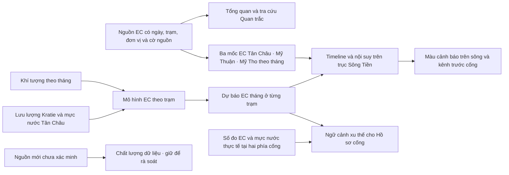

# Hướng dẫn luồng WebGIS Đồng Tháp và hồ sơ thử giảm sai số EC Mỹ Tho

**Bản đối chiếu:** 08/11/2026, theo giao diện `frontend/workspace.html`, mã đang phục vụ trong dự án chính `D:\Study\TLCN` (nhánh `TinBranch`) và các báo cáo nghiên cứu ngày 08/11/2026. **Đường vào:** `http://127.0.0.1:8000/workspace.html`. Tài liệu mô tả chức năng hiện có; số liệu mới sau ngày này cần đọc lại từ nguồn trên trang.

**Mục đích:** giúp người xem sử dụng từng mục của WebGIS, đọc đúng hình và biểu đồ, đồng thời giúp người hướng dẫn thấy rõ mô hình chính đã chọn, các cách đã thử để giảm sai số, kết quả và việc còn cần kiểm chứng.

## 1. Đọc đúng bốn loại thông tin trước khi bắt đầu

| Thông tin | Trên trang thường thấy ở đâu | Cách hiểu đúng |
| --- | --- | --- |
| **Mẫu EC quan trắc** | Điểm trạm, bảng/biểu đồ quan trắc, bảng mẫu gần nhất | Một số đo tại **trạm và ngày ghi trong nguồn**. Các trạm có thể được đo khác ngày; số gần nhất không đồng nghĩa với nước hiện tại. Trong nguồn MRC, thường chỉ có một mẫu trong tháng, không phải EC trung bình của cả tháng. |
| **EC mô phỏng không gian** | Màu trục Sông Tiền, nhánh kênh tới cống, phiếu tra cứu trên bản đồ | Giá trị được **nội suy từ các trạm theo một tháng/kịch bản** trên hình học nghiên cứu. Nó không phải mẫu đo tại mọi điểm dọc sông, trong kênh hoặc tại cống. |
| **EC dự báo** | Tab **Dự báo EC đa biến**, lớp phủ bản đồ sau khi bấm áp dụng | Kết quả mô hình cho một **tháng mục tiêu**, dựa vào đầu vào có nguồn hoặc đầu vào người dùng khai báo. Chưa phải quan trắc mới, chưa xác nhận độ chính xác cho riêng tháng đó. |
| **Độ mặn ước tính** | Nút **Độ mặn g/L** trên bản đồ | Trang lấy `g/L ≈ 0,0064 × EC (mS/m)` để minh họa. Quan hệ này phụ thuộc đặc tính nước và nhiệt độ; **màu cảnh báo vẫn tính theo EC**, không phải theo một ngưỡng g/L đã đo hoặc hiệu chuẩn tại hiện trường. |

EC là **độ dẫn điện** của nước, đơn vị trên WebGIS là **mS/m**. Nước có EC cao thường gợi ý nhiều chất hòa tan hơn, nhưng EC không tự xác định chính xác độ mặn, nguồn muối hay mức phù hợp với một cây trồng. Khi đưa ra quyết định tại cống hoặc ruộng, cần số đo cùng thời điểm, đúng vị trí và quy tắc chuyên môn phù hợp.

## 2. Luồng chung của hệ thống

**Cách đi qua trang theo một câu hỏi thực tế:**

1. Muốn biết **đã đo gì**, mở **Quan trắc**, chọn trạm và xem ngày, nguồn, cờ quan trắc/ước tính.
2. Muốn xem **mức EC thay đổi theo không gian và tháng**, chọn tháng trên Timeline. Đọc nhãn cho biết tháng ấy dùng mẫu MRC, ước tính mô hình hay trung vị mùa; sau đó mới đọc màu và chú giải.
3. Muốn có **kết quả mô hình cho một tháng**, mở **Dự báo EC đa biến**, chọn trạm, tháng, nguồn đầu vào và chạy. Xem phiên bản mô hình, bảng đầu vào, sai số hồi cứu; có thể đưa kết quả lên bản đồ để xem xu thế dọc sông.
4. Muốn biết **nguồn có đủ đáng tin để dùng cho mục đích đang xét**, mở **Chất lượng dữ liệu**. Muốn rà soát **điều kiện tại một cống**, mở **Hồ sơ cống** và nhập bộ số đo thực tế tại cống.

Thanh trên có năm tab: **Tổng quan → Quan trắc → Dự báo EC đa biến → Chất lượng dữ liệu → Hồ sơ cống**. Mỗi tab là một góc nhìn của cùng dự án; việc mở tab không làm một số mô phỏng trở thành số đo.

## 3. Hướng dẫn từng mục trên giao diện

### 3.1. Tổng quan

**Mục này dùng để định hướng**, chưa phải nơi kết luận mặn ở một địa điểm cụ thể.

- Nút **Mở bản đồ quan trắc** đi tới bản đồ; **Xem dự báo EC** đi tới công cụ chạy mô hình.
- Hình sơ đồ trục Sông Tiền và các kênh có cống là **hình học nghiên cứu tĩnh**. Nó cho thấy quan hệ vị trí tổng quát giữa trục sông và tuyến có cống; màu EC chỉ xuất hiện trên bản đồ khi chọn tháng. Không đọc hình giới thiệu như ảnh đo EC hay bằng chứng cống đang mở/đóng.
- Khung **Phạm vi hệ thống** nói về dự báo theo trạm và nguồn đầu vào. **Kiểm tra PostgreSQL** chỉ kiểm tra kết nối cơ sở dữ liệu. Huy hiệu đầu trang ghi **PostgreSQL** hoặc **Snapshot có nguồn** để biết trang đang lấy dữ liệu theo chế độ nào. Snapshot vẫn có thể tra cứu nguồn được đóng gói; thao tác kiểm tra kết nối không tự đổi chế độ dữ liệu.
- Bốn chỉ số tóm tắt lần lượt là số mẫu RIA2 Đồng Tháp, số điểm đang phục vụ, ngày của quan trắc gần nhất và số trạm có mô hình đa biến. **Ngày quan trắc gần nhất** là ngày của mẫu trong nguồn, không phải ngày cập nhật giao diện.
- Các thẻ hướng dẫn đưa tới trạm, công cụ dự báo và phần truy nguồn. Các thẻ kịch bản nhanh như **mùa khô 04/2024**, **mùa mưa 10/2022** hoặc **ngưỡng sầu riêng 50/80 mS/m** chỉ giúp chọn nhanh tháng/ngưỡng để xem mô phỏng; ngưỡng minh họa không phải chuẩn chung cho mọi vườn.
- Bảng **EC quan trắc gần nhất theo trạm** sắp theo ngày mẫu, hiển thị tối đa tám trạm đầu. Bấm **Mở trạm** để vào lịch sử của trạm đó. Hai hàng trong bảng có ngày khác nhau thì không nên so như hai phép đo đồng thời.
- Cuối trang Tổng quan có phần **Nguồn dữ liệu, phạm vi và minh chứng**. Nên mở khi cần ghi xuất xứ trong báo cáo; điểm RIA2 và trạm MRC có mã riêng, không được nối thành một chuỗi đo duy nhất.

**Hình 1 – sơ đồ ở Tổng quan:**

Sơ đồ giúp nhận diện mạng tuyến nghiên cứu; chiều dài, màu và vị trí chính xác cần đọc trên lớp bản đồ cùng thông tin nguồn. Hình này không hiển thị EC của một tháng.

### 3.2. Quan trắc: bản đồ, Timeline và trạm

#### A. Chọn tháng và hiểu lớp dữ liệu đang xem

Khung ở chân bản đồ là **Timeline**. Phần trên của khung ghi **tháng đang xem**, chế độ dữ liệu, EC tại **Tân Châu → Mỹ Thuận → Mỹ Tho**, cùng bối cảnh mưa, nhiệt độ và gió. Có thể chọn trực tiếp một tháng, kéo thanh thời gian, dùng các mốc gợi ý, chọn **Tháng này/Tháng sau**, hoặc bấm **Phát chu kỳ** với tốc độ 1×, 2×, 4×. Nút **Hiện cắt dọc sông** mở sơ đồ biến thiên EC theo lý trình; đóng lại để dành chỗ cho bản đồ. Khi rời tab hoặc ẩn cửa sổ, phát chu kỳ dừng.

Nút Tháng này/Tháng sau tính theo ngày hiện tại, **không gán cứng**. Timeline tạo dải tháng lịch sử và kéo đến ít nhất **12 tháng sau tháng hiện tại** nếu dữ liệu cần thiết nạp được; vì vậy ở thời điểm tài liệu này nó có thể chạm **11/2027**. Sự xuất hiện của tháng tương lai trên thanh **không bảo đảm** tháng đó có đầu vào dự báo đã được kiểm chứng. Nếu yêu cầu một tháng không có khung dữ liệu, trang chuyển về tháng có sẵn gần nhất và báo rõ ở dòng trạng thái.

Đọc dòng nhãn ngay cạnh tháng trước khi đọc màu:

| Nhãn/nguồn trên Timeline | Nó được tạo ra thế nào | Điều cần tránh khi diễn giải |
| --- | --- | --- |
| **Mẫu nguồn MRC** | Lấy mẫu EC sẵn có của ba trạm đến 12/2023. Nếu tháng thiếu mẫu, hệ thống có thể nội suy theo thời gian từ các tháng kề và ghi **“+ nội suy thời gian”**. | Một mẫu trong tháng hoặc giá trị lấp chỗ trống không phải chuỗi đo liên tục của tháng đó. |
| **Ước tính hồi cứu · khí tượng ERA5** | Giá trị từ mô hình/lưu trữ khí tượng của kỳ đã qua; trong tập 2024–2026 có cả tệp nghiên cứu lịch sử. Mỹ Tho được tính lại bằng mô hình chính ở tháng có đủ khí tượng và thủy văn. | Không xem đây là EC thực đo sau 2023; bản lưu khí tượng cũ không phải đầu ra chính mới của Mỹ Tho. |
| **Dự báo EC đa biến** | Mô hình trạm chạy với đầu vào tháng `t−2` đã được hệ thống coi là đủ và sẵn có. | Đây là kết quả nghiên cứu phụ thuộc đầu vào, chưa được xác nhận bằng EC thực đo cùng tháng. |
| **Kịch bản trung vị mùa lịch sử** | Khi không đủ đầu vào cho mô hình, hệ thống dùng trung vị EC và khí tượng cùng tháng của nhiều năm 2010–2023. | Đây là hình dung theo mùa, **không phải dự báo khí tượng tương lai** hay quan trắc. Không gọi mọi tháng tương lai là RF. |

Nếu tháng lịch sử thiếu Mỹ Thuận, giao diện ghi **“Khuyết mẫu · nội suy 2 trạm”**. Khi đủ ba mốc, trang dùng hai chặng giữa ba trạm; khi thiếu mốc giữa, dùng Tân Châu và Mỹ Tho. Nhãn nguồn của từng tháng quyết định cách diễn giải ba số trên Timeline.

#### B. Đọc hình bản đồ và các nút điều khiển

Đường chính là **trục Sông Tiền**. Giá trị EC trên trục được nội suy tuyến tính từng đoạn từ các mốc trạm của tháng đang chọn; phía cửa sông có một **điều kiện biên giả định, chưa hiệu chuẩn**. Các nét kênh từ sông đến cống nhận giá trị mô phỏng **ngoài cống** theo vị trí chiếu lên trục sông. **Đoạn sau cống** hiện nét đứt/không có EC nội kênh. Vì vậy tuyến có cống được vẽ liên tục về mặt đường đi, nhưng màu không chứng minh nước mặn đã đi xuyên qua cống hoặc cống đang mở. Đây là khác biệt quan trọng giữa **hình học tuyến** và **dòng chảy thực tế**.

- **Kênh có cống:** chọn một kênh bằng bàn phím hoặc chuột để đưa bản đồ đến nhánh và mở phiếu thông tin. Phiếu ghi tên/mã cống, tên tuyến, lý trình, khoảng cách tới trục và EC mô phỏng từ sông tới cống. Có thể bấm trực tiếp nhánh/cống trên bản đồ. Bấm chỗ khác trên bản đồ mở phiếu **nguồn nước lân cận**: EC của đoạn sông gần đó, khoảng cách tới trục, cống/trạm gần nhất và cảnh báo rằng đây chưa phải số đo ở điểm chọn.
- **Hiện/Ẩn danh sách trạm:** tìm trạm theo tên/mã. Chọn trạm để mở biểu đồ chi tiết ở phía dưới; bấm **Toàn cảnh** để về phạm vi trục sông. **Bản đồ sáng/Nền tối/Ảnh vệ tinh** chỉ đổi nền hiển thị.
- **EC mS/m / Độ mặn g/L:** đổi cách ghi **giá trị hiển thị**. Với g/L, dùng quy đổi tham khảo `0,0064 × EC`; các mức màu cảnh báo vẫn xét EC. Dòng ghi chú quy đổi hiện ngay ở chú giải khi bật g/L.
- **Mục đích dùng nước** chọn bộ mốc EC minh họa: sầu riêng **50/80**, cây có múi **100/150** (mặc định), lúa và nước ngọt **120/200 mS/m**. Nút **Mốc cảnh báo** cho xem/sửa hai số: *dưới mốc xem xét lấy nước*; *từ mốc ngăn mặn*. Có thể chọn **Tự nhập ngưỡng**. Số thứ hai phải lớn hơn số thứ nhất. Đổi mốc làm tính lại màu cảnh báo của cùng tháng; nó **không đổi số đo nguồn hoặc trọng số mô hình**.
- **Mức cảnh báo EC** ẩn/hiện bảng chú giải nhỏ để bản đồ rộng hơn. Ba mức là **dưới mốc thấp**, **từ mốc thấp đến dưới mốc cao**, **từ mốc cao**. Đây là phân loại theo ngưỡng kịch bản đang chọn, không phải ba cấp đánh giá pháp lý.
- **Hướng dòng nước** bật/tắt hạt chuyển động minh họa theo mùa và EC; đó không phải vận tốc dòng chảy đo được. **Lớp gió** bật/tắt hạt gió theo dữ liệu khí tượng; đó không phải số đo gió tại từng pixel bản đồ.
- **Chú giải và nguồn** mở phần lựa chọn điểm RIA2 tham khảo, nền, ranh giới, giải thích màu và giới hạn tọa độ. Điểm RIA2 viền đứt có tọa độ tham khảo với hệ quy chiếu giả định WGS84. Số trạm ở góc bản đồ là **số điểm có tọa độ đang hiện**, không phải số trạm được đo trong tháng đang chọn.

**Hình 2 – bản đồ màu EC:** đọc theo thứ tự **tháng → nhãn nguồn → đơn vị → hai mốc EC → màu trục sông → nhánh tới cống → phiếu chi tiết**. Ví dụ với bộ 100/150 mS/m, đoạn EC mô phỏng 120 mS/m nằm ở khoảng chuyển tiếp; không được suy thành “nước trong đồng ở cống có EC 120”. Muốn biết sau cống cần đo phía trong cống.

#### C. Xem mẫu thật của một trạm

Mở **Đối chiếu ngưỡng EC nâng cao & Biểu đồ chi tiết trạm** sau khi chọn trạm. Đầu khung cho biết tên/mã, nhà cung cấp, vai trò, EC của **mẫu nguồn mới nhất** và ngày nguồn. Chọn **Từ ngày/Đến ngày**, bấm **Áp dụng**; **Toàn bộ** mở cả chuỗi. Nếu vừa sửa ngày mà chưa áp dụng, biểu đồ/bảng và nút tải được làm trống để tránh xuất nhầm kỳ cũ. Bấm **Tải CSV đang xem** để lấy đúng các dòng sau lọc, gồm ngày, loại O/E, cờ chất lượng, mã nguồn và dấu vết tệp.

Biểu đồ có các **điểm mẫu rời rạc**. Điểm quan trắc (O) và ước tính (E) được tách riêng; khoảng trống không được tự hiểu là EC ổn định. Mở **Bảng số đo và nguồn từng dòng** để đối chiếu ngày, giá trị mS/m và minh chứng. MRC có ngày ghi mẫu; dấu `00:00` của tệp nguồn không chứng minh giờ lấy mẫu thực tế hay pha triều. Mẫu **Mỹ Tho 692 mS/m ngày 15/03/2020 là giá trị đúng đã được chủ dự án xác nhận**; đây là một mẫu, không phải trung bình tháng.

Khung **Đối chiếu ngưỡng EC** ở đầu phần nâng cao cho nhập một ngưỡng và ghi mục đích/nguồn tham khảo. Sau khi bấm **Áp dụng ngưỡng**, bản đồ điểm và đường tham chiếu trên biểu đồ quan trắc/dự báo dùng mốc đó; **Bỏ ngưỡng** xóa đối chiếu. Mốc một giá trị này khác với **cặp mốc màu sông** trong thanh điều khiển bản đồ.

Nếu trạm có mô hình, nút **Dự báo EC cho trạm này** dẫn sang tab dự báo và chọn cùng trạm. Nếu không có mô hình đã đăng ký, trạm vẫn được xem quan trắc, không tự sinh dự báo.

#### D. Lịch sử PostgreSQL

Mở **Tra cứu lịch sử quan trắc PostgreSQL**, bấm **Kết nối và tải danh sách trạm**. Chọn nguồn, trạm, loại **Quan trắc (O)** hoặc **Ước tính (E)**, khoảng ngày rồi bấm **Tải lịch sử**. Nút **Toàn bộ thời gian** lấy khoảng sẵn có; **Xuất CSV đã lọc** tải đúng kết quả đã áp dụng; bảng có nút chuyển trang. Chế độ snapshot không tự kết nối PostgreSQL. Nếu chưa có cơ sở dữ liệu hoặc trạm/bộ dữ liệu tương ứng, khung này có thể trống dù bản đồ snapshot vẫn có trạm.

### 3.3. Dự báo EC đa biến

#### A. Chạy dự báo chính theo trạm

1. Chọn **Trạm dự báo** và **Tháng cần dự báo EC**. Nút **Tháng này/Tháng sau** tính lại theo thời gian hiện tại; cũng có thể chọn tháng khác sau mốc huấn luyện. Tháng đã nằm trong tập huấn luyện bị chặn để không dự báo lại nhãn mô hình đã học.
2. Chọn **Nguồn đầu vào**. **Dữ liệu khí tượng lưu trữ** sẽ nạp mưa (mm), nhiệt độ trung bình (°C) và gió (m/s) của tháng `t−2`. **Dữ liệu do người dùng cung cấp** cho nhập ba giá trị này; kết quả ghi nguồn `MANUAL`. Ví dụ dự báo **11/2026** cần đầu vào tháng **09/2026**, không lấy khí tượng của 11/2026 sau khi tháng ấy kết thúc để tự nhận là dự báo phát hành trước đó.
3. Với **Mỹ Tho**, ngoài ba biến khí tượng và chu kỳ tháng, máy chủ tự lấy năm đặc trưng thủy văn: lưu lượng Kratie của `t−2`, trung bình ba tháng, tỷ lệ so với cùng mùa; mực nước Tân Châu của `t−2` và trung vị ba tháng. Mỗi tháng nguồn cần ít nhất 20 ngày dữ liệu cho giá trị tháng. Trang giả định thủy văn có thể dùng sau cuối tháng nguồn **5 ngày**, nhưng chưa có lịch công bố lịch sử thật. **Nhập khí tượng thủ công không thay thế thủy văn thiếu**; thiếu Kratie hoặc Tân Châu thì nút chạy Mỹ Tho không khả dụng. Mỹ Thuận và Tân Châu có mô hình khí tượng riêng.
4. Bấm **Chạy dự báo đa biến**. Ô **Lưu lượt chạy vào PostgreSQL** mặc định được chọn; khi có cơ sở dữ liệu và lưu thành công, dự báo xuất hiện trong lịch sử. Bỏ chọn để chạy một lượt chưa lưu, sau đó có thể bấm **Chạy và lưu dự báo vào PostgreSQL**; thao tác lưu chạy lại mô hình trên máy chủ với cùng yêu cầu.
5. Đọc kết quả: EC tháng mục tiêu (mS/m), nguồn đầu vào, thời gian phát hành, mã dự báo, phiên bản mô hình, bảng từng biến, kỳ và số mẫu huấn luyện. Phần **P10–P90** chỉ cho biết mức phân tán của 300 cây RF, **không phải khoảng tin cậy đã hiệu chuẩn**, không bảo đảm bao phủ EC thật. Bảng đối chiếu cây trồng dùng ngưỡng minh họa; trang **không quy đổi EC dự báo thành độ mặn** vì thiếu hiệu chuẩn phù hợp.
6. **Tải JSON/CSV** để lưu giá trị và nguồn; **So sánh các lượt dự báo trong phiên** để xem tác động của các đầu vào đã thay đổi (bảng phiên mất khi tải lại trang); **Lịch sử dự báo đã lưu trong PostgreSQL** để tra cứu lượt đã lưu. Khi đổi trạm, tháng hoặc đầu vào, phải chạy lại; kết quả cũ bị xóa khỏi khung hiện hành.

**Mô hình chính của Mỹ Tho hiện nay** là Random Forest **300 cây**, dùng 5 biến khí tượng/chu kỳ tháng và 5 biến thủy văn Kratie/Tân Châu; học trên **463 mẫu EC Mỹ Tho đến 12/2023**. Trong giao diện, phiên bản Mỹ Tho là `20261108T_HYDROLOGY_PRIMARY_V1`. Tân Châu và Mỹ Thuận vẫn dùng mô hình riêng. Số EC dự báo thuộc tháng mục tiêu, không phải số đo tại cống hoặc lệnh vận hành.

#### B. Đưa dự báo lên bản đồ và hồ sơ cống

**Áp dụng kịch bản dự báo lên bản đồ** lấy dự báo cùng tháng của **cả ba trạm** (nếu mới chạy một trạm, hai trạm còn lại được tính bổ sung), rồi nội suy theo **Tân Châu → Mỹ Thuận → Mỹ Tho**. Trên bản đồ xuất hiện viền/vòng của trạm dự báo và một dải thông báo ghi ba EC, tháng mục tiêu và tháng nền. Lớp sông lúc này là **lớp phủ dự báo**, không còn là khung Timeline nền; trạng thái cống của Timeline nền tạm ẩn để tránh gắn kết luận cũ vào EC mới. Bấm **Quay về Timeline** hoặc chọn lại tháng để trở về lớp nền. Phần nội suy chỉ mô tả hình học dọc sông, chưa chứng minh liên thông thủy lực đến từng cống/kênh.

**Dùng dự báo để kiểm tra cống** chuyển kết quả sang **Phần A** của Hồ sơ cống như một bối cảnh xu thế. Nó **không tự điền** EC hay mực nước hiện trường ở Phần B. Có thể xem riêng các lượt dự báo ở ba trạm cùng tháng trước khi dùng bối cảnh này.

#### C. Các khung kiểm chứng lịch sử dưới công cụ dự báo

Mở **Kiểm chứng dự báo khi EC ngừng cập nhật** để xem ba kỳ giả định mất EC liên tục: **2019–2021 (36 tháng), 2021–2023 (36 tháng), 2022–2023 (24 tháng)**. Có thể đổi giả định EC sẵn có sau **5** hoặc **35 ngày**. Tại đầu mỗi kỳ, mô hình được huấn luyện bằng EC biết trước kỳ đó; EC trong kỳ bị giữ lại **chỉ để chấm sau**. Đầu vào khí tượng/thủy văn `t−2` thay đổi theo từng tháng. Đường **xanh đậm** là EC thực đo để đối chiếu; **xanh ngọc** là RF thủy văn chính của Mỹ Tho nếu đủ dãy; **cam** là RF chỉ khí tượng; **xanh lam nét đứt** là giữ EC cuối cùng. Bảng dưới biểu đồ cho MAE, RMSE, số tháng và các đối chứng. Các ô **Thử thêm dữ liệu thủy văn và EC trạm lân cận** và **Thử riêng EC từng trạm và mô hình tuyến tính** là hồ sơ nghiên cứu, không phải nút chuyển mô hình chính.

Khung **Đánh giá lịch sử: mô hình EC trễ và Persistence** nằm thấp hơn và mặc định thu gọn. Nó là **thí nghiệm cũ riêng**, chọn mô hình trên validation rồi chấm test 2022–2023, dự báo mẫu EC của tháng kế tiếp khi dữ liệu EC tới chậm. Đường **Quan trắc / Mô hình chọn trên validation / Persistence** không được đọc như biểu đồ của mô hình RF thủy văn chính. Có thể chọn trạm/giả định trễ, lọc năm, tải bảng tháng và tệp `metrics`, `predictions`, `manifest`. Thẻ **Dự báo sau mẫu cuối của bộ thí nghiệm** là kết quả lưu của thí nghiệm ở thời điểm kết thúc dữ liệu, không phải dự báo “hôm nay”. Nếu đưa `RF_compact` lên bản đồ, lớp phủ được gắn nhãn thí nghiệm cũ, khác mô hình chính.

### 3.4. Chất lượng dữ liệu

Phần **Dữ liệu có thể tin đến đâu?** giúp kiểm tra một bộ nguồn độ mặn bổ sung đang **rà soát**, chưa đưa vào EC quan trắc chính hoặc huấn luyện. Bấm **Làm mới thông tin dữ liệu** để cập nhật. Khung đầu cho số dòng nguồn, số trạm và số giá trị giữ để kiểm tra. Mở **Xem khoảng thời gian và số ngày có dữ liệu** để biết ngày đầu/cuối, số ngày có mẫu, chuỗi liên tục dài nhất và số cặp có nhãn ngày tiếp theo. Mở **Tra cứu số đo độ mặn chưa xác minh**, chọn điểm **trên sông/nội đồng tại cống/nội đồng cách 200 m**, rồi đọc ngày, giờ hoặc kỳ đo, cách đo và **g/L**. Ô trống không được coi là 0; mẫu g/L ở đây không phải nhãn EC mS/m của mô hình. **Chi tiết kiểm tra nguồn** nêu các chỗ lệch lịch, thiếu xác định vị trí đo và mức đầy đủ của biến. Khi người hướng dẫn đánh giá dữ liệu, đây là nơi phân biệt “đã nhập vào hồ sơ” với “đã qua kiểm chứng”.

Phần **Ước tính EC lịch sử từ khí tượng · xem thêm** là một bảng/biểu đồ **hồi cứu 01/2024–08/2026** từ bản khí tượng Open-Meteo đã lưu. Có thể chọn Tân Châu, Mỹ Thuận, Mỹ Tho, xem đỉnh và trung bình chu kỳ, mở bảng từng tháng, tải CSV. Đây là **bản lưu nghiên cứu cũ**, đặc biệt không được lấy hàng Mỹ Tho làm đầu ra hiện hành của RF thêm Kratie/Tân Châu. Đầu vào khí tượng lịch sử có thể chỉ được biết đầy đủ sau sự kiện; chuỗi này không chứng minh chất lượng dự báo tại ngày phát hành, và chưa có EC thực đo cùng kỳ để chấm độc lập.

### 3.5. Hồ sơ cống

Chọn **cống trong danh mục tài liệu/GIS**. Trang hiển thị mã, tên, tuyến, thông tin hồ sơ nếu có và liên kết **Danh mục gốc · trang 2**. **Đọc cống PostgreSQL** chỉ bổ sung danh mục trong cơ sở dữ liệu; danh sách “trạm ứng viên” được tìm theo **khoảng cách** (bán kính 50 km), chưa xác lập trạm nào đại diện thủy lực cho cống. Chọn nhánh trên bản đồ cũng có thể đưa tới hồ sơ cống tương ứng.

Hồ sơ chia hai phần:

- **Phần A – Ngữ cảnh xu thế:** nếu đã dùng một dự báo đa biến, hệ thống hiển thị EC dự báo ba trạm, EC chiếu tới vị trí cống theo hình học, mức cảnh giác và nguồn của các giá trị. Nếu thiếu vị trí chiếu, Mỹ Tho chỉ làm bối cảnh thay thế, **không là EC tại cống**. Dự báo cao có thể rút thời hạn cho phép của **mẫu đo hiện trường**; nó không tự quyết định mở cống.
- **Phần B – Điều kiện hiện trường:** người dùng nhập **EC ngoài sông sát cống**, **EC phía trong đồng**, **mực nước ngoài/trong**, **thời điểm đo GMT+7**, người đo/nguồn, tình trạng cơ khí; xác nhận hai mực nước cùng hệ cao độ. Sau đó bấm **Kiểm tra điều kiện xem xét lấy nước**. Dự báo và màu mô phỏng không được tự chép vào các ô này.

**Quy tắc mặc định trong bản hiện tại** (có thể xem và thay trong `RuleProfile`): EC ngoài **≤156,25 mS/m**, EC trong **≤125 mS/m**, chênh mực nước ngoài trừ trong **≥0,05 m và dương**, cơ khí **READY**, xác nhận cùng hệ cao độ và có người đo. Mẫu không quá **6 giờ** khi bình thường, **2 giờ** khi cảnh giác cao. Cảnh giác cao bật nếu Mỹ Tho dự báo đạt/vượt mốc P90 tham chiếu (**60,42 mS/m** khi thiếu mốc khác), hoặc EC chiếu cống đạt **80% ngưỡng EC ngoài**, hoặc bối cảnh dự báo đã bật cảnh giác. Đây là quy tắc kỹ thuật cấu hình cho sàng lọc, **không phải quy trình pháp lý của công trình**. Con số `156,25 ≈ 1 g/L` chỉ là quy đổi tham khảo theo hệ số nói trên.

Kết quả có ba dạng: **Đề nghị xem xét lấy nước** nếu mọi tiêu chí đủ và đạt; **Chưa phù hợp để lấy nước** nếu bộ dữ liệu đầy đủ nhưng có tiêu chí không đạt; **Cần bổ sung hoặc đo lại** nếu thiếu thông tin hoặc mẫu hết hạn. Bảng chi tiết cho biết tiêu chí nào đạt/không đạt/cần bổ sung và ngưỡng đã dùng. Nút **Tải bảng kiểm tra JSON** lưu lại kết quả. Sau thời hạn mẫu, hoặc khi sửa một ô, cần đánh giá lại. Kết quả là **đề xuất để người vận hành xem xét**, không phát lệnh đóng/mở cống.

## 4. Cách đọc các hình và chỉ số mà không lẫn nguồn

| Hình/biểu đồ | Trục, màu hoặc ký hiệu | Câu hỏi nó trả lời được | Câu hỏi nó chưa trả lời được |
| --- | --- | --- | --- |
| Sơ đồ ở Tổng quan | Trục sông và tuyến có cống | Nghiên cứu đang xét mạng tuyến nào? | Nước tháng này mặn tới đâu, cống mở hay đóng? |
| Bản đồ Quan trắc/Timeline | Màu theo **cặp ngưỡng EC**; điểm trạm, nhánh trước/sau cống; tháng và nguồn ở chân bản đồ | Trong **kịch bản tháng đã chọn**, EC nội suy trên trục vượt mốc nào và nhánh nào cần chú ý? | EC thực đo tại mọi pixel, nước phía sau cống, độ mặn g/L đo trực tiếp? |
| Cắt dọc Sông Tiền | Lý trình dọc trục và EC mô phỏng; chấm trạm/cống | EC nội suy thay đổi theo chặng Tân Châu–Mỹ Thuận–Mỹ Tho thế nào? | Thời gian truyền nước, vận tốc thực, độ sâu hay liên thông với ruộng? |
| Biểu đồ chi tiết trạm | Thời gian và EC (mS/m); quan trắc/ước tính tách nhau | Mẫu tại **một trạm** tăng giảm theo những ngày đã có dữ liệu ra sao? | EC giữa hai ngày không đo hoặc trung bình tháng liên tục? |
| Biểu đồ kiểm chứng “mất EC” | Tháng; thực đo, RF thủy văn, RF khí tượng, giữ EC cuối | Nếu giả định không nhận EC nhiều tháng, các phương án lệch mẫu thật bao nhiêu? | Sai số chắc chắn của dự báo 2026/2027? |
| Biểu đồ đánh giá EC trễ cũ | Thực đo, mô hình chọn trên validation, Persistence | Thí nghiệm cũ dự đoán mẫu kế tiếp tốt hơn đối chứng ở kỳ test nào? | Hiệu quả hiện hành của RF thủy văn Mỹ Tho? |
| Biểu đồ ước tính 2024–2026 | Một đường EC ước tính từ khí tượng lưu trữ | Bản nghiên cứu cũ ước tính biến thiên thế nào? | EC quan trắc cùng kỳ hay kiểm định dự báo phát hành thật? |

**MAE** là trung bình độ lớn sai lệch tuyệt đối giữa dự báo và thực đo; **RMSE** cũng đo sai lệch nhưng phạt mạnh hơn khi có lỗi lớn. Cả hai ở đây tính bằng **mS/m**; nhỏ hơn là tốt hơn **trên đúng tập tháng và giao thức đang chấm**. Không so điểm của hai giao thức khác nhau như cùng một bảng xếp hạng. **P90 của các cây RF** là phân vị nội bộ giữa cây, khác P90 của EC huấn luyện dùng trong ngữ cảnh cảnh giác và cũng khác một khoảng dự báo đã hiệu chuẩn.

## 5. Mô hình chính Mỹ Tho và các kết quả đã kiểm chứng

Mục tiêu của mô hình là dự báo **EC mẫu tháng tại Mỹ Tho**, không phải độ mặn g/L. Lựa chọn hiện tại: **RF 300 cây, khí tượng + lưu lượng Kratie + mực nước Tân Châu**, dùng dữ liệu `t−2` và chu kỳ tháng. Cách chấm quan trọng nhất là **khóa EC liên tục**: giả định Mỹ Tho ngừng cập nhật EC trong một giai đoạn, huấn luyện một lần trước giai đoạn, rồi dùng EC ẩn trong giai đoạn chỉ để so sau dự báo. Nó gần với câu hỏi “nếu lâu ngày không có EC Mỹ Tho mới, mô hình ra sao?” hơn việc cho mô hình học thêm EC Mỹ Tho mỗi tháng.

| Kỳ giả định mất EC Mỹ Tho | RF chỉ khí tượng: MAE / RMSE | **RF khí tượng + thủy văn chính:** MAE / RMSE | Giữ EC cuối trước kỳ: MAE / RMSE |
| --- | ---: | ---: | ---: |
| 2019–2021, 36 tháng | 69,55 / 147,73 | **57,81 / 133,82** | 80,20 / 191,23 |
| 2021–2023, 36 tháng | 28,31 / 64,23 | **16,57 / 31,21** | 19,13 / 42,57 |
| 2022–2023, 24 tháng | 18,39 / 49,35 | **12,19 / 25,43** | **10,76 / 16,46** |

Đơn vị: **mS/m**. Thêm thủy văn giúp RF giảm cả MAE và RMSE so với **RF chỉ khí tượng** trong cả ba kỳ. Gọi đây là **phương án chính phù hợp nhất trong những phương án đã cân nhắc**, với mục đích và dữ liệu hiện có; không nói nó thắng mọi đối chứng ở mọi kỳ. Riêng 2022–2023, **giữ EC cuối** vẫn có sai số thấp hơn. Mẫu **692 mS/m ngày 15/03/2020 là đúng**; mô hình khóa trước 2019 chỉ dự báo **213,67 mS/m** cho 03/2020. Tháng 04/2022 cũng báo cao (**100,04** so với mẫu **25,7 mS/m**). Hai ví dụ cho thấy sai số trung bình giảm nhưng rủi ro bỏ sót đỉnh/báo cao giả còn thật.

Các kỳ này và mẫu cực trị đã được nhìn thấy trong quá trình nghiên cứu; đây là **hồi cứu**, chưa phải kiểm định mù trên EC mới sau 2023. Nguồn MRC chỉ ghi ngày mẫu và không chứng minh giờ thực đo. Lịch công bố lịch sử thực tế của đầu vào thủy văn cũng chưa được xác minh; mốc “cuối tháng +5 ngày” là giả định kỹ thuật. Vì vậy không chuyển điểm hồi cứu thành cam kết sai số tương lai.

## 6. Các phương pháp đã thử để giảm sai số sau khi chọn RF thủy văn làm mô hình chính

Đây là phần để người hướng dẫn thấy **đã thử gì, kết quả nào có triển vọng, vì sao chưa đổi WebGIS**. Các nhóm thí nghiệm dùng **hai cách chấm khác nhau**:

- **Khóa EC liên tục**: cố định mô hình trước từng kỳ mất tín hiệu 2019–2021, 2021–2023 hoặc 2022–2023. Đây là cách chấm dùng để đối chiếu trực tiếp với mô hình chính ở bảng mục 5.
- **Rolling origin**: mỗi tháng là một lần phát hành mới; chỉ dữ liệu giả định đã biết ở tháng ấy được đưa vào huấn luyện. Kết quả có ích để nghiên cứu nhưng **không lấy MAE/RMSE của rolling origin trừ trực tiếp cho điểm khóa EC**.

### 6.1. Bảng thí nghiệm và quyết định
z
| Nhóm thử | Cách làm ngắn gọn | Kết quả chính đã ghi nhận | Kết luận hiện nay |
| --- | --- | --- | --- |
| **Tinh chỉnh RF, tăng trọng số EC cao, Gradient Boosting Huber** | Thử cấu hình RF mịn hơn, biến biểu diễn thiếu nước, cho mẫu EC cao trọng số lớn hơn; thử mô hình Huber và phối hợp các dự báo. Chấm theo **rolling origin**, EC chậm 5 hoặc 35 ngày. | Với +5 ngày, `RF_fine_compact` giảm MAE giai đoạn 2019–2021 từ **51,71 xuống 49,40**, nhưng MAE 2022–2023 tăng **12,01 lên 13,88**. Huber có MAE 2022–2023 **10,28**, nhưng 2019–2021 tăng lên **64,96**. | Có cải thiện từng kỳ, chưa ổn định; giao thức khác mô hình chính. **Chưa thay mô hình phục vụ.** |
| **Bổ sung triều FES2022b theo cửa sổ thời gian** | Thử cực đại/trung bình triều ban ngày 13–17, cực đại nửa đầu tháng và biên độ 05–12. Giữ giao thức **khóa EC**. | MAE mô hình chính 2019–2021 **57,81**; thêm trung bình triều ban ngày thành **57,93** (xấu hơn chút), dù 2021–2023 từ **16,57 xuống 15,59**. Dự báo 03/2020 vẫn chỉ **229,86** so với **692**. | Tín hiệu ở kỳ gần đây, chưa ổn định ở kỳ đỉnh mặn; **chưa thêm FES vào WebGIS**. Atlas FES2022b ra sau những ngày phát hành lịch sử nên phép thử là hindcast nghiên cứu. |
| **Chuyển mạch theo lưu lượng Kratie** | Nếu tháng mùa khô và tỷ lệ Q Kratie `t−2` thấp, dùng RF chú trọng EC cao; ngoài điều kiện ấy dùng RF chính. Thử mốc `<0,75` và `<0,85`. | Mốc `<0,85` giảm MAE/RMSE 2019–2021 từ **57,81/133,82** xuống **56,19/128,17**, nhưng số tháng EC ≥100 bị dự báo dưới 100 **tăng 2 lên 3**. Tháng 02/2020 đo **558**, dự báo chuyển mạch chỉ **85,74 mS/m**. | Giảm sai số trung bình không đủ nếu bỏ sót thêm tháng EC cao. Mốc 0,85 còn được xem sau khi biết dữ liệu 03/2020; **giữ làm ứng viên nghiên cứu**. |
| **Học `log(EC)` và hiệu chỉnh smearing** | Giảm ảnh hưởng của đỉnh cực trị khi học; thử thêm phép đưa kết quả từ thang log về thang EC. | RF log có MAE 2019–2021 **66,21**, cao hơn mô hình chính **57,81**; log + smearing thành **62,83**, và kỳ 2022–2023 xấu rõ (**26,06** so với **12,19**). | Không cải thiện đủ ổn định; **không đưa vào dự báo chính**. |
| **Ridge nghịch đảo Q + RF học phần dư** | Dùng quan hệ đơn giản với `1/Q`, mực nước, mưa, mùa; RF học phần sai còn lại. | MAE/RMSE 2019–2021 **57,43/129,75** và 2022–2023 **10,33/19,29**, nhưng 2021–2023 thành **17,48/32,88**, xấu hơn mô hình chính **16,57/31,21**. Phần dư hiện được học trên dự báo Ridge trong tập học, cần kiểm tiếp ngoài mẫu. | Có triển vọng ở vài kỳ, chưa thắng ổn định và cần kiểm phương pháp học phần dư; **chưa triển khai**. |
| **Dữ liệu ngày sát thời điểm phát hành** | Thêm cửa sổ ngắn của lưu lượng Kratie và mực nước Tân Châu gần ngày phát hành, với giả định độ trễ công bố. | MAE 2019–2021 tăng từ **57,81 lên 64,82**; dù một vài kỳ khác thay đổi nhỏ. Thử nghiệm này **chỉ gồm bốn đặc trưng ngày của hai nguồn thủy văn**, chưa bao gồm gió ngày hay mực nước cửa sông có chung mốc cao độ. | Cấu hình đã thử chưa giúp kỳ khó nhất; không bác bỏ mọi ý tưởng dùng dữ liệu ngày, nhưng **chưa dùng trên WebGIS**. |
| **Khoảng trên theo sai số mùa khô; phân vị cây RF** | Tìm một mức cộng bù từ sai số lịch sử và xem phân vị 90% giữa 300 cây. | Khoảng trên thử nghiệm chỉ bao phủ **10/15 tháng mùa khô (66,7%)** ở 2019–2021, thấp hơn mục tiêu 90%; p90 cây chỉ bao phủ **22/36 tháng** toàn kỳ và **1/6 tháng EC ≥100**. Ở 03/2020, p90 cây **360,97**, p95 **425,92**, còn mẫu đúng **692**. | **Không đưa một “trần an toàn” hoặc khoảng tin cậy giả lên giao diện.** P10–P90 hiện có ở kết quả chỉ mô tả các cây phân tán thế nào. |
| **EC Mỹ Thuận/Tân Châu và mô hình Ridge đối chứng** | Thử thêm EC từng trạm lân cận hoặc cả hai; thử Ridge thuần và Ridge + RF phần dư, cùng kỳ khóa EC. | Thêm hai EC giúp RMSE 2021–2023 từ **31,21 xuống 29,59**, nhưng 2019–2021 thành **136,58** và 2022–2023 **28,09**, cao hơn RMSE thủy văn chính **133,82** và **25,43**. Ridge thuần kém hơn cả ba kỳ; Ridge lai có vài điểm tốt nhưng tăng MAE/bỏ sót tháng EC cao. | Không có cơ sở nói EC trạm lân cận “vô ích” vĩnh viễn; trong kiểm chứng hiện có **chưa nên thay mô hình chính**. |

**Lưu ý về thời điểm thử:** các báo cáo cùng ngày 08/11/2026 không ghi một đồng hồ thao tác hoàn chỉnh. Bảng gom các phép kiểm chứng bổ sung dùng để quyết định **có nên thay mô hình RF thủy văn đã chọn hay không**; nó không khẳng định thứ tự từng lần chạy trong ngày. Các kết quả rolling origin, khóa EC và hindcast triều được tách rõ để tránh so sai.

### 6.2. Vì sao giữ mô hình hiện tại dù vẫn có lỗi lớn?

Trong các kỳ khóa EC đã chấm, RF thêm thủy văn cải thiện nhất quán **so với RF chỉ khí tượng** và có đầu vào rõ nguồn, đủ để làm **mô hình chính nghiên cứu** ở Mỹ Tho. Các cách mới có tháng hoặc kỳ tốt hơn, nhưng không giảm lỗi ổn định trên cả ba kỳ; một số tăng **bỏ sót EC cao**, điều đặc biệt đáng quan tâm khi xem rủi ro mặn. Không có phương án nào dự báo sát mẫu **692 mS/m 03/2020**. Vì vậy giữ phiên bản đang phục vụ, trình bày sai số và giới hạn ngay bên cạnh dự báo, rồi chờ dữ liệu độc lập để quyết định bước tiếp.

### 6.3. Gợi ý câu hỏi cho người hướng dẫn

1. **Tiêu chí chọn mô hình** nên ưu tiên MAE/RMSE toàn kỳ, hay thêm một chỉ số riêng cho **bỏ sót tháng EC cao**? Nếu chọn mốc EC cao, nên đặt mốc nghiên cứu theo mục tiêu nào để tránh lẫn với ngưỡng vận hành cống?
2. Có thể thu thập **EC hoặc EC25 đo trực tiếp** ở điểm gần cửa sông, với ngày giờ và lịch công bố rõ, đủ liên tục để thử trước từng ngày phát hành không? Dữ liệu g/L rời rạc có được hiệu chuẩn tại chỗ để kết nối với EC hay cần giữ riêng?
3. Có thể xác nhận **lịch công bố thật** của Kratie, mực nước Tân Châu, khí tượng và các trạm EC lân cận không? Khi có lịch đó, cần chấm lại mọi thử nghiệm theo đúng dữ liệu thực sự khả dụng tại ngày phát hành.
4. Có thể dành ra một **kỳ EC Mỹ Tho mới sau 2023 chưa từng dùng để chọn phương án** để kiểm định mù không? Cần đánh giá riêng mùa khô, đỉnh lớn, báo cao giả và bỏ sót.
5. Nếu muốn phát triển mô hình vật lý/lai, cần thêm mực nước, triều, gió và kết nối thủy lực ở **đúng vị trí và cùng hệ cao độ** nào? Công thức hiện tại mới là giả thuyết cơ chế, chưa hiệu chuẩn cho Mỹ Tho.

## 7. Nguồn đối chiếu để đọc sâu hoặc tái lập

- [Giao diện WebGIS](../frontend/workspace.html), [điều khiển Timeline](../frontend/src/features/timeline-scrubber.js), [nguồn tháng cho bản đồ](../backend/services/spatial_inputs.py), [nội suy và mốc cống](../backend/services/spatial_simulation.py).
- [Công cụ dự báo trên giao diện](../frontend/src/features/multivariate-forecast.js), [dịch vụ dự báo](../backend/services/multivariate.py), [đầu vào thủy văn](../backend/repositories/hydrology_inputs.py), [lớp phủ dự báo](../frontend/src/shared/forecast-map-overlay.js).
- [Báo cáo chọn mô hình chính Mỹ Tho](mytho_hydrology_primary_2026-11-08.md), [kiểm chứng thêm thủy văn/trạm lân cận](frozen_ec_remedies_2026-11-08.md), [kiểm chứng EC từng trạm và Ridge](frozen_ec_followup_2026-11-08.md).
- [Thử giảm sai số theo rolling origin](ec_error_reduction_2026-11-08.md), [cửa sổ triều và phân vị cây](ec_tide_window_audit_2026-11-08.md), [chuyển mạch, log, dữ liệu ngày và khoảng trên](ec_math_physics_experiments_2026-11-08.md). Các báo cáo có đường dẫn đến bảng dự báo từng tháng, chỉ số, giao thức, mã chạy và dấu vết nguồn.

**Chốt phạm vi:** WebGIS hiện giúp tra cứu nguồn, quan sát mẫu EC, hình dung biến thiên theo sông, chạy dự báo nghiên cứu và sàng lọc điều kiện cần đo tại cống. Mọi màu mô phỏng, giá trị g/L quy đổi, P10–P90 và đề nghị từ Hồ sơ cống phải được đọc cùng ngày, nguồn, đơn vị và giới hạn nêu trên.
