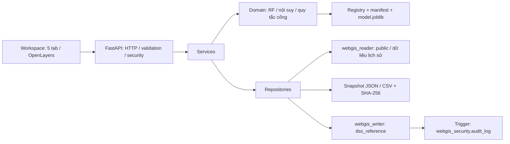

# Hồ sơ bằng chứng kỹ thuật cho báo cáo tốt nghiệp

> Hồ sơ này chụp TinBranch ngày 17/11/2026. Sau khi tích hợp vào `refactor`, cơ chế đăng nhập, phân quyền và cách lưu dự báo đã thay đổi; xem [bảo mật hiện hành](database-security.md) và mã hiện tại trước khi dùng các số dòng hoặc mô tả API key bên dưới.

**Dự án:** WebGIS và dự báo EC theo tháng — Đồng Tháp / Sông Tiền.
**Ngày đối chiếu:** 17/11/2026, giờ Việt Nam (UTC+7).
**Mốc Git:** `705ee7320c6ffcac67e0685861c513af15c11c6e`, cộng các thay đổi chưa commit đang có trong checkout khi khảo sát. Tài liệu mô tả nội dung working tree, không đồng nhất nó với riêng commit này.
**Phạm vi:** đọc mã nguồn, SQL, dữ liệu, registry/manifest và kết quả thí nghiệm; chạy kiểm thử và build để ghi kết quả thực tế. Không sửa mã ứng dụng, không huấn luyện lại hoặc đổi artifact model đang phục vụ, không áp dụng migration hay ghi dữ liệu nghiệp vụ. Build chỉ tạo lại `frontend/dist/` đã được Git ignore.
**Quy ước bằng chứng:** đường dẫn tính từ gốc repo; `:Lx–Ly` là dòng mã/SQL, `CSV: cột/điều kiện` và `JSON: khóa` là vị trí trích xuất. Các bảng thống kê dữ liệu được tính lại từ tệp, không suy từ số dòng vật lý của CSV. Phân biệt rõ đối tượng **khai báo trong SQL** và đối tượng **hiện có trong DB**, mô hình đang phục vụ và kết quả hồi cứu.

## 1. Kiến trúc hệ thống, stack và 85 HTTP endpoint

### 1.1. Kiến trúc và luồng xử lý

Ứng dụng dùng frontend JavaScript ES modules, bản đồ OpenLayers và backend FastAPI. Backend chia thành `api/` (HTTP), `services/` (ca sử dụng), `repositories/` (đọc tệp/PostgreSQL), `domain/` (quy tắc và suy luận). `run_webgis.py` nạp cấu hình, chọn chế độ `postgres`/`snapshot`, kiểm tra bảo mật rồi phục vụ API và bản build Vite cùng origin; `/` chuyển tới `/workspace.html`. Dev server Vite cổng 5173 và preview cổng 4173 proxy `/api` tới `127.0.0.1:8000`.



Năm tab là **Tổng quan, Quan trắc, Dự báo EC đa biến, Chất lượng dữ liệu, Hồ sơ cống**. Quan trắc PostgreSQL lỗi thì trả lỗi, không tự đổi sang snapshot. Snapshot có manifest kiểm tra SHA-256; RIA2 được gắn nguồn tham khảo riêng khi ghép vào workspace PostgreSQL. Dự báo chạy suy luận từ artifact đã lưu, không huấn luyện trong request. Đầu ra theo trạm có thể làm mốc nội suy sông; kết quả sàng lọc cống là hỗ trợ xem xét hồ sơ.

**Nguồn:** `backend/main.py:L34–83`; `backend/api/workspace.py`; `backend/repositories/workspace.py:L24–61, L93 trở đi`; `backend/services/workspace.py:L25–75`; `run_webgis.py:L49–84`; `frontend/vite.config.js:L4–22`; `frontend/workspace.html`; `frontend/src/app/workspace.js`.

### 1.2. Stack được xác nhận

| Thành phần | Phiên bản/cấu hình xác nhận | Bằng chứng |
| --- | --- | --- |
| Python | **3.12.10** trong `.venv`; không dùng Python 3.14 cài toàn máy để chạy kiểm chứng | `.venv/pyvenv.cfg`; `.venv/Scripts/python.exe --version` |
| FastAPI / Uvicorn | **0.141.1 / 0.53.0** | `backend/requirements-api.txt:L3–4`; metadata môi trường thực chạy |
| Pydantic | **2.13.5** | `backend/requirements-api.txt:L7` |
| PostgreSQL driver / pool | `psycopg[binary]` **3.3.5**, `psycopg-pool` **3.3.3** | `backend/requirements-api.txt:L5–6` |
| Frontend | JavaScript ES modules; OpenLayers **6.15.1**, Vite **5.4.21** | `frontend/package.json`; `frontend/package-lock.json`, khóa `packages["node_modules/ol"]`, `packages["node_modules/vite"]` |
| Mô hình | scikit-learn **1.9.1**, NumPy **2.5.3**, pandas **2.3.3** trong môi trường kiểm chứng; joblib lưu model | `requirements-forecast-multivariate.txt`; metadata `.venv`; model manifest |
| Kiểm thử HTTP | httpx **0.28.1**, FastAPI `TestClient` | `requirements-dev.txt`; metadata `.venv`; `tests/test_workspace_api.py` |
| Node.js / npm | **v24.14.0 / 11.21.2** trong lượt kiểm chứng | `node --version`, `npm.cmd --version` |
| PostgreSQL / PostGIS | DB `dongthap_gis`; phiên bản và danh mục đối tượng thực tế tại phần 2 | `backend/database.py:L28–38`; catalog DB chỉ đọc |
| Dữ liệu không gian | GeoJSON theo `[kinh độ, vĩ độ]`; hình học SQL SRID **4326** | `backend/main.py:L144`; `sql/01_core_schema_if_new.sql`; `data/biengioi/tien_river_corridor.geojson` |

`requirements-forecast-multivariate.txt` khóa scikit-learn 1.9.1 nhưng chỉ đặt khoảng phiên bản cho NumPy/pandas; vì vậy các phiên bản đo trong `.venv` không phải tất cả đều được pin trong repo.

### 1.3. Danh sách phân nhóm đầy đủ 85 endpoint

Đếm bằng các cặp **HTTP method + path** trong `backend.main.app.openapi()['paths']`: **85 = 71 GET + 14 POST**, **78 path khác nhau**. Các alias được tính riêng vì có URL riêng. Không cộng `/docs`, `/redoc`, `/openapi.json`, route `/` do runner thêm và các tệp static. Đây là số endpoint đã đăng ký trong mã, không phải kết luận cả 85 đã được gọi thành công với DB thật.

| Nhóm | Tổng | GET | POST | Nguồn đăng ký |
| --- | ---: | ---: | ---: | --- |
| API nền và lịch sử PostgreSQL | 5 | 5 | 0 | `backend/main.py:L94–161` |
| Workspace: API chính | 29 | 25 | 4 | `backend/api/workspace.py`; `backend/main.py:L75` |
| Research: alias tương thích | 29 | 25 | 4 | `backend/research.py:L7–8`; `backend/main.py:L74` |
| Dự báo đa biến và lịch sử: đường dẫn ngắn | 7 | 5 | 2 | `backend/api/multivariate.py`; `backend/api/dss_storage.py`; `backend/main.py:L76–77` |
| Độ mới dữ liệu | 1 | 1 | 0 | `backend/api/data_freshness.py:L52` |
| Sàng lọc cống độc lập | 1 | 0 | 1 | `backend/api/gate_screening.py:L20` |
| Sổ phát hành dự báo | 2 | 1 | 1 | `backend/api/forecast_issues.py:L19–25` |
| Phiếu EC thực địa và duyệt | 3 | 1 | 2 | `backend/api/field_measurements.py:L56–79` |
| Tiếp nhận dữ liệu: hai prefix | 8 | 8 | 0 | `backend/intake.py:L26–77`; `backend/main.py:L82–83` |
| **Tổng** | **85** | **71** | **14** | OpenAPI sinh trực tiếp từ mã |

**API nền và lịch sử PostgreSQL (5 endpoint)**

| STT | Method | Path |
| ---: | --- | --- |
| 1 | GET | `/api/v1/app-health` |
| 2 | GET | `/api/v1/health` |
| 3 | GET | `/api/v1/stations` |
| 4 | GET | `/api/v1/stations/{site_code}/datasets` |
| 5 | GET | `/api/v1/stations/{site_code}/observations` |

**Workspace: API chính (29 endpoint)**

| STT | Method | Path |
| ---: | --- | --- |
| 6 | GET | `/api/v1/workspace/multivariate/catalog` |
| 7 | GET | `/api/v1/workspace/multivariate/inputs` |
| 8 | GET | `/api/v1/workspace/multivariate/evaluation` |
| 9 | POST | `/api/v1/workspace/multivariate/predict` |
| 10 | GET | `/api/v1/workspace/threshold-presets` |
| 11 | GET | `/api/v1/workspace/gate-drafts` |
| 12 | POST | `/api/v1/workspace/gate-drafts` |
| 13 | GET | `/api/v1/workspace/multivariate/history` |
| 14 | POST | `/api/v1/workspace/multivariate/history` |
| 15 | GET | `/api/v1/workspace/multivariate/history/{prediction_id}` |
| 16 | GET | `/api/v1/workspace/summary` |
| 17 | GET | `/api/v1/workspace/stations` |
| 18 | GET | `/api/v1/workspace/stations/{site_code}/observations` |
| 19 | GET | `/api/v1/workspace/experiments/{experiment_id}` |
| 20 | GET | `/api/v1/workspace/experiments/{experiment_id}/next-forecast` |
| 21 | GET | `/api/v1/workspace/boundaries` |
| 22 | GET | `/api/v1/workspace/gates` |
| 23 | GET | `/api/v1/workspace/database-gates` |
| 24 | GET | `/api/v1/workspace/future-forecast` |
| 25 | GET | `/api/v1/workspace/monthly-estimates` |
| 26 | GET | `/api/v1/workspace/simulation/corridor` |
| 27 | GET | `/api/v1/workspace/simulation/timeline` |
| 28 | GET | `/api/v1/workspace/simulation/frame` |
| 29 | GET | `/api/v1/workspace/database-gates/{gate_code}/candidate-stations` |
| 30 | GET | `/api/v1/workspace/gate-template/{kind}` |
| 31 | POST | `/api/v1/workspace/gate-evaluation` |
| 32 | GET | `/api/v1/workspace/monthly-estimates/export` |
| 33 | GET | `/api/v1/workspace/artifacts/{experiment_id}/{filename}` |
| 34 | GET | `/api/v1/workspace/gate-source` |

**Research: alias tương thích (29 endpoint)**

| STT | Method | Path |
| ---: | --- | --- |
| 35 | GET | `/api/v1/research/multivariate/catalog` |
| 36 | GET | `/api/v1/research/multivariate/inputs` |
| 37 | GET | `/api/v1/research/multivariate/evaluation` |
| 38 | POST | `/api/v1/research/multivariate/predict` |
| 39 | GET | `/api/v1/research/threshold-presets` |
| 40 | GET | `/api/v1/research/gate-drafts` |
| 41 | POST | `/api/v1/research/gate-drafts` |
| 42 | GET | `/api/v1/research/multivariate/history` |
| 43 | POST | `/api/v1/research/multivariate/history` |
| 44 | GET | `/api/v1/research/multivariate/history/{prediction_id}` |
| 45 | GET | `/api/v1/research/summary` |
| 46 | GET | `/api/v1/research/stations` |
| 47 | GET | `/api/v1/research/stations/{site_code}/observations` |
| 48 | GET | `/api/v1/research/experiments/{experiment_id}` |
| 49 | GET | `/api/v1/research/experiments/{experiment_id}/next-forecast` |
| 50 | GET | `/api/v1/research/boundaries` |
| 51 | GET | `/api/v1/research/gates` |
| 52 | GET | `/api/v1/research/database-gates` |
| 53 | GET | `/api/v1/research/future-forecast` |
| 54 | GET | `/api/v1/research/monthly-estimates` |
| 55 | GET | `/api/v1/research/simulation/corridor` |
| 56 | GET | `/api/v1/research/simulation/timeline` |
| 57 | GET | `/api/v1/research/simulation/frame` |
| 58 | GET | `/api/v1/research/database-gates/{gate_code}/candidate-stations` |
| 59 | GET | `/api/v1/research/gate-template/{kind}` |
| 60 | POST | `/api/v1/research/gate-evaluation` |
| 61 | GET | `/api/v1/research/monthly-estimates/export` |
| 62 | GET | `/api/v1/research/artifacts/{experiment_id}/{filename}` |
| 63 | GET | `/api/v1/research/gate-source` |

**Dự báo đa biến và lịch sử: đường dẫn ngắn (7 endpoint)**

| STT | Method | Path |
| ---: | --- | --- |
| 64 | GET | `/api/v1/multivariate/catalog` |
| 65 | GET | `/api/v1/multivariate/inputs` |
| 66 | GET | `/api/v1/multivariate/evaluation` |
| 67 | POST | `/api/v1/multivariate/predict` |
| 68 | GET | `/api/v1/multivariate/history` |
| 69 | POST | `/api/v1/multivariate/history` |
| 70 | GET | `/api/v1/multivariate/history/{prediction_id}` |

**Độ mới dữ liệu (1 endpoint)**

| STT | Method | Path |
| ---: | --- | --- |
| 71 | GET | `/api/v1/data-freshness` |

**Sàng lọc cống độc lập (1 endpoint)**

| STT | Method | Path |
| ---: | --- | --- |
| 72 | POST | `/api/v1/gate-screening/evaluate` |

**Sổ phát hành dự báo (2 endpoint)**

| STT | Method | Path |
| ---: | --- | --- |
| 73 | POST | `/api/v1/forecast-issues` |
| 74 | GET | `/api/v1/forecast-issues` |

**Phiếu EC thực địa và duyệt (3 endpoint)**

| STT | Method | Path |
| ---: | --- | --- |
| 75 | POST | `/api/v1/field-measurements` |
| 76 | GET | `/api/v1/field-measurements` |
| 77 | POST | `/api/v1/field-measurements/{measurement_id}/review` |

**Tiếp nhận dữ liệu: hai prefix (8 endpoint)**

| STT | Method | Path |
| ---: | --- | --- |
| 78 | GET | `/api/v1/workspace/intake` |
| 79 | GET | `/api/v1/workspace/intake/coverage` |
| 80 | GET | `/api/v1/workspace/intake/measurement-points` |
| 81 | GET | `/api/v1/workspace/intake/observations` |
| 82 | GET | `/api/v1/research/intake` |
| 83 | GET | `/api/v1/research/intake/coverage` |
| 84 | GET | `/api/v1/research/intake/measurement-points` |
| 85 | GET | `/api/v1/research/intake/observations` |


## 2. Thiết kế CSDL dongthap_gis và cơ chế bảo mật

### 2.1. Phạm vi và trạng thái DB đã đối chiếu

Khảo sát trực tiếp bằng `backend.database.read_connection()` ngày 17/11/2026 xác nhận **database `dongthap_gis`, PostgreSQL 17.11, PostGIS 3.6.2, session role `webgis_reader`, `transaction_read_only=on`**. Catalog `pg_class`/`pg_namespace` ghi nhận **30 bảng + 6 view = 36 đối tượng** trong bốn schema; không có materialized view, foreign table hoặc bảng partitioned tại đây. Có tính các đối tượng PostGIS và hai bảng sổ migration; không tính sequence, index, function hay schema hệ thống PostgreSQL.

| Schema | Bảng hiện có | View hiện có | Tổng |
| --- | ---: | ---: | ---: |
| `public` | 12 | 5 | 17 |
| `webgis_research` | 6 | 0 | 6 |
| `dss_reference` | 10 | 1 | 11 |
| `webgis_security` | 2 | 0 | 2 |
| **Tổng** | **30** | **6** | **36** |

### 2.2. Toàn bộ bảng/view theo schema và khóa chính/ngoại

Trong các bảng sau, FK không ghi schema đích có nghĩa là cùng schema; dấu `—` nghĩa là không khai báo khóa tương ứng. Các FK ghép chứa `is_demo` hoặc `source_id` bảo đảm không ghép chéo nguồn/dữ liệu demo. View không có ràng buộc PK/FK vật lý.

**Schema `public`: 12 bảng**

| Bảng | PK | FK chính | Nguồn định nghĩa |
| --- | --- | --- | --- |
| `data_source` | `source_id` | — | `sql/01_core_schema_if_new.sql:L34` |
| `admin_boundary` | `boundary_id` | `(source_id,is_demo)` → `data_source(source_id,is_demo)` | Cùng tệp, L46 |
| `salinity_station` | `station_id` | `(source_id,is_demo)` → `data_source(source_id,is_demo)` | Cùng tệp, L65 |
| `irrigation_gate` | `gate_id` | `(source_id,is_demo)` → `data_source(source_id,is_demo)` | Cùng tệp, L81 |
| `salinity_observation` | `observation_id` | `(station_id,is_demo)` → `salinity_station(station_id,is_demo)`; `(source_id,is_demo)` → `data_source(source_id,is_demo)` | Cùng tệp, L97 |
| `water_level_observation` | `observation_id` | Hai FK ghép như `salinity_observation` | Cùng tệp, L113 |
| `analysis_area` | `area_id` | — | `sql/10_extend_realdata_schema.sql:L15` |
| `source_dataset` | `dataset_id` | `(source_id,is_demo)` → `data_source(source_id,is_demo)` | Cùng tệp, L22 |
| `measurement_site` | `site_id` | `area_id` → `analysis_area(area_id)`; `(source_id,is_demo)` → `data_source(source_id,is_demo)` | Cùng tệp, L41 |
| `conductivity_observation` | `ec_observation_id` | `(dataset_id,source_id,dataset_kind)` → `source_dataset(dataset_id,source_id,dataset_kind)`; `(site_id,source_id)` → `measurement_site(site_id,source_id)` | Cùng tệp, L64 |
| `monthly_feature` | `(dataset_id,area_id,month_start)` | `area_id` → `analysis_area(area_id)`; `(dataset_id,dataset_kind)` → `source_dataset(dataset_id,dataset_kind)` | Cùng tệp, L88 |
| `spatial_ref_sys` | `srid` | — | Extension PostGIS, catalog DB thực tế |

**Schema `public`: 5 view**

| View | Vai trò / nguồn |
| --- | --- |
| `v_station_latest` | Quan trắc độ mặn mới nhất theo trạm; `sql/01_core_schema_if_new.sql:L142` |
| `v_station_training` | Dữ liệu trạm cho phân tích/học; cùng tệp L154 |
| `v_monthly_coverage` | Độ phủ EC theo tháng; `sql/10_extend_realdata_schema.sql:L118` |
| `geometry_columns` | Metadata hình học do PostGIS cung cấp |
| `geography_columns` | Metadata geography do PostGIS cung cấp |

Chuỗi EC MRC ứng dụng hiện đọc qua **`measurement_site` → `conductivity_observation` → `source_dataset`**, không nhầm với các bảng độ mặn `salinity_*` của thiết kế ban đầu. Hình học trạm/cống là `Point,4326`, ranh giới là `MultiPolygon,4326`. Cột EC được lưu theo mS/m, cờ chất lượng và nguồn vẫn giữ riêng. Các truy vấn API dùng tham số và phân trang, không nối trực tiếp giá trị người dùng vào SQL (`backend/database.py`; `backend/repositories/dss_storage.py`).

Các index chính trong schema mở rộng gồm GiST `idx_measurement_site_geom`, B-tree `idx_measurement_site_area`, `idx_ec_site_time(site_id,observed_at)`, `idx_ec_source`, `idx_dataset_source`, `idx_monthly_area_time(area_id,month_start)` (`sql/10_extend_realdata_schema.sql:L110–115`). Snapshot nguồn có dataset/hash riêng; phải chọn đúng dataset khi đọc để không cộng trùng các phiên bản nhập.

**Schema `webgis_research`: 6 bảng, không có view**

| Bảng | PK | FK | Nguồn `sql/04_research_workspace.sql` |
| --- | --- | --- | --- |
| `snapshot` | `snapshot_id` | — | L6 |
| `source` | `(snapshot_id,source_id)` | `snapshot_id` → `snapshot(snapshot_id)` | L11 |
| `site` | `(snapshot_id,site_code)` | `snapshot_id` → `snapshot(snapshot_id)` | L17 |
| `ec_observation` | `(snapshot_id,site_code,observed_date)` | `(snapshot_id,site_code)` → `site`; `(snapshot_id,source_id)` → `source` | L27 |
| `gate_catalog` | `(snapshot_id,gate_code)` | `snapshot_id` → `snapshot`; `(snapshot_id,source_id)` → `source` | L44 |
| `experiment` | `(snapshot_id,experiment_id)` | `(snapshot_id,site_code)` → `site` | L54 |

**Schema `dss_reference`: 10 bảng, 1 view**

| Đối tượng | Loại | PK | FK | Nguồn |
| --- | --- | --- | --- | --- |
| `ec_threshold_presets` | Bảng | `preset_code` | — | `sql/30_dss_storage.sql:L5` |
| `multivariate_prediction_log` | Bảng | `prediction_id` | — | Cùng tệp L32 |
| `gate_simulation_drafts` | Bảng | `draft_id` | — | Cùng tệp L62 |
| `schema_migrations` | Bảng | `version` | — | `scripts/apply_dss_storage.py:L31` |
| `forecast_slot` | Bảng | `slot_id` | — | `sql/33_forecast_issue.sql:L8` |
| `forecast_slot_event` | Bảng | `event_id` | `slot_id` → `forecast_slot(slot_id)` | Cùng tệp L22 |
| `forecast_issue` | Bảng | `issue_id` | `slot_id` → `forecast_slot(slot_id)`; đồng thời `UNIQUE(slot_id)` | Cùng tệp L31 |
| `forecast_score` | Bảng | `score_id` | `issue_id` → `forecast_issue(issue_id)` | Cùng tệp L44 |
| `field_measurement` | Bảng | `measurement_id` | — | `sql/35_field_measurement.sql:L8` |
| `field_measurement_review` | Bảng | `review_id` | `measurement_id` → `field_measurement(measurement_id)` | Cùng tệp L29 |
| `v_field_measurement_status` | View | — | — | Cùng tệp L40 |

Các cột mã trạm/cống trong log dự báo hoặc nháp cống **không có FK sang `public`/`webgis_research`**. Không suy diễn quan hệ logic thành ràng buộc DB đã tồn tại. Migration 32 mở rộng điều kiện trạm để nhận Mỹ Thuận; migration 33/33b bổ sung sổ phát hành và bảo vệ tính bất biến (`sql/32_dss_prediction_stations.sql`, `sql/33b_forecast_issue_guard.sql`).

**Schema `webgis_security`: 2 bảng, không có view**

| Bảng | PK | FK | Nguồn |
| --- | --- | --- | --- |
| `audit_log` | `audit_id` | — | `sql/31_database_security.sql:L2` |
| `migrations` | `version` | — | `scripts/setup_security.py:L142` |

### 2.3. Mười một bảng có SQL nhưng chưa tồn tại trong DB đang khảo sát

| Tệp migration | Bảng dự kiến trong `public` | PK / FK trong định nghĩa |
| --- | --- | --- |
| `sql/20_alert_threshold_gate_rule_freshness.sql:L22` | `alert_threshold_profile` | PK `threshold_profile_id`; FK `site_id` → `measurement_site` |
| Cùng tệp L72 | `gate_rule_profile` | PK `gate_rule_id`; FK `gate_id` → `irrigation_gate` |
| Cùng tệp L90 | `gate_rule_required_input` | PK `(gate_rule_id,input_type)`; FK `gate_rule_id` → `gate_rule_profile` |
| Cùng tệp L104 | `data_freshness_policy` | PK/FK `source_id` → `data_source` |
| Cùng tệp L118 | `system_capability_snapshot` | PK `snapshot_id` |
| `sql/migrations/11_schema_migration.sql:L10` | `data_quality_flag` | PK `quality_code` |
| Cùng tệp L29 | `tide_point` | PK `tide_point_id` |
| Cùng tệp L45 | `hydro_point` | PK `point_id` |
| Cùng tệp L63 | `tide_prediction` | PK `id`; FK `tide_point_id` → `tide_point`, `quality_code` → `data_quality_flag` |
| Cùng tệp L82 | `discharge_observation` | PK `id`; FK `point_id` → `hydro_point`, `quality_code` → `data_quality_flag` |
| Cùng tệp L99 | `gate_coordinate_source` | PK `id`; FK `gate_id` → `irrigation_gate`, `source_id` → `data_source` |

Đây là chênh lệch giữa thiết kế trong repo và triển khai hiện tại, không được cộng vào 30 bảng đang có. Không chạy các migration trong đợt lập hồ sơ này.

### 2.4. Hai role DB, phân quyền và audit

| Thuộc tính | `webgis_reader` | `webgis_writer` |
| --- | --- | --- |
| Đặc quyền hệ thống thực tế | LOGIN; không superuser/CREATEDB/CREATEROLE/REPLICATION/BYPASSRLS | Như reader |
| Đọc dữ liệu | SELECT trên `public`, sáu bảng research, chín bảng DSS nghiệp vụ + view DSS và `audit_log` | SELECT trên tám bảng được ghi; có quyền đọc metadata PostGIS qua quyền công khai |
| Ghi dữ liệu | Không INSERT/UPDATE/DELETE/TRUNCATE trên 36 đối tượng | Chỉ SELECT + INSERT trên tám bảng DSS liệt kê dưới; không UPDATE/DELETE/TRUNCATE |
| Sổ migration | Không SELECT trên hai bảng sổ migration | Không có quyền trực tiếp |
| Transaction/pool | `default_transaction_read_only=on`; backend đặt `read_only=True`, `REPEATABLE_READ`; pool mặc định tối đa 6, giới hạn cấu hình 1–10 | Pool riêng mặc định tối đa 2, giới hạn 1–10; bắt buộc user riêng và `WEBGIS_DSS_WRITES_ENABLED=true` |
| Giới hạn thời gian DB | statement 10.000 ms; lock 3.000 ms; idle in transaction 30.000 ms | Như reader |

Tám bảng writer được INSERT: `multivariate_prediction_log`, `gate_simulation_drafts`, `forecast_slot`, `forecast_slot_event`, `forecast_issue`, `forecast_score`, `field_measurement`, `field_measurement_review`. Tài liệu cũ nói chỉ có hai bảng ghi phản ánh giai đoạn trước migration 33/35, không còn đủ cho hiện trạng.

Backend từ chối tài khoản quản trị/chủ sở hữu và thành viên role đặc quyền, kể cả qua quan hệ role đệ quy (`backend/db_security.py:L5–18`). Writer không tự dùng tài khoản quản trị khi thiếu cấu hình (`backend/repositories/dss_storage.py:L43–49`). Nguồn cấp quyền: `scripts/setup_security.py:L87–134`; `sql/33_forecast_issue.sql:L140`; `sql/35_field_measurement.sql:L92`; nguồn pool: `backend/database.py:L29–64`, `backend/repositories/dss_storage.py:L25–70`.

`audit_log` lưu **audit_id, occurred_at, database_actor, application_actor, table_name, action, record_id**; `action` chỉ nhận `INSERT`. Trigger `AFTER INSERT` hiện có trên cả tám bảng ghi. Function audit chạy `SECURITY DEFINER`, đặt `search_path=pg_catalog,pg_temp`, thu hồi quyền thực thi từ PUBLIC. Ứng dụng chỉ truyền marker actor (`API_KEY_CLIENT`, `LOCAL_APPLICATION`, `REVIEW_KEY_CLIENT`), không phải danh tính cá nhân đã đăng nhập. Cả hai role ứng dụng không thể sửa/xóa audit; quản trị DB vẫn có thẩm quyền bảo trì.

Sáu bảng forecast/field có thêm trigger chặn UPDATE/DELETE; hai bảng prediction/draft ban đầu dựa trên phân quyền để chặn sửa/xóa. Catalog có **2 dòng audit có sẵn** (một nháp cống, một dự báo) tại lúc đọc; đợt này không tạo giao dịch ghi thử. Nguồn: `sql/31_database_security.sql:L2–25`; `sql/33_forecast_issue.sql:L106–140`; `sql/35_field_measurement.sql:L66–92`; `backend/repositories/dss_storage.py:L88–96`.

### 2.5. X-API-Key, origin và các lớp bảo vệ HTTP

| Lớp | Hành vi trong code hiện tại | Bằng chứng |
| --- | --- | --- |
| API key ghi chung | Khi `WEBGIS_WRITE_API_KEY` có giá trị, POST vào `WRITE_PATHS` phải có `X-API-Key` đúng; so sánh constant-time, sai/thiếu → 401. Nếu chưa cấu hình key thì middleware chung không bắt buộc key | `backend/security.py:L10–44` |
| Các alias được bảo vệ | `/workspace/gate-drafts`, `/research/gate-drafts`; history đa biến dưới cả `/multivariate`, `/workspace/multivariate`, `/research/multivariate`; `/forecast-issues`, `/field-measurements` (đều có prefix `/api/v1`) | `backend/security.py:L10–13`; chuẩn hóa dấu `/` cuối tại middleware |
| Phiếu thực địa | Submit bắt buộc `WEBGIS_WRITE_API_KEY`; review bắt buộc `WEBGIS_REVIEW_API_KEY`; key chưa cấu hình → 503. GET phiếu khác trạng thái `APPROVED` cũng cần review key | `backend/api/field_measurements.py:L17–29, L56–79` |
| Same-origin / allowlist | Mọi request `/api/` có method thay đổi trạng thái bị từ chối nếu `Sec-Fetch-Site=cross-site` hoặc có Origin ngoài base URL và `WEBGIS_CORS_ORIGINS`. Không có Origin vẫn được phép; dev origin trong allowlist vẫn được phép | `backend/security.py:L20–36` |
| Kiểm tra ghi DSS | Origin trong allowlist và `Content-Type: application/json`; sai kiểu → 415. Nháp tối đa 256 KiB, phiếu thực địa tối đa 16 KiB | `backend/api/dss_storage.py:L19–26, L63–78`; `backend/api/field_measurements.py:L58–64` |
| CORS / Host | CORS credentials=false, method GET/POST, header Accept/Content-Type/X-API-Key; TrustedHost lấy allowlist cấu hình | `backend/main.py:L60–85` |
| Header phản hồi | `nosniff`, `X-Frame-Options: DENY`, `Referrer-Policy: strict-origin-when-cross-origin`; API `Cache-Control: no-store` | `backend/security.py:L47–54` |

Giao diện không có tài khoản đăng nhập người dùng. Hai role là tài khoản **dịch vụ PostgreSQL**, API key là bí mật cấp quyền cho client ghi, còn origin guard kiểm soát nguồn trình duyệt; ba khái niệm này khác nhau. Ô key lưu dự báo và key phiếu thực địa chỉ giữ trong trang hiện tại, không nhúng vào bundle, URL, payload xuất hoặc localStorage/sessionStorage (`frontend/src/features/prediction-history.js`, `multivariate-forecast.js`, `field-measurements.js`; các test API key trong `tests/forecast_flows.test.mjs`). Hồ sơ này không chứa giá trị key, mật khẩu hoặc DSN.

Có thể kiểm kê lại bằng các truy vấn sau qua kết nối **read-only**, không cần đọc tệp bí mật ra màn hình:

```sql
SELECT n.nspname AS schema_name, c.relname, c.relkind
FROM pg_class c JOIN pg_namespace n ON n.oid=c.relnamespace
WHERE n.nspname IN ('public','webgis_research','dss_reference','webgis_security')
  AND c.relkind IN ('r','p','v','m','f')
ORDER BY 1,2;

SELECT conrelid::regclass AS object_name, conname, pg_get_constraintdef(oid)
FROM pg_constraint
WHERE contype IN ('p','f') AND connamespace IN
  (SELECT oid FROM pg_namespace WHERE nspname IN
    ('public','webgis_research','dss_reference','webgis_security'))
ORDER BY 1,2;
```

## 3. Dữ liệu quan trắc MRC và RIA2

### 3.1. Phạm vi bộ dữ liệu hiện hành

`data/research/workspace.json` có **13 trạm/điểm và 1.428 quan trắc = 1.378 MRC + 50 RIA2**. `data/research/mrc_ec_monthly_samples.csv` có đúng **1.378 mẫu tháng**, mỗi dòng `sample_count=1`, gồm Tân Châu 464, Mỹ Thuận 451, Mỹ Tho 463. Một mẫu trong tháng không đại diện cho chuỗi cảm biến giờ hay trung bình EC liên tục cả tháng.

### 3.2. Ba trạm MRC: số mẫu, thời gian, khoảng thiếu và cực trị

| Trạm / mã | Số mẫu | Ngày quan trắc đầu–cuối | Min mS/m (tháng) | Max mS/m (tháng) | Thiếu tháng trong khoảng bao phủ riêng |
| --- | ---: | --- | --- | --- | --- |
| Tân Châu / `MRC_VN_019803` | 464 | 15/05/1985–15/12/2023 | 1,4 (02/1998) | 60,9 (06/1998) | 0 |
| Mỹ Thuận / `MRC_VN_019804` | 451 | 15/05/1985–15/12/2023 | 1,5 (02/1998) | 58,2 (06/1998) | **13: 01–12/1999 và 12/2001** |
| Mỹ Tho / `MRC_VN_019805` | 463 | 26/06/1985–15/12/2023 | 4,2 (02/1998) | **841 (04/1998)** | 0 nội bộ; không có 05/1985 nếu dùng khung chung bắt đầu 05/1985 |

| Trạm | Khoảng ngày giữa hai mẫu liên tiếp: nhỏ nhất / trung vị / lớn nhất | Metadata thời gian của workspace |
| --- | --- | --- |
| Tân Châu | 20 / 31 / 42 ngày | `SOURCE_TIMESTAMP` |
| Mỹ Thuận | 20 / 31 / 396 ngày | `DATE_ONLY`; `observed_at=null`, giữ timestamp nguồn trong `source_observed_at` |
| Mỹ Tho | 16 / 31 / 45 ngày | `SOURCE_TIMESTAMP` |

Thiếu tháng được tính bằng tập tháng kỳ vọng trừ tập `month_start` có mẫu, không dùng điều kiện mọi khoảng ngày phải đúng 30. `SOURCE_TIMESTAMP` chỉ là timestamp được bảo toàn từ nguồn; cả ba trạm đều `hourly_validation_eligible=false`. Chuỗi midnight `00:00` không chứng minh giờ lấy mẫu đã được xác minh.

**Mẫu 692 mS/m cần nêu trong báo cáo:** Mỹ Tho ngày **15/03/2020**, dòng 419 trong CSV MRC gốc và bảng mẫu tháng; đây là đỉnh lớn của kỳ 2019–2021. **Không gọi 692 là cực đại toàn chuỗi**, vì repo còn mẫu **841 mS/m ngày 15/04/1998**, dòng 156. Cả hai được giữ nguyên; không tự loại cực trị. Theo hệ số minh họa phần 5, 692 tương ứng khoảng 4,429 g/L và 841 tương ứng khoảng 5,382 g/L; hai số quy đổi này không phải số đo độ mặn.

Nguồn trực tiếp:

- `data/raw/ec/mrc/Conductivity.Water Quality@VN_019803_[Tan Chau].csv`: 464 bản ghi, cờ nguồn `Observed or Estimated=O`.
- `data/raw/ec/mrc/Conductivity.Water Quality@VN_019805_[My Tho].csv`: 463 bản ghi, toàn bộ cờ O; **L156 = 841**, **L419 = 692**, trạng thái nguồn `Raw - Not Yet Reviewed` / `Unverified data`.
- `data/external/tien_multisite_20261029_verified/019804_Conductivity_Water Quality_4c105414.csv`: 451 bản ghi Mỹ Thuận; grade −1, approval `Working`, method `DefaultNone`, `publication_time_known=False`.
- `data/research/mrc_ec_monthly_samples.csv`: các cột `station`, `month_start`, EC, `sample_count`, QA; cực trị tại L154/L156, L618/L622, L1069/L1073; 692 tại L419.
- `data/research/workspace.json`: các đối tượng trạm Mỹ Tho/Tân Châu/Mỹ Thuận khoảng L268/L301/L334; các dòng observations là nguồn tính ngày/gap trong bảng.

Toàn bộ mẫu MRC trong bảng nghiên cứu giữ **`quality_flag=UNVERIFIED`, `ec_temperature_basis=UNKNOWN`, `gate_decision_eligible=false`**. Cờ O nghĩa là nguồn ghi quan trắc, không tự nâng QA thành VALIDATED; hậu tố thư mục “verified” cũng không làm thay đổi cờ QA của mẫu. Chuỗi kết thúc 12/2023, không có EC MRC 2024–2026 trong bộ này.

### 3.3. Mười điểm RIA2: bộ 50 mẫu đang được workspace sử dụng

Mỗi điểm có **5 mẫu**, gồm một mẫu đợt 12 và bốn mẫu đợt 15–18/2025. Khoảng bao phủ chung **03/08–11/11/2025**; min toàn bộ **11,7**, max **20,7 mS/m**. Tất cả điểm có gap nhỏ nhất/trung vị **14 ngày**, nhưng có khoảng trống **54–58 ngày** giữa đợt tháng 8 và cuối tháng 9.

| Mã điểm | Tên trong nguồn | n | Ngày đầu–cuối (2025) | Min–max mS/m | Khoảng không có mẫu dài nhất giữa hai đợt |
| --- | --- | ---: | --- | --- | --- |
| `RIA2_DT_01` | Sông Sở Thượng | 5 | 05/08–11/11 | 11,8–20,7 | 05/08→30/09: 56 ngày |
| `RIA2_DT_02` | Sông Tiền - Tân Hòa | 5 | 05/08–11/11 | 11,9–15,5 | 05/08→30/09: 56 ngày |
| `RIA2_DT_03` | Sông Tiền - Tân Thuận Tây | 5 | 04/08–10/11 | 11,9–16,1 | 04/08→29/09: 56 ngày |
| `RIA2_DT_04` | Sông Tiền - Tân Khánh Đông | 5 | 04/08–09/11 | 11,7–14,7 | 04/08→28/09: 55 ngày |
| `RIA2_DT_05` | Sông Vàm Cái Sơn - Vĩnh Thới | 5 | 06/08–10/11 | 14,6–17,3 | 06/08→29/09: 54 ngày |
| `RIA2_DT_06` | Sông Sa Đéc - An Nhơn | 5 | 04/08–09/11 | 11,8–16,2 | 04/08→28/09: 55 ngày |
| `RIA2_DT_07` | Sông Tiền - Tân Mỹ - Lấp Vò | 5 | 03/08–10/11 | 11,7–15,5 | 03/08→29/09: 57 ngày |
| `RIA2_DT_08` | Tân Công Sính 1 | 5 | 03/08–11/11 | 14,9–16,8 | 03/08→30/09: 58 ngày |
| `RIA2_DT_09` | Sông Hậu -Tân Hòa | 5 | 05/08–10/11 | 13,8–15,2 | 05/08→29/09: 55 ngày |
| `RIA2_DT_10` | Sông Tiền - An Nhơn | 5 | 05/08–09/11 | 11,8–15,3 | 05/08→28/09: 54 ngày |

Nguồn bảng: tính trực tiếp `workspace.json: stations + observations` theo `site_code`; metadata trạm bắt đầu L8, L34, L60, L86, L112, L138, L164, L190, L216, L242. Các giá trị RIA2 nguồn ghi **µS/cm**, chuẩn hóa **EC(mS/m) = EC(µS/cm)/10**.

Hai lớp nguồn cần giữ để tái lập đúng 50 mẫu:

| Nguồn | Phạm vi | Bằng chứng |
| --- | --- | --- |
| `data/external/ec_recovery_20261011/ec_dongthap_ria2_2025.csv` | **40 mẫu**, 4/điểm; đợt 15–18, 28/09–11/11/2025; toàn bộ min/max 11,7/16,4 mS/m | CSV L2/6/10/14/18/22/26/30/34/38 bắt đầu các điểm; `ec_recovery_manifest.json:L6–7` ghi không phải toàn bộ archive |
| `data/metadata/ria2_issue12_transcription.json` | **10 mẫu bổ sung**, đợt 12, ngày mẫu 03–06/08/2025; bản tin 45/TTQT-ĐT ngày 08/08/2025 | `source_id=RIA2_CATRA_2025_12`, L2–20; giữ đường dẫn/hash PDF nguồn |

Mười EC đợt 12 theo thứ tự điểm 01→10 là **207, 147, 128, 138, 173, 138, 133, 168, 138, 138 µS/cm**; chia 10 trước khi ghép. Nếu chỉ đếm CSV recovery sẽ thiếu 10 mẫu và làm sai cả khoảng thời gian lẫn cực đại RIA2.

Toàn bộ 50 dòng RIA2 có **`SOURCE_REPORTED_METHOD_UNVERIFIED`, `DATE_ONLY`, `observed_at=null`**. Mười điểm có `geometry=null`; tọa độ in trong bản tin giữ ở `source_coordinates`, CRS là `NOT_STATED_IN_BULLETIN`, chưa kiểm chứng độc lập. Mã RIA2 là mã nội bộ dự án, không khẳng định đồng nhất với trạm MRC. Nguồn này là quan trắc tham khảo nuôi cá tra, không phải chuỗi EC MRC kéo dài tới 2025 và không đủ số mẫu để huấn luyện/kiểm định theo giờ. Giá trị 692 thuộc MRC Mỹ Tho, không thuộc RIA2.

## 4. Mô hình dự báo EC đa biến và bằng chứng đánh giá

### 4.1. Registry, artifact đang phục vụ và cấu hình học

`data/models/multivariate_registry.json` **chỉ trỏ đường dẫn/hash** tới model và manifest; các metric nằm trong manifest được trỏ tới, không nằm trực tiếp trong registry. Đã tính lại SHA-256 của cả ba `model.joblib` và ba `manifest.json`: **6/6 khớp registry**.

| Trạm | Phiên bản trong registry | Đầu vào | Mẫu fit cuối | Khoảng nhãn fit cuối | Thư mục artifact |
| --- | --- | ---: | ---: | --- | --- |
| Tân Châu | `20261023T041813Z` | 5 | 464 | 05/1985–12/2023 | `runs/multivariate_ec/tanchau/20261023T041813Z/` |
| Mỹ Thuận | `20261104T_MYTHUAN_3STATION` | 5 | 451 | 05/1985–12/2023, có 13 tháng thiếu | `runs/multivariate_ec/mythuan/20261104T_MYTHUAN_3STATION/` |
| Mỹ Tho | `20261108T_HYDROLOGY_PRIMARY_V1` | 10 | 463 | 06/1985–12/2023 | `runs/multivariate_ec/mytho/20261108T_HYDROLOGY_PRIMARY_V1/` |

Mỗi thư mục chứa `manifest.json`, `model.joblib`, `predictions.csv`. Đích là **mẫu EC đại diện của tháng, mS/m**, không phải nhãn độ mặn g/L hoặc số trung bình EC quan trắc liên tục cả tháng. Cả ba manifest đặt `deployment_ready=false`; model fit cuối dùng mọi nhãn đến 12/2023 để phục vụ suy luận. Các điểm đánh giá dưới đây thuộc những lần fit hồi cứu riêng, không phải điểm in-sample của model fit cuối.

Quy ước nguồn cho các bảng: **MTO** = manifest Mỹ Tho trong thư mục trên; **TC** = manifest Tân Châu; **MTU** = manifest Mỹ Thuận. Nguồn đăng ký: `data/models/multivariate_registry.json:L4–21`; số mẫu/cutoff: MTO L33–36, TC/MTU L22 trở đi.

**Siêu tham số đã kiểm trực tiếp từ artifact (`get_params(deep=False)`) và manifest:**

| Tham số / bước xử lý | Tân Châu | Mỹ Thuận | Mỹ Tho |
| --- | --- | --- | --- |
| Estimator | `RandomForestRegressor` | Như Tân Châu | Như Tân Châu |
| scikit-learn | 1.9.1 | 1.9.1 | 1.9.1 |
| `n_estimators` | 300 | 300 | 300 |
| `max_depth` | 8 | 8 | 8 |
| `min_samples_leaf` | 3 | 3 | 3 |
| `min_samples_split` | 2 | 2 | 2 |
| `random_state` | 42 | 42 | 42 |
| `max_features` | 1.0 | 1.0 | 1.0 |
| `criterion` / `bootstrap` | `squared_error` / true | Như Tân Châu | Như Tân Châu |
| `n_jobs` lưu trong artifact | -1 | 1 | 1 |
| `max_leaf_nodes`, `max_samples`, `monotonic_cst` | None / None / None | Như Tân Châu | Như Tân Châu |
| `ccp_alpha`, `min_impurity_decrease`, `min_weight_fraction_leaf` | 0.0 / 0.0 / 0.0 | Như Tân Châu | Như Tân Châu |
| `oob_score`, `warm_start`, `verbose` | false / false / 0 | Như Tân Châu | Như Tân Châu |
| Tiền xử lý | `SimpleImputer(strategy='median')` | Như Tân Châu | Như Tân Châu |
| Imputer: `add_indicator`, `copy`, `keep_empty_features` | false / true / false | Như Tân Châu | Như Tân Châu |
| Imputer: `missing_values`, `fill_value` | NaN / None | Như Tân Châu | Như Tân Châu |

Nguồn khai báo bốn tham số chính: MTO L61, TC L55, MTU L100; pipeline ở `scripts/train_multivariate_ec.py:L20`. Các tham số còn lại được đọc từ chính artifact đã xác minh hash, không mặc định suy theo một phiên bản sklearn khác. Imputation xử lý ô thiếu trong tập học; API dự báo hiện tại vẫn yêu cầu đầu vào hợp lệ, không tự cho phép thiếu thủy văn Mỹ Tho.

### 4.2. Danh sách feature và độ trễ chính xác

Mỹ Tho có **10 feature: 8 biến ngoại sinh dùng thông tin đến t−2 và 2 biến lịch của tháng dự báo t**. Vì vậy câu “cả 10 biến đều trễ t−2” không chính xác. Tân Châu/Mỹ Thuận dùng năm feature đầu tiên theo đúng thứ tự trong bảng. Ví dụ dự báo **11/2026** dùng khí tượng/thủy văn **09/2026**, cùng hai biến lịch **11/2026**.

| Thứ tự | Tên feature đúng trong code | Cách tính / đơn vị | Trạm dùng | Feature importance Mỹ Tho, giá trị trong manifest |
| ---: | --- | --- | --- | ---: |
| 1 | `rainfall_mm` | Tổng mưa ngày tháng t−2; mm | Cả 3 | 0.3405445123 |
| 2 | `temperature_degC` | Trung bình nhiệt độ ngày tháng t−2; °C | Cả 3 | 0.0381281080 |
| 3 | `wind_source_units` | Trung bình gió 10 m ngày tháng t−2; **m/s** | Cả 3 | 0.0409978396 |
| 4 | `month_sin` | `sin(2π × month(t)/12)`; không đơn vị | Cả 3 | 0.0127340505 |
| 5 | `month_cos` | `cos(2π × month(t)/12)`; không đơn vị | Cả 3 | 0.0095745345 |
| 6 | `kratie_q_t2` | Lưu lượng trung bình tháng Kratie tại t−2; m³/s | Mỹ Tho | 0.1597958644 |
| 7 | `kratie_q3_t2` | Trung bình trượt ba tháng kết thúc t−2, tối thiểu hai tháng hợp lệ; m³/s | Mỹ Tho | 0.0917537065 |
| 8 | `kratie_q_ratio_t2` | Q(t−2) / trung vị Q cùng tháng của tối đa 15 năm trước, tối thiểu 5 năm; chặn trong [0,5] | Mỹ Tho | 0.2314395475 |
| 9 | `tc_stage_t2` | Trung vị tháng của mực nước ngày Tân Châu tại t−2; m | Mỹ Tho | 0.0346639635 |
| 10 | `tc_stage3_t2` | Trung vị trượt ba tháng kết thúc t−2, tối thiểu hai tháng hợp lệ; m | Mỹ Tho | 0.0403678732 |

Nguồn: MTO `feature_order` L7–18, `feature_units` L19–30, `feature_importance` L147–158; `backend/repositories/multivariate_inputs.py:L52`; `scripts/train_multivariate_ec.py:L44–47`; `scripts/experiment_ec_long_hydrology.py:L37–83`; `backend/domain/multivariate_ec.py:L178–202`. Độ quan trọng RF là thống kê của estimator, không chứng minh quan hệ nhân quả.

Thủy văn cần **ít nhất 20 ngày nguồn trong tháng**. Nguồn Kratie là `data/external/mrc_kratie_discharge_20261029/014901_Discharge_Calculated daily discharge_22a8130e.csv`; nguồn Tân Châu là `data/external/tien_manual_long_20261029/019803_Water_Level_Manual_3bd17f3a.csv` kết hợp bản cập nhật trong `data/external/tien_manual_2024_2026_20261029/`. Khí tượng ERA5 nằm trong `data/external/multivariate_weather/`. Các điểm lưới khí tượng không nhất thiết trùng tọa độ lấy mẫu EC.

MTO ghi ô thiếu trong tập học: `kratie_q_ratio_t2=57`, `tc_stage_t2=12`, `tc_stage3_t2=12`, các feature khác bằng 0 (MTO L159–170). Không có **EC lag1, EC lag12, EC trung bình trượt hoặc EC trạm lân cận** trong ba artifact đang đăng ký. Các feature EC trễ có trong nhánh thí nghiệm (`scripts/research_ec_features.py:L26, L217–222`; `scripts/experiment_ec_upstream_asof.py:L29`) phải được trình bày riêng. Seasonal baseline dùng EC(t−12) không có nghĩa RF nhận EC(t−12).

### 4.3. Giao thức đánh giá và định nghĩa baseline

| Trạm / giao thức của manifest hiện tại | Cách fit và sử dụng dữ liệu | Điểm cần giữ khi viết báo cáo |
| --- | --- | --- |
| Tân Châu — chronological split | Fit nhãn ≤2018 cho validation 2019–2021; fit ≤2021 cho 2022–2023; baseline cập nhật thông tin đến t−2; cuối cùng refit toàn bộ nhãn | Không đồng nhất với first-issue freeze: fit đến tháng 12 khác với cutoff nhãn sẵn có ở ngày 6/12 |
| Mỹ Thuận — rolling origin as-of | Ngày phát hành 6 của t−1; EC và ERA5 t−2 giả định có sau cuối tháng +5 ngày | 2022–2023 là hồi cứu đã xem, manifest ghi rõ không phải blind holdout mới |
| Mỹ Tho — `FROZEN_EC_HYDROLOGY_PRIMARY_V1` | Fit một lần trước kỳ mất EC; khóa nhãn EC; chỉ cập nhật weather/hydro t−2; EC bị giữ lại chỉ dùng chấm điểm | Đã xem các cửa sổ lịch sử khi chọn phương án; không phải lựa chọn mù hay đánh giá vận hành sau 2023 |

Nguồn: TC L108; MTU L92; MTO L67, L115; `scripts/train_multivariate_ec.py:L64–79`; `scripts/train_mytho_hydrology_primary.py:L38–75`; `outputs/mythuan_three_station_20261104/run_manifest.json:L30`.

**Persistence** giữ giá trị EC mới nhất được phép biết theo giao thức. **MonthlyClimatology** dùng trung bình theo tháng lịch từ tập huấn luyện được phép dùng. **SeasonalNaive** lấy EC cùng tháng năm trước, t−12. Riêng **FrozenPersistence** giữ nguyên giá trị cuối trước freeze, còn **FrozenSeasonalRepeat** lặp giá trị mới nhất đã biết cho từng tháng lịch trước freeze; sau khi thiếu EC kéo dài, nó không phải direct SeasonalNaive. Không âm thầm đổi baseline hoặc bỏ các tháng baseline không sẵn có.

Ba kỳ khóa EC Mỹ Tho với giả định trễ công bố +5 ngày:

| Cửa sổ chấm điểm | Ngày issue đầu | Tháng EC train mới nhất | Số mẫu train trước freeze |
| --- | --- | --- | ---: |
| 01/2019–12/2021 | 06/12/2018 | 11/2018 | 402 |
| 01/2021–12/2023 | 06/12/2020 | 11/2020 | 426 |
| 01/2022–12/2023 | 06/12/2021 | 11/2021 | 438 |

Nguồn: `outputs/frozen_ec_gap_20261104/predictions.csv`, lọc `station=MYTHO`, `ec_delay_days=5`; `scripts/evaluate_frozen_ec_gap.py:L29–48, L83`. Mốc cuối tháng +5 ngày là **giả định sẵn có**, chưa phải lịch công bố lịch sử đã xác minh.

### 4.4. So sánh RF, Persistence, Climatology, Seasonal của đủ ba trạm

Mỗi ô ghi **MAE / RMSE, đơn vị mS/m**, làm tròn sáu chữ số thập phân từ manifest. Công thức: `MAE = Σ|ŷ−y|/n`; `RMSE = sqrt(Σ(ŷ−y)²/n)`. Các mô hình trên cùng một hàng dùng cùng số tháng; **không so trực tiếp các hàng khác giao thức như một bảng xếp hạng chung ba trạm**.

| Trạm / cửa sổ / giao thức | n | RandomForest | Persistence theo giao thức | MonthlyClimatology | Seasonal theo giao thức |
| --- | ---: | --- | --- | --- | --- |
| Mỹ Tho 2019–2021, frozen | 36 | 57.807845 / 133.815049 | 80.195556 / 191.229268 | 70.221934 / 167.379401 | 75.211667 / 185.474285 |
| Mỹ Tho 2022–2023, frozen | 24 | 12.190082 / 25.430737 | 10.756667 / 16.456744 | 22.189285 / 45.033429 | 28.590833 / 60.641453 |
| Tân Châu 2019–2021, chronological | 36 | 3.732575 / 4.782947 | 4.857778 / 5.871894 | 3.905840 / 4.816395 | 2.568333 / 3.290802 |
| Tân Châu 2022–2023, chronological | 24 | 4.447939 / 5.842373 | 4.864167 / 6.061762 | 3.796472 / 4.996082 | 2.382083 / 3.191377 |
| Mỹ Thuận 2019–2021, rolling as-of | 36 | 4.070804 / 4.975578 | 4.639444 / 5.560761 | 4.348303 / 4.996071 | 2.452500 / 3.044552 |
| Mỹ Thuận 2022–2023, rolling as-of | 24 | 3.917425 / 4.856469 | 4.806250 / 5.772399 | 3.956993 / 4.720397 | 1.893333 / 2.538817 |

Ở hai hàng Mỹ Tho, tên khóa baseline chính xác là **FrozenPersistence / FrozenSeasonalRepeat**; ở Tân Châu/Mỹ Thuận là **Persistence / SeasonalNaive**. Nguồn: MTO `evaluation.validation` L69–90 và `evaluation.holdout` L91–112; TC `evaluation` L63–106; MTU `evaluation` L47–90. MTO tạo metric bằng ghép dự báo RF thủy văn từ `outputs/frozen_ec_remedies_20261108/` với baseline từ `outputs/frozen_ec_gap_20261104/`, kiểm cùng tháng/nhãn rồi lưu `predictions.csv` cạnh model (`scripts/train_mytho_hydrology_primary.py:L38–75`).

**Cửa sổ Mỹ Tho bổ sung 2021–2023, cùng frozen protocol:**

| Mô hình | n | MAE mS/m | RMSE mS/m |
| --- | ---: | ---: | ---: |
| RF khí tượng + thủy văn | 36 | 16.569240 | 31.209852 |
| FrozenPersistence | 36 | 19.133056 | 42.574442 |
| MonthlyClimatology | 36 | 21.532042 | 42.574867 |
| FrozenSeasonalRepeat | 36 | 172.458056 | 292.083186 |

Nguồn: MTO `gap_validation`, L116–145. Các cửa sổ chồng lấn; không cộng 36 + 36 + 24 thành 96 tháng kiểm định độc lập.

Kết quả cho phép kết luận: RF Mỹ Tho vượt ba baseline ở 2019–2021 nhưng **thua FrozenPersistence ở 2022–2023**; SeasonalNaive tốt hơn RF ở cả Tân Châu và Mỹ Thuận trong hai cửa sổ. Ở Mỹ Thuận 2022–2023, RF giảm MAE nhẹ so với climatology nhưng RMSE cao hơn. Không có căn cứ viết RF thắng mọi baseline hoặc đạt độ chính xác vận hành ngoài hiện trường.

### 4.5. Đối chiếu outputs và phân biệt mô hình cũ

`outputs/mythuan_three_station_20261104/model_metrics.csv` cung cấp thí nghiệm **weather-only ba trạm**, rolling as-of đồng nhất. Lọc `ec_delay_days=5`, `split=historical_2022_2023`, n=24/trạm:

| Trạm | RF MAE / RMSE | Persistence MAE / RMSE | MonthlyClimatology MAE / RMSE |
| --- | --- | --- | --- |
| Mỹ Tho | 18.630740 / 49.917942 | 12.621250 / 18.910941 | 21.917383 / 44.466850 |
| Tân Châu | 4.342503 / 5.735182 | 4.864167 / 6.061762 | 3.766472 / 4.949950 |
| Mỹ Thuận | 3.917425 / 4.856469 | 4.806250 / 5.772399 | 3.956993 / 4.720397 |

CSV này không có SeasonalNaive; không bổ sung số seasonal từ một cohort khác vào bảng. Đây không phải bảng điểm của cả ba artifact registry hiện tại: Mỹ Tho đã chuyển sang thủy văn, Tân Châu còn giữ giao thức manifest riêng. Nguồn: CSV trên, L2–4, L14–16, L26–28; `outputs/mythuan_three_station_20261104/run_manifest.json`, `report.md`.

RF_compact cũ dùng **8 feature**: `month_sin`, `month_cos`, `rainfall_mm`, `kratie_q_t2`, `kratie_q3_t2`, `kratie_q_ratio_t2`, `tc_stage_t2`, `tc_stage3_t2`; **100 cây, depth 7, leaf 3, max_features=0.8, seed 42**, imputer median có missing indicator (`scripts/experiment_ec_extreme_robust.py:L25–38`). Không dùng thông số hay MAE 11,07/14,77 của compact để mô tả model chính 10 biến/300 cây/depth 8. `data/models/future_ec_forecast_2024_2026.csv` cũng là đầu ra nghiên cứu lưu trước đây, không mặc định là dự báo mới của model Mỹ Tho hiện tại.

### 4.6. Giới hạn và nhận diện artifact

Chuỗi EC nguồn còn cờ UNVERIFIED, chưa có EC MRC sau 2023 trong tập này để chấm điểm độc lập cho dự báo 2024–2026. Các đỉnh lớn phải giữ trong đánh giá; không loại 692 hoặc 841 chỉ vì sai số lớn. Lịch công bố ERA5/thủy văn được giả định; dữ liệu tái phân tích hoàn chỉnh sau sự kiện không tự chứng minh đã sẵn có tại ngày issue. Phân vị giữa cây trong RF chỉ mô tả phân tán ensemble, chưa phải khoảng dự báo được hiệu chuẩn. Nguồn: MTO L173 trở đi; MTU `evaluation_protocol`; `backend/domain/multivariate_ec.py`; `docs/mytho_hydrology_primary_2026-11-08.md`.

| Trạm | SHA-256 model hiện tại, khớp registry |
| --- | --- |
| Mỹ Tho | `f3bc750b33db5b1de841fce5c2882cf79ce3aba2ea2a81e34a07ef880b1ced0e` |
| Tân Châu | `9b01d1232a19b70621594f1fee4baee49bde3b0af6c4899d0aa811e876a00122` |
| Mỹ Thuận | `8ccf590c40f8ef961b91f3fa549d97019518ebccfb666f27197f8f110cfdd120` |

## 5. Mô phỏng không gian và sàng lọc cống

### 5.1. Trục TIEN_MAIN, tọa độ điểm trạm và lý trình mô phỏng

`data/biengioi/tien_river_corridor.geojson` chứa trục **`TIEN_MAIN` có 175 đỉnh tọa độ** (`len(geometry.coordinates)=175`), độ dài **danh nghĩa 175 km**, chia **35 đoạn × 5 km**. Số đỉnh và số km trùng số 175 nhưng là hai đại lượng khác nhau. Hình học lấy từ OSM, đơn giản hóa tolerance **17,965 m**; không phải bộ đo đạc hình học/thủy lực công trình được hiệu chuẩn. Nguồn: GeoJSON L95/L99/L118; `backend/services/spatial_simulation.py:L102 trở đi, L239–244`.

| Trạm / biên | Tọa độ điểm trạm trong catalog `[lon,lat]` | Tọa độ neo trên trục mô phỏng `[lon,lat]` | Lý trình mô phỏng |
| --- | --- | --- | ---: |
| Tân Châu | `[105.2480164,10.80062008]` | `[105.23607136,10.80589425]` | 0 km |
| Mỹ Thuận | `[105.9263229,10.27532005]` | `[105.9263229,10.27532005]` | 85,217605 km |
| Mỹ Tho | `[106.3529997,10.35912163]` | `[106.35984003,10.34514228]` | 125 km |
| Cửa Tiểu, điều kiện biên | Không phải trạm EC trong bộ MRC | `[106.7503834,10.2635303]` | 175 km |

Nguồn điểm trạm: `data/research/workspace.json:L268–353`; nguồn neo: `backend/services/spatial_simulation.py:L22–26`; lý trình Mỹ Thuận: `backend/domain/river_interpolation.py:L5–7`. Tân Châu/Mỹ Tho có tọa độ neo khác pin trạm trong catalog. Không nói tọa độ chân chiếu lưu sẵn được tính lại từ chính các pin hiện hành, vì provenance hình học còn chứa các tọa độ bờ sông tham chiếu khác.

`RiverAxis` cộng khoảng cách địa lý giữa các đỉnh rồi co giãn riêng hai phần để Mỹ Tho đúng 125 km và cửa biển đúng 175 km. Đây là hệ lý trình quy ước mô phỏng, không phải chiều dài thủy văn đã kiểm định. EC đại diện mỗi đoạn lấy ở trung điểm; profile/frontend giữ các nút trạm để không làm mất cực trị tại Mỹ Thuận. Có **27 cống trong lớp mô phỏng** và **10 tuyến kênh có hình học đi qua công trình**; khác với phạm vi bốn hồ sơ cống nghiên cứu. Đoạn sau cống không có EC nội kênh đo liên tục (`tests/test_spatial_simulation.py:L96 trở đi`; `frontend/src/features/gated-waterways.js`; `README.md`).

### 5.2. Nội suy và điều kiện biên

Giữa hai neo kề nhau `(x_i,EC_i)` và `(x_(i+1),EC_(i+1))`:

```text
u = clip((x − x_i) / (x_(i+1) − x_i), 0, 1)
EC(x) = EC_i + (EC_(i+1) − EC_i) × u
```

Đây là **nội suy tuyến tính từng chặng dọc trục**, không phải IDW dù wrapper cũ còn tên `_idw`. Có Mỹ Thuận thì dùng thêm neo giữa; thiếu mẫu Mỹ Thuận chỉ cho fallback hai trạm ở lịch sử (13 tháng phần 3). Từ 01/2024, thiếu neo Mỹ Thuận dự báo thì báo không sẵn có, không tự dùng fallback hai trạm. Nguồn: `backend/domain/river_interpolation.py:L12 trở đi`; `backend/services/spatial_simulation.py:L227–244`; `tests/test_three_station_integration.py`.

Biên cửa biển giả định:

```text
EC_cửa = A × EC_MyTho + 0,4 × max(0, EC_MyTho − EC_TanChau)
A = 6 trong tháng 12–4; A = 1,5 trong các tháng còn lại
```

Điều kiện biên này chưa hiệu chuẩn; không phải quan trắc cửa biển hoặc nghiệm mô hình thủy động lực/vận chuyển mặn. Nguồn: `backend/services/spatial_simulation.py:L217–232`. Lấp thiếu theo thời gian phục vụ bản đồ phải giữ cờ nguồn/imputation, không ghi đè quan trắc gốc (`backend/services/spatial_inputs.py`).

### 5.3. Quy đổi EC sang g/L và đơn vị ngưỡng

```text
Độ mặn tham khảo (g/L) ≈ 0,0064 × EC (mS/m)
```

Code làm tròn ba chữ số thập phân (`backend/services/spatial_simulation.py:L51`). Hệ số tương ứng giả định kinh nghiệm `TDS(mg/L)≈0,64×EC(µS/cm)`, vì `1 mS/m = 10 µS/cm` nên `0,64×10/1000=0,0064`. Code không tự xác minh TDS tương đương salinity, cơ sở EC25, thành phần ion hoặc hiệu chuẩn địa phương; QA MRC còn `ec_temperature_basis=UNKNOWN`. Nguồn giới hạn: `docs/spatial-simulation.md:L103`.

| EC mS/m | Giá trị quy đổi tham khảo | Ý nghĩa trong code |
| ---: | --- | --- |
| 125 | 0,800 g/L | Ngưỡng EC nội cống của intake screening mặc định |
| 156,25 | 1,000 g/L | Ngưỡng EC ngoại cống của intake screening mặc định |
| 625 | 4,000 g/L | Một mốc đường đẳng trị quy đổi |
| 692 | 4,429 g/L sau làm tròn | Mẫu EC Mỹ Tho 03/2020, không phải độ mặn đo trực tiếp |

Màu cảnh báo giao diện dùng **EC mS/m** và cặp ngưỡng được chọn; không dùng giá trị g/L quy đổi để xác nhận nước tưới/sinh hoạt.

### 5.4. Ba lớp quy tắc cống trong repo

**(a) Màu/trạng thái mô phỏng không gian** — mặc định `EC<120` → `OPEN_INTAKE`; `120≤EC<150` → `CAUTION_TRANSITION`; `EC≥150` → `CLOSED_SALINITY_BARRIER`. Đây là ngưỡng kịch bản toàn cục có thể đổi trong UI, không phải trạng thái cơ khí đo thực tế. Không nhầm cặp 120/150 này với ngưỡng 156,25 của screening. Nguồn: `backend/services/spatial_simulation.py:L56`; `docs/spatial-simulation.md:L151`.

**(b) Engine mô phỏng INTAKE/DRAIN** — đặt `ΔH=H_ngoài−H_trong`:

| Điều kiện | INTAKE — hướng lấy nước vào | DRAIN — hướng tiêu nước ra |
| --- | --- | --- |
| Hướng thủy lực | Kiểm `ΔH>0` và `ΔH≥min_head` | Kiểm `−ΔH>0` và `−ΔH≥min_head` |
| Chênh quá lớn | Chặn nếu `abs(ΔH)>max_abs_head` | Tương tự |
| Giới hạn nước nội đồng | Chặn nếu `H_trong≥inside_max` | Chặn nếu `H_trong≤inside_min` |
| EC ngoài cống | `EC≥close_at_or_above` → BLOCKED; `open_below≤EC<close` → REVIEW_REQUIRED; `EC<open_below` và điều kiện khác đạt → CONDITIONS_MET | Kiểm tương tự, trừ khi policy bật `allow_drainage_with_saline_outside=true` thì bỏ kiểm tra EC ngoài; vẫn cần hướng dòng và giới hạn mực nước |
| Ngưỡng thủy lực/EC | Lấy từ policy công trình, không có một bộ min/max_head hay mực nước cố định cho mọi cống | Như INTAKE |

Engine yêu cầu mã cống/đơn vị đúng, số hữu hạn, số đo cùng thời điểm, cùng hệ cao độ, EC basis thống nhất EC25 hoặc RAW; có kiểm chronology. Nháp mặc định chưa có `levels` thực đo nên không thể kết luận đạt. Engine này **không chứa thời hạn mẫu 6h/2h**. Nguồn: `backend/domain/gate_simulation.py:L42–118`; `frontend/src/features/gate-simulation-draft.js:L94`.

**(c) Bộ sàng lọc điều kiện lấy nước tại cống** — quy tắc hiện hành `MYTHO_TIEN_RIVER_INTAKE_SCREENING`, version **`TECH_SCREENING_RULE_V1.0`**:

| Tham số / điều kiện mặc định | Giá trị chính xác |
| --- | --- |
| EC ngoài tối đa | **≤156,25 mS/m** |
| EC trong tối đa | **≤125 mS/m** |
| Chênh mực nước | `H_ngoài−H_trong≥0,05 m` và dương |
| Hệ cao độ / cơ khí | Cùng hệ cao độ; `mechanicalStatus=READY` |
| Truy nguồn đo | Có người đo hoặc nguồn số đo |
| Tuổi mẫu bình thường | **≤6 giờ** |
| Tuổi mẫu khi cảnh giác cao | **≤2 giờ** |
| Bật cảnh giác cao | EC Mỹ Tho **≥P90**, P90 mặc định **60,42 mS/m**; **hoặc** EC dự kiến tại cống **≥0,8×156,25=125 mS/m**; **hoặc** `isHighVigilance=true` |

Nếu không có EC dự kiến riêng tại cống, code dùng EC Mỹ Tho làm giá trị dự kiến để xét cảnh giác; `p90Threshold` hợp lệ trong context có thể thay P90 mặc định. Timestamp phải hợp lệ, có múi giờ và không ở tương lai. Tuổi mẫu bằng đúng 6h/2h còn được chấp nhận; quá hạn hoặc thiếu/âm/không hữu hạn bị xem thiếu. Dữ liệu `SIMULATION` hoặc `gateObservation=false` không đủ làm số đo hiện trường.

| Kết quả | Quy tắc tổng hợp |
| --- | --- |
| `INSUFFICIENT_OR_EXPIRED_DATA` | Có bất kỳ mục thiếu/hết hạn; ưu tiên trạng thái này kể cả khi mục khác FAILED |
| `NOT_SUITABLE` | Đủ dữ liệu nhưng có điều kiện FAILED |
| `ELIGIBLE_FOR_REVIEW` | Mọi điều kiện đều PASSED; chỉ đề nghị người vận hành xem xét |

`validUntilIso` chỉ có khi đủ điều kiện; `requiresOperatorReview=true`, `actuatorCommand=null`. Ngưỡng trên là quy tắc kỹ thuật cấu hình, không thay quy trình vận hành pháp lý. Nguồn: `backend/domain/gate_intake_rules.py:L9–16, L100–164`; bản JavaScript đối ứng `frontend/src/shared/gate-intake-rules.js`; fixture parity `tests/fixtures/gate_intake_cases.json`.

Cả mô phỏng và sàng lọc đều không phát lệnh đóng/mở. Bộ rà soát hồ sơ còn ghi rõ `SERVER_VERIFIED_GATE_EVIDENCE_NOT_AVAILABLE` và `MONTHLY_EC_CANNOT_DETERMINE_SWITCHING_TIMES` (`backend/domain/gates.py:L96–99`). Khoảng cách trạm–cống và nội suy trên bản đồ không tự chứng minh liên thông thủy lực hoặc chất lượng nước sau cống.

## 6. Kết quả kiểm thử thực tế và cách tái lập

### 6.1. Lượt chạy trực tiếp ngày 17/11/2026

| Hạng mục | Lệnh thực chạy từ gốc repo | Kết quả thực tế | Thời gian / lưu ý |
| --- | --- | --- | --- |
| Python `unittest` toàn bộ thư mục `tests/` | `.venv/Scripts/python.exe -B -m unittest discover -s tests -p 'test_*.py' -v` | **168 test được phát hiện/chạy: 164 đạt, 4 bỏ qua, 0 lỗi/failure; exit 0; `OK (skipped=4)`** | **90,335 giây**; Python 3.12.10 |
| JavaScript `node:test`, gồm cả test nằm cạnh feature | `node --test tests/*.test.mjs frontend/src/features/gate-simulation-draft.test.js` | **181 test đạt; 0 fail, 0 cancelled, 0 skipped, 0 todo; exit 0** | **6.057,6964 ms** theo runner; có tính subtest |
| Vite production build | `npm.cmd --prefix frontend run build` | **Thành công, exit 0; 254 module được transform** | **23,18 giây**; Vite 5.4.21 |
| Kiểm kê API từ mã | Sinh `backend.main.app.openapi()` rồi đếm method HTTP trong `paths` | **85 endpoint, 78 path; 71 GET + 14 POST** | Kiểm kê đăng ký route, không phải 85 cuộc gọi tích hợp HTTP |

Các số trên là kết quả lượt chạy này, không chép từ `merge-python-tests.log` / `merge-js-tests.log` hoặc báo cáo triển khai ngày trước.

### 6.2. Bốn test Python bị bỏ qua

| Test | Lý do runner ghi nhận | Giới hạn của bằng chứng |
| --- | --- | --- |
| `test_collect_fes2022b.Transfers.test_retry_only_connection_errors` | `paramiko not installed` | Chưa kiểm chứng nhánh retry SFTP cần thư viện tùy chọn Paramiko trong môi trường này |
| `test_dss_postgres_contract.PostgresContractTests.test_field_list_and_monthly_label_preserve_api_units` | `Set WEBGIS_TEST_PG_DSN for PostgreSQL contracts` | Không chạy contract trên PostgreSQL thật trong lượt này |
| `test_dss_postgres_contract.PostgresContractTests.test_issue_insert_history_and_scores_preserve_api_units` | Như trên | Không chạy contract trên PostgreSQL thật trong lượt này |
| `test_mythuan_three_station.GeneratedEvidenceChecks.test_source_and_output_hashes_are_reproducible` | `Original source snapshots unavailable: data/external/multivariate_weather/manifest.json` | Test tìm manifest nguồn nguyên bản có hash phù hợp trong cây hiện tại hoặc `outputs/mythuan_three_station_20261104/source_snapshots/` nhưng không có bản nguyên gốc cần thiết; không đồng nghĩa mọi output đều sai. Test kiểm hash output riêng vẫn đạt |

**Nguồn điều kiện skip:** `tests/test_collect_fes2022b.py`; `tests/test_dss_postgres_contract.py:L39–40`; `tests/test_mythuan_three_station.py:L101–120`. Hai contract PostgreSQL dùng bảng/view tạm và rollback nếu được bật; chúng đã được giữ ở trạng thái skip để lượt thu thập này không tạo đối tượng hoặc ghi dữ liệu DB. Khảo sát catalog ở phần 2 dùng transaction chỉ đọc.

### 6.3. Phạm vi đã kiểm chứng và cảnh báo build

Bộ Python bao phủ xác thực payload, checksum/model loading, as-of và nhãn bị khóa, ba trạm, nội suy sông, nguồn quan trắc và fallback, cache, bảo mật, pool và SQL migration, quy tắc cống, phiếu thực địa và lịch phát hành. Bộ JavaScript kiểm tra hợp đồng dữ liệu/UI, request bất đồng bộ, API key, forecast overlay ba trạm, timeline, hồ sơ và sàng lọc cống, hình học sông và hiển thị ngưỡng. Các test có mock/snapshot không chứng minh lịch phát hành nguồn thực tế, chất lượng dự báo tương lai, hay độ chính xác thủy lực ngoài hiện trường.

Build tạo `workspace.html` **28,46 kB** (gzip **8,56 kB**), CSS workspace **85,36 kB** (gzip **17,53 kB**), JS workspace chính **546,19 kB** (gzip **155,55 kB**). Vite cảnh báo chunk lớn hơn **500 kB** sau minify; đây là **cảnh báo, không làm build thất bại**. Bundle nằm trong `frontend/dist/`, không phải mã nguồn ứng dụng và bị `.gitignore` loại khỏi Git.

Để đối chiếu nhanh các con số dữ liệu, đọc `data/research/workspace.json` theo `site_code`, lấy `len`, `min/max(observed_date)` và `min/max(ec_mS_m)`; đối chiếu tháng kỳ vọng với tập tháng quan trắc. Để tái kiểm metric, đọc CSV predictions/metrics đúng đường dẫn và đúng giao thức ở phần 4; không chạy lại trainer hoặc builder vì chúng có thể thay artifact/registry.
