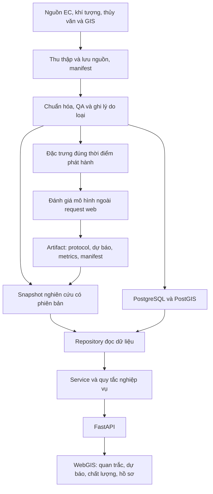

# Kiến trúc WebGIS và dự báo EC theo tháng

Ngày cập nhật: 23/10/2026. Phạm vi được chọn: **WebGIS kết hợp dự báo giá trị mẫu EC tháng kế tiếp tại từng trạm**. Tài liệu mô tả trách nhiệm các thành phần và nguyên tắc tích hợp; kết quả nghiệm thu cần đối chiếu với lần kiểm tra thực tế, không suy ra từ sơ đồ.

## 1. Sản phẩm và giới hạn dữ liệu

Ứng dụng giúp chọn trạm, xem EC theo thời gian, đối chiếu thực đo với dự báo hồi cứu, đọc sai số so với baseline và truy nguồn. EC giữ đơn vị mS/m. Một mẫu trong tháng không đại diện mặc nhiên cho trung bình hoặc cực đại cả tháng.

Bộ nghiên cứu hiện có 977 quan trắc: 927 MRC tại Mỹ Tho/Tân Châu và 50 RIA2 tại 10 điểm. Chuỗi MRC kết thúc năm 2023 và còn cờ nguồn chưa xác minh. Dữ liệu khí tượng đến 2026 không bổ sung nhãn EC thực đo sau 2023. Không quy đổi EC sang độ mặn khi chưa có phương pháp, cơ sở nhiệt độ, hiệu chuẩn và sai số phù hợp.

Phần công trình phục vụ xem hồ sơ và phần bằng chứng còn thiếu. Kết quả mô phỏng phải được nhận diện rõ. Khoảng cách từ trạm tới cống không chứng minh quan hệ thủy lực; dự báo tại trạm không tự trở thành dự báo tại cống. Ứng dụng không phát lệnh đóng/mở thiết bị.

## 2. Luồng dữ liệu

Mũi tên QA tới PostgreSQL thể hiện luồng nhập có kiểm soát, không phải cơ chế tự đồng bộ đang chạy. Tương tự, một thư mục kết quả mới chưa tự trở thành phiên bản đang phục vụ. Cần bước tiếp nhận và kiểm tra hợp đồng dữ liệu trước khi đưa artifact vào ứng dụng.

## 3. Trách nhiệm các lớp

| Thành phần | Trách nhiệm | Ranh giới |
| --- | --- | --- |
| `backend/main.py` | Tạo ứng dụng, middleware và đăng ký router | Không huấn luyện mô hình |
| `backend/api/` | Route HTTP, kiểm tra đầu vào và mã lỗi | Không chứa trực tiếp toàn bộ SQL hoặc quy tắc đánh giá |
| `backend/services/` | Điều phối ca sử dụng, chuẩn bị kết quả cho API | Không coi khai báo người dùng là chứng từ đã thẩm định |
| `backend/repositories/` | Đọc snapshot, kết quả tệp hoặc dữ liệu DB theo chế độ | Không chuyển nguồn âm thầm khi DB lỗi |
| `backend/domain/` | Quy tắc nghiệp vụ và trạng thái hồ sơ | Không phụ thuộc giao diện trình duyệt |
| `backend/research.py` | Lớp tương thích cho import/router nghiên cứu cũ trong quá trình chuyển đổi | Mã nghiệp vụ mới thuộc các lớp chuyên trách |
| `frontend/` | Trang ứng dụng, bản đồ, bộ lọc, bảng, biểu đồ và điều hướng | Không tự tạo bằng chứng xác minh hoặc quan trắc |
| `scripts/`, `pipelines/`, `etl/`, các runner khoa học | Thu thập, chuẩn hóa, QA và đánh giá ngoài web | Không chạy huấn luyện theo mỗi thao tác chọn trạm |
| `data/raw/`, `data/external/` | Nguồn gốc, hồ sơ tải và tiếp nhận | Bảo toàn nội dung và provenance |
| `data/research/`, `runs/`, `outputs/` | Snapshot và kết quả có phiên bản | Phân biệt artifact đang phục vụ với nghiên cứu chưa tích hợp |
| `sql/` | Schema, migration và kiểm toán dữ liệu | Thay đổi schema/nhập DB là bước riêng có kiểm soát |

Các module đã được tách trong đợt chuyển đổi:

- `backend/api/workspace.py`: adapter HTTP cho workspace.
- `backend/services/workspace.py`, `forecasts.py`, `gates.py`: ca sử dụng đọc dữ liệu, metadata/kiểm tra kết quả tháng và rà soát hồ sơ.
- `backend/repositories/workspace.py`: đọc tệp và PostgreSQL theo nguồn được chọn.
- `backend/domain/workspace.py`, `gates.py`: hợp đồng snapshot và bộ đánh giá cống độc lập HTTP.
- `backend/research.py`: facade tương thích xuất router, `validate_bundle` và `load_bundle`; `run_gate_advisor.py` là wrapper CLI của bộ đánh giá domain.

Đây là mô tả cấu trúc mã; kết quả chạy cần được kiểm tra riêng. Các thành phần lịch sử chưa thuộc phạm vi tách vẫn giữ adapter hiện có.

## 4. Điều hướng theo công việc

Trang chính của đợt chuyển đổi là `frontend/workspace.html`. Điều hướng hash tổ chức theo công việc:

| Mục | Luồng chính |
| --- | --- |
| `#overview` | Hiểu phạm vi, dữ liệu đang có và chọn việc cần làm |
| `#observations` | Chọn trạm, thời gian, xem bản đồ/bảng/biểu đồ và xuất dữ liệu |
| `#forecasts` | Chọn thí nghiệm tháng, xem thực đo–dự báo, baseline và sai số |
| `#data-quality` | Đọc nguồn, cờ chất lượng, độ phủ và giới hạn dữ liệu |
| `#gates` | Xem hồ sơ công trình và bằng chứng cần bổ sung |

`frontend/src/app/workspace.js` khởi tạo ứng dụng; `app/navigation.js` quản lý điều hướng. Các feature nằm trong `frontend/src/features/`: `observations.js`, `forecasts.js`, `weather-estimates.js`, `gate-dossiers.js` và `overview.js`. Lớp gọi API dùng `frontend/src/shared/workspace-api.js`; tiện ích giao diện dùng `shared/ui.js`. Phần tiếp nhận `intake.js` được hiển thị trong mục chất lượng dữ liệu, vẫn tách khỏi quan trắc đã tiếp nhận.

Từ mục Quan trắc, nút xem kiểm chứng chuyển sang đúng thí nghiệm của trạm MRC đang chọn. Trạm RIA2 chưa có thí nghiệm tháng được thông báo rõ. Lựa chọn trạm và thí nghiệm được nhớ trong phiên trình duyệt; mỗi module hủy yêu cầu cũ khi thay đầu vào để tránh hiển thị kết quả trạm trước.

`frontend/index.html` tiếp tục phục vụ lịch sử PostgreSQL với lựa chọn dataset rõ ràng. `frontend/research.html` chuyển tới trang workspace và hỗ trợ hash cũ; `frontend/src/research.js` giữ import tương thích. Tên hiển thị theo nghiệp vụ; các tên API/adapter cũ không buộc giao diện phải lấy “research” làm trung tâm điều hướng.

Lịch sử PostgreSQL cũng đã tích hợp vào mục Quan trắc qua `features/database-history.js`. Bản đồ nằm ở `features/observations-map.js`; biểu đồ ở `shared/time-series.js`; ngưỡng tự nhập ở `shared/ec-scenario.js`; kiểu giao diện ở `app/workspace.css`. `features/next-forecast.js` đọc dự báo sau mẫu cuối đã lưu. `backend/domain/gate_simulation.py` tính kịch bản cống độc lập với trạng thái phê duyệt. Các entry point `research` chỉ giữ tương thích cho phần đã chuyển.

Nhánh dự báo đa biến chính dùng `backend/api/multivariate.py` → `services/multivariate.py` → `domain/multivariate_ec.py`; khí tượng do `repositories/multivariate_inputs.py` cung cấp. `scripts/update_multivariate_weather.py` cập nhật nguồn ERA5 có đơn vị; `scripts/train_multivariate_ec.py` đánh giá và lưu model ngoài request. `features/multivariate-forecast.js` gọi suy luận và gửi kết quả sang lớp dự báo riêng trên bản đồ. Phần đánh giá mô hình EC trễ cũ được thu gọn để tham khảo; CSV dùng khí tượng cùng tháng nằm trong mục chất lượng dữ liệu.

## 5. Phân biệt các sản phẩm mô hình

| Sản phẩm | Đầu vào và ý nghĩa | Cách trình bày |
| --- | --- | --- |
| Dự báo mẫu EC tháng kế tiếp | Chỉ dùng thông tin được coi là đã có trước tháng mục tiêu; giả định độ trễ phải công bố | Kèm thời điểm phát hành, horizon, protocol, baseline, metrics và tập tháng đánh giá |
| Ước tính EC từ khí tượng cùng tháng | Dùng khí tượng thực tế của tháng cần ước tính, hiện có chuỗi 2024–2026 | Ước tính lịch sử tại giai đoạn thiếu EC; không gọi là dự báo trước một tháng hoặc số đo thực tế |
| Nghiên cứu feature 19/10 | Thử thêm nhóm biến, so sánh trên cùng tập tháng theo protocol riêng | Kết quả nghiên cứu chưa tự thay thế bộ đang phục vụ; không dùng chéo MAE giữa các tập nhãn |

Nghiên cứu mới giữ các nhãn nguồn hữu hạn, không âm; bản feature v2 cũ đã loại 117 mẫu MRC qua QA. Vì tập nhãn và protocol khác nhau, chỉ so sánh mô hình sau khi xác định cùng cohort. Cấu hình chọn bằng validation không đồng nghĩa sẵn sàng triển khai. Mô hình phức tạp không thắng baseline vẫn là kết quả cần hiển thị trung thực.

## 6. Nguồn dữ liệu và trạng thái lỗi

- Chế độ snapshot đọc dữ liệu nghiên cứu có manifest/checksum. Tệp thiếu hoặc checksum không khớp phải báo lỗi có hướng xử lý.
- Chế độ postgres đọc trạm và EC từ schema public, chọn một phiên bản RAW_EC mỗi trạm; thí nghiệm và danh mục tài liệu giữ nguồn tệp riêng. Lỗi DB phải được báo rõ, không tự chuyển sang snapshot.
- Trang lịch sử DB luôn đọc PostgreSQL; trạng thái ứng dụng chạy không đồng nghĩa DB kết nối được.
- Kết quả ước tính 2024–2026 hiện có nguồn tệp riêng; huy hiệu chế độ DB không được diễn giải thành mọi khối đều đọc DB.
- Hồ sơ tiếp nhận chưa xác minh giữ riêng, không nhập ngầm vào quan trắc hoặc nhãn huấn luyện.
- Không dữ liệu, dữ liệu cũ và dữ liệu chưa xác minh là các trạng thái riêng; không thay bằng giá trị 0 hay mẫu giả.

## 7. Chuyển đổi tương thích và bảo toàn bằng chứng

API workspace dùng tiền tố `/api/v1/workspace`; `/api/v1/research` là alias tương thích. Nhánh ước tính khí tượng dùng `/monthly-estimates`; `/future-forecast` còn là alias cho client cũ. CSV có đường dẫn `/monthly-estimates/export?station=...` dưới tiền tố workspace. API lịch sử `/api/v1/stations` vẫn riêng cho PostgreSQL.

Giữ đường dẫn/API cũ cần thiết trong giai đoạn chuyển đổi, chuyển nghiệp vụ sang module chuyên trách và cập nhật runner/build để trang chính mới được phục vụ. Chỉ đổi bố cục hoặc tên module không được làm đổi giá trị nguồn, tập thí nghiệm, đơn vị hoặc ý nghĩa cờ chất lượng.

Các thư mục chưa được Git theo dõi và script nghiên cứu mới không được coi là tệp rác chỉ vì chưa commit. Khi chủ động di chuyển artifact, cần giữ ánh xạ đường dẫn, checksum và cập nhật các tham chiếu liên quan. Các thao tác xóa do người dùng xác nhận trong đợt này được giữ nguyên. Thư mục kết quả feature 19/10 hiện không còn trong checkout; tài liệu về nghiên cứu đó là hồ sơ lịch sử, không phải artifact đã được ứng dụng nạp.

Tham khảo: [kế hoạch triển khai](implementation-plan.md), [báo cáo kiến trúc 18/10](reports/20261018_kien_truc_du_lieu_va_dinh_huong_webgis.md), [hướng dẫn kết quả 21/10](reports/20261021_huong_dan_file_va_cau_hoi_giang_vien.md), [bàn giao 16/10](handover.md).
