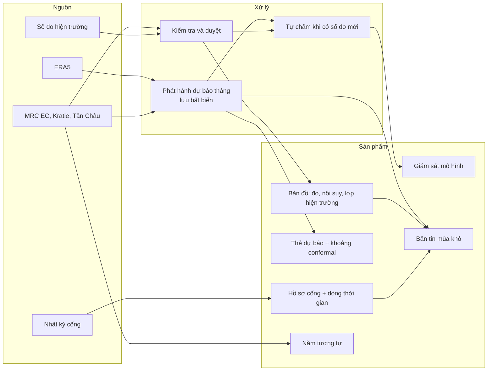

# Đề xuất mở rộng chức năng WebGIS EC Đồng Tháp

Ngày 12/11/2026. Đề xuất, chưa triển khai. Dựa trên mã hiện tại (`frontend/workspace.html`, `multivariate-forecast.js`, `backend/api/*.py`) và các kết quả trong [huong_phat_trien_webgis_2026-11-12.md](huong_phat_trien_webgis_2026-11-12.md). Không tính năng nào phát lệnh đóng/mở cống.

## 1. Đặt dải conformal ở đâu

**Không nên đặt dải conformal vào tab Quan trắc.** Tab này (bản đồ sông, timeline, bảng số đo) đang trình bày **số đo và nội suy từ số đo**; giao diện đã mất công tách trạm MRC, RIA2, chấm cống và đoạn sau cống. Thêm một dải bất định của **dự báo** vào cùng bản đồ/biểu đồ sẽ làm lẫn ba loại số: đo, nội suy, dự báo.

**Nên đặt ở ba chỗ, mỗi chỗ một vai trò:**

| Vị trí | Hiển thị | Không hiển thị |
|---|---|---|
| Thẻ kết quả trong tab **Dự báo EC đa biến** | Dự báo điểm + khoảng conformal theo mùa, kèm dòng "phủ 16/18 tháng mùa khô 2019–2021, trượt 02–03/2020" | Không đặt song song với P10–P90 giữa các cây ở cùng cấp; chuyển P10–P90 vào phần "Chi tiết kỹ thuật" để người xem không phải chọn giữa hai khoảng |
| Biểu đồ trạm (khi đã có dự báo) | Dải mờ **chỉ ở đoạn sau mẫu đo cuối**, khác màu với chuỗi đo | Không vẽ dải đè lên các tháng đã có số đo |
| Phiếu trạm trên bản đồ khi bật lớp dự báo | Một dòng chữ: "Dự báo 201 mS/m; khoảng thống kê đến 683" | **Không tô màu sông hay cống theo cận trên.** Cận trên là giới hạn bất định, không phải giá trị mô hình dự báo |

Cận trên 889 mS/m của 04/2020 là biên của khoảng, không phải mô hình "đoán EC là 889"; giao diện phải dùng chữ "khoảng thống kê", không dùng "EC tối đa" hay "dự báo cao nhất".

## 2. Vì sao đồ án đang có cảm giác đơn giản

Ứng dụng hiện phục vụ **một vai trò** (người chủ động tìm hiểu) với **một luồng chính**: chọn trạm/tháng → xem EC đo, nội suy và dự báo. Dữ liệu chỉ chảy một chiều từ nguồn vào màn hình. Ba hướng làm ứng dụng sâu hơn mà vẫn giữ tính trung thực khoa học:

1. **Thêm vai trò**: người dân/nông hộ, cán bộ thủy lợi vận hành cống, người nghiên cứu, quản trị dữ liệu. Mỗi vai trò có việc riêng cần làm.
2. **Cho dữ liệu chảy hai chiều**: người dùng ghi số đo, nhật ký cống; hệ thống lưu dự báo đã phát hành và tự chấm khi có số đo mới.
3. **Biến dự báo thành sản phẩm**: bản tin mùa khô, so sánh năm tương tự, cảnh báo theo thửa ruộng.

Ưu điểm: các chức năng này **tạo ra chính dữ liệu dự án đang thiếu** (số đo mới, trạng thái cống, dự báo lưu đúng ngày phát hành).

## 3. Chức năng đề xuất và luồng hoạt động

### 3.1 Lưu trữ dự báo đã phát hành và tự chấm (ưu tiên cao)

**Mục đích:** có bằng chứng kiểm định thật theo thời gian, thay vì chỉ hồi cứu. Giải quyết trực tiếp vấn đề "chưa có kiểm định độc lập".

**Luồng:**
1. Hằng tháng, ngày phát hành (ví dụ ngày 6), hệ thống chạy dự báo cho tháng tới tại ba trạm.
2. Lưu **bản ghi bất biến**: tháng mục tiêu, ngày giờ phát hành, phiên bản model + hash, đầu vào đã dùng (tháng nguồn, hash tệp), dự báo, khoảng conformal.
3. Khi có số đo EC mới (nạp tay hoặc từ MRC), hệ thống khớp với dự báo **đã lưu trước đó**, không chạy lại.
4. Trang "Giám sát mô hình" cập nhật: sai số từng tháng, MAE/RMSE luỹ kế, độ phủ khoảng thực tế, tháng trượt, báo cao giả.
5. Khi số tháng đủ và tiêu chí khóa trước đạt/không đạt, hiển thị trạng thái rõ.

**Dữ liệu cần:** bảng `forecast_issue` (bất biến, chỉ thêm), `forecast_score`. Cấm sửa dự báo sau khi lưu.
**Liên quan mã:** `prediction-history.js`, `backend/api/multivariate.py` (`/predict`), `backend/repositories/dss_storage.py`.

### 3.2 Nhập số đo hiện trường có kiểm duyệt (ưu tiên cao)

**Mục đích:** thu EC/độ mặn mới ở điểm cần quan tâm (cống, ruộng) khi nguồn chính thức không cấp.

**Luồng:**
1. Người dùng (cán bộ, hợp tác xã, sinh viên) mở form trên điện thoại: vị trí GPS hoặc chọn cống, ngày giờ, EC thô, nhiệt độ nước, đơn vị, máy đo, ảnh màn hình máy đo, ghi chú (đỉnh triều/ngoài giờ).
2. Hệ thống kiểm tự động: đơn vị hợp lệ, giá trị trong khoảng vật lý, ngày giờ không ở tương lai, vị trí trong vùng nghiên cứu.
3. Bản ghi vào **hàng chờ** với trạng thái `chờ duyệt`.
4. Người duyệt (vai trò quản trị) xem ảnh, đối chiếu điểm lân cận; chọn `chấp nhận` / `từ chối` / `cần bổ sung`, ghi lý do.
5. Bản ghi được chấp nhận hiện trên bản đồ như **lớp riêng "đo hiện trường"** (ký hiệu khác MRC/RIA2), kèm người đo và trạng thái QA. Không trộn vào chuỗi MRC, không làm nhãn huấn luyện mặc định.
6. Nếu một điểm có đủ chuỗi, dùng làm điểm giữ lại để kiểm định nội suy (mục 2 của tài liệu hướng phát triển).

**Lưu ý:** cần cơ chế đăng nhập tối thiểu và phân quyền; không công khai thông tin cá nhân người đo.

### 3.3 Nhật ký vận hành cống (ưu tiên trung bình)

**Mục đích:** hoàn thiện phần B của hồ sơ cống và tích lũy dữ liệu trạng thái cống, điều kiện cần để sau này mô phỏng EC trong kênh.

**Luồng:**
1. Cán bộ chọn cống trên bản đồ hoặc trong tab Hồ sơ cống.
2. Ghi sự kiện: thời điểm, trạng thái (mở/đóng/lấy nước gạn), EC hoặc độ mặn đo hai phía nếu có, mực nước hai phía, tình trạng cơ khí, người ghi.
3. Hệ thống đặt sự kiện cạnh dự báo xu thế (phần A) và kết quả rà soát điều kiện (phần B) của cùng ngày.
4. Dòng thời gian của cống: trạng thái theo ngày, EC đo hai phía, dự báo tháng.
5. Xuất CSV/PDF cho báo cáo mùa.

**Ranh giới:** ứng dụng **ghi lại** quyết định của con người; không đề xuất giờ đóng/mở. Có thể mở rộng từ `gate-drafts` hiện có (`backend/api/dss_storage.py`).

### 3.4 Bản tin mùa khô tự động (ưu tiên trung bình)

**Mục đích:** một sản phẩm đọc được cho người dân và cán bộ, thay vì phải tự thao tác bản đồ.

**Luồng:**
1. Đầu mùa khô (tháng 11–12) và mỗi tháng sau đó, hệ thống tổng hợp: dự báo ba trạm tháng tới + khoảng; Kratie so với trung vị cùng tháng các năm trước; số đo mới nhất (MRC, hiện trường đã duyệt); trạng thái các cống đã ghi.
2. Sinh trang HTML/PDF theo mẫu cố định, ngôn ngữ đơn giản, ghi rõ phần nào là đo, nội suy, dự báo, và giới hạn mô hình.
3. Cán bộ xem trước, sửa phần nhận định chữ, rồi phát hành; bản đã phát hành được lưu bất biến cùng ngày giờ.

### 3.5 So sánh năm tương tự (ưu tiên trung bình, dễ làm)

**Mục đích:** giải thích dễ hiểu và có cơ sở: "năm nay dòng chảy thượng nguồn giống năm nào, năm đó Mỹ Tho mặn ra sao".

**Luồng:**
1. Người dùng chọn tháng phát hành.
2. Hệ thống tính các chỉ số đã có tại ngày đó (thiếu hụt Kratie từ tháng 11, mùa lũ trước, ONI) và tìm 3–5 năm lịch sử gần nhất theo các chỉ số này.
3. Hiển thị EC Mỹ Tho thực đo các tháng II–V của những năm đó, kèm khoảng cách tương đồng.
4. Ghi rõ: "năm tương tự là bối cảnh, không phải dự báo"; khoảng cách không chứng minh kết quả sẽ lặp lại.

### 3.6 Kịch bản "nếu – thì" cho đầu vào thủy văn (ưu tiên thấp)

**Mục đích:** cho người nghiên cứu xem mô hình nhạy với lưu lượng thượng nguồn thế nào.

**Luồng:** chọn tháng → kéo thanh "Q Kratie thay đổi −30%…+30%" → xem dự báo thay đổi. Nhãn: "phân tích độ nhạy của mô hình, không phải dự báo kịch bản thủy lực". Không đưa kết quả lên bản đồ màu.

### 3.7 Theo dõi thửa ruộng/điểm quan tâm (ưu tiên thấp, cần hạ tầng)

**Luồng:** người dân đánh dấu điểm hoặc chọn cống gần nhà, chọn cây trồng (dùng cặp mốc đã có: sầu riêng, cây có múi, lúa) → trang tóm tắt cá nhân: số đo gần nhất gần điểm, dự báo trạm gần nhất, bản tin mới. Thông báo qua email/Zalo cần dịch vụ ngoài và chính sách dữ liệu cá nhân; chỉ làm sau 3.1–3.4.

### 3.8 Quản trị nạp dữ liệu nguồn (hỗ trợ các chức năng trên)

**Luồng:** quản trị tải CSV nguồn (MRC, bản tin) → hệ thống kiểm đơn vị, trùng lặp, SHA-256, khoảng thời gian → **xem trước** thay đổi → xác nhận nạp → ghi manifest. Áp dụng quy tắc dự án: raw bất biến, nạp vào lớp xử lý riêng, lỗi DB không tự chuyển sang snapshot.

## 4. Sơ đồ tổng thể sau mở rộng

## 5. Thứ tự đề xuất cho đồ án

| Giai đoạn | Chức năng | Lý do |
|---|---|---|
| 1 | 3.1 Lưu trữ dự báo và tự chấm; dải conformal trong thẻ dự báo | Trả lời câu hỏi lớn nhất của hội đồng: mô hình đúng đến đâu theo thời gian thực |
| 2 | 3.2 Nhập số đo hiện trường; 3.8 nạp dữ liệu | Tạo nguồn dữ liệu mới, có quy trình QA rõ |
| 3 | 3.3 Nhật ký cống; 3.5 Năm tương tự | Mở rộng vai trò cán bộ; chức năng giải thích dễ làm với dữ liệu sẵn có |
| 4 | 3.4 Bản tin; 3.6 Nếu – thì; 3.7 Theo dõi điểm | Sản phẩm hoàn thiện, cần các giai đoạn trước |

Mỗi chức năng cần test riêng (đơn vị, quyền ghi, bất biến của bản ghi phát hành, không trộn lớp dữ liệu) trước khi đưa lên trang.
