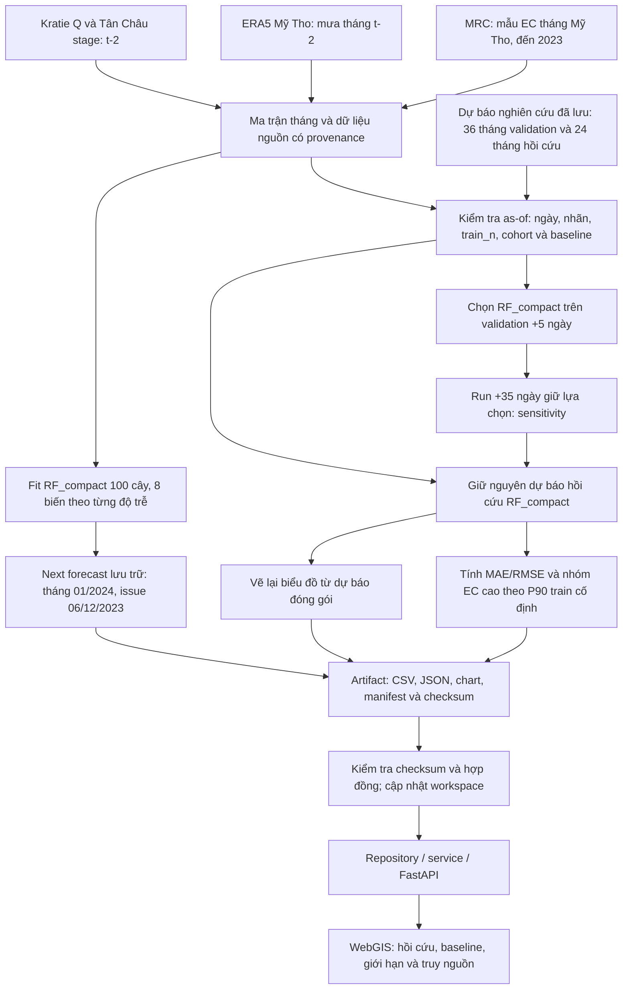
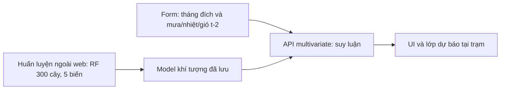

# Quy trình nghiên cứu và tích hợp RF_compact

Cập nhật 01/11/2026 theo mã đóng gói hiện tại. Sơ đồ mô tả luồng dữ liệu, không phải bằng chứng đã chạy thành công DB, trình duyệt hoặc một lần kiểm thử mới.

Ngày phát hành giả định là ngày 06 tháng trước tháng đích. Nhãn EC được coi là có sau cuối tháng +5 hoặc +35 ngày; khí tượng/thủy văn tháng `t−2` giả định có sau cuối tháng +5 ngày. Không có đầy đủ lịch sử phiên bản và ngày công bố thật để xác nhận tính khả dụng lịch sử ngoài các giả định này. Metadata phân biệt tuổi nguồn mới nhất với tuổi nhãn EC; baseline dùng nguồn EC riêng.

P90 trong artifact được tính từ các nhãn có sẵn tại lần phát hành validation đầu tiên và giữ cố định trong đánh giá. Nó khác nhóm EC ≥ 100 mS/m trong báo cáo nghiên cứu và khác nhóm mùa khô. Giai đoạn 2022–2023 đã từng được xem, không phải kiểm định mù. Next forecast tháng 01/2024 được tính thật từ mô hình, nhưng là dự báo nghiên cứu sau nhãn cuối, không phải dự báo cho hôm nay.

## Luồng suy luận trực tiếp riêng

Năm biến gồm hai biến mùa và ba biến khí tượng. Cập nhật thí nghiệm RF_compact không thay thế model của form này, không chuyển metric giữa hai model và không đưa huấn luyện vào request web.

## Bản đồ và cống

`riverRibbon()` chia hình học theo tỷ lệ khoảng cách địa lý tích lũy, giữ các đỉnh trung gian và nội suy EC tại trung điểm từng phần. Sửa này tránh lệch phân bố màu khi tọa độ nguồn có mật độ đỉnh không đều; đây vẫn là biểu diễn mô phỏng. Không có bước mặc nhiên biến dự báo trạm thành EC đo tại cống qua IDW, và không phát lệnh thiết bị từ dải màu. Hồ sơ cống và mô phỏng kịch bản tiếp tục cần đầu vào, giả định và bằng chứng riêng.

Nguồn DAHITI, GloFAS hoặc UHSLC có thể thuộc những nghiên cứu khác; chúng không phải đầu vào trực tiếp của RF_compact tám biến được mô tả ở đây.

Tham khảo [kiến trúc](../architecture.md), [luồng người dùng](../user-flow.md), [báo cáo RF_compact](../mo_hinh_rf_compact_chinh_thuc_2026-10-30.md) và [cập nhật logic, tiến trình 01/11/2026](../cap_nhat_logic_va_tien_trinh_2026-11-01.md).
