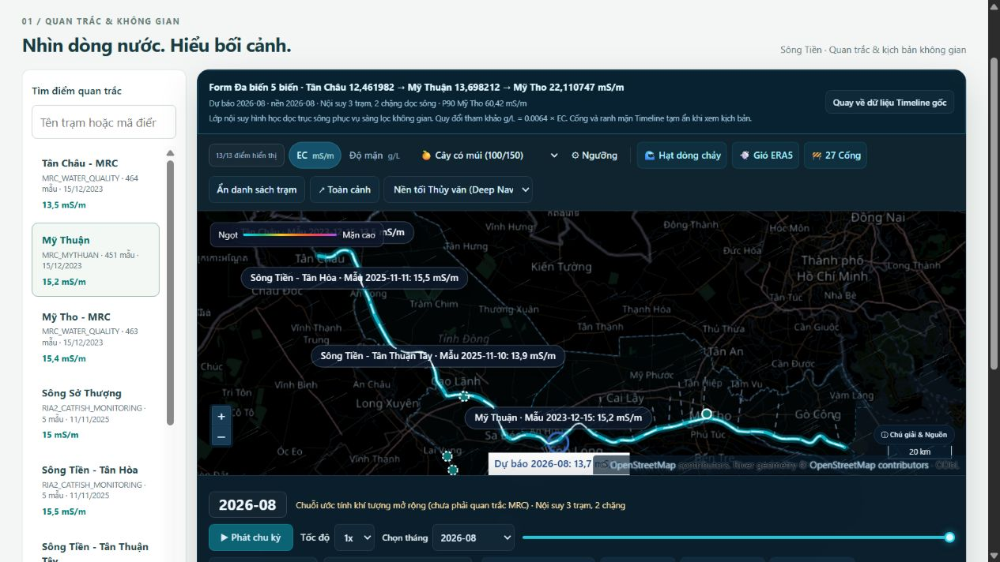
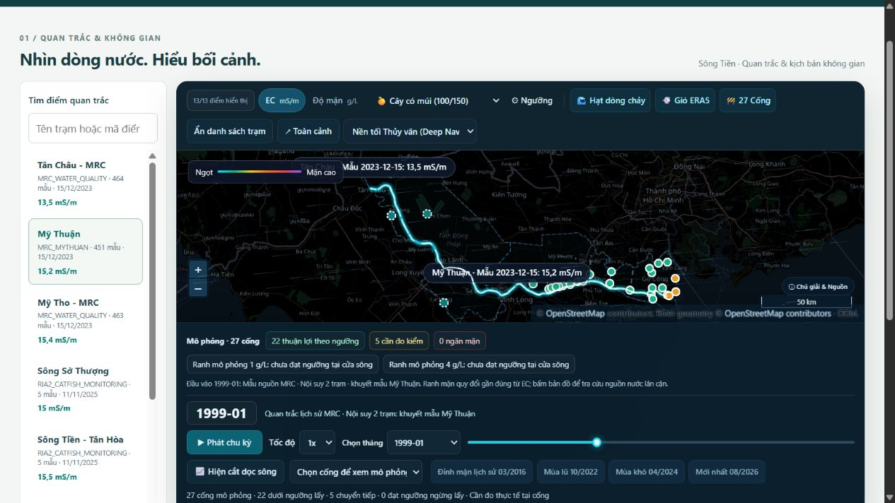

# Bước 3 — Mỹ Thuận và nội suy hai chặng trên WebGIS

Triển khai ngày 04/11/2026, tiếp nối [kiểm chứng Bước 1–2](kiem_chung_mythuan_ba_tram_2026-11-04.md).

## Dữ liệu và mô hình phục vụ

| Thành phần | Sau tích hợp |
|---|---|
| Mã trạm | `MYTHUAN` / `MyThuan` / `MRC_VN_019804` |
| Tọa độ nguồn WGS84 | `[105.9263229, 10.27532005]` |
| Vị trí chiếu dọc tuyến | `85.217605 km`, tỷ lệ `0.68174084` giữa Tân Châu và Mỹ Tho |
| Nhãn EC | 451 mẫu tháng, 05/1985–12/2023; `mS/m` |
| Chất lượng và nhiệt độ | Giữ `quality_flag=UNVERIFIED`, `ec_temperature_basis=UNKNOWN` trong dữ liệu chuẩn; không nâng thành số đo đã kiểm định |
| Thời gian mẫu | Chỉ xác nhận ngày; `observed_at=null`, `time_precision=DATE_ONLY`; timestamp nguồn được giữ riêng |
| Model | `20261104T_MYTHUAN_3STATION`, sao chép đúng artifact `outputs/mythuan_three_station_20261104/mythuan_model.joblib` |
| Đặc trưng | RF 300 cây, khí tượng tháng t−2 + sin/cos tháng mục tiêu, 5 biến |
| Khí tượng Mỹ Thuận | `data/external/mythuan_weather_20261104/`, kiểm tra manifest/hash/đơn vị |
| Chuỗi mở rộng | 32 tháng hợp lệ 01/2024–08/2026, 96 dòng = 3 trạm × 32 tháng |
| Snapshot nghiên cứu | 13 điểm, 1.428 quan trắc; trong đó 1.378 mẫu MRC của ba trạm |

Các giá trị lưu trữ của hai trạm cũ được giữ; Mỹ Thuận dùng model đã đăng ký và khí tượng t−2. Các ước tính 2024–2026 chưa có nhãn EC cùng kỳ để tính sai số thực tế. Tích hợp không tự tạo thêm các tháng ngoài nguồn hiện có. Form suy luận có thể chạy tháng khác khi có đủ khí tượng t−2 đã khả dụng.

`scripts/integrate_mythuan.py` đóng gói CSV, workspace, manifests, registry và chuỗi mở rộng. Các byte đầu vào cũ dùng cho Bước 1–2 được lưu tại `outputs/mythuan_three_station_20261104/source_snapshots/`; kết quả đánh giá và manifest nghiên cứu gốc được giữ để đối chiếu hash.

PostgreSQL đã được bổ sung một nguồn, một dataset, một điểm và 451 quan trắc RAW_EC. Kiểm tra lại script đồng bộ trả `changes={}`; fingerprint 1.017 quan trắc ngoài Mỹ Thuận giữ nguyên. Timestamp nửa đêm trong cột DB chỉ là chỗ lưu ngày; metadata và API workspace công bố `DATE_ONLY`.

## API

Cả `/api/v1/workspace/multivariate/` và `/api/v1/multivariate/` hỗ trợ `catalog`, `inputs`, `predict`, `evaluation`, `history` cho ba trạm. Hai tiền tố dùng chung chính sách bảo vệ ghi lịch sử. Khởi động nạp trước cả ba model, request vẫn kiểm tra hash từng artifact.

Đánh giá Mỹ Thuận trên API đọc bảng rolling-origin đã kiểm chứng, không chấm lại bằng model cuối cùng đã học các nhãn này:

| Mô hình, 24 tháng 2022–2023 | MAE (mS/m) | RMSE (mS/m) |
|---|---:|---:|
| Random Forest Mỹ Thuận | 3.917425 | 4.856469 |
| Persistence | 4.806250 | 5.772399 |
| MonthlyClimatology | 3.956993 | 4.720397 |

## Công thức không gian

Với `r = chainage_km / 125` và `r_mt=0.68174084`:

- `0 ≤ r ≤ r_mt`: `EC = TC + (MT − TC) × r / r_mt`.
- `r_mt < r ≤ 1`: `EC = MT + (MTho − MT) × (r − r_mt) / (1 − r_mt)`.

Đây là nội suy tuyến tính giữa hai điểm neo kề nhau. Nó giữ đúng EC tại cả ba điểm và cho phép EC trung lưu cao hơn hoặc thấp hơn cả hai đầu. Backend và frontend dùng cùng hằng số vị trí Mỹ Thuận.

| Trường hợp | `interpolation_mode` | Xử lý |
|---|---|---|
| Đủ ba điểm neo | `PIECEWISE_3_STATION` | Hai chặng qua Mỹ Thuận |
| Tháng lịch sử thiếu mẫu Mỹ Thuận | `TWO_STATION_FALLBACK_MISSING_MYTHUAN` | Tuyến tính Tân Châu → Mỹ Tho; kèm `interpolation_fallback_reason` |
| Thiếu dự báo Mỹ Thuận từ 2024 | Không có frame hợp lệ | API báo dữ liệu không khả dụng; frontend từ chối lớp phủ thiếu điểm neo |

13 tháng thiếu là **01–12/1999 và 12/2001**. Không bù thời gian hoặc gán giá trị giả cho Mỹ Thuận. Timeline giữ 495 tháng 06/1985–08/2026; mẫu Mỹ Thuận 05/1985 vẫn nằm trong lịch sử trạm, ngoài đầu timeline do Mỹ Tho bắt đầu từ 06/1985.

Backend vẫn có 35 đoạn 5 km. Đoạn km85–90 có thêm `ec_stops` tại Mỹ Thuận. `riverRibbon` cắt đúng điểm này (thường thành 281 lát hiển thị) và biểu đồ cắt dọc giữ điểm gãy. Giá trị EC tại cống được tính từ cùng hàm nội suy theo lý trình chiếu. Tọa độ điểm quan trắc nguồn và vị trí chiếu trên trục sông được giữ riêng.

Phần sau Mỹ Tho đến km175 vẫn là đoạn kịch bản cửa sông hiện hữu của backend; Cửa Tiểu là điều kiện biên giả định, không phải trạm quan trắc thứ tư. Lớp phủ dự báo trực tiếp giữ EC Mỹ Tho sau km125 như hợp đồng trước đó.

## Giao diện và engine cống

- Danh sách quan trắc và form đa biến có Mỹ Thuận; bản đồ đọc tọa độ từ dữ liệu trạm.
- Áp dụng dự báo trực tiếp từ bất kỳ trạm nào gọi thêm hai model còn lại cùng tháng/kịch bản, không tự lưu hai lượt bổ sung.
- Luồng RF_compact giữ dự báo Mỹ Tho của thí nghiệm, lấy Tân Châu và Mỹ Thuận từ model đa biến 5 biến cho đúng tháng; không mượn EC của tháng nền bị kẹp.
- Banner hiển thị `Tân Châu EC → Mỹ Thuận EC → Mỹ Tho EC`, tháng, nguồn và phương pháp hai chặng. Timeline ghi rõ chế độ 3/2 trạm.
- Phần A của engine giai đoạn 2 nhận EC tại vị trí chiếu của cống từ công thức mới. Ngưỡng cảnh giác cao có thể siết thời hạn phiếu đo từ 6 xuống 2 giờ; EC mô phỏng không tự điền vào số đo hiện trường ở Phần B.

## Kiểm tra và tái tạo

```powershell
.venv\Scripts\python.exe scripts/integrate_mythuan.py
.venv\Scripts\python.exe scripts/sync_mythuan_to_postgres.py
# Chỉ khi cần bổ sung vào một DB chưa có Mỹ Thuận:
.venv\Scripts\python.exe scripts/sync_mythuan_to_postgres.py --apply
.venv\Scripts\python.exe -m unittest discover -s tests
node --test
npm --prefix frontend run build
git diff --check
```

Kiểm thử bao gồm giá trị đúng tại ba neo, tỷ lệ cục bộ hai chặng, tính liên tục và đỉnh EC trung lưu, 13 tháng khuyết, từ chối thiếu dự báo, điểm gãy của ribbon/cắt dọc, EC chiếu vào engine cống và API ba trạm ở cả hai tiền tố. Xem kết quả chạy thực tế trong phần xác nhận ở cuối tài liệu.

Giới hạn: dữ liệu nguồn vẫn chưa được kiểm định độc lập; nội suy hình học chưa mô tả vận chuyển mặn hoặc xác minh kết nối thủy lực từng nhánh/cống. Kết quả dùng để xem xét kỹ thuật, không phát lệnh điều khiển công trình.

## Xác nhận hoàn tất

| Kiểm tra thực chạy | Kết quả |
|---|---|
| `python -m unittest discover -s tests` | 91 bài: 90 đạt, 1 bỏ qua do thiếu thư viện tùy chọn `paramiko` |
| `node --test` | 144/144 đạt |
| `npm --prefix frontend run build` | Thành công, 253 module |
| `git diff --check` | Thành công |
| API PostgreSQL tại `127.0.0.1:8000` | HTTP 200: catalog, history, stations, 451 quan trắc Mỹ Thuận, frame lịch sử khuyết/đủ và frame dự báo |
| Giao diện | Có trạm Mỹ Thuận trong danh sách và form; dự báo 08/2026 chạy thành công; banner đủ ba giá trị; 01/1999 ghi fallback; console không có lỗi/cảnh báo trong lượt kiểm tra |

Ví dụ kiểm tra giao diện tháng **08/2026** từ model trực tiếp: Tân Châu **12.461982**, Mỹ Thuận **13.698212**, Mỹ Tho **22.110747 mS/m**. Cống Cái Lá ở lý trình chiếu **97.518211 km** nhận khoảng **16.299 mS/m** từ chặng Mỹ Thuận → Mỹ Tho; các ô số đo hiện trường vẫn trống.

Bằng chứng được lưu ở `outputs/mythuan_integration_20261104/`: log kiểm thử/build, bản tổng hợp kiểm tra và ba ảnh giao diện.




