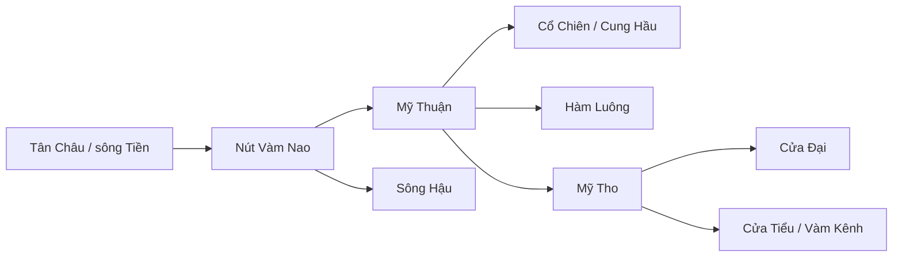

# Thu thập quan trắc bổ sung dọc sông Tiền — 29/10/2026

## Phạm vi và nguồn

Mục tiêu hiện tại là dự báo **EC tháng tại Mỹ Tho** theo ngày phát hành 06 của tháng trước. EC (mS/m), nồng độ chloride Cl⁻ (mg/L), độ mặn (g/L hoặc PSU) và lưu lượng (m³/s) là các đại lượng khác nhau; không đổi trực tiếp từ EC sang Cl⁻/độ mặn nếu không có hiệu chuẩn theo thành phần ion, nhiệt độ và phương pháp đo.

Nguồn tải: [MRC Time Series Portal](https://portal.mrcmekong.org/time-series) qua inventory và `timeSeriesCorrectedData` công khai. Các gói trong `data/external/` giữ nguyên phản hồi JSON, CSV đã chuẩn hóa, giờ địa phương UTC+7, mã trạm, đơn vị, cờ chất lượng, URL và SHA-256 trong `manifest.json`. Bảng kiểm toàn bộ ở `outputs/tien_multisite_audit_20261029/series_coverage.csv`. **28 chuỗi; toàn bộ checksum, số dòng và tính duy nhất của thời điểm đo đều đạt.** Cờ MRC của những chuỗi tải được là `UNVERIFIED`; không có lịch sử ngày công bố từng mẫu. Không lấp khoảng trống, không xóa đỉnh EC, không ghép mực nước thủ công với tự động bằng giả định cùng mốc cao độ. Xem [báo cáo hiệu chỉnh thủy văn](ec_hydrology_recalibration_2026-10-29.md) cho thí nghiệm bổ sung sau lần kiểm kê đầu.

| Đại lượng và trạm | Chuỗi tải được | Độ phủ hữu ích |
|---|---:|---|
| EC Mỹ Thuận | 451 mẫu, 1985–2023 | 60/60 tháng của 2019–2023; một mẫu/tháng |
| EC Tứ Thường | 222 mẫu, 2004–2023 | 60/60 tháng của 2019–2023; một mẫu/tháng |
| EC Hồng Ngự và Phong Mỹ | 83 mẫu mỗi trạm | Chỉ 1986–2003, không chồng với kỳ chấm gần đây |
| Mực nước tự động Tân Châu | 174.521 bản ghi 2019–2023; thêm 100.115 bản ghi 2024–2026 | 1.825 ngày 2019–2023 có quan trắc, 1.811 ngày có ≥80 mẫu |
| Mực nước tự động Mỹ Thuận | 107.452 bản ghi 2019–2023; thêm 100.091 bản ghi 2024–2026 | 1.160 ngày có quan trắc, 1.097 ngày có ≥80 mẫu |
| Mực nước tự động Vàm Kênh, gần cửa Tiểu | 91.722 bản ghi 2019–2023; thêm 92.447 bản ghi 2024–2026 | 1.004 ngày có quan trắc, 929 ngày có ≥80 mẫu |
| Mực nước tự động Vàm Nao, phân lưu Tiền–Hậu | 190.252 bản ghi 2019–09/2026 | 1.118 ngày có quan trắc trong 2019–2023, 1.047 ngày có ≥80 mẫu |
| Mực nước thủ công Mỹ Thuận, Vàm Kênh, Vàm Nao | 2008–2023, ba chuỗi | 1.819, 1.785, 1.819 ngày có quan trắc tương ứng trong 2019–2023 |
| Mực nước thủ công Mỹ Tho | 9.863 bản ghi 1985–2012 | Không chồng với giai đoạn chấm 2019–2023 |
| Lưu lượng tính toán ngày Kratie, Campuchia | 22.161 bản ghi 1985–28/10/2026, đơn vị m³/s | 60/60 tháng 2019–2023; đây là biên nước ngọt thượng lưu, không phải Q tại phân lưu sông Tiền |
| Mực nước thủ công Tân Châu | 125.749 bản ghi 1985–2023; thêm 7.220 bản ghi 2024–2026 | 60/60 tháng 2019–2023; dùng trễ t−2 để chấm |
| Mực nước thủ công Mỹ Thuận, Vàm Kênh, Vàm Nao trước 2008 | 8.644, 5.479, 1.931 bản ghi | Tăng chiều dài lịch sử đặc trưng, không tự chứng minh cùng hệ cao độ |
| EC Cái Mơn, An Long, Tuyên Nhơn và Cần Thơ | 83, 83, 76, 464 mẫu | Ba trạm đầu chỉ có 1986–2003; Cần Thơ ở nhánh Hậu, không ghép như trạm dọc Tiền |

Mực nước tự động lấy theo bước thời gian xấp xỉ 15 phút khi trạm hoạt động. Có các khoảng khuyết lớn ở Mỹ Thuận, Vàm Kênh và Vàm Nao; không coi 60 tháng có ít nhất một bản ghi là 60 tháng hoàn chỉnh. Dữ liệu thủ công có lịch lấy mẫu khác nên không gộp trực tiếp với chuỗi tự động. Các mức min/max ở file kiểm kê chỉ là kiểm tra sơ bộ; riêng Vàm Kênh thủ công 2008–2018 có cực đại 4,44 m cần đối chiếu bản ghi và mốc cao độ trước khi dùng vào mô hình thủy lực.

## Thử đặc trưng trên đúng ngày phát hành

`scripts/experiment_tien_multisite_asof.py` thử EC Mỹ Thuận đã biết theo giả định công bố sau cuối tháng 5 hoặc 35 ngày, cùng thống kê mực nước **tháng t−2**. Chỉ nhãn có thể biết trước ngày 06 mới được vào tập huấn luyện. Dữ liệu thời tiết và tập đánh giá khớp giao thức backtest trước đó. Vì MRC không lưu ngày công bố lịch sử, đây vẫn là backtest theo giả định. 2019–2021 dùng để chọn; 2022–2023 là kiểm tra hồi cứu đã từng được nhìn thấy, không phải test độc lập mới.

| Mô hình EC Mỹ Tho, MAE mS/m | 2019–2021, trễ EC +5 ngày | 2019–2021, +35 ngày | 2022–2023, +5 ngày |
|---|---:|---:|---:|
| RF ban đầu cùng giao thức | **71,56** | **71,26** | 18,63 |
| RF với EC Mỹ Tho trễ | 76,69 | 75,73 | 21,68 |
| Thêm EC Mỹ Thuận trễ | 76,36 | 76,34 | 26,63 |
| Thêm EC Mỹ Thuận và mực nước tự động | 84,38 | 85,17 | 27,76 |
| Mực nước thủ công 2008–2023, không thêm EC Mỹ Thuận | 76,87 | 79,47 | 28,14 |
| EC Mỹ Thuận và mực nước thủ công | 77,68 | 79,40 | 28,53 |

Kết luận: **không đưa các đặc trưng mới vào mô hình đang phục vụ** vì MAE không giảm trong kỳ chọn. Mực nước có quan hệ vật lý với xâm nhập mặn, nhưng mực nước tháng t−2, dữ liệu thủ công không đồng đều và EC tháng một mẫu không đủ để xác định sự lan truyền theo triều. Giảm sai số cho mô hình EC tháng cần dữ liệu đồng thời, có thời điểm đo và thời điểm công bố rõ ràng; không thể chứng minh bằng cách chỉ thêm cột.

## Sơ đồ sông–kênh hiện có

`outputs/tien_network_20261029/centerline.geojson` giữ 5 đoạn OSM nối hình học từ Tân Châu đến cửa Tiểu; `station_chainage.csv` chiếu 5 trạm lên tuyến tham khảo dài khoảng 226 km. Các đoạn nối đầu mút, nhưng thứ tự điểm OSM chưa chứng minh chiều chảy. Tuyến mới chứa **một nhánh**, chưa đủ các phân lưu, kênh ngang, cống, mặt cắt và độ sâu. Khoảng cách chiếu gần nhất không phải kết nối thủy lực hay thời gian truyền mặn. Nguồn OSM cần ghi công và tuân thủ ODbL khi chia sẻ. [Tài liệu Overpass/OSM](https://wiki.openstreetmap.org/wiki/Overpass_API).

Sơ đồ **khái niệm** của các nhánh chính theo [mô hình mạng sông đăng ở HESS](https://hess.copernicus.org/articles/24/189/2020/) và [Chau và cộng sự](https://www.chijournal.org/C575); các mũi tên chỉ hướng ra biển trung bình, không mô tả dòng đảo chiều do triều:

Hai yêu cầu mở rộng mạng OSM toàn vùng bằng Overpass đều lỗi máy chủ (502 và timeout vào 29/10/2026), nên chưa có hình học kênh ngang xác minh được. Script `scripts/collect_tien_osm_network.py` giữ truy vấn để thử lại; không được xem sơ đồ trên là graph tính toán lan truyền.

## Dữ liệu vẫn thiếu và cách lấy

1. **Cl⁻, độ mặn hoặc EC theo giờ/ngày đo đồng thời:** Tân Châu, Mỹ Thuận, Mỹ Tho, Hòa Bình, Vàm Kênh; thêm các nhánh Cửa Đại, Hàm Luông, Cổ Chiên nếu mô phỏng đa nhánh. Cần file gốc với ngày/giờ và múi giờ, vị trí chính xác, độ sâu lấy mẫu, đơn vị, bù nhiệt cho EC, thiết bị, cờ QA, ngày công bố. MRC công khai chỉ có mẫu EC thưa đến 2023; không có chuỗi Cl⁻/độ mặn ngày/giờ phù hợp trong inventory vùng này. Bài báo [Chau và cộng sự (2026)](https://www.chijournal.org/C575) dùng độ mặn theo giờ tại Hòa Bình và mực nước/lưu lượng theo giờ tại Tân Châu, Vàm Nao, Mỹ Thuận cho các đợt 2016/2020, nhưng không kèm tệp đo có thể tải. Bài báo [Cong và cộng sự (2026)](https://www.mdpi.com/2073-4441/18/19/2379) dùng 721 ngày độ mặn Vàm Kênh mùa khô 2020–2025; mục Data Availability chỉ cho biết có thể liên hệ tác giả. Không lấy các hình vẽ trong bài làm nhãn quan trắc.
   [Ứng dụng Mekong Forecast của SIWRR](https://siwrr.com/Forecast) mô tả mạng giám sát độ mặn, nhiệt độ, mực nước và pH, nhưng trang công khai tìm được không cung cấp tệp lịch sử theo trạm để tải; đây là đầu mối xin dữ liệu gốc, không phải một chuỗi đã thu thập.
2. **Lưu lượng đo tại phân lưu:** ít nhất Q Tân Châu, Q Vàm Nao hai chiều, Q Mỹ Thuận và các nhánh sau Mỹ Thuận ở độ phân giải giờ/ngày, kèm quy ước dấu và phương pháp đo/đường quan hệ Q–H. Inventory MRC công khai của vùng hạ lưu đã kiểm tra không có tham số `Discharge`; đã tải được **lưu lượng Kratie** ở thượng lưu Campuchia, hữu ích cho dự báo thống kê nhưng không thay thế Q ở các nút phân lưu. Mực nước tải được cũng **không thay thế Q**. Nghiên cứu [Chau và cộng sự (2026)](https://www.chijournal.org/C575) mô tả các chuỗi giờ tại hạ lưu từ SIWRR/dự án, song không kèm dữ liệu gốc có thể tải.
3. **Mạng thủy lực:** cần centerline đầy đủ các nhánh/kênh, nút phân lưu–hợp lưu, hướng chảy khi triều đổi chiều, mặt cắt và bathymetry, cống/đập và lịch vận hành, hệ cao độ chung. Có thể tham khảo [GRIT, mạng sông có phân nhánh](https://www.hydrological.org/datasets/grit/) cho topology sơ bộ, nhưng phải kiểm tra thủ công ở đồng bằng và hiệu chỉnh bằng đo đạc địa phương trước khi dùng lan truyền mặn.

Đầu ra ưu tiên để giảm lỗi: **một đợt đo đồng bộ 2019–2023 ở 4–6 trạm Tiền/Cửa Tiểu với EC/độ mặn theo giờ, Q qua Vàm Nao và Mỹ Thuận, mực nước Vàm Kênh, cùng datum và thời điểm công bố**. Khi có dữ liệu này, mới hiệu chuẩn độ trễ truyền theo từng nhánh, kiểm tra chu kỳ triều, và chấm lại bằng rolling-origin theo ngày phát hành. Nếu chỉ có độ mặn ngày, vẫn có thể thử mô hình ngày nhưng không khẳng định được pha triều dưới ngày.
